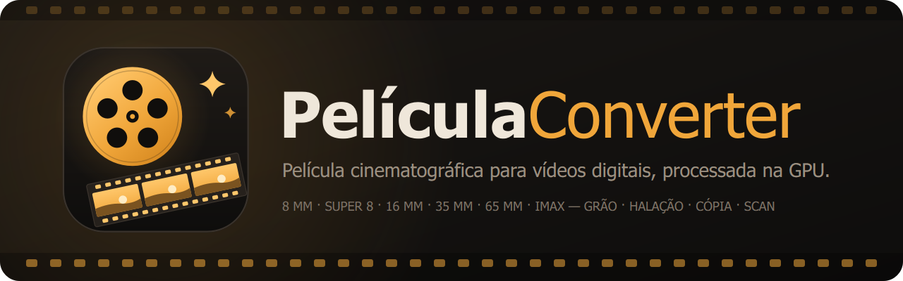
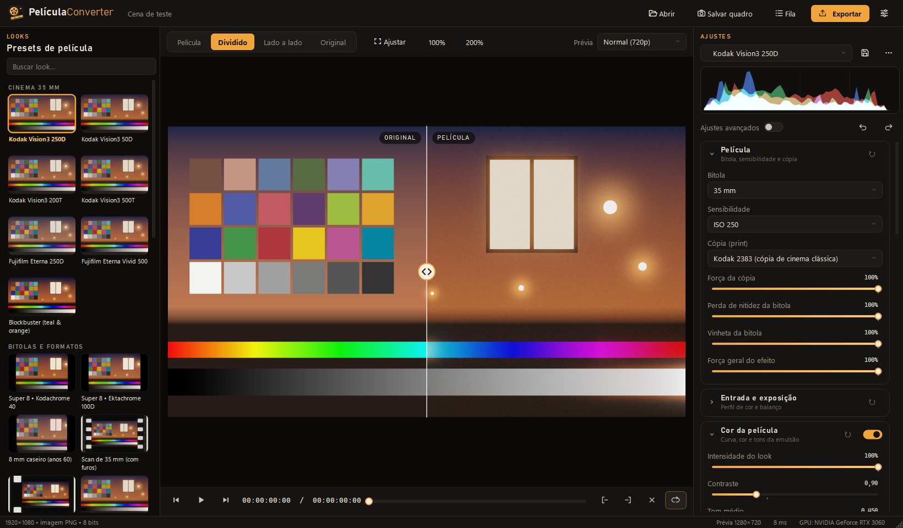
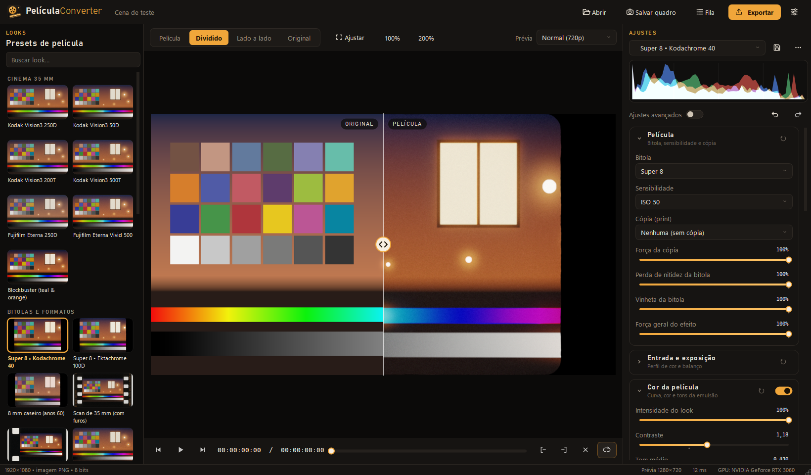
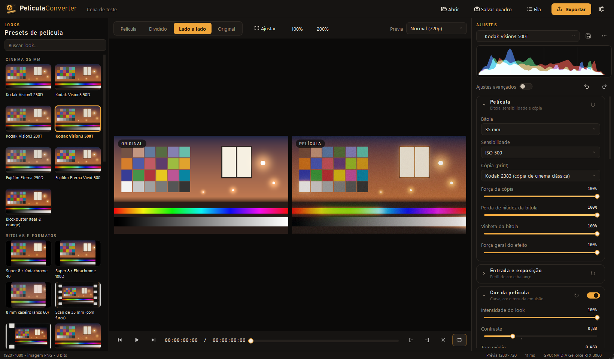
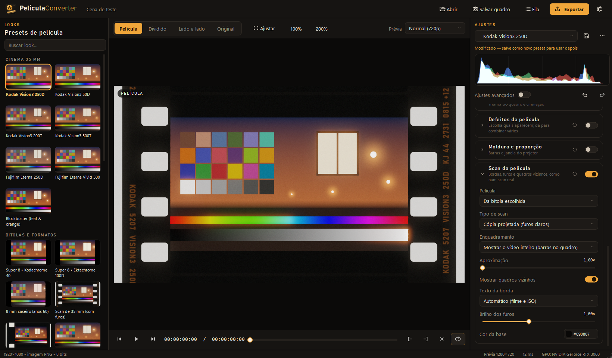
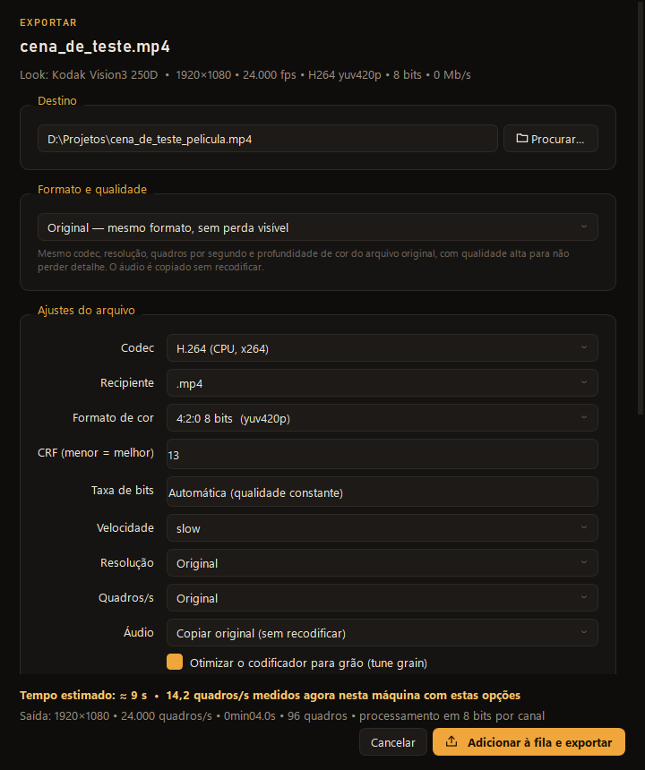
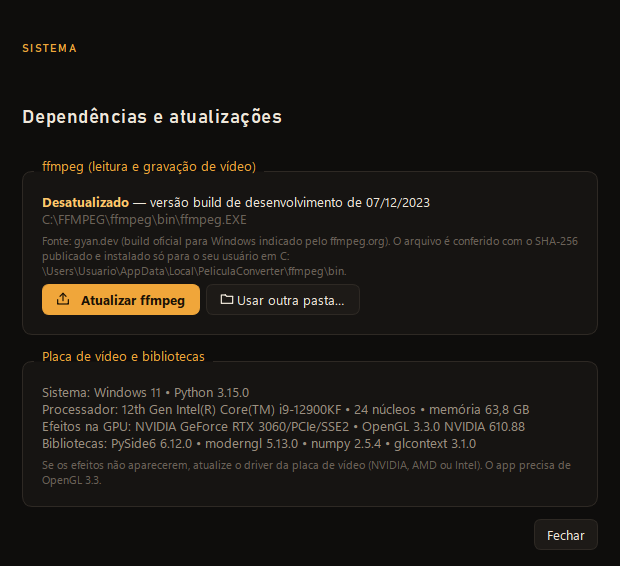
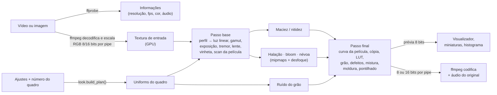

<p align="center">
  
</p>

<p align="center">
  <b>Transforme vídeo digital em película de cinema</b> — cor de negativos e cópias, grão, halação,
  bitolas de 8 mm a IMAX, tremor de projetor, defeitos e até o scan da película com furos,
  tudo processado na placa de vídeo e com prévia em tempo real.
</p>

<p align="center">
  <a href="https://github.com/edvitor13/pelicula-converter/releases/latest"></a>
  
  
  
  
</p>

---

## Sumário

- [O que é](#o-que-é)
- [Capturas de tela](#capturas-de-tela)
- [Recursos](#recursos)
- [Como funciona](#como-funciona)
- [Instalação](#instalação)
  - [Jeito fácil: instalador ou versão portátil](#jeito-fácil-instalador-ou-versão-portátil)
  - [Pelo código-fonte](#pelo-código-fonte)
  - [Requisitos](#requisitos)
  - [O ffmpeg e o gerenciador de dependências](#o-ffmpeg-e-o-gerenciador-de-dependências)
  - [Dependências e por que cada uma existe](#dependências-e-por-que-cada-uma-existe)
- [Guia de uso](#guia-de-uso)
- [Modo Edição: montar, cortar e ajustar antes da película](#modo-edição-montar-cortar-e-ajustar-antes-da-película)
- [Laboratório: negativo, luzes da copiadora e cópia](#laboratório-negativo-luzes-da-copiadora-e-cópia)
- [Plugin para o DaVinci Resolve](#plugin-para-o-davinci-resolve)
- [Modo terminal (pelicula-cli)](#modo-terminal-pelicula-cli)
- [Arquivos RAW (N-RAW, R3D, BRAW, ProRes RAW)](#arquivos-raw-n-raw-r3d-braw-prores-raw)
- [Bitolas e formatos de película](#bitolas-e-formatos-de-película)
- [Perguntas frequentes](#perguntas-frequentes)
- [Solução de problemas](#solução-de-problemas)
- [Gerar o executável (build)](#gerar-o-executável-build)
- [Desenvolvimento](#desenvolvimento)
- [Política de assinatura de código (Code signing policy)](#política-de-assinatura-de-código-code-signing-policy)
- [Privacidade (Privacy policy)](#privacidade-privacy-policy)
- [Licença](#licença)
- [Aviso legal](#aviso-legal)

---

## O que é

O **PeliculaConverter** é um aplicativo de desktop, gratuito e de código aberto, que dá a vídeos e
fotos digitais a aparência de película cinematográfica. Ele não é um filtro de cor simples: cada
quadro passa por uma cadeia parecida com a da película real.

1. O vídeo é convertido para **luz da cena** (linear), respeitando o perfil em que foi gravado
   (Rec.709, N-Log, S-Log3, LogC3, V-Log, Log3G10, DaVinci Intermediate, Cineon…).
2. A luz atravessa a **lente** (maciez, aberração cromática, distorção, vinheta) e a **emulsão**
   (halação nas luzes fortes, bloom, névoa de filtro difusor).
3. A **curva do negativo** é aplicada canal por canal, com densidade de cor, tons de sombra e luz,
   preto e branco com filtros e viragens.
4. O resultado é "copiado" para uma **película de cópia** (Kodak 2383, Kodak 2393 ou Fuji 3513),
   como numa projeção de cinema.
5. Por cima entram o **grão** (com tamanho que depende da bitola e do ISO), os **defeitos**
   (poeira, riscos, fio de cabelo, manchas, emendas, clarões, marcas de troca de rolo) e a
   **moldura** ou o **scan da película** com furos reais e quadros vizinhos.

Tudo roda em shaders OpenGL 3.3 na placa de vídeo. A prévia é a mesma conta da exportação, quadro a
quadro: o que você vê é o que vai para o arquivo final.

O app tem **dois modos**, escolhidos no topo da janela:

- **Película** — aplica o look de película num vídeo, numa imagem ou na sua montagem.
- **Edição** — um editor simples, em faixas de vídeo e de áudio: junte clipes, corte, mude a
  velocidade, acerte a cor e a luz de cada clipe (rodas de cor, curva, HSL, nitidez…) e trate o som
  (volume, fades, graves e agudos, voz, ruído). A montagem vira a entrada do look de película.

E vem com um **plugin para o DaVinci Resolve** (DCTLs e LUTs) que leva os mesmos looks para dentro
do Resolve.

Toda a interface está em português do Brasil.

## Capturas de tela

> As imagens abaixo usam só a **cena de teste** que o próprio app gera (cartela de cores, rampa de
> cinza e luzes fortes); nenhuma filmagem pessoal.

**Janela principal** — presets com miniaturas à esquerda, visualizador no meio (modo *Dividido*) e
os ajustes à direita:



**Super 8 • Kodachrome 40** — bitola pequena com grão grande, tremor, poeira e janela de cantos
arredondados:



**Kodak Vision3 500T** no modo *Lado a lado*:



**Scan da película** — a tira de 35 mm inteira, com furos iluminados, texto de borda e pedaços dos
quadros vizinhos:



<table>
  <tr>
    <td width="54%"><b>Exportar</b> — qualidades prontas, ajustes do arquivo, desempenho e tempo estimado medido na sua máquina<br><br>
      </td>
    <td width="46%"><b>Dependências e atualizações</b> — ffmpeg, placa de vídeo e bibliotecas<br><br>
      </td>
  </tr>
</table>

## Recursos

### Película e cor
- **Bitolas**: 8 mm, Super 8, 16 mm, Super 16, 35 mm, 65 mm e IMAX 70 mm (15/70). Cada uma muda
  tamanho e força do grão, perda de nitidez, tremor, vinheta, halação e proporção.
- **Sensibilidade** de ISO 50 a ISO 3200 (grão maior e mais visível nos filmes mais sensíveis).
- **Cópia (print)**: Kodak 2383 (cópia de cinema clássica), Kodak 2393 (mais contraste) e
  Fuji 3513 (mais fria e neutra), com força ajustável.
- **Curva da emulsão** por canal: contraste, tom médio, preto e branco da película, suavidade das
  altas luzes e das sombras, saturação, **densidade de cor**, cor das sombras e das altas luzes
  (split toning), equilíbrio, envelhecimento (cópia desbotada).
- **Ajustes avançados**: contraste e equilíbrio por canal (R, G, B), matiz dos verdes e dos azuis,
  saturação da pele.
- **Preto e branco** com filtros de lente (pancromático, vermelho, laranja, amarelo, verde, azul) e
  **viragens** (sépia, selênio, cianótipo, ouro).

### Laboratório (negativo → cópia)
- **Emulação por densidade**, como num laboratório de cinema: o negativo (curva característica de
  cada camada, sensibilidade e diafonia), a **revelação forçada** (push/pull), as **luzes da
  copiadora** em pontos (vermelho, verde, azul e densidade, 12 pontos = 1 stop) e a película de
  **cópia** (2383, 2393, 3513, 2302 P&B ou o negativo escaneado, sem cópia).
- **Processos**: **Technicolor 3 tiras** (três registros P&B, corantes puros e chave preta),
  **Technicolor 2 cores** (anos 20) e **retenção de prata** (bleach bypass).
- O cinza médio sai neutro em qualquer combinação; exposição + luzes da copiadora funcionam como
  no laboratório de verdade. Controle de **pele** (matiz, saturação e luz) no look.

### Edição
- **Faixas de vídeo e de áudio**, imagem e som ligados, importar vídeos, imagens e músicas.
- **Dividir no cursor**, lâmina, aparar pelas bordas, mover entre faixas, apagar fechando o espaço,
  ímã, zoom da linha do tempo, desfazer/refazer.
- **Velocidade** (0,1× a 8×), **congelar quadro** e **transições** (dissolver, surgir do preto ou
  do branco, sumir).
- **Cor e luz por clipe**: exposição, contraste, realces, sombras, brancos, pretos, temperatura,
  tonalidade, vibração, saturação, matiz, **rodas de cor**, curva de tons, **HSL de 8 cores**,
  nitidez, clareza, desfoque, redução de ruído, vinheta, desbotado; enquadramento (escala,
  posição, rotação, espelhar, cortar, opacidade e mesclagem). **Cor automática**, ajustes rápidos
  e copiar/colar ajustes entre clipes.
- **Som por clipe**: volume, mudo, balanço, fades, graves, médios, agudos, realçar voz, redução de
  ruído e normalizar; faixas com mudo, solo, trava e volume; forma de onda na linha do tempo.
- **Medidores**: histograma, forma de onda, parada RGB e vetorscópio.

### Entrada
- **Perfis de câmera**: Rec.709/sRGB, Linear, Nikon N-Log, Sony S-Log3 (S-Gamut3.Cine),
  ARRI LogC3 (EI 800), Panasonic V-Log, RED Log3G10 (RWG — para R3D e Nikon N-RAW convertidos),
  DaVinci Intermediate (DaVinci Wide Gamut) e Cineon/DPX log, com a conversão de gamut certa.
- **Exposição** (±3 EV), **temperatura** e **tonalidade** aplicadas em luz linear.

### Luz e lente
- **Halação**: o brilho avermelhado em volta das luzes fortes, com raio, limiar (em EV) e cor.
- **Bloom** e **névoa** (imitação de filtros difusores tipo Pro-Mist).
- **Lente**: maciez, recuperação de detalhe (nitidez), aberração cromática, distorção barril ou
  almofada, vinheta com raio, suavidade e redondeza.

### Projeção, defeitos e moldura
- **Projetor**: tremor horizontal, vertical e de rotação; cintilação de brilho.
- **Defeitos da película**, cada um liga e desliga sozinho: poeira (escura, clara ou mista),
  riscos, fio de cabelo na janela, manchas químicas, clarões de fim de rolo, marcas de troca de rolo
  (*cue marks*), cor instável, emendas e vazamento de luz.
- **Moldura e proporção**: 1,33 a 2,76 (Academy, IMAX, Scope, Ultra Panavision…), cantos
  arredondados da janela do projetor, borda suave ou irregular e cor das barras.
- **Scan da película**: a tira inteira com **geometria real** de 35 mm (4 furos), 16 mm, Super 16
  e Super 8 — furos, linhas entre quadros, quadros vizinhos, texto impresso na borda
  (por exemplo `KODAK 5207 VISION3 250D`), cópia projetada (furos claros) ou negativo invertido
  (furos escuros).

### Presets e LUTs
- **42 presets prontos** em sete grupos (Cinema 35 mm, Laboratório, Bitolas e formatos, Preto e
  branco, Fotografia, Processos e estilos, Básicos), com **miniaturas ao vivo** do seu próprio quadro
  e busca.
- **Presets do usuário**: salvar como, atualizar, excluir, voltar ao preset, importar e exportar
  em `.json`.
- **LUT externo** `.cube` (3D): usa os LUTs que **já estão instalados** pelo Premiere Pro e pelo
  DaVinci Resolve, LUTs instalados no próprio app ou qualquer arquivo; escolha o espaço de entrada
  que o LUT espera e se ele entra depois do look ou no lugar dele.
- **Exportar LUT**: grava a parte de cor do look atual num `.cube` de 33 ou 65 pontos, ou gera um
  **pacote de LUTs gratuito** com todos os presets.
- **Plugin para o DaVinci Resolve**: DCTLs *PeliculaConverter Cor*, *Textura* e *Projetor*, um DCTL
  por preset e os LUTs de todos os presets, instalados com um clique.

### Visualização
- Comparação **Película / Dividido / Lado a lado / Original**, botão direito para espiar o original.
- **Zoom** de 100% e 200%, roda do mouse até 1600%, arrastar para mover.
- **Linha do tempo** com reprodução, entrada e saída (I/O), repetição e quadro a quadro.
- **Histograma** RGB, **desfazer/refazer** (até 300 passos), **atalhos de teclado**, arrastar e
  soltar vídeos, imagens, LUTs e presets.
- **Qualidade da prévia**: 540p, 720p, 1080p ou resolução original.
- **Salvar quadro** em PNG 16 bits, TIFF 16 bits ou JPEG, na resolução original.

### Exportação
- **Codecs**: H.264 e H.265 (x264/x265), H.264/H.265 na GPU (NVIDIA NVENC, Intel Quick Sync,
  AMD AMF — só aparecem se funcionarem de verdade na máquina), AV1 (SVT-AV1), VP9/WebM,
  MPEG-4 Xvid (AVI), GIF animado, Apple ProRes (Proxy, LT, 422, 422 HQ, 4444, 4444 XQ),
  Avid DNxHR (LB, SQ, HQ, HQX, 444), **FFV1 sem perdas 16 bits**, sequências PNG/TIFF e imagens
  PNG/TIFF/JPEG/WebP.
- **Qualidades prontas**: *Original — mesmo formato*, MP4, MOV, MKV, YouTube 4K (H.265 10 bits ou
  H.264), Full HD, redes sociais, leve 720p, WebM, AVI, GIF, masters ProRes/DNxHR, FFV1 e
  sequência PNG.
- **Áudio**: copiar o original, AAC 320/192 kb/s, MP3 320 kb/s, Opus 192 kb/s, PCM 24 bits ou sem áudio
  (com correção automática quando o recipiente não aceita o formato).
- Processamento em **16 bits por canal** sempre que o formato de saída tem mais de 8 bits;
  pontilhado (*dither*) contra faixas em 8 bits; *tune grain* no x264/x265.
- **Desempenho**: núcleos do processador, prioridade do processo, decodificação por hardware,
  placa NVIDIA usada pelo NVENC e buffer de quadros na memória (com cálculo de RAM).
- **Tempo estimado real**: o app exporta um trecho curto com as opções escolhidas e mede a
  velocidade desta máquina.
- **Fila de exportação** em segundo plano, com progresso, velocidade, tempo restante e cancelamento.

### Sistema
- **Gerenciador de dependências**: se o ffmpeg não existir ou estiver antigo, o app oferece baixar
  a versão oficial, conferida por SHA-256, só para o seu usuário (sem administrador).
- **Windows 10/11 e Linux**. O macOS está preparado no código e no CI, mas **desativado** por
  enquanto.

## Como funciona



- **Mesmo caminho para prévia e exportação.** Os dois usam `look.build_plan()` e o mesmo
  `Engine.render()`. Tudo o que varia no tempo (tremor, cintilação, grão animado, poeira, riscos,
  clarões…) é calculado a partir do **número do quadro** com funções de hash determinísticas, então
  o quadro 120 da prévia é o quadro 120 do arquivo final. Uma exportação FFV1 16 bits é idêntica,
  bit a bit, ao render direto do motor.
- **Independente de resolução.** Raios, larguras e tremores são definidos em "px@1080" (pixels de
  um quadro de 1080 linhas) e convertidos para a resolução real; por isso a prévia em 720p tem a
  mesma cara do 4K exportado.
- **Leitura e gravação rápidas.** O ffmpeg entrega quadros RGB já na resolução pedida; no Windows a
  troca de dados usa *named pipes* com buffer grande (bem mais rápido que stdin/stdout para 4K).
  A exportação roda numa thread própria, com contexto OpenGL próprio, e três etapas em paralelo:
  leitura → GPU → gravação.

O mergulho técnico completo está em [docs/ARQUITETURA.md](docs/ARQUITETURA.md) e cada ajuste é
explicado em [docs/EFEITOS.md](docs/EFEITOS.md).

## Instalação

### Jeito fácil: instalador ou versão portátil

Os pacotes já trazem o Python e todas as bibliotecas (PySide6, moderngl, numpy). Só o **ffmpeg**
fica de fora — e o próprio app oferece baixá-lo. Todos ficam na página de
[*Releases*](https://github.com/edvitor13/pelicula-converter/releases):

| Arquivo | Sistema | O que é |
|---|---|---|
| `PeliculaConverter-<versão>-windows-x64.msi` | Windows 10/11 | **Instalador** (recomendado): atalhos, associação dos projetos `.plc`, atualização no lugar |
| `PeliculaConverter-<versão>-windows-x64.zip` | Windows 10/11 | Versão **portátil**: é só extrair e abrir |
| `PeliculaConverter-<versão>-linux-x64.deb` | Debian, Ubuntu e derivados | **Pacote** do sistema: menu de aplicativos, associação `.plc`, dependências pelo `apt` |
| `PeliculaConverter-<versão>-linux-x64.tar.gz` | Linux x64 | Versão **portátil** |
| `SHA256SUMS.txt` | — | Somas SHA-256 de todos os arquivos, para conferir o download |

Os dois executáveis vão em todos os pacotes: `PeliculaConverter` (a janela) e **`pelicula-cli`**
(modo de terminal, para usar em scripts).

**Windows — instalador `.msi`**

1. Baixe o `.msi` e abra. A instalação é **só para o seu usuário** e **não pede administrador**:
   o app vai para `%LOCALAPPDATA%\Programs\PeliculaConverter`.
2. Na tela *Instalação personalizada* dá para trocar a pasta e escolher os extras (todos vêm
   marcados): **atalho na Área de Trabalho**, **abrir projetos `.plc` com o PeliculaConverter**
   (dois cliques num projeto abrem o app) e **usar o `pelicula-cli` no terminal** (a pasta do app
   entra no `PATH` do usuário; vale para terminais abertos depois da instalação). O atalho no
   Menu Iniciar sempre é criado.
3. Uma versão nova instalada por cima **substitui a antiga no mesmo lugar**, mantendo a pasta e
   as escolhas. Para remover: *Configurações → Aplicativos → PeliculaConverter → Desinstalar*.
   As suas preferências (idioma, projetos recentes, opções de exportação) ficam guardadas para
   uma próxima instalação; para apagá-las também, remova a chave
   `HKCU\Software\PeliculaConverter` no Editor do Registro.
4. Sem assinatura digital (ainda), o Windows SmartScreen pode avisar na primeira vez: clique em
   **Mais informações → Executar assim mesmo**. O porquê e os planos estão em
   [docs/ASSINATURA.md](docs/ASSINATURA.md).

Instalação silenciosa, para administradores e scripts:
`msiexec /i PeliculaConverter-<versão>-windows-x64.msi /passive` (acrescente
`ABRIR_APOS_INSTALAR=1` para abrir o app no fim).

**Windows — versão portátil `.zip`**

1. Extraia o `.zip` numa pasta qualquer (por exemplo `C:\Programas\PeliculaConverter`).
2. Abra `PeliculaConverter.exe` (o mesmo aviso do SmartScreen pode aparecer).

Nos dois casos, se o ffmpeg não for encontrado, a janela **Dependências e atualizações** abre
sozinha: clique em **Baixar ffmpeg** e pronto.

**Linux — pacote `.deb` (Debian/Ubuntu)**

```bash
sudo apt install ./PeliculaConverter-*-linux-x64.deb
```

O `apt` instala junto as bibliotecas que o Qt e o OpenGL usam e, se possível, o `ffmpeg`
(recomendado pelo pacote). O app fica em `/opt/pelicula-converter`, aparece no menu de
aplicativos, os comandos `pelicula-converter` e `pelicula-cli` passam a funcionar no terminal e
os arquivos `.plc` (tipo `application/x-pelicula-project`) abrem no PeliculaConverter. Para
remover: `sudo apt remove pelicula-converter`. Funciona no **Ubuntu 22.04 ou mais novo**, no
**Debian 12 ou mais novo** e nos derivados (Linux Mint, Pop!_OS, elementary OS…); em sistemas mais
antigos, rode pelo código-fonte.

**Linux — versão portátil `.tar.gz`**

1. Extraia e rode:

   ```bash
   tar -xzf PeliculaConverter-*-linux-x64.tar.gz
   ./PeliculaConverter/PeliculaConverter
   ```

2. Se a janela não abrir, instale as bibliotecas que o Qt usa (Debian/Ubuntu):

   ```bash
   sudo apt install libxcb-cursor0 libxkbcommon-x11-0 libegl1 libgl1 libfontconfig1 libdbus-1-3
   ```

3. Sem ffmpeg no sistema, o app oferece baixar um build estático (ou instale com
   `sudo apt install ffmpeg`).

**Conferir o download** (opcional): baixe também o `SHA256SUMS.txt` e, na mesma pasta, rode
`sha256sum -c SHA256SUMS.txt --ignore-missing` (Linux) ou compare com
`Get-FileHash <arquivo> -Algorithm SHA256` (PowerShell).

### Pelo código-fonte

**Windows** — com o [Python 3.15](https://www.python.org/downloads/) instalado (marque o *py launcher*):

```bat
instalar.bat     :: cria o .venv (py -3.15, ou py -3 se não houver) e instala as dependências
executar.bat     :: abre o app sem janela de console (aceita arquivos como argumento)
```

**Linux**:

```bash
bash instalar.sh     # cria o .venv com o Python 3.12+ mais novo encontrado e instala as dependências
./executar.sh        # abre o app (aceita arquivos como argumento)
```

**Manual (qualquer sistema)**:

```bash
python -m venv .venv
# Windows: .venv\Scripts\activate      Linux: source .venv/bin/activate
python -m pip install -r requirements.txt
python -m pelicula                      # ou: python PeliculaConverter.pyw [arquivo]
```

Também dá para instalar como pacote (gera o comando `pelicula-converter`):

```bash
python -m pip install .            # ou: python -m pip install ".[dev]" para pytest e PyInstaller
pelicula-converter
```

Rodando pelo código-fonte, se faltar `moderngl` ou `numpy` o app avisa na abertura e oferece
instalar com o `pip`.

### Requisitos

| Item | Mínimo | Observação |
|---|---|---|
| Sistema | Windows 10/11 64 bits ou Linux x64 | Executáveis prontos no Linux: glibc 2.35+ (Ubuntu 22.04+, Debian 12+). macOS: preparado, mas desativado nesta versão |
| Placa de vídeo | **OpenGL 3.3** | Qualquer GPU dedicada ou integrada dos últimos ~12 anos com driver atualizado |
| ffmpeg + ffprobe | 7.0 ou mais novo (recomendado) | O app baixa sozinho se não encontrar; **FFmpeg 8+** também decodifica **ProRes RAW** |
| Python (só pelo código-fonte) | 3.12 | Recomendado **3.15**; o executável já traz o Python |
| Memória | 8 GB | 16 GB ou mais para 4K com buffer grande |

### O ffmpeg e o gerenciador de dependências

O ffmpeg lê e grava todos os formatos de vídeo. O PeliculaConverter procura o `ffmpeg` e o
`ffprobe`, nesta ordem:

1. a pasta escolhida em **Configurações → Pasta do ffmpeg…** (ou *Usar outra pasta…* na janela de
   dependências);
2. a pasta onde o próprio app instala o ffmpeg que baixou;
3. o `PATH` do sistema;
4. pastas comuns — Windows: `C:\FFMPEG\ffmpeg\bin`, `C:\FFMPEG\bin`, `C:\ffmpeg\bin`,
   `%ProgramFiles%\ffmpeg\bin`, os atalhos do WinGet e a pasta do ShareX; Linux: `/usr/local/bin`,
   `/usr/bin`, `/snap/bin`.

**Configurações → Dependências e atualizações…** mostra a versão do ffmpeg, a placa de vídeo e a
versão do OpenGL, o processador, a memória e as versões das bibliotecas Python. Na abertura o app
confere tudo em segundo plano:

- **ffmpeg ausente** → a janela de dependências abre com o botão **Baixar ffmpeg**.
- **ffmpeg antigo** (versão menor que 7.0, ou build de desenvolvimento com mais de ~18 meses) →
  o app pergunta se quer atualizar (*Atualizar*, *Agora não* ou *Não perguntar de novo*). No
  Windows ele também confere a última versão publicada no gyan.dev e avisa quando a sua é mais
  antiga.

O download automático usa só fontes confiáveis e confere a integridade antes de instalar:

| Sistema | Fonte | Conferência | Pasta de instalação (sem administrador) |
|---|---|---|---|
| Windows | [gyan.dev](https://www.gyan.dev/ffmpeg/builds/) — build *release essentials*, o build para Windows indicado pelo ffmpeg.org | SHA-256 publicado pelo gyan.dev | `%LOCALAPPDATA%\PeliculaConverter\ffmpeg\bin` |
| Linux | [BtbN/FFmpeg-Builds](https://github.com/BtbN/FFmpeg-Builds) — build estático GPL (GitHub Releases) | `checksums.sha256` da release | `~/.local/share/PeliculaConverter/ffmpeg/bin` (respeita `$XDG_DATA_HOME`) |

O arquivo é baixado numa pasta temporária, o SHA-256 é comparado e, só se conferir, os executáveis
são copiados para a pasta acima (com um `ORIGEM.txt` registrando a URL e o hash). Se algo não
conferir, nada é instalado. Prefere instalar por conta própria?

```bash
winget install Gyan.FFmpeg      # Windows
sudo apt install ffmpeg         # Debian/Ubuntu
```

### Dependências e por que cada uma existe

| Dependência | Para quê |
|---|---|
| [PySide6](https://pypi.org/project/PySide6/) (Qt 6) | Interface inteira, configurações (`QSettings`), ícones desenhados em código, texto da borda da película desenhado com `QPainter`. |
| [moderngl](https://pypi.org/project/moderngl/) + glcontext | Contexto **OpenGL 3.3** sem janela (WGL no Windows, X11/EGL no Linux) para rodar os shaders GLSL, tanto na prévia quanto na thread de exportação. O `glcontext` vem junto com o moderngl. |
| [numpy](https://pypi.org/project/numpy/) | Quadros em memória (8 e 16 bits), matrizes de gamut, LUTs, cena de teste e histograma. |
| **ffmpeg / ffprobe** (programa externo) | Ler qualquer formato, converter matriz de cor e escala, codificar o vídeo final e copiar/converter o áudio. |
| pytest (desenvolvimento) | Testes automatizados. |
| PyInstaller (desenvolvimento) | Gerar o executável de pasta única. |
| WiX Toolset 5 e `dpkg-deb` (desenvolvimento) | Montar o instalador `.msi` (Windows) e o pacote `.deb` (Linux). |

Não há outras dependências: nada de Pillow, OpenCV ou SciPy. Biblioteca padrão do Python para o
resto (downloads com `urllib`, SHA-256 com `hashlib`, pipes nomeados com `_winapi`).

## Guia de uso

### 1. Abrir um arquivo

- Botão **Abrir** (`Ctrl+O`), arrastar e soltar na janela, ou passar o arquivo na linha de comando
  (`executar.bat video.mov`, `./executar.sh video.mov`, ou *Abrir com* apontando para o
  executável).
- Formatos: tudo o que o seu ffmpeg lê — MP4, MOV, MKV, AVI, MXF, WebM, M4V, MTS/M2TS, WMV, MPG,
  TS, ProRes, DNxHR, H.264/H.265 8/10 bits — e imagens PNG, JPEG, TIFF, BMP, WebP, DPX e EXR.
- Sem vídeo à mão? **Usar cena de teste** gera uma cartela de cores com rampa de cinza e luzes
  fortes, ótima para ver halação e bloom.
- O **Abrir** também lista os projetos **`.plc`**: escolher um deles abre o projeto, como em
  *Projeto → Abrir projeto*.
- Arrastar um **`.cube`** carrega o LUT; arrastar um **`.json`** importa um preset.

A barra de status mostra resolução, fps, codec, formato de pixel, profundidade de cor e taxa de
bits do arquivo, além do tamanho da prévia, do tempo de render de cada quadro e da GPU em uso.

### 2. Escolher um look

O painel **Looks** (à esquerda) mostra cada preset aplicado ao **seu** quadro atual. Clique para
aplicar, use **Buscar look…** (a busca ignora acentos) e passe o mouse para ler a descrição. O
mesmo preset aparece na lista do painel **Ajustes**.

| Grupo | Presets |
|---|---|
| Cinema 35 mm | Kodak Vision3 250D · Kodak Vision3 50D · Kodak Vision3 200T · Kodak Vision3 500T · Fujifilm Eterna 250D · Fujifilm Eterna Vivid 500 · Blockbuster (teal & orange) |
| Laboratório | Vision3 250D → 2383 · Vision3 500T → 2383 (noite) · Eterna 250D → Fuji 3513 · 5247 ECN-II (anos 70) · Technicolor 3 tiras · Technicolor 2 cores (anos 20) · Retenção de prata · Double-X → 2302 (P&B) · Negativo escaneado (sem cópia) |
| Bitolas e formatos | Super 8 • Kodachrome 40 · Super 8 • Ektachrome 100D · 8 mm caseiro (anos 60) · Scan de 35 mm (com furos) · Scan de Super 8 (com furos) · 16 mm • Vision3 500T (documentário) · Super 16 • Vision3 250D · 35 mm Scope (2,39) · 65 mm • Vision3 50D (épico) · IMAX 70 mm |
| Preto e branco | Kodak Double-X 5222 · Kodak Tri-X 400 · Ilford HP5 Plus · Noir anos 40 · Sépia antigo |
| Fotografia | Kodak Portra 400 · Kodak Ektar 100 · Fujifilm Velvia 50 · Fujifilm Superia 400 · CineStill 800T |
| Processos e estilos | Bleach bypass · Technicolor 3 cores · Revelação cruzada · Cópia desbotada (anos 70) |
| Básicos | Só textura (cor original) · Original (sem efeito) |

Todos os presets de película partem da mesma base (35 mm, ISO 250, cópia Kodak 2383, grão, halação,
bloom e lente ligados) e mudam só o que os diferencia. Os do grupo **Laboratório** desligam a cor
paramétrica e usam a emulação por densidade (negativo → copiadora → cópia).

### 3. Ajustar

O painel **Ajustes** tem uma seção para cada etapa: *Película*, *Entrada e exposição*,
*Cor da película*, *LUT externo*, *Grão*, *Halação*, *Bloom e difusão*, *Lente e nitidez*,
*Projetor*, *Defeitos da película*, *Moldura e proporção* e *Scan da película*. Cada parâmetro é
explicado em [docs/EFEITOS.md](docs/EFEITOS.md).

- A chave no título liga e desliga a seção inteira; o botão ↺ volta a seção ao padrão.
- **Ajustes avançados** mostra os controles finos (contraste por canal, matiz dos verdes etc.).
- Clique no número para digitar (aceita vírgula, `%` e unidades). **Duplo clique** no slider volta
  ao padrão; **Shift + arrastar** faz ajuste fino; com o slider em foco, as setas mudam um passo
  (Shift = 10 passos).
- Sementes aleatórias têm um dado (🎲 *Sortear*) para trocar o padrão do grão ou dos defeitos.
- **Desfazer/Refazer** com `Ctrl+Z` / `Ctrl+Y` (ou `Ctrl+Shift+Z`).

Quando os ajustes ficam diferentes do preset, aparece *"Modificado — salve como novo preset para
usar depois"*.

### 4. Salvar seus próprios presets

No painel **Ajustes**:

- **Salvar** (ícone de disquete, `Ctrl+Alt+S`) → *Salvar como novo preset*. O preset entra no grupo
  **Meus presets**, com miniatura.
- **⋯ (Mais opções de preset)**:
  - *Atualizar este preset com os ajustes atuais* (só presets do usuário);
  - *Excluir este preset* (só presets do usuário);
  - *Desfazer mudanças (voltar ao preset)*;
  - *Importar preset (.json)…* e *Exportar preset (.json)…* para trocar presets com outras pessoas;
  - *Exportar a cor como LUT .cube* (33 ou 65 pontos) e *Exportar todos os presets como LUTs (pacote)*.

Os presets ficam em arquivos `.json` legíveis:

| Sistema | Pasta |
|---|---|
| Windows | `%APPDATA%\PeliculaConverter\presets` |
| Linux | `~/.config/PeliculaConverter/presets` (ou `$XDG_CONFIG_HOME`) |

**Configurações → Abrir pasta dos meus presets** abre a pasta. Formato do arquivo:

```json
{
  "nome": "Meu Vision3 500T",
  "desc": "Criado a partir de Kodak Vision3 500T",
  "app": "PeliculaConverter",
  "versao": 1,
  "valores": { "bitola": "35mm", "iso": "500", "grao_on": true, "...": "..." }
}
```

Ao carregar, valores desconhecidos são ignorados e números fora da faixa são limitados, então
presets antigos continuam abrindo.

### 5. LUTs

A seção **LUT externo** aplica qualquer LUT 3D `.cube`.

- **De onde vêm os LUTs da lista**: os que já estão instalados no computador pelo **Adobe
  Premiere Pro** (`Lumetri/LUTs/Creative` e `Resources/LUTs/FilmEmulation`), pelo **After
  Effects** (`Support Files/Lumetri/LUTs/Creative`) e pelo **DaVinci Resolve** (`Film Looks`),
  além de **Meus LUTs**. O app só **lê** esses arquivos onde eles já
  estão; nenhum LUT de terceiros acompanha o PeliculaConverter.
- **Instalar LUTs…** copia arquivos `.cube` (depois de conferir que são válidos) para a pasta
  **Meus LUTs** (`%APPDATA%\PeliculaConverter\luts` no Windows; `~/.config/PeliculaConverter/luts`
  no Linux). Eles passam a aparecer sempre na lista. O botão **Pasta** abre essa pasta.
- *Procurar arquivo .cube…* usa um arquivo de qualquer lugar sem copiar.
- **O LUT espera**: o espaço de cor de entrada do LUT. LUTs de cópia do Resolve (Kodak 2383 etc.)
  esperam **Cineon**; LUTs criativos do Premiere esperam **Rec.709**. O app adivinha pelo nome e
  pela pasta (Cineon, LogC, S-Log3, N-Log, V-Log) e você pode trocar.
- **Aplicar**: *Depois do look de película* ou *No lugar do look* (só o LUT, sem a curva da
  película e sem a cópia). **Intensidade do LUT** mistura com o resultado.
- Só LUTs 3D são aceitos (LUT 1D é recusado com aviso). `DOMAIN_MIN`/`DOMAIN_MAX` e
  `LUT_3D_INPUT_RANGE` são respeitados.

**Exportar LUTs do próprio app**: *⋯ → Exportar a cor como LUT .cube* grava a parte de cor do look
atual (curva, cópia, tons, saturação, LUT externo e exposição/balanço) com entrada no mesmo perfil
escolhido em *Perfil do vídeo*. *Exportar todos os presets como LUTs (pacote)* gera um `.cube` de
33 pontos para cada preset, com entrada Rec.709 — um pacote de LUTs gratuito que funciona no
Premiere, Resolve, Final Cut, CapCut, OBS e qualquer programa que aceite `.cube`. Grão, halação,
bloom, defeitos e moldura não cabem num LUT e ficam só no PeliculaConverter.

### 6. Comparar, dar zoom e reproduzir

- **Película / Dividido / Lado a lado / Original** (tecla `C` alterna). No modo *Dividido*, arraste
  a linha; segure o **botão direito** sobre o vídeo para ver o original em qualquer modo.
- **Zoom livre, de 10% a 1600%**: lupas **−** e **+** na barra da prévia, teclas `−` e `+` ou a
  **roda do mouse** (aproxima no ponto do cursor). Ao passar pelo tamanho que cabe na janela, o zoom
  para nele uma vez. Atalhos diretos: **Ajustar** (`F`), **100%** (`1`) e **200%** (`2`). O **duplo
  clique** alterna entre ajustar e 100%, e **arrastar** move a imagem quando ela é maior que a tela.
  O zoom atual aparece ao lado dos botões.
- **Tela cheia da prévia** (botão no fim da barra da prévia ou `F11`): a prévia ocupa a tela e somem
  a barra superior, os painéis de looks e de ajustes e a barra de status. A **barra da prévia**
  (comparação, lupas, resolução da prévia, *Sair da tela cheia*) e o **player** (reproduzir, linha do
  tempo, entrada/saída, repetir, volume) continuam. A resolução escolhida não muda; para ver o
  máximo de detalhe, escolha *Máxima (resolução original)* ali mesmo. `Esc` ou `F11` saem.
  `Shift+F11` põe a janela inteira em tela cheia, com os painéis.
- **Prévia**: *Rápida (540p)*, *Normal (720p)*, *Alta (1080p)* ou *Máxima (resolução original)*.
  O grão só aparece fiel na resolução máxima com zoom 100%.
- **Linha do tempo**: clique ou arraste; `Espaço` reproduz/pausa (a reprodução pula quadros se a
  prévia não acompanhar, mantendo o tempo real), `←`/`→` andam um quadro, `Shift+←/→` um segundo,
  `Home`/`End` vão para a entrada/saída (ou começo/fim).
- **Entrada e saída**: `I` e `O` marcam o trecho, `X` limpa, `L` liga/desliga a repetição. O trecho
  marcado pode ser exportado sozinho.
- **Som**: a reprodução toca o áudio do vídeo, sincronizado com o quadro mostrado (o som se corrige
  sozinho se escorregar mais de 0,15 s, inclusive na repetição e ao buscar). O botão de alto-falante
  (ou a tecla `M`) deixa mudo e o controle ao lado ajusta o volume; as duas escolhas ficam salvas.
- **Salvar quadro** (`Ctrl+Shift+F`): renderiza o quadro atual na resolução original em 16 bits e
  salva em PNG 16 bits, TIFF 16 bits ou JPEG.

### 7. Exportar

**Exportar** (`Ctrl+E`) abre a janela de exportação com o look atual.

**Qualidades prontas** (vídeo):

| Qualidade | Codec e ajustes |
|---|---|
| Original — mesmo formato, sem perda visível | Mesmo codec, resolução, fps e profundidade do original: ProRes vira ProRes no mesmo perfil, DNxHD/DNxHR vira DNxHR HQ/HQX, VP9 vira VP9, H.265 ou >8 bits vira x265 CRF 14 (10 bits), o resto vira x264 CRF 13; áudio copiado |
| MP4 H.264 — o formato mais comum, abre em tudo | x264 CRF 18, `medium`, 4:2:0 8 bits, AAC 320 kb/s |
| MOV H.264 — Apple, Final Cut, iPhone | x264 CRF 17, `slow`, AAC 320 kb/s |
| MKV H.265 — arquivo menor com boa qualidade | x265 CRF 20, 10 bits, AAC 192 kb/s |
| YouTube 4K — H.265 10 bits | x265 CRF 16, `slow`, 2160p, AAC 320 kb/s |
| YouTube 4K — H.264 | x264 CRF 15, `slow`, 2160p, AAC 320 kb/s |
| Full HD 1080p — H.264 alta qualidade | x264 CRF 17, `slow`, 1080p |
| Redes sociais 1080p — Instagram, TikTok, WhatsApp | x264 CRF 20, `medium`, 1080p, AAC 192 kb/s |
| Leve 720p — H.264 | x264 CRF 23, 720p |
| WebM VP9 — para sites e navegadores | VP9 CRF 30, Opus (se o ffmpeg tiver libvpx) |
| AVI Xvid — aparelhos e players antigos | Xvid q3, MP3 (usa o `mpeg4` nativo se não houver libxvid) |
| GIF animado (480p, 15 quadros/s) | Paleta otimizada (`palettegen`/`paletteuse`), sem áudio |
| Master — ProRes 422 HQ (10 bits) | `prores_ks` perfil 3, PCM 24 bits |
| Master máximo — ProRes 4444 XQ | `prores_ks` perfil 5, 4:4:4 10 bits, PCM 24 bits |
| Master — DNxHR HQX (10 bits) | DNxHR HQX em `.mov`, PCM 24 bits |
| Sem perdas — FFV1 16 bits RGB (.mkv) | FFV1 nível 3, RGB 48 bits, PCM 24 bits |
| Rápido na GPU NVIDIA / Intel / AMD — H.265 | NVENC (CQ 17, `p6`, 10 bits), Quick Sync ou AMF — só aparecem se o codificador funcionar nesta máquina |
| Sequência PNG 16 bits (para efeitos visuais) | Uma pasta com `nome_000001.png`, `nome_000002.png`… |

Para **imagens**, as qualidades são PNG 16 bits, TIFF 16 bits, JPEG alta qualidade e WebP.

Escolhendo **Personalizado** (ou mexendo em qualquer campo) você controla tudo:

- **Codec**, **recipiente** e **formato de cor** (4:2:0, 4:2:2, 4:4:4, 8/10/12/16 bits, RGB);
- **qualidade** (CRF, CQ, QP… — menor é melhor) ou **taxa de bits** fixa em Mb/s;
- **velocidade** do codificador (`ultrafast`…`veryslow`, `p1`…`p7` etc.) e **perfil** (ProRes, DNxHR);
- **resolução** (original, 8K, 4K, 1440p, 1080p, 720p, 540p, 480p, 360p) e **quadros/s**
  (original, 12, 15, 23,976, 24, 25, 29,97, 30, 50, 59,94, 60);
- **áudio** (copiar, AAC, MP3, Opus, PCM 24 bits, sem áudio). Se o áudio original não couber no
  recipiente, o app converte: WebM → Opus, AVI → MP3, MOV → PCM, MP4 → AAC;
- **Otimizar para grão** (`-tune grain` no x264/x265) e **pontilhado** em 8 bits.

Detalhes que o app cuida sozinho: dimensões pares para codecs de vídeo, metadados de cor BT.709,
`+faststart` em MP4/MOV, tag `hvc1` em H.265 (compatível com Apple), processamento em 16 bits
sempre que a saída tem mais de 8 bits, e remoção do arquivo parcial quando a exportação é cancelada.

**Trecho**: *Vídeo inteiro* ou *Só o trecho marcado* (com entrada/saída marcadas).

**Desempenho** (a janela mostra processador, núcleos, memória livre e placas de vídeo):

| Opção | O que faz |
|---|---|
| Núcleos do processador | Quantos núcleos o ffmpeg pode usar para ler, converter e codificar (*Todos* por padrão). Menos núcleos deixa o computador mais livre. |
| Prioridade | *Normal*, *Baixa* (dá para usar o PC enquanto exporta) ou *Acima do normal*. No Linux a prioridade baixa usa `nice`. |
| Decodificação por hardware | *Desligada*, *Automática*, NVIDIA (CUDA), DirectX 11, DXVA2 ou Intel Quick Sync — só as que o seu ffmpeg oferece. |
| Placa para codificar | Qual placa NVIDIA o NVENC usa (máquinas com mais de uma GPU). |
| Memória (buffer) | Quadros guardados entre leitura, efeitos e gravação (2 a 64). A janela mostra a RAM estimada e o máximo seguro com a memória livre agora. |

Os efeitos rodam na placa de vídeo principal do sistema. Em notebooks com duas GPUs, escolha *Alto
desempenho* para o PeliculaConverter (ou para o Python) em **Configurações do Windows → Sistema →
Tela → Gráficos**.

**Tempo estimado**: quase um segundo depois de você mudar uma opção, o app exporta de verdade um
trecho de até 60 quadros (no máximo ~15 s) num arquivo temporário, com o codec e as opções
escolhidas, ignora os primeiros quadros de aquecimento e mostra *"Tempo estimado: ≈ X •
Y quadros/s medidos agora nesta máquina com estas opções"*. O arquivo temporário é apagado.

**Fila**: *Adicionar à fila e exportar* põe o trabalho na fila (botão **Fila** no topo mostra o
progresso). Cada item mostra quadros feitos, porcentagem, velocidade e tempo restante, com
*Cancelar* e *Abrir pasta*. Pode continuar ajustando e enfileirando outros vídeos enquanto exporta.
Ao fechar o app com exportações em andamento, ele pergunta antes de cancelar.

### 8. Atalhos do teclado

| Atalho | Ação |
|---|---|
| `Espaço` | Reproduzir / pausar |
| `←` / `→` | Quadro anterior / próximo |
| `Shift + ←` / `Shift + →` | Voltar / avançar 1 segundo |
| `Home` / `End` | Ir para a entrada (ou início) / saída (ou fim) |
| `I` / `O` | Marcar entrada / saída |
| `X` | Limpar entrada e saída |
| `L` | Repetir (liga/desliga) |
| `C` | Trocar o modo de comparação |
| `F` | Ajustar à janela |
| `+` / `−` | Mais / menos zoom (de 10% a 1600%) |
| `1` / `2` | Zoom 100% / 200% |
| Botão direito (segurar) no vídeo | Ver o original |
| Duplo clique no slider | Voltar ao padrão |
| `Shift` + arrastar slider | Ajuste fino |
| `M` | Som da prévia: mudo / com som |
| `Ctrl+N` | Novo projeto |
| `Ctrl+Shift+O` | Abrir projeto (.plc) |
| `Ctrl+S` / `Ctrl+Shift+S` | Salvar projeto / salvar projeto como |
| `Ctrl+O` | Abrir vídeo, imagem ou projeto (.plc) |
| `Ctrl+E` | Exportar |
| `Ctrl+Alt+S` | Salvar preset |
| `Ctrl+Shift+F` | Salvar quadro |
| `Ctrl+Z` / `Ctrl+Y` (ou `Ctrl+Shift+Z`) | Desfazer / refazer |
| `F11` | Prévia em tela cheia, com a barra da prévia e o player (`Esc` sai) |
| `Shift+F11` | Janela inteira em tela cheia, com os painéis |
| `Ctrl+1` / `Ctrl+2` | Modo Película / modo Edição |
| `Ctrl+I` | Importar para a edição |
| `S` (Edição) | Dividir no cursor |
| `Delete` / `Shift+Delete` (Edição) | Apagar / apagar e fechar o espaço |
| `B` / `V` / `N` (linha do tempo) | Lâmina / seleção / ímã |
| `Ctrl` + roda (linha do tempo) | Zoom da linha do tempo |
| `Ctrl+Alt+C` / `Ctrl+Alt+V` (Edição) | Copiar / colar os ajustes de cor do clipe |

No modo Edição, `Ctrl+Z` e `Ctrl+Y` desfazem e refazem a montagem (cortes, movimentos e ajustes dos
clipes); no modo Película, os ajustes do look. A lista também está em **Configurações → Atalhos do
teclado**.

### 9. Projetos (.plc): continuar de onde parou

Um **projeto** guarda a edição inteira num arquivo `.plc`: o vídeo de origem, o look escolhido,
todos os ajustes, a entrada/saída marcadas, o quadro em que você estava, o modo de comparação, a
qualidade da prévia e uma miniatura.

- Menu **Projeto** (no topo): *Novo projeto* (`Ctrl+N`), *Abrir projeto…* (`Ctrl+Shift+O`),
  *Projetos recentes*, *Salvar projeto* (`Ctrl+S`), *Salvar projeto como…* (`Ctrl+Shift+S`).
- O título da janela mostra o nome do projeto e um **•** quando há mudanças não salvas. Ao fechar
  o app, abrir outro vídeo ou outro projeto com mudanças pendentes, ele pergunta se você quer salvar.
- Se o vídeo mudou de pasta junto com o projeto, o app o encontra pelo caminho relativo; se não
  encontrar, pede para você localizá-lo.
- Também abre com dois cliques no `.plc` (quando instalado pelo `.msi`/`.deb`), arrastando o arquivo
  para a janela ou pela linha de comando (`PeliculaConverter projeto.plc`).
- O `.plc` é JSON legível (UTF-8). Valores desconhecidos ou fora da faixa são corrigidos ao abrir.
- Com o **modo Edição**, o projeto guarda também a montagem (faixas, clipes, cortes e ajustes de
  cada clipe, com o caminho relativo de cada arquivo) e o modo em que você estava. Esses projetos
  são gravados com `"formato": 2`; projetos sem edição continuam no formato 1 e abrem nas versões
  antigas.

### 10. Idiomas, boas-vindas e novidades

- **Idiomas**: português do Brasil, inglês e espanhol. No primeiro acesso o app pergunta, já com o
  idioma do sistema selecionado (ou inglês, se o do sistema não for um dos três). Para trocar:
  **Configurações → Idioma…** (o app reabre no idioma novo). Números seguem o idioma (1,5 / 1.5).
- **Tela de boas-vindas**: mostra a versão e a data, os **projetos recentes** com miniatura (clique
  abre; botão direito remove da lista) e atalhos para abrir um vídeo, um projeto ou a cena de teste.
  Dá para desligar em *Mostrar esta tela ao abrir o app* e reabrir em **Configurações → Tela de
  boas-vindas**.
- **Novidades**: um resumo em linguagem simples do que mudou em cada versão, no idioma escolhido.
  Abre sozinho uma vez depois de cada atualização e fica em **Configurações → Novidades desta versão**.

### 11. Atualizações automáticas

O app verifica uma vez por dia (em segundo plano) se há versão nova em
[github.com/edvitor13/pelicula-converter/releases](https://github.com/edvitor13/pelicula-converter/releases).
Quando há, aparece **Atualizar para X.Y.Z** na barra de status e na tela de boas-vindas.

- **Atualizar agora** baixa o pacote do mesmo tipo da sua instalação (`.msi`, `.zip`, `.deb` ou
  `.tar.gz`), **confere o SHA-256** com o `SHA256SUMS.txt` publicado na release, fecha o app,
  instala e abre de novo sozinho. Se o arquivo não conferir, nada é instalado.
- Também dá para *Pular esta versão*, *Agora não* ou *Abrir página da versão*.
- **Configurações → Verificar atualizações…** verifica na hora.
- **Configurações → Procurar atualizações automaticamente** desliga (ou religa) a consulta feita ao
  abrir o app, tanto a do app quanto a do ffmpeg. Veja [Privacidade](#privacidade-privacy-policy).
- Rodando pelo código-fonte, o app só avisa (atualize com `git pull`).
- O repositório precisa ser **público** para a verificação funcionar sem login. Para testar com o
  repositório privado, defina `PELICULA_GITHUB_TOKEN` com um token de leitura.

## Modo Edição: montar, cortar e ajustar antes da película

Clique em **Edição** no topo da janela (ou `Ctrl+2`). O arquivo que estava aberto já aparece na
linha do tempo, com a imagem na faixa **V1** e o som na **A1**, ligados.

1. **Importar** (`Ctrl+I`, botão *Importar* ou arrastar arquivos para a linha do tempo): vídeos e
   imagens vão para o fim da faixa de vídeo; músicas entram no começo da primeira faixa de áudio
   livre. Tudo fica também no painel **Mídia**, de onde dá para arrastar de novo.
2. **Cortar**: posicione o cursor e aperte **S** (divide), ou use a **lâmina** (B) e clique no
   clipe. **Delete** apaga; **Shift+Delete** apaga e fecha o espaço. Arraste as bordas para aparar
   e o meio para mover (o que estiver embaixo é sobrescrito). O **ímã** (N) gruda nos cortes.
3. **Ajustar a cor**: selecione o clipe e use o painel **Clipe** à direita — *Automático* acerta
   exposição, níveis e balanço de branco; os ajustes rápidos dão um ponto de partida; as seções
   *Luz*, *Cor*, *Rodas de cor*, *Curva de tons*, *Cor por faixa (HSL)*, *Detalhe* e *Efeitos*
   refinam. **Copiar/Colar ajustes** (`Ctrl+Alt+C` / `Ctrl+Alt+V`) e **Aplicar a todos** igualam a
   cor da montagem. Os medidores (forma de onda, parada RGB, vetorscópio) ficam acima do painel.
4. **Som**: em clipes de áudio (ou *Som*, num clipe ligado), volume, fades, balanço, graves, médios,
   agudos, *Realçar voz*, *Redução de ruído* e *Normalizar volume*. Cada faixa tem mudo, solo,
   trava e volume.
5. **Velocidade e transições**: *Velocidade* (câmera lenta ou acelerado, a duração acompanha),
   *Congelar quadro*, e em *Transições* dissolver, surgir do preto/branco e sumir.
6. **Sequência** (barra da prévia): resolução, quadros por segundo e cor de fundo. A primeira mídia
   importada define o formato.

Ligue **Com película** na barra da prévia para ver a montagem já com o look; o que aparece é o que
sai na exportação. Ao voltar para o modo **Película**, o look é aplicado na montagem (exportar,
salvar quadro e fila incluídos). Projetos `.plc` guardam a montagem inteira. Guia completo:
[docs/EDICAO.md](docs/EDICAO.md).

## Laboratório: negativo, luzes da copiadora e cópia

A seção **Laboratório (negativo e cópia)** do painel *Ajustes* simula o caminho do filme no
laboratório, em densidade: o **negativo** escolhido registra a luz (cada camada com sua curva e sua
sensibilidade), pode ser **revelado forçado** (push/pull), é copiado com as **luzes da copiadora**
(vermelho, verde, azul e densidade, em pontos: mais pontos de vermelho deixam a cópia mais ciano,
como no laboratório) e vira a **cópia** projetada. Os processos **Technicolor 3 tiras**,
**Technicolor 2 cores** e **retenção de prata** trocam a química do caminho. Os presets do grupo
*Laboratório* são o jeito mais rápido de começar. Detalhes de cada controle em
[docs/EFEITOS.md](docs/EFEITOS.md).

## Plugin para o DaVinci Resolve

O PeliculaConverter gera um pacote para o Resolve com os mesmos looks do app:

- **PeliculaConverter Cor** (DCTL): perfil de entrada, exposição, Laboratório, cor da película e
  cópia — a mesma matemática do app (conferida nos testes).
- **PeliculaConverter Textura** (DCTL): grão animado, halação, bloom e lente.
- **PeliculaConverter Projetor** (DCTL): tremor, cintilação, poeira, riscos e moldura.
- Os DCTLs de cada preset (pasta *Presets*, com os valores do preset já como padrão) e um **LUT
  `.cube` por preset** (pasta *LUTs*), que funciona também no Resolve gratuito, no Premiere e em outros
  programas.

Instale em **Configurações → Plugin para o DaVinci Resolve…** (ou `pelicula-cli resolve --instalar`)
e reabra o Resolve. Na página **Color**, use três nós em série — *Cor → Textura → Projetor* — com o
efeito **OpenFX → ResolveFX Color → DCTL**. O plugin DCTL precisa do **DaVinci Resolve Studio**;
os LUTs funcionam em qualquer versão. Guia completo: [docs/DAVINCI.md](docs/DAVINCI.md).

## Modo terminal (pelicula-cli)

Tudo o que a janela faz com os looks também dá para fazer no terminal, sem abrir a interface —
útil para processar muitos arquivos, automatizar ou rodar num servidor com GPU. Use o executável
`pelicula-cli` (instalado junto) ou `python -m pelicula <comando>` pelo código-fonte. Cada comando
tem um apelido em inglês e as mensagens seguem o idioma do app (ou a variável `PELICULA_LANG`).

| Comando (apelido) | O que faz |
|---|---|
| `exportar` (`export`, `render`) | Exporta um vídeo, imagem ou projeto `.plc` com o look, mostrando uma barra de progresso |
| `projeto` (`project`) | Cria ou edita um projeto `.plc` (preset, ajustes, entrada/saída) |
| `quadro` (`frame`, `still`) | Salva um quadro com o look em PNG/TIFF 16 bits ou JPEG |
| `lut` | Grava a cor de um preset ou projeto num LUT `.cube` (17, 33 ou 65 pontos) |
| `presets` (`list-presets`) | Lista os presets prontos e os seus |
| `parametros` (`params`) | Lista todos os parâmetros: chave, nome, faixa e padrão |
| `qualidades` (`qualities`) | Lista as qualidades de exportação (para um arquivo, se informado) |
| `info` | Mostra resolução, fps, codec e áudio de um arquivo |
| `ffmpeg` | Mostra a versão do ffmpeg em uso; `--baixar` baixa/atualiza da fonte oficial |
| `resolve` (`davinci`) | Plugin do DaVinci Resolve: `--instalar`, `--pasta DIR` (gera o pacote numa pasta) ou `--listar` |
| `versao` (`version`) | Mostra a versão |

Exemplos:

```bash
# aplicar um preset, ajustar dois parâmetros e exportar em MP4
pelicula-cli exportar video.mp4 --preset vision3_500t --set grao_forca=1.5 --set hal_forca=0.9

# criar um projeto, marcar um trecho e exportar só o trecho em ProRes
pelicula-cli projeto meu.plc --criar video.mp4 --preset super8_kodachrome --set scan_on=true --inicio 00:00:05 --fim 00:00:12
pelicula-cli exportar meu.plc -o final.mov --qualidade prores_hq --trecho

# um quadro em 16 bits e o LUT do look
pelicula-cli quadro video.mp4 -o quadro.png --tempo 3.5 --preset double_x
pelicula-cli lut --preset vision3_250d -o vision3_250d.cube

# exportar a montagem do modo Edição (projeto salvo pela janela)
pelicula-cli exportar edicao.plc -o montagem.mp4 --preset lab_technicolor3

# plugin do DaVinci Resolve
pelicula-cli resolve --listar
pelicula-cli resolve --instalar
pelicula-cli resolve --pasta "D:/plugins/PeliculaConverter"

# ver o que existe
pelicula-cli presets
pelicula-cli parametros --secao grao
pelicula-cli qualidades video.mp4
```

Opções de `exportar`: `-o/--saida`, `--preset`, `--set CHAVE=VALOR` (repetível; cores em `#RRGGBB`,
porcentagens como `45%`, booleanos `true/false`), `--qualidade` (chaves de `qualidades`), `--codec`,
`--recipiente`, `--pix`, `--crf`, `--taxa` (Mb/s), `--velocidade`, `--perfil`, `--resolucao`,
`--fps`, `--audio`, `--inicio`/`--fim` (segundos, `00:01:02.5` ou `#quadro`), `--trecho` (usa a
entrada/saída do projeto), `--threads`, `--prioridade`, `--hwaccel`, `--buffer`, `-y` (substituir),
`--json` (progresso em JSON, uma linha por segundo) e `-q` (sem barra de progresso). `Ctrl+C`
cancela e apaga o arquivo parcial. Códigos de saída: 0 sucesso, 1 erro, 2 uso incorreto,
130 cancelado.

## Arquivos RAW (N-RAW, R3D, BRAW, ProRes RAW)

O ffmpeg **não decodifica** Nikon N-RAW (`.NEV`), RED R3D (`.R3D`) nem Blackmagic RAW (`.braw`);
esses formatos exigem os SDKs dos fabricantes. O caminho recomendado, de graça:

1. Abra o RAW no **DaVinci Resolve** (versão gratuita).
2. No *Camera RAW*, use os valores da câmera e escolha uma saída log larga:
   - **RED Log3G10 / REDWideGamutRGB** (R3D e Nikon N-RAW; o N-RAW usa o mesmo pipeline da RED), ou
   - **DaVinci Intermediate / DaVinci Wide Gamut**.
3. Na página *Deliver*, exporte em **ProRes 4444** (ou ProRes 422 HQ) ou **DNxHR 444**, sem
   nenhuma correção de cor por cima.
4. No PeliculaConverter, abra o arquivo e escolha em **Entrada e exposição → Perfil do vídeo** o
   perfil correspondente: *RED Log3G10 (RWG) — R3D, Nikon N-RAW e R3D NE* ou *DaVinci
   Intermediate (DaVinci Wide Gamut)*.
5. Ajuste a **Exposição** em EV e exporte num master (ProRes 4444 XQ ou FFV1 16 bits) para
   continuar a edição.

**ProRes RAW**: o **FFmpeg 8 ou mais novo** já decodifica ProRes RAW; com ele (o app oferece
atualizar), basta abrir o arquivo.

**Por que não dá para exportar "em RAW"?** RAW é o dado do sensor **antes** do *debayer* (sem
cor RGB definida por pixel). Depois que a imagem foi revelada, colorida e recebeu grão, não existe
mais RAW para gravar. Para o máximo de qualidade use **ProRes 4444 XQ** (4:4:4 10 bits) ou
**FFV1 16 bits RGB** (sem nenhuma perda).

Gravou em log sem RAW (N-Log, S-Log3, LogC3, V-Log)? Abra direto e escolha o perfil da câmera.

## Bitolas e formatos de película

A **bitola** é a largura da película. Quanto menor o quadro, mais o grão aparece ampliado, menor a
nitidez e maior o tremor no projetor. No app, cada bitola multiplica os ajustes de grão, maciez,
tremor, vinheta e halação; a proporção vale quando a moldura está em *Da bitola escolhida*.

| Bitola | Quadro real (aprox.) | Grão (tamanho × força) | Maciez da bitola | Tremor | Vinheta | Proporção |
|---|---|---|---|---|---|---|
| 8 mm (Regular 8) | ~4,5 × 3,3 mm, película de 16 mm passada duas vezes | 3,0 × 1,55 | 2,4 px | 2,8× | forte | 1,33 |
| Super 8 | 5,79 × 4,01 mm, 1 furo por quadro (cartucho, 1965) | 2,6 × 1,45 | 1,9 px | 2,4× | forte | 1,36 |
| 16 mm | 10,26 × 7,49 mm, 1 furo por quadro | 1,8 × 1,25 | 1,1 px | 1,6× | média | 1,33 |
| Super 16 | 12,45 × 7,41 mm, furos só de um lado | 1,6 × 1,18 | 0,9 px | 1,5× | média | 1,66 |
| 35 mm | 24,9 × 18,66 mm, 4 furos por quadro | 1,0 × 1,0 (referência) | 0,35 px | 1,0× | leve | 1,85 |
| 65 mm | ~52,5 × 23 mm, 5 furos (cópia de projeção em 70 mm) | 0,6 × 0,72 | — | 0,7× | mínima | 2,20 |
| IMAX 70 mm (15/70) | ~70 × 52 mm, 15 furos por quadro, correndo na horizontal | 0,45 × 0,55 | — | 0,55× | mínima | 1,43 |
| Nenhuma (manual) | — | 1,0 × 1,0 | — | 1,0× | — | proporção do vídeo |

"Maciez" é o desfoque gaussiano natural em px@1080; o **ISO** também mexe no grão (tamanho ∝
(ISO/250)^0,18 e força ∝ (ISO/250)^0,35).

O **Scan da película** desenha a tira com as medidas reais em milímetros:

| Formato do scan | Largura | Passo do quadro | Furos | Texto de borda automático |
|---|---|---|---|---|
| 35 mm | 35 mm | 19,0 mm (4 furos) | 2,794 × 1,981 mm, dos dois lados | `KODAK 52xx …` conforme ISO (50D, 200T, 250D, 500T; Double-X no P&B) |
| 16 mm | 16 mm | 7,62 mm (1 furo) | 1,829 × 1,27 mm, um lado | `KODAK 72xx …` |
| Super 16 | 16 mm | 7,62 mm | um lado (a imagem ocupa o outro) | — |
| Super 8 | 8 mm | 4,234 mm | 0,914 × 1,143 mm, um lado | — |

8 mm usa a geometria do Super 8; 65 mm, IMAX e *Nenhuma* usam a de 35 mm.

## Perguntas frequentes

**Os nomes "Kodak Vision3", "Portra", "Velvia"… são os filmes de verdade?**
Não. São **aproximações artísticas** do estilo de cada filme, feitas com os controles do app, sem
dados nem relação com os fabricantes. Veja o [aviso legal](#aviso-legal).

**O grão muda a cada quadro?**
Sim, por padrão (*Grão muda a cada quadro*). Desligue para um grão fixo. A *Semente* troca o padrão.

**A prévia é igual ao vídeo exportado?**
Sim. Os dois usam o mesmo código e o mesmo número de quadro. A única diferença vem da resolução da
prévia (o grão fino aparece de verdade na prévia *Máxima* com zoom 100%).

**Por que o meu vídeo log ficou lavado (ou estourado)?**
Escolha o perfil certo em *Entrada e exposição → Perfil do vídeo*. Vídeo log aberto como Rec.709
fica sem contraste; Rec.709 aberto como log fica estourado.

**Posso usar os LUTs do Premiere e do Resolve?**
Sim, desde que esses programas estejam instalados: o app só lê os arquivos onde eles já estão.
Ajuste *O LUT espera* (Cineon para as cópias do Resolve, Rec.709 para os criativos do Premiere).

**Dá para usar os looks do PeliculaConverter em outro editor?**
Sim, a parte de cor: *⋯ → Exportar a cor como LUT .cube* ou o pacote com todos os presets. Grão,
halação, bloom, defeitos e moldura só existem no app.

**Exporta em 10/16 bits de verdade?**
Sim. Saídas com mais de 8 bits (H.265 10 bits, ProRes, DNxHR HQX/444, FFV1, PNG/TIFF 16 bits) são
lidas, processadas e gravadas em 16 bits por canal.

**Funciona sem placa de vídeo dedicada?**
Funciona com qualquer GPU integrada que tenha OpenGL 3.3 (Intel HD 4000 em diante, AMD/NVIDIA
atuais). Só é mais lento em 4K.

**Funciona no macOS?**
Ainda não. O suporte está preparado no código e no CI, mas desativado nesta versão.

**Onde ficam as minhas configurações?**
A sessão (último look, geometria da janela, modo de comparação, pasta e qualidade de exportação,
opções de desempenho, pasta do ffmpeg) fica no `QSettings` do Qt — no Windows, no registro em
`HKEY_CURRENT_USER\Software\PeliculaConverter\PeliculaConverter`; no Linux, em
`~/.config/PeliculaConverter/PeliculaConverter.conf`.

## Solução de problemas

| Sintoma | O que fazer |
|---|---|
| *"Não foi possível iniciar o processamento na placa de vídeo (é preciso OpenGL 3.3)"* | Atualize o driver da GPU (NVIDIA, AMD ou Intel). Em máquinas virtuais e áreas de trabalho remotas o OpenGL 3.3 pode não existir. No Linux, confira `glxinfo \| grep "OpenGL core"` e instale os drivers Mesa. |
| *"Não encontrei o ffmpeg neste computador"* | **Configurações → Dependências e atualizações → Baixar ffmpeg**, ou instale (`winget install Gyan.FFmpeg` / `sudo apt install ffmpeg`), ou aponte a pasta em *Pasta do ffmpeg…*. |
| O app avisa que o ffmpeg está desatualizado | Clique em *Atualizar*. O app baixa a versão oficial para a pasta dele, sem mexer no ffmpeg do sistema. |
| *"Não foi possível abrir o arquivo"* com `.NEV`, `.R3D` ou `.braw` | O ffmpeg não lê esses RAW. Veja [Arquivos RAW](#arquivos-raw-n-raw-r3d-braw-prores-raw). |
| Um codec não aparece na lista | Codecs só aparecem se o seu ffmpeg tiver o codificador. NVENC/QSV/AMF são testados de verdade e somem se a placa ou o driver não suportarem. Atualize o ffmpeg pela janela de dependências. |
| Exportação falha com erro do ffmpeg | A fila mostra a mensagem do ffmpeg. Combinações comuns: H.264/H.265 exigem dimensões pares (o app já ajusta), MP4 não aceita PCM (o app troca por AAC), NVENC exige driver recente. Tente a qualidade *MP4 H.264*. |
| Efeitos lentos / prévia travando | Use a prévia *Rápida (540p)* ou *Normal (720p)*. Em notebooks, force a GPU dedicada (*Alto desempenho*). Halação, bloom e névoa com raios grandes custam mais. |
| Exportação deixa o computador lento | Prioridade *Baixa* e menos núcleos na seção *Desempenho*. |
| Faixas (*banding*) em degradês | Mantenha o *Pontilhado (dither)* ligado em 8 bits ou exporte em 10 bits (MKV H.265, YouTube 4K H.265). |
| O LUT não muda nada ou fica estranho | Confira *O LUT espera* (Cineon × Rec.709 × log da câmera) e se a seção *LUT externo* está ligada. LUTs 1D não são suportados. |
| Linux: `qt.qpa.plugin: Could not load the Qt platform plugin "xcb"` | Instale `libxcb-cursor0 libxkbcommon-x11-0` (e as outras bibliotecas listadas na instalação). |
| Windows: o SmartScreen bloqueia o `.exe` ou o `.msi` | Os pacotes ainda não são assinados. *Mais informações → Executar assim mesmo*, ou rode pelo código-fonte. Detalhes em [docs/ASSINATURA.md](docs/ASSINATURA.md). |
| Windows: `pelicula-cli` não é reconhecido no terminal | Abra um terminal **novo** depois de instalar (o `PATH` só vale para terminais abertos depois) e confira se o recurso *Usar o pelicula-cli no terminal* estava marcado. |
| Linux: o `.deb` não instala por causa da `libc6` | Os executáveis prontos pedem a glibc 2.35 ou mais nova (Ubuntu 22.04+, Debian 12+). Em sistemas mais antigos, rode pelo código-fonte. |

## Gerar o executável (build)

O projeto usa o **PyInstaller** em modo pasta única (*onedir*). A receita é
[`PeliculaConverter.spec`](PeliculaConverter.spec) e gera, na mesma pasta e dividindo as mesmas
bibliotecas, dois executáveis: `PeliculaConverter` (janela, sem console) e `pelicula-cli` (modo de
terminal). Funciona no Windows e no Linux (o ícone `.ico` é usado só no Windows; o macOS tem um
`BUNDLE` preparado). Os instaladores são montados a partir dessa pasta com as receitas de
[`packaging/`](packaging).

**Windows**:

```bat
build.bat
```

Instala o PyInstaller no `.venv` e gera `dist\PeliculaConverter\` (com `PeliculaConverter.exe` e
`pelicula-cli.exe`), o `.zip` portátil `dist\PeliculaConverter-<versão>-windows-x64.zip` e, se o
[WiX Toolset](https://wixtoolset.org/) estiver instalado, o instalador
`dist\PeliculaConverter-<versão>-windows-x64.msi`. Para ter o WiX (precisa do .NET SDK):

```bat
dotnet tool install --global wix --version 5.0.2
```

**Linux**:

```bash
bash build.sh
```

Gera `dist/PeliculaConverter/`, o `.tar.gz` portátil e, no Debian/Ubuntu (com `dpkg-deb`), o
pacote `dist/PeliculaConverter-<versão>-linux-x64.deb`. No macOS (desativado) o mesmo script
gera um `.dmg`.

Cada pacote leva, ao lado do executável, um `pelicula-install.json` com o tipo de instalação
(`msi`, `zip`, `deb`, `tar` ou `dmg`) e a versão, que o atualizador do app usa para escolher o
pacote certo. O ffmpeg **não** vai dentro dos pacotes: quem usar instala pelo próprio app
(download conferido) ou pelo sistema.

**CI (GitHub Actions)** — [`.github/workflows/build.yml`](.github/workflows/build.yml):

- todo push e pull request roda só os **testes** (`windows-latest` e `ubuntu-latest`, Python
  3.15, ffmpeg instalado, `QT_QPA_PLATFORM=offscreen`; os testes de GPU se pulam sozinhos sem
  OpenGL 3.3);
- push no `main`/`master`, tags `v*` e execução manual (*Run workflow*) também geram os
  executáveis e os pacotes (`.msi` e `.zip` no Windows, `.deb` e `.tar.gz` no Linux). O `.msi` e
  o `.deb` são **instalados, atualizados e removidos de verdade** no runner para conferir pasta,
  atalhos, associação `.plc`, `PATH` e marcador;
- em tags `v*` (por exemplo `v1.1.0`, que precisa bater com a versão do app), cria a **Release**
  com os pacotes e o `SHA256SUMS.txt`, usando `pelicula/novidades/release_<tag>.md` como texto
  (ou as notas geradas pelo GitHub, se o arquivo não existir), e avisa no Discord;
- se um push no `main`/`master` falhar, avisa no Discord;
- assinatura digital opcional (só com os segredos do certificado): veja
  [docs/ASSINATURA.md](docs/ASSINATURA.md);
- existe um job de **macOS** pronto (com `.dmg`), mas desativado (`if: false`) por enquanto.

## Desenvolvimento

```bash
# testes (os de GPU e de ffmpeg se pulam sozinhos quando não há OpenGL 3.3 ou ffmpeg)
.venv\Scripts\python -m pytest -q      # Windows
.venv/bin/python -m pytest -q          # Linux
```

- [AGENTS.md](AGENTS.md) — arquitetura, mapa dos módulos, regras que não podem quebrar e receitas
  (como adicionar um parâmetro, um preset ou um codec). Também serve para agentes de IA.
- [docs/ARQUITETURA.md](docs/ARQUITETURA.md) — pipeline de GPU, threads, pipes e exportação em detalhe.
- [docs/EFEITOS.md](docs/EFEITOS.md) — todos os parâmetros, seção por seção.
- [docs/ASSINATURA.md](docs/ASSINATURA.md) — assinatura de código: SmartScreen, opções, custos e
  como ligar no CI.
- [CHANGELOG.md](CHANGELOG.md) — histórico de versões.

Estrutura:

```
pelicula-converter/
├── PeliculaConverter.pyw      # abre o app sem console (duplo clique)
├── pelicula/                  # código do app
│   ├── app.py                 # ponto de entrada (tema, checagens, janela)
│   ├── params.py              # esquema de todos os parâmetros (gera a interface)
│   ├── look.py                # parâmetros → uniforms de cada quadro
│   ├── shaders.py / engine.py # pipeline de GPU (OpenGL 3.3)
│   ├── presets.py / luts.py   # presets prontos e do usuário; LUTs .cube
│   ├── media.py / export.py   # ffmpeg: leitura, codecs, fila de exportação
│   ├── deps.py / system.py    # ffmpeg (download/versão), informações da máquina
│   ├── edgetext.py / testimage.py
│   └── ui/                    # janelas e controles (PySide6)
├── tests/                     # pytest
├── assets/                    # logo, ícone e banner
├── docs/                      # documentação e capturas de tela
├── packaging/                 # instaladores: windows/ (.msi, WiX), linux/ (.deb), macos/ (.dmg),
│                              # marcador pelicula-install.json, avisos no Discord, pelicula-cli
├── instalar.bat / executar.bat / build.bat
├── instalar.sh / executar.sh / build.sh
├── PeliculaConverter.spec     # PyInstaller (PeliculaConverter + pelicula-cli)
└── pyproject.toml / requirements.txt
```

## Política de assinatura de código (Code signing policy)

Os arquivos do Windows (`PeliculaConverter.exe`, `pelicula-cli.exe` e o instalador `.msi`) serão
assinados pelo programa gratuito da SignPath Foundation para projetos de código aberto. A inscrição
está em análise; até a aprovação, os arquivos saem **sem assinatura** (veja
[docs/ASSINATURA.md](docs/ASSINATURA.md)).

> Free code signing provided by [SignPath.io](https://about.signpath.io/), certificate by
> [SignPath Foundation](https://signpath.org/).

- Só são assinados arquivos gerados pelo GitHub Actions a partir deste repositório
  ([`.github/workflows/build.yml`](.github/workflows/build.yml)), em tags `v*`. Cada versão é
  aprovada manualmente antes da assinatura.
- **Autores e revisores (committers and reviewers):** [@edvitor13](https://github.com/edvitor13)
- **Aprovadores (approvers):** [@edvitor13](https://github.com/edvitor13)
- Quem tem acesso ao repositório e à SignPath usa autenticação em dois fatores.
- As bibliotecas de terceiros que vão dentro do pacote (Python, Qt/PySide6, numpy, moderngl) são
  incluídas como estão, sem a nossa assinatura.

*English:* Windows binaries (`PeliculaConverter.exe`, `pelicula-cli.exe` and the `.msi` installer)
will be signed through the SignPath Foundation program for open source projects (application under
review; until then, files are unsigned). Only artifacts built by GitHub Actions from this
repository, on `v*` tags, are signed, and every release is approved manually. Committers, reviewers
and approvers: [@edvitor13](https://github.com/edvitor13). Multi-factor authentication is required
for repository and SignPath access.

## Privacidade (Privacy policy)

O PeliculaConverter **não coleta dados pessoais**: não tem conta, telemetria, estatísticas de uso
nem anúncios, e os seus vídeos, projetos e presets **nunca saem do computador**. O app só usa a
internet nestes casos:

| Quando | Para onde | O que é enviado |
|---|---|---|
| Ao abrir, no máximo uma vez por dia: procurar versão nova do app | `api.github.com` | Um pedido de página comum (o endereço IP, como em qualquer site, e `User-Agent: PeliculaConverter/<versão>`) |
| Ao abrir, no Windows: ver qual é a versão mais nova do ffmpeg | `www.gyan.dev` | O mesmo tipo de pedido |
| Quando você pede: baixar ou atualizar o ffmpeg | `www.gyan.dev` (Windows) ou `github.com` (Linux, builds do BtbN) | Download do arquivo |
| Quando você aceita uma atualização do app | `github.com` (Releases deste repositório) | Download do arquivo |

- As duas consultas feitas ao abrir podem ser desligadas em **Configurações → Procurar atualizações
  automaticamente**. Desligadas, o app só se conecta quando você pede.
- Esses serviços têm as próprias políticas: [GitHub](https://docs.github.com/site-policy/privacy-policies/github-general-privacy-statement)
  e [gyan.dev](https://www.gyan.dev/).

*English:* PeliculaConverter does not collect personal data: no accounts, telemetry, usage
statistics or ads, and your videos, projects and presets never leave your computer. It only goes
online to (1) check GitHub for a new app version at startup, at most once a day; (2) on Windows,
check gyan.dev for the latest ffmpeg version at startup; (3) download ffmpeg when you ask; and
(4) download an app update when you accept it. These requests carry no personal data besides the
IP address inherent to any connection and a `PeliculaConverter/<version>` user agent. The two
startup checks can be turned off in **Settings → Check for updates automatically**; with them off,
the program will not transfer any information to other networked systems unless specifically
requested by the user.

## Licença

[MIT](LICENSE) © 2026 Vitor Gabriel.

O ffmpeg baixado pelo app não faz parte deste repositório e segue a licença do próprio ffmpeg
(os builds *essentials* do gyan.dev e os builds do BtbN são GPL).

## Aviso legal

- Os nomes de filmes, processos e marcas usados nos presets (Kodak, Vision3, Eastman, Double-X,
  Tri-X, Portra, Ektar, Ektachrome, Kodachrome, Fujifilm, Eterna, Velvia, Superia, Ilford, HP5,
  CineStill, Technicolor e outros) **apenas descrevem o estilo** que cada preset tenta lembrar.
  São **aproximações artísticas**, feitas com os controles do app, **sem relação, parceria ou
  endosso** dos fabricantes, e sem uso de dados, perfis ou LUTs deles. Todas as marcas pertencem
  aos seus donos. O texto de borda do *Scan da película* é decorativo.
- **LUTs da Adobe e da Blackmagic Design não são distribuídos.** O PeliculaConverter apenas
  **lê**, no próprio computador do usuário, os arquivos que o Premiere Pro e o DaVinci Resolve
  instalaram; nenhum desses arquivos é copiado para o repositório, para o executável ou para os
  pacotes de LUTs gerados pelo app (que contêm só os looks do próprio PeliculaConverter).
- O software é fornecido "como está", sem garantias (veja a [licença](LICENSE)).
