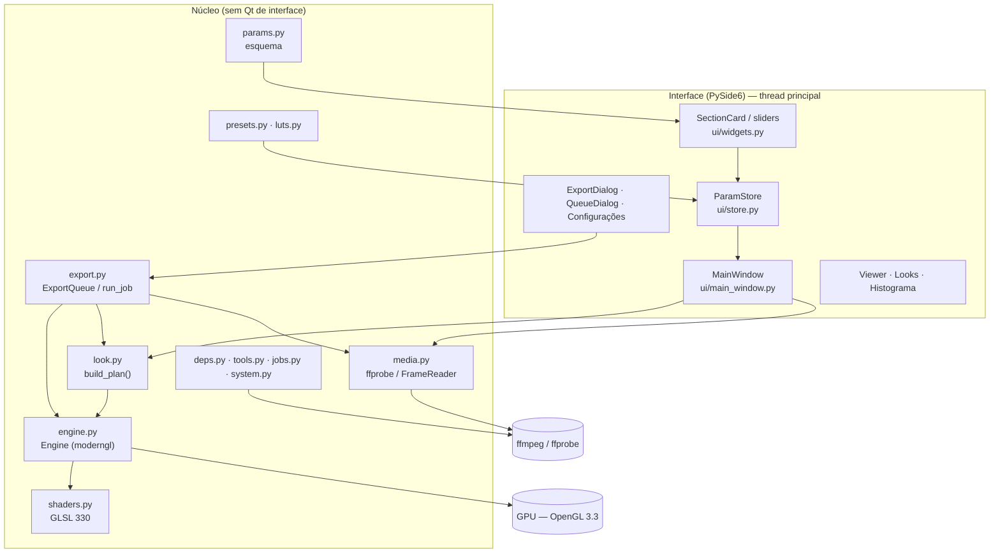
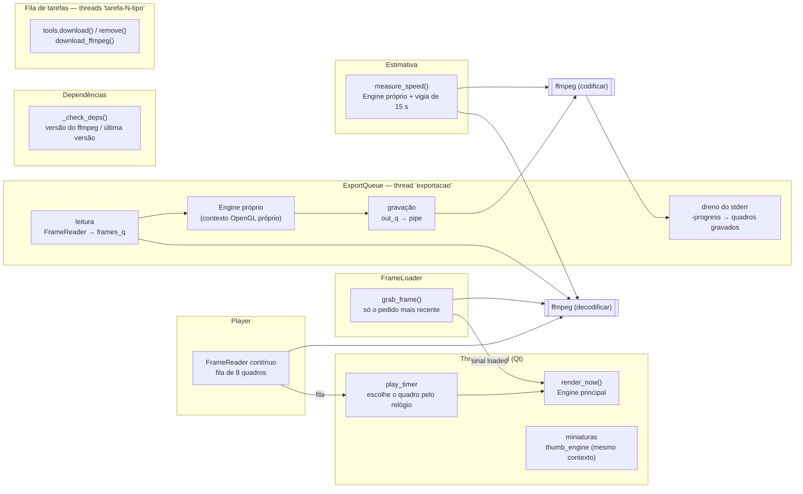
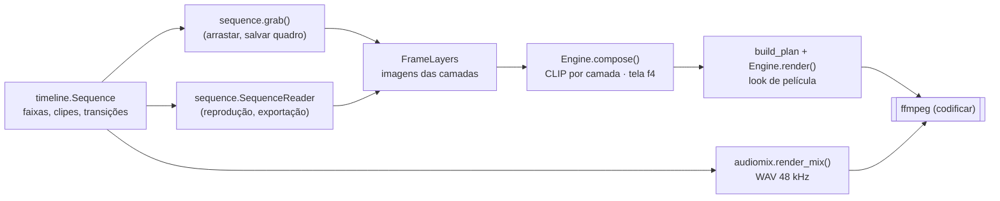
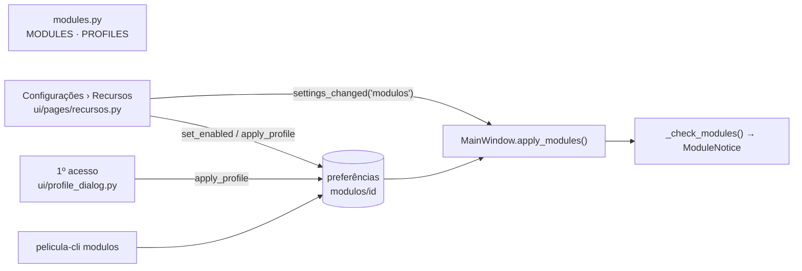
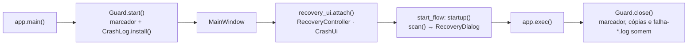

# Arquitetura do PeliculaConverter

Mergulho técnico no funcionamento interno: camadas, pipeline de GPU, gestão de cor, threads,
comunicação com o ffmpeg, exportação e persistência. Para regras de contribuição e receitas
rápidas, veja [AGENTS.md](../AGENTS.md); para o significado de cada ajuste, [EFEITOS.md](EFEITOS.md).

## Sumário

1. [Visão geral](#1-visão-geral)
2. [Mapa dos módulos](#2-mapa-dos-módulos)
3. [Dos ajustes aos uniforms](#3-dos-ajustes-aos-uniforms)
4. [Pipeline de GPU](#4-pipeline-de-gpu)
5. [Gestão de cor](#5-gestão-de-cor)
6. [Determinismo e independência de resolução](#6-determinismo-e-independência-de-resolução)
7. [Threads e processos](#7-threads-e-processos)
8. [Leitura de quadros com o ffmpeg](#8-leitura-de-quadros-com-o-ffmpeg)
9. [Exportação](#9-exportação)
10. [Dependências externas (deps.py)](#10-dependências-externas-depspy)
11. [Persistência e arquivos](#11-persistência-e-arquivos)
12. [Testes](#12-testes)
13. [Modo Edição](#13-modo-edição)
14. [Laboratório: emulação por densidade](#14-laboratório-emulação-por-densidade)
15. [Plugin do DaVinci Resolve (`resolve.py`)](#15-plugin-do-davinci-resolve-resolvepy)
16. [Módulos (recursos opcionais)](#16-módulos-recursos-opcionais)
17. [Componentes externos (`tools.py`)](#17-componentes-externos-toolspy)
18. [Fila de tarefas (`jobs.py`)](#18-fila-de-tarefas-jobspy)
19. [Notificações do sistema (`notify.py`)](#19-notificações-do-sistema-notifypy)
20. [Recuperação automática e relatórios de erro (`recovery.py`, `crashlog.py`)](#20-recuperação-automática-e-relatórios-de-erro-recoverypy-crashlogpy)
21. [Componentes de IA: receitas com o uv e o CorridorKey](#21-componentes-de-ia-receitas-com-o-uv-e-o-corridorkey)
22. [Base da 1.5: receita do quadro, formato 3, chaves, transparência e clipes sem arquivo](#22-base-da-15-receita-do-quadro-formato-3-chaves-transparência-e-clipes-sem-arquivo)

---

## 1. Visão geral



Três ideias guiam o projeto:

1. **Um único caminho de renderização.** Prévia, miniaturas, "Salvar quadro", estimativa de tempo
   e exportação chamam as mesmas funções: `look.build_plan(values, w, h, frame, fps, lut_info,
   dither)` e `Engine.render(plan, depth)`.
2. **Esquema declarativo.** `params.SECTIONS` descreve todos os ajustes (tipo, faixa, padrão,
   rótulo, dica). A interface é gerada a partir dele e o motor lê os valores pelas chaves.
3. **O núcleo não depende da interface.** `look`, `engine`, `media`, `export`, `presets`, `luts`,
   `deps`, `tools` e `jobs` funcionam sem janela (são usados assim pelos testes). A exceção é `edgetext`, que usa
   `QPainter` sobre `QImage` e precisa de uma `QGuiApplication` existente (sem ela, o texto de
   borda simplesmente não é desenhado).

## 2. Mapa dos módulos

| Módulo | Responsabilidade |
|---|---|
| `PeliculaConverter.pyw` | Abre o app sem console (`pythonw`). |
| `pelicula/__main__.py` | `python -m pelicula`. |
| `pelicula/__init__.py` | `__version__` e `APP_NAME`. |
| `pelicula/app.py` | `main()`: `QApplication`, estilo Fusion, paleta e folha de estilo, ícone; bloqueio do macOS (desativado); oferta de `pip install` se faltar `moderngl`/`numpy`/`glcontext`; sessão da recuperação e registro de erros antes da janela (`recovery_ui.Guard`); cria a `MainWindow` e liga as notificações do sistema e a recuperação; aviso de recuperação antes das boas-vindas; arquivos da linha de comando; gancho `PELICULA_SCREENSHOT`. |
| `pelicula/params.py` | `Param`, `Section`, `Schema` (esquema genérico: padrões e limpeza), `SECTIONS`/`FILM`, `PARAMS`, `defaults()`, `sanitize()`. |
| `pelicula/look.py` | Tabelas de bitolas (`GAUGES`), cópias (`PRINTS`), scan (`SCAN_FORMATS`), filtros P&B, viragens, primárias e matrizes de gamut; Laboratório (negativos, cópias, processos, calibração `lab_paths`); `build_plan()` → `Plan`. |
| `pelicula/shaders.py` | GLSL: `VERT`, `COMMON` (curvas, transferências log, look, cópia, LUT), `BASE`, `EXTRACT`, `BLUR`, `NOISE`, `FINAL`, `BAKE`. |
| `pelicula/engine.py` | `Engine`: contexto moderngl, programas, alvos de render, textura de entrada, LUT 3D, texto da borda; `render()` e `bake_lut()`; cache de LUTs por `mtime`. |
| `pelicula/frame.py` | `Recipe`: a receita única de um quadro (montagem → valores do look no quadro → `build_plan` → `render`/`render_fit`), usada por todo lugar que mostra ou grava um quadro (seção 22.1). |
| `pelicula/presets.py` | `FILM_BASE`, `BUILTIN` (44 presets), presets do usuário (JSON), importar/exportar. |
| `pelicula/luts.py` | Ler/gravar `.cube`, palpite do espaço de entrada, LUTs instalados (Premiere, Resolve, Meus LUTs), instalar LUTs. |
| `pelicula/media.py` | Localizar ffmpeg/ffprobe, `probe()` → `MediaInfo`, `NamedPipe` (Windows), `FrameReader`, `grab_frame()`, `Perf`, detecção de codificadores e hwaccels. |
| `pelicula/export.py` | `CODECS`, qualidades prontas, `ExportSettings`, `output_size()` (resolução = lado menor, ou o quadro fixo), `build_encoder_cmd()`, `frame_pipeline()`/`preview_frame()` (a receita de `frame.py` com os ajustes da exportação), `ExportJob`, `ExportQueue`, `run_job()` (gravação segura num parcial, volume alvo, duas passadas do tamanho alvo), `measure_speed()`, `save_still()`. |
| `pelicula/platforms.py` | Exportação por plataforma: `PLATFORMS` (YouTube, Instagram, TikTok, WhatsApp, Discord…, com fonte oficial), `settings_for()` → `ExportSettings`, `limits_text()`, `warnings()`, áreas seguras (`SAFE_AREAS`). Sem Qt (seção 9.5). |
| `pelicula/fit.py` | Encaixe num quadro de outra proporção (cortar, bordas, fundo desfocado): `plan()` → `Fit`, a geometria usada pela exportação e pela prévia dela (seção 9.6). |
| `pelicula/loudnorm.py` | Volume alvo da exportação: medida (`measure`) e filtro da 2ª passada (`filter_for`) do `loudnorm` do ffmpeg (seção 9.8). |
| `pelicula/deps.py` | Versão do ffmpeg, download verificado (gyan.dev / BtbN), extração segura (`extract_archive`, `safe_member`), pasta do app, pacotes Python, `pip_install()`. |
| `pelicula/tools.py` | Componentes externos: registro `TOOLS` (versão, URL e SHA-256 fixos), `download()` com troca atômica, `remove()`, `status()`, `disk_usage()`, detecção de programas do sistema (seção 17); receitas de IA (código + ambiente Python pelo uv + modelos): `Recipe`, `build_env()`, `fetch_file()` retomável, `install_recipe()`, `run_process()` (seção 21). |
| `pelicula/corridorkey.py` | CorridorKey (módulo Beta `recorte_ia`): requisitos da placa (`nvidia-smi`, capacidade 8.0+), linha de comando e progresso do `infer.py`, `run()` num processo separado com pasta parcial, aviso de entrada (log/HDR/RAW). Sem Qt (seção 21). |
| `pelicula/data/` | Dados lidos em tempo de execução: listas travadas com hash e manifestos de código das receitas (`corridorkey/`). Gerados por `uv pip compile` e `tools/gerar_manifesto.py`. |
| `pelicula/jobs.py` | Fila de tarefas em segundo plano: `Job`, `JobQueue` (limite por tipo, GPU 1 por vez), `shared()` (seção 18). |
| `pelicula/notify.py` | Notificações do sistema sem Qt: tipos (`KINDS`), preferências `notificacoes/…`, `decide()` (avisar, tocar som, piscar), textos (`Notice`) e o resumo da fila (`queue_notices`) (seção 19). |
| `pelicula/recovery.py` | Recuperação depois de um travamento, sem Qt: marcador da sessão (pid + hora de início), cópias automáticas com rodízio, fila de exportação guardada, `scan()` das sessões que travaram (seção 20). |
| `pelicula/crashlog.py` | Relatórios de erro e de travamento em `<pasta do app>/logs/`: `faulthandler`, `sys.excepthook` e `threading.excepthook`, pasta de tamanho limitado (seção 20). |
| `pelicula/system.py` | Processador, núcleos, RAM, GPUs NVIDIA (`nvidia-smi`), abrir pasta/arquivo no sistema, gravação segura (`partial_path`, `replace_file`, `atomic_write`). |
| `pelicula/edgetext.py` | Máscara do texto impresso na borda da película. |
| `pelicula/testimage.py` | Cena de teste (cartela de 24 cores, janela clara, lâmpadas, faixa de matiz, rampa de cinza). |
| `pelicula/timeline.py` | Modo Edição: `Source`, `Clip`, `Track`, `Layer`, `Marker`, `Sequence` (montagem, tempo, transições, marcadores, emendas de som, JSON) e `History` (desfazer). Sem Qt. |
| `pelicula/chapters.py` | Capítulos a partir dos marcadores: texto para o YouTube (com as regras dele) e arquivo FFMETADATA para a exportação (MP4, MOV, MKV). Sem Qt. |
| `pelicula/loudness.py` | Loudness ITU-R BS.1770-4 / EBU R128 em numpy: ponderação K, momentânea, curto prazo, integrada (portões), LRA, pico e true peak (`LoudnessMeter`, `measure`). Sem Qt. |
| `pelicula/editparams.py` | Esquemas dos ajustes por clipe (`VIDEO`, `AUDIO`), cores do HSL, ajustes rápidos. |
| `pelicula/compositor.py` | Ajustes do clipe → uniforms do `CLIP` (`clip_uniforms`), enquadramento (`fit_box`, `transform`), `auto_adjust`. |
| `pelicula/editshaders.py` | GLSL do modo Edição: `CLIP` (uma camada sobre a tela) e `OUT` (tela → 8/16 bits inteiros). |
| `pelicula/resolve.py` | Plugin do DaVinci Resolve: gera os DCTLs (Cor, Textura, Projetor e os de cada preset), os LUTs e o `LEIA-ME`; instala na pasta de LUTs do Resolve. |
| `pelicula/modules.py` | Módulos (recursos que o usuário liga e desliga): `MODULES`, `GROUPS`, `PROFILES`, `is_enabled()`, `apply_profile()`, `current_profile()`, `used_by()`. Sem Qt (veja a seção 16). |
| `pelicula/ui/settings_dialog.py` / `ui/pages/` | Janela de Configurações: páginas numa barra lateral (`Page(dialog)` por arquivo); `pages/recursos.py` liga e desliga os módulos. |
| `pelicula/ui/profile_dialog.py` / `module_notice.py` | Perfil de recursos do primeiro acesso (`ProfileDialog`, cartões `ProfileCard`); faixa de aviso "recursos desligados em uso" (`ModuleNotice`). |
| `pelicula/ui/edit_model.py` | `TimelineModel`: a sequência da edição, seleção, histórico e as edições que a interface pede (sinal `changed`). |
| `pelicula/ui/timeline_view.py` | `TimelineEditor`: barra de ferramentas, régua, cabeçalhos das faixas, clipes, forma de onda, arrastar/aparar/lâmina/ímã, marcadores e transição de som. |
| `pelicula/ui/markers.py` | `MarkerDialog` (nome, nota, cor, capítulo) e `ChaptersDialog` (copiar os capítulos para o YouTube, com os avisos). |
| `pelicula/ui/meter.py` | `AudioMeter`: picos L/R em dBFS com retenção e as leituras M, S, I e TP ao lado da prévia (módulo `medidor_som`). |
| `pelicula/ui/edit_panels.py` | `MediaBin` (Mídia) e `ClipInspector` (ajustes do clipe gerados de `editparams`). |
| `pelicula/ui/scopes.py` | Medidores: histograma, forma de onda, parada RGB e vetorscópio. |
| `pelicula/ui/sequence_dialog.py` / `resolve_dialog.py` | Resolução e fps da sequência; instalação do plugin do DaVinci. |
| `pelicula/ui/corridorkey_dialog.py` | Janela não modal "Recorte por IA (CorridorKey)": arquivo, opções e o trabalho GPU na fila (seção 21). |
| `pelicula/sequence.py` | Quadros da sequência: `grab` (acesso direto), `SequenceReader` (em ordem, com pré-abertura), `media_info`. |
| `pelicula/audiomix.py` | Mixagem do som da sequência com o ffmpeg (`render_mix`), fades nas emendas e transição de som, chave da prévia (`mix_key`), forma de onda (`peaks`), som do arquivo para o medidor (`decode_wav`, `WavReader`). |
| `pelicula/ui/main_window.py` | Janela principal, carregamento de quadros, reprodução, presets, LUTs, exportação, atalhos, checagem de dependências. |
| `pelicula/ui/store.py` | `ParamStore`: valores atuais, sinal `changed`, desfazer/refazer (agrupado por 400 ms, até 300 passos). |
| `pelicula/ui/widgets.py` | `FilmSlider`, `ToggleSwitch`, linhas de parâmetro, `LutRow`, `SectionCard`, `Segmented`, `Histogram`, `Timeline`, `timecode()`. |
| `pelicula/ui/viewer.py` | Visualizador: modos de comparação, zoom livre (10%–1600%) e pan, espiar o original, modo de tela cheia (sem borda, fundo preto, dica das teclas), arrastar e soltar; área segura das plataformas por cima (`SafeAreaButton`, só na tela). |
| `pelicula/ui/looks.py` | Painel de miniaturas dos presets com busca. |
| `pelicula/ui/export_dialog.py` | Janela de exportação: plataforma (limites, avisos, prévia do resultado), qualidade, opções do arquivo, desempenho e estimativa. |
| `pelicula/ui/queue_dialog.py` | Janela da fila. |
| `pelicula/ui/settings_dialog.py` / `pages/` | Configurações em páginas; `pages/componentes.py` mostra os componentes (ffmpeg, ferramentas, programas do sistema), o espaço em disco e o sistema (placa de vídeo, bibliotecas). |
| `pelicula/ui/job_bridge.py` | `JobBridge`/`bridge()`: eventos da fila de tarefas como sinais do Qt na thread principal; `on_finished`. |
| `pelicula/ui/notifier.py` / `pages/notificacoes.py` | `Notifier` da janela (`MainWindow.notifier`) e os backends: bandeja/toast (`QSystemTrayIcon`), D-Bus (`org.freedesktop.Notifications`) e nulo (testes); página Configurações › Notificações (seção 19). |
| `pelicula/ui/recovery_ui.py` / `crash_dialog.py` / `pages/recuperacao.py` | `Guard` (sessão + registro de erros de uma execução), `RecoveryController` (cópias automáticas, fila guardada), `RecoveryDialog` (aviso depois de um travamento), `ErrorDialog` (erro inesperado) e a página Configurações › Recuperação (seção 20). |
| `pelicula/ui/theme.py` / `icons.py` | Cores, fontes, folha de estilo; ícones vetoriais e ícone do app (usa `assets/logo-*.png` quando existem). |

## 3. Dos ajustes aos uniforms

```
params.SECTIONS ──► interface (SectionCard) ──► ParamStore.values (dict)
                                                     │
                     presets.builtin_values() ───────┤  (FILM_BASE + valores do preset, sanitize)
                                                     ▼
          look.build_plan(values, largura, altura, quadro, fps, lut_info, dither)
                                                     │
                                                     ▼
   Plan(uniforms, soft_sigma, chains[hal/bloom/mist], grain_size, grain_seed, lut_path, edge_text)
                                                     │
                                                     ▼
                                   Engine.render(plan, depth=8|16)
```

`build_plan()` é uma função pura: dado o mesmo dicionário de valores, o mesmo tamanho e o mesmo
número de quadro, devolve exatamente os mesmos uniforms. Ela:

- converte px@1080 para pixels reais (`scale = altura / 1080`);
- aplica os multiplicadores da bitola (`GAUGES`) e do ISO (`(ISO/250)^0,35` na força,
  `(ISO/250)^0,18` no tamanho do grão);
- soma exposição, temperatura, tonalidade, cintilação, clarões e cor instável num ganho em EV por
  canal (`u_gain`);
- calcula o tremor (`u_shift`, `u_rot`, `u_zoom`) e os eventos de defeitos com `_hash()`/`_vnoise()`
  sobre o número do quadro e as sementes;
- monta as **cadeias de brilho** (`Chain`): halação (só luminância, limiar `0,18·2^limiar`, raio ×
  fator da bitola, máscara alfa quando há scan), bloom (colorido) e névoa (sem limiar);
- decide maciez/nitidez (`soft_sigma` = √(maciez_bitola² + (raio·maciez·2)²)·scale);
- calcula o tamanho do grão em pixels (mínimo 1 px) e a semente (`semente·7919 + quadro` se
  animado);
- converte as tabelas de cópia, filtros P&B, viragens e a cor da base do scan;
- com LUT ligado e `lut_info` válido, preenche tamanho, domínio e a matriz de gamut inversa do
  espaço que o LUT espera;
- com scan ligado, escolhe o formato (`SCAN_FORMATS`), a janela de visão em mm e o texto da borda.

## 4. Pipeline de GPU

Todos os passos desenham um quadrilátero de tela cheia (`VERT`) num *framebuffer*. Alvos usados
(criados sob demanda e reaproveitados enquanto o tamanho não muda):

| Alvo | Formato | Tamanho | Conteúdo |
|---|---|---|---|
| `input_tex` | RGB `f1` (8 bits) ou `nu2` (16 bits normalizado) | quadro | Quadro vindo do ffmpeg |
| `lin` | RGBA `f2` (half float) | quadro | Luz linear após o passo base; alfa = máscara da imagem no scan |
| `tmp`, `soft` | RGBA `f2` | quadro | Desfoque separável da maciez |
| `hi` | RGBA `f2` com mipmaps | quadro | Luzes extraídas para uma cadeia de brilho |
| `<cadeia>_a`, `<cadeia>_b` | RGBA `f2` | reduzido (`w >> nível`) | Desfoque horizontal e vertical de halação, bloom e névoa |
| `noise` | RGBA `f2` | `w / tamanho_do_grão` | Quatro canais de ruído gaussiano |
| `out8` / `out16` | RGB `f1` / `nu2` | quadro | Resultado lido de volta para a CPU |
| `bake` | RGB `f4` | `n² × n` | Grade de um LUT sendo exportado |

### 4.1 Passo base (`BASE`)

1. **Tremor**: `weave()` aplica zoom, rotação e deslocamento em pixels.
2. **Lente**: `lens()` aplica a distorção radial normalizada (o canto continua no canto) e, com
   aberração cromática, amostra R, G e B com escalas `1 + ca`, `1` e `1 − ca`.
3. **Entrada**: `toLinear(código, perfil, cv)` desfaz a curva (Rec.709 neutra, N-Log, S-Log3, LogC3,
   V-Log, Cineon, DaVinci Intermediate, Log3G10, Blackmagic Gen 5, LogC4, Apple Log, HLG, PQ) e `u_gamut`
   converte o gamut para Rec.709. Com `cv` (curva em código de 10 bits e fonte em faixa legal expandida,
   seção 5.1) o valor volta ao código da câmera antes da curva.
4. **Exposição e balanço**: `× exp2(u_gain)` por canal.
5. **Vinheta** (bitola + lente) em EV.
6. **Scan** (se ligado): converte o pixel para milímetros na tira (`u_scan_view`), calcula em qual
   quadro (`k`) ele cai, a distância com sinal ao retângulo arredondado do quadro (com rugosidade
   `fbm2`), os furos (retângulos arredondados periódicos), a densidade da base, o texto da borda
   (textura `t_text`) e a área fora da película. O vídeo é encaixado no quadro (caber/preencher) e
   os vizinhos mostram o mesmo quadro (como num scan estático). Alfa = dentro da imagem.

### 4.2 Maciez (`BLUR` × 2)

Gaussiana separável em resolução cheia com `soft_sigma`. O passo final usa `lin + (lin − soft) ×
nitidez` sobre a mistura escolhida, o que implementa ao mesmo tempo a maciez e a "recuperação de
detalhe" (máscara de nitidez).

### 4.3 Halação, bloom e névoa (`EXTRACT` + mipmaps + `BLUR`)

Para cada cadeia:

1. `EXTRACT` separa as luzes com joelho suave (`smoothstep(0,5·limiar, 1,5·limiar, L)`), limita a
   energia (`e / (1 + e/limite)`, evita que um pixel de 50× domine), multiplica pelo alfa do scan
   quando pedido e, na halação, reduz a luminância.
2. `build_mipmaps()` gera as reduções.
3. Escolhe-se o nível `n` tal que `σ / 2ⁿ ≤ 6` (até 8 níveis); o desfoque horizontal lê o mipmap
   nesse nível com `textureLod` e grava num alvo reduzido; o vertical completa. Raios de 250 px
   em 4K custam o mesmo que raios pequenos. O núcleo tem raio `3σ`, limitado a 48 amostras.

### 4.4 Ruído do grão (`NOISE`)

Uma textura com `⌈w / tamanho⌉ × ⌈h / tamanho⌉` texels recebe quatro números gaussianos
independentes por texel (Box–Muller sobre o hash PCG de `(x, y, semente)`). O passo final amostra
essa textura com **interpolação bicúbica** em duas escalas (fina e ~2,3× maior, misturadas pela
aspereza), mistura um canal comum (monocromático) com três independentes (grão colorido) e aplica a
resposta por luminância (gaussianas em L = 0,10 / 0,45 / 0,88).

### 4.5 Passo final (`FINAL`)

Em ordem:

1. `lin` → maciez/nitidez (`t_soft`).
2. Névoa: `mix(lin, névoa, 0,3·força) + névoa·0,35·força`.
3. Bloom (`+ bloom·força·0,22`), halação (`+ halo·cor·força·0,32`) e vazamento de luz (duas
   gaussianas coloridas que passeiam pelas bordas).
4. `colorPipe(lin)`:
   - **Laboratório** (se ligado): `lin` passa por `labPipe` (negativo → copiadora → cópia, seção 14)
     e volta para luz linear pela curva neutra inversa; daí em diante o resto do caminho vale igual;
   - **neutro** = curva neutra de exibição;
   - **LUT no lugar do look** → `mix(neutro, LUT(codificado no espaço do LUT), força)`;
   - senão **filmLook** (P&B com pesos do filtro → stops → saturação em log → contraste e
     deslocamento por canal → curva por canal com ombro/pé suaves → densidade → matiz de verdes,
     azuis e pele → tons de sombra/luz com pivô → viragem), misturado por *Intensidade do look*;
   - **printStage**: volta de exibição para stops (curva neutra inversa), saturação, gama e
     deslocamento por canal e curva da cópia; misturado por *Força da cópia*;
   - **envelhecimento**: dessatura 40%, levanta o preto (`×0,82 + 0,075`) e puxa para o magenta;
   - **LUT depois do look**: reencoda para o espaço que o LUT espera (Rec.709 usa o valor de
     exibição direto) e mistura.
5. Grão (no valor de exibição, como numa cópia).
6. Defeitos (`damage()`), em coordenadas px@1080: manchas, fio de cabelo (curva amostrada em 40
   segmentos), marca de troca de rolo, emenda, poeira (células de 90 px, 3×3 vizinhas, partículas
   elípticas) e riscos (até 6).
7. **Força geral**: `mix(código_original, resultado, u_mix)`.
8. **Moldura**: distância com sinal a um retângulo arredondado na proporção pedida, com borda suave
   e irregular, cor das barras (desligada quando o scan está ligado).
9. **Pontilhado**: ruído triangular de ±1 LSB em 8 bits (só quando `dither=True`).
10. `clamp(0, 1)` e gravação em `out8`/`out16`, lido com `fbo.read()`.

### 4.6 Exportar LUT (`BAKE`)

`Engine.bake_lut(values, n, legal=False)` desenha uma grade `n² × n` (R varia mais rápido, depois G, depois B —
a ordem do `.cube`) e roda só `toLinear → gamut → ganho → colorPipe`, com o projetor desligado e sem
pontilhado. O resultado vai para `luts.save_cube()` (domínio 0–1, valores limitados a 0–1). A grade está no
domínio da própria curva (`legal=False`: código de 10 bits no S-Log3/V-Log/N-Log, como os LUTs dos
fabricantes); `legal=True` é o clipe de faixa legal expandido (o gráfico *Curva* de um vídeo comum e a
referência do plugin do Resolve com *Faixa do vídeo = Vídeo*).

### 4.7 Coordenadas

Os shaders usam **coordenadas de imagem com y para baixo**: a linha 0 do array numpy (topo da
imagem) é enviada como linha 0 da textura e lida de volta como linha 0 do framebuffer. Como nada é
invertido no caminho, `v_uv.y = 0` é o topo. Toda geometria escrita à mão (tremor, scan, defeitos,
vazamento, marca de rolo no canto superior direito) segue essa convenção.

## 5. Gestão de cor

- **Espaço de trabalho**: luz linear de cena com primárias Rec.709/D65; cinza médio = 0,18.
- **Gamut**: matrizes calculadas em `look.py` a partir das primárias xy (Rec.709, Rec.2020,
  S-Gamut3.Cine, ARRI Wide Gamut 3/4, V-Gamut, DaVinci Wide Gamut, REDWideGamutRGB, Blackmagic Wide
  Gamut), todas com branco D65; enviadas como `mat3` coluna-maior (`mat3_uniform`).
- **Curvas de câmera** em GLSL: N-Log, S-Log3, LogC3 (EI 800), V-Log, Cineon (685/300 com preto
  offset), DaVinci Intermediate, Log3G10, Blackmagic Film Gen 5, LogC4, Apple Log, HLG e PQ —
  decodificação e codificação (a codificação serve para alimentar LUTs que esperam log).
- **HLG e PQ** (BT.2100): HLG é a OETF inversa × `HLG_SCALE` (o cinza da BT.2408, 38% do sinal, vira
  0,18); PQ é a EOTF da ST 2084 (cd/m²) seguida da OOTF inversa do HLG a 1000 cd/m² (γ = 1,2 pela
  luminância BT.2100, como a conversão PQ → HLG da BT.2408) e da mesma escala. Acima de 1000 cd/m² não há
  corte; valores negativos (pé da faixa legal) não geram NaN. Constantes em `look.HLG_*`/`PQ_*`, repetidas
  no GLSL e no plugin (`tests/test_entrada.py` confere).
- **Curva neutra de exibição** (`D_SLOPE = 0,155` por stop, `D_MID = 0,45`, `D_P = 4`): uma
  sigmoide de *soft clip* em stops, **inversível**. Ela é usada para levar Rec.709 até a luz linear
  e de volta, então com todos os efeitos desligados o vídeo sai igual ao que entrou (a menos do
  pontilhado). `look.display_to_lin()` é a mesma inversa em Python (usada para a cor da base do
  scan).
- **Curva da película** (`curve()`): mesma família, com inclinação = `D_SLOPE × contraste`, tom
  médio, preto, branco e expoentes de ombro (`ps`) e pé (`pt`) controlados pela suavidade
  (`4 → 1,15`).
- **Saída**: valores de exibição BT.709. O codificador recebe RGB e o ffmpeg converte para YUV com
  matriz BT.709 em faixa limitada (BT.601 em faixa cheia para JPEG/WebP), gravando as tags
  `bt709` de primárias, transferência e matriz.

### 5.1 Faixa do arquivo e domínio das curvas

O `FrameReader` expande o vídeo YUV de faixa legal (`in_range=limited`): em 10 bits o shader recebe
v = (código − 64)/876, a fração de "IRE" — o mesmo valor que o DaVinci Resolve tem de um clipe em *Video
levels*. Vídeo de faixa cheia (`pc`, `yuvj`) e imagens RGB chegam como v = código/1023. Cada curva declara em
`look.INPUT_DOMAIN` em que escala o fabricante escreveu a fórmula (fontes no comentário do código):

| Domínio | Perfis | O que o shader faz |
|---|---|---|
| `"cv"`: código de 10 bits, gravado como está | S-Log3 (Sony), V-Log (Panasonic), N-Log (Nikon) | com `u_legal = 1`: CV = (v·876 + 64)/1023 antes da curva; com faixa cheia, CV = v |
| `"sinal"`: o próprio sinal E′ (quantização padrão 64 + 876·E′) | LogC3, LogC4, Blackmagic Gen 5, DaVinci Intermediate, Log3G10, Cineon, Apple Log, HLG, PQ, Rec.709, linear | usa v como está |

O fluxo da faixa:

```
arquivo ──ffprobe──► MediaInfo ──media.legal_range()──┐
montagem (Edição) ──sequence.legal_range()─────────────┤  (faixa da maioria dos clipes de vídeo)
                                                       ▼
build_plan(..., legal) → u_legal ; INPUT_DOMAIN[entrada] e log_reescalado → u_input_cv
                                                       ▼
          BASE / BAKE: toLinear(código, u_input, u_input_cv == 1 && u_legal == 1)
```

- **Quem passa a faixa**: prévia, miniaturas, gráfico *Curva* e "Salvar quadro" (`MainWindow._source_legal`),
  exportação (`export._encode`, também na estimativa) e o terminal (`quadro`, `exportar`).
- **Modo Edição**: cada clipe é decodificado com a sua faixa e a tela montada guarda esses valores; o look
  usa a faixa da maioria dos clipes de vídeo (empate: o primeiro; imagens só contam sem vídeo). Clipes log de
  faixas diferentes na mesma montagem ficam com uma faixa só (perfil por clipe fica para depois).
- **`log_reescalado`** (avançado, fora dos presets): gravação externa em que a câmera mandou o log já
  reescalado para 64–940 (saída HDMI *Limited*, comum na Nikon) — desliga a volta ao código.
- **LUTs**: o LUT externo (`lutEncode`) e os `.cube` exportados (`Engine.bake_lut`, padrão `legal=False`)
  usam o domínio da própria curva — o código de 10 bits nas curvas `"cv"`, a convenção dos LUTs "Full" dos
  fabricantes e das IDTs do ACES (que aplicam a fórmula direto na entrada). Assim um LUT oficial da Sony
  recebe 420/1023 no cinza, venha o arquivo em faixa legal ou cheia.
- **Plugin do Resolve**: o nó recebe o valor que o Resolve tem do clipe, sem saber a faixa do arquivo; o
  controle *Faixa do vídeo* (padrão *Vídeo* = `bake_lut(legal=True)`, *Cheia* = `legal=False`) faz o papel de
  `u_legal` (seção 15).
- **Limite conhecido**: a saída RGB inteira do decodificador corta em 1,0 o que passa do código 940 (super
  brancos). No S-Log3, que usa códigos até ~1000, isso corta as luzes mais de ~6,7 stops acima do cinza.

## 6. Determinismo e independência de resolução

- **Nada aleatório de verdade.** Em Python, `_hash(i, semente)` (hash inteiro de 32 bits) e
  `_vnoise(x, semente)` (ruído de valor suave) geram tremor, cintilação, clarões, emendas, fio de
  cabelo, manchas, cor instável e vazamento a partir de `t = quadro / fps`, do índice do quadro e
  das sementes. Em GLSL, `pcg()`/`rnd(uvec3)` geram grão, poeira, riscos e pontilhado a partir de
  coordenadas inteiras, quadro e semente.
- **Mesmo quadro, mesmo resultado.** A prévia chama `build_plan(..., self.frame_idx, info.fps)`; a
  exportação chama `build_plan(..., first_index + i, fps_saída)`. Com a mesma resolução, o
  resultado é idêntico — uma exportação FFV1 16 bits foi conferida bit a bit contra
  `Engine.render()`.
- **Troca de fps.** Quando a exportação muda os quadros por segundo, os índices passam a contar na
  nova taxa (o primeiro quadro é `round(início · fps_saída / fps_original)`) e `build_plan` recebe
  o fps de saída; os efeitos ligados ao tempo (`t`) continuam no mesmo ritmo.
- **px@1080.** Todas as distâncias do esquema são em pixels de um quadro de 1080 linhas e
  multiplicadas por `altura / 1080`; os defeitos são desenhados num sistema de coordenadas de
  1080 linhas de altura. O grão é a única textura cujo padrão exato depende da resolução (o
  tamanho estatístico é o mesmo); por isso a dica da prévia recomenda a resolução máxima para
  julgar o grão.

## 7. Threads e processos



| Thread | Onde | O que faz | Como fala com a interface |
|---|---|---|---|
| Principal (Qt) | `MainWindow` | Recebe quadros, chama `build_plan` + `Engine.render` (8 bits) para a prévia, desenha o visualizador, o histograma e as miniaturas (com `thumb_engine`, que compartilha o contexto do `engine` principal). | — |
| `FrameLoader` | `main_window.FrameLoader` | Decodifica um único quadro com `media.grab_frame()`. Se chegarem vários pedidos (arrastando a linha do tempo), só o mais recente é atendido. | Sinais `loaded` / `failed` (fila do Qt). |
| `Player` | `main_window.Player` | Um `FrameReader` contínuo a partir do quadro atual; põe `(índice, imagem)` numa fila de 8. Repete o trecho se a repetição estiver ligada. | `play_timer` (timer preciso) lê a fila e mostra o quadro certo para o tempo decorrido, descartando quadros atrasados. |
| `exportacao` | `export.ExportQueue` | Executa os trabalhos um de cada vez. O `Engine` é criado **dentro** dessa thread (contexto OpenGL próprio, atual nela). | `QTimer` de 500 ms na janela e de 250 ms na fila leem o estado do `ExportJob`. |
| leitura / gravação / dreno | `export.run_job` | Leitura: `FrameReader` → `frames_q`. GPU: laço na thread `exportacao`. Gravação: `out_q` → pipe do codificador. Dreno: lê o `stderr` do ffmpeg, interpreta `frame=` do `-progress` e guarda as mensagens de erro. As filas têm o tamanho do *buffer* escolhido (mínimo 2). | Campos do `ExportJob` (`done`, `fps_rate`, `eta`, `status`, `error`). |
| estimativa | `export_dialog._start_estimate` | `measure_speed()` cria **outro** `Engine`, exporta até 60 quadros num arquivo temporário (sem áudio), descarta os 8 primeiros (aquecimento) e para sozinho depois de 15 s (thread vigia). | `_Bridge.done` (sinal). Uma nova mudança cancela a medição anterior (`threading.Event`). |
| dependências | `MainWindow._check_deps` | Confere o ffmpeg e a última versão publicada (guardada em `deps.cached_latest_version()`). | `_DepsBridge.result`. |
| fila de tarefas | `jobs.JobQueue` (`jobs.shared()`) | Um thread por trabalho rodando: downloads e remoções de componentes (página Componentes), depois análises e IA. No máximo 1 trabalho de GPU. | `ui/job_bridge.JobBridge`: sinais `added`/`changed`/`finished` e `on_finished` na thread principal. |

Regras que decorrem disso:

- **Um contexto OpenGL por thread.** Um `Engine` só é usado na thread que o criou. A exportação e
  a estimativa criam os seus; a interface nunca toca neles.
- **Nada de Qt de interface fora da thread principal.** As threads de trabalho só trocam dados por
  sinais, filas ou campos simples.
- **Cancelamento cooperativo.** `ExportJob.cancel` (`threading.Event`) é conferido na leitura, na
  GPU e na gravação; o processo do codificador é morto e o parcial é apagado (arquivo ou pasta da
  sequência). O destino antigo nunca é tocado (veja a gravação segura em 9.2).
- **Exceção sem tratamento numa thread.** `threading.excepthook` (de `crashlog.CrashLog`) grava o
  relatório na própria thread; o aviso na tela chega à thread principal por um sinal em fila
  (`ui/crash_dialog.CrashUi`). Veja a seção 20.

## 8. Leitura de quadros com o ffmpeg

`media.probe()` roda `ffprobe -print_format json -show_streams -show_format` e monta o
`MediaInfo`: resolução (trocada em vídeos girados 90°), fps (`r_frame_rate`, imagens = 24),
quadros (`nb_frames` ou duração × fps), formato de pixel e profundidade, codec e perfil, taxa de
bits, metadados de cor, áudio e se é imagem.

`media.FrameReader` monta:

```
ffmpeg -v error -nostdin [-hwaccel X] [-threads N] [-ss (quadro−0,45)/fps]
       -i arquivo -map 0:v:0 -an -sn -dn
       -vf [fps=F,]scale=L:A:flags=…:in_color_matrix=M:in_range=R:threads=N,format=rgb24|rgb48le
       [-filter_threads N] [-frames:v K] -f rawvideo -pix_fmt rgb24|rgb48le <pipe>
```

- A busca usa `-ss` antes do `-i` meio quadro antes do alvo (rápido e preciso).
- A matriz de entrada vem dos metadados (`bt709`, `bt601`, `bt2020`, `smpte240m`; sem metadado,
  BT.709 a partir de 720 linhas); a faixa vem de `color_range`/`yuvj` (`_in_range`). `media.legal_range(info)`
  diz se o leitor expandiu a faixa legal — é o `legal` do `build_plan` (seção 5.1).
- `MediaInfo.color_transfer` (`arib-std-b67` = HLG, `smpte2084` = PQ) sugere o perfil de entrada
  (`media.detect_profile`/`auto_profile`) ao abrir um arquivo; nada no leitor muda com isso.
- Prévia: `bicubic+full_chroma_int`. Exportação e "Salvar quadro": `lanczos+accurate_rnd+full_chroma_int`.
- 8 bits → `rgb24`; 16 bits → `rgb48le` (textura `nu2`).
- **Windows**: `NamedPipe` cria `\\.\pipe\pelicula_<uuid>` com buffer de 1 MiB; o ffmpeg escreve
  nele como se fosse um arquivo. A conexão espera o ffmpeg abrir o pipe e destrava sozinha se ele
  morrer antes (timeout de 60 s). Isso é bem mais rápido que `stdout` para quadros 4K.
- **Linux/macOS**: `stdout`/`stdin` comuns.
- Prioridade: no Windows por `creationflags` (abaixo/acima do normal); no Linux, `os.nice(10)`
  para *Baixa*.

Codificadores e acelerações são descobertos com `ffmpeg -encoders` e `ffmpeg -hwaccels`
(em cache; `media.reset_cache()` limpa depois de trocar o ffmpeg). NVENC, QSV e AMF aparecem na
lista mesmo sem hardware compatível, então `encoder_works()` codifica 0,1 s de teste antes de
oferecê-los.

## 9. Exportação

### 9.1 Do diálogo à fila

`ExportDialog` monta um `ExportSettings` (codec, recipiente, formato de pixel, qualidade,
velocidade, perfil, taxa de bits, resolução, fps, áudio, *tune grain*, pontilhado, as opções de
desempenho e as da exportação por plataforma) e um `ExportJob` com uma **cópia** dos valores atuais. A
janela principal guarda a pasta, a qualidade, a plataforma (`export_platform`) e o desempenho escolhidos
e põe o trabalho na `ExportQueue`.

Campos da exportação por plataforma (1.4), todos com padrão neutro: um `to_dict()` antigo, sem eles,
exporta exatamente como antes (`tests/test_export_neutral.py` compara os comandos do codificador com os
da 1.3.1 gravados em `tests/export_cmds_1_3.json`).

| Campo | Padrão | O que faz |
|---|---|---|
| `platform` | `""` | id da plataforma que preencheu as opções (só informativo) |
| `frame` | `""` | quadro fixo `"LxA"`; vazio = `resolution` e a proporção do vídeo |
| `fit` | `"cortar"` | encaixe no quadro fixo: `cortar`, `bordas`, `desfocado` |
| `target_mb` | `0` | tamanho alvo em MB (1.000.000 bytes), duas passadas no x264/x265 |
| `maxrate` | `0` | teto de taxa (Mb/s) com qualidade constante no x264/x265 |
| `loudness` | `0` | volume alvo em LUFS (negativo); 0 = o som não muda |
| `true_peak` | `-1` | pico real máximo (dBTP) com volume alvo |
| `net_grain` | `False` | "Grão para redes" |

### 9.2 `run_job()`

1. Tamanho de saída (`output_size`), fps, profundidade (`high_depth`: 16 bits se o formato tiver
   10/12/16 bits, `p010`, RGB 48 ou for ProRes/FFV1), trecho em quadros e total de quadros na taxa de
   saída. A resolução escolhida (`"2160"`, `"1080"`, `"720"`…) é o **lado menor** do quadro, como no
   YouTube e nos celulares: deitado, ela é a altura (1920 × 1080); em pé, a largura (1080 × 1920); o
   outro lado segue a proporção. Codecs de vídeo recebem dimensões pares (arredondadas para baixo);
   FFV1, GIF, imagens e sequências ficam com o tamanho exato. A janela mostra em cada opção o tamanho
   que sai (`ExportDialog._res_labels`) e o terminal aceita `--resolucao 1080` ou `1080p`.
2. **Gravação segura** (`_prepare_output` / `_commit_output` / `_discard_output`): o codificador nunca
   grava no destino. Ele recebe `system.partial_path()` — `video.parcial-pelicula.mp4`, ao lado do
   destino, com a extensão real no fim para o ffmpeg escolher exatamente o mesmo formato (mp4, mov,
   matroska, gif, image2…) sem `-f` nem tabela própria de formatos — ou, nas sequências,
   `quadros.parcial-pelicula/quadros_%06d.png`. A marca não é só `.parcial` porque essa é uma palavra
   comum (`entrevista.parcial.mp4` pode ser da pessoa). Um parcial que sobrou de uma exportação
   interrompida é apagado antes de começar; se um arquivo de **entrada** tem o nome do parcial
   (`partial_clash`), a exportação é recusada em vez de apagá-lo. Só quando tudo deu certo o resultado
   vai para o lugar do destino com `os.replace` (`system.replace_file`, que tenta de novo por até 2 s
   quando o Windows segura o arquivo): o arquivo antigo fica intacto até esse instante. Nas sequências,
   uma pasta nova troca de nome inteira; se a pasta já existe, cada quadro é movido, os quadros que
   sobram de uma exportação anterior mais longa (`nome_NNNNNN.ext` além do último) saem, e arquivos da
   pessoa na pasta nunca são apagados. Cancelado ou com erro (inclusive exceção no meio), o parcial é
   apagado. Se o destino não puder ser trocado (aberto num player), o trabalho vira `erro` e o resultado
   completo fica no parcial, com o caminho na mensagem. A janela e o terminal perguntam (ou pedem `-y`)
   antes de substituir um arquivo ou uma pasta de sequência que já tem quadros (`output_exists`).
3. Pipe nomeado de saída (Windows) e comando do codificador (`build_encoder_cmd`):
   - entrada 0: `rawvideo` RGB (8/16 bits) pelo pipe, com `-progress pipe:2`;
   - entrada 1 (se houver áudio e o formato aceitar): o arquivo original com `-ss`/`-t` do trecho,
     mapeando `1:a:0?`;
   - conversão para YUV com `scale=out_color_matrix=…:out_range=…:flags=accurate_rnd+full_chroma_int`
     (GIF usa `palettegen`/`paletteuse`);
   - argumentos do codec (CRF/CQ/QP/bitrate, preset, perfil, `-tune grain`, `-x265-params`,
     `-tag:v hvc1`, opções de NVENC/QSV/AMF, FFV1 nível 3 com GOP 1 e 16 *slices*, TIFF com
     *deflate* etc.);
   - tags de cor BT.709, `+faststart` em MP4/MOV, áudio conforme `_audio_args()`.
4. `FrameReader` em alta qualidade (`open_reader`, no tamanho do encaixe da seção 9.6). Com troca de fps,
   o leitor aplica o filtro `fps=` desde o começo e pula os quadros antes do trecho.
5. Três etapas em paralelo (leitura → GPU → gravação) com filas do tamanho do *buffer*. A GPU usa
   `FramePipeline.render()` — montagem (modo Edição), `look.build_plan()` e o encaixe — o mesmo objeto que
   `preview_frame()` usa na prévia da janela de exportação. Antes disso, com volume alvo, vem a medida do
   som (seção 9.8); com tamanho alvo, as etapas 3–7 rodam duas vezes (seção 9.7).
6. Progresso: quadros **gravados** pelo ffmpeg (`frame=` do `-progress`) ou, antes disso, quadros
   processados; velocidade e tempo restante a partir daí.
7. Fim: fecha o pipe, espera o ffmpeg, confere código de saída e erros de escrita; troca o destino
   pelo parcial e só então marca `concluido`; ou `erro` (com o final do `stderr`) ou `cancelado`, com o
   parcial apagado.

Os outros arquivos que o usuário grava seguem a mesma regra: "Salvar quadro" e `pelicula-cli quadro`
usam `export.save_still()` (ffmpeg no parcial + `replace_file`); LUTs `.cube` (`luts.save_cube`, também
no pacote do DaVinci) e presets exportados (`presets.export_file`) usam `system.atomic_write()`. Os
projetos `.plc` já eram gravados num `.tmp` e trocados com `os.replace`.

### 9.3 Qualidades prontas e codecs

`export.quality_presets(info)` devolve a lista conforme o arquivo (imagem ou vídeo) e o que o
ffmpeg instalado oferece (`available()`). *Original — mesmo formato* é derivado do arquivo:
ProRes → mesmo perfil; DNxHD → DNxHR HQ/HQX; VP9/WebM → VP9; H.265 ou >8 bits → x265 10 bits com
o mesmo croma; senão x264 com o mesmo croma.

### 9.4 Áudio

`_audio_args()` copia quando o codec do original cabe no recipiente (tabela por recipiente) e senão
converte: WebM → Opus, AVI → MP3, MOV → PCM 24 bits, demais → AAC 320. PCM em MP4 vira AAC. GIF,
imagens e sequências não têm áudio. Com volume alvo ou tamanho alvo o som nunca é copiado
(`_audio_mode`): "Copiar original" vira o formato do recipiente (AAC 128 kb/s no tamanho alvo) e a janela
avisa (`audio_reencoded_for_volume`).

### 9.5 Plataformas (`platforms.py`)

`PLATFORMS` é a tabela de alvos prontos: id ASCII que nunca muda (fica nas preferências como
`export_platform` e nos scripts com `--plataforma`), nome, grupo (`GROUPS`) e o alvo — quadro fixo ou lado
menor mantendo a orientação, fps máximo, codec/recipiente/formato de cor, CRF e teto de taxa, som, duração e
tamanho máximos, tamanho alvo, volume alvo, área segura e uma nota. Cada entrada tem a fonte oficial em
comentário ("conferido em 2026-10"); quando a plataforma não publica especificação (Kwai, status do
WhatsApp), os valores são conservadores e `official=False` (a janela diz isso).

- `settings_for(id, info, base, duration, fit_mode)` → `ExportSettings`: as opções de desempenho e o
  pontilhado vêm de `base`; o fps é o da origem dividido pelo menor inteiro que cabe no máximo (`fps_for`:
  59,94 → 29,97, 50 → 25); o encaixe é o da plataforma ou `auto_fit` (cortar quando as proporções diferem
  até 25%, senão fundo desfocado); sem quadro fixo, nunca aumenta um vídeo menor (só o YouTube 1440p/4K,
  de propósito); com tamanho alvo, a resolução é a que a taxa disponível sustenta (`resolution_for_rate`).
- `limits_text()` e `warnings()` dão o resumo e os avisos da janela e do terminal.
- A janela (`ExportDialog`) mostra a lista em grupos, preenche tudo e deixa mudar qualquer opção; escolher
  uma qualidade pronta volta para "Nenhuma". Avisos: duração acima do máximo (com "Exportar só os primeiros
  N s", que encurta o trecho do `ExportJob`), tamanho estimado acima do máximo (`estimate_bytes` com a
  medida de `measure_speed(stats=...)`), duas passadas e som recodificado. A estimativa de tempo conta as
  duas passadas.
- Terminal: `pelicula-cli plataformas [--json]` e `exportar --plataforma ID` (não combina com
  `--qualidade`), com `--quadro`, `--encaixe`, `--tamanho-alvo`, `--volume`, `--pico` e `--grao-redes`.
- Nada é enviado: a exportação só grava o arquivo. A exportação por plataforma é parte do núcleo (não é um
  módulo de `modules.MODULES`): exportar é sempre visível, e a lista só preenche opções que já existiam.

### 9.6 Encaixe no quadro (`fit.py`)

Com quadro fixo (`frame`), `output_size()` devolve esse quadro e `fit.plan()` calcula uma vez a geometria
(`Fit`) que `FramePipeline` usa:

- **cortar**: o vídeo é recortado na proporção do quadro **antes** do look — no modo Película no
  decodificador (`FrameReader(crop=...)`, em pixels do arquivo), no modo Edição numa tela montada maior, da
  qual só o centro sai (`Engine.compose(crop=...)`). Vinheta, bordas do scan, halação e grão (px@1080)
  seguem o quadro final.
- **bordas** e **desfocado**: o vídeo inteiro cabe no quadro (`box`); o look é desenhado nesse tamanho e
  `Engine.render_fit()` (programa `FIT` de `shaders.py`) o põe sobre o fundo — preto, ou a própria imagem
  com o look ampliada para cobrir o quadro, desfocada (`BLUR_PX` px@1080) e escurecida (`DIM`). Uma passada
  determinística na GPU, com y para baixo como o resto.
- Sem quadro fixo, ou com a mesma proporção (até 1 px de diferença), nada muda (`mode == ""`).

A prévia da janela de exportação chama `preview_frame()` numa thread com o próprio `Engine` (um contexto
por thread), com `scale` < 1: o mesmo plano em tamanho menor. `tests/test_fit.py` confere que o quadro da
prévia em escala 1 é igual ao quadro gravado (FFV1 16 bits) nos dois modos.

### 9.7 Tamanho alvo (duas passadas)

`target_bitrate()` desconta do tamanho alvo o som (5% acima da taxa nominal), o recipiente (48 kB + 1,5 kB
por segundo) e uma folga de 4% (`TARGET_MARGIN`), e `_encode_passes()` roda o x264/x265 com `-pass 1` e
`-pass 2` num diretório temporário (o registro `pelicula_2passadas` fica lá e é apagado no fim). A GPU
renderiza o vídeo duas vezes ("leva cerca do dobro do tempo"); `ExportJob.passes`/`pass_index` fazem o
progresso encher metade em cada passada e `stage` mostra "Passada 1 de 2" na fila e no terminal. Se a 2ª
passada ainda passar do alvo (raro), uma 3ª refaz só ela com a taxa corrigida; se não couber, o trabalho
vira `erro` com a explicação. Cancelar ou errar em qualquer passada apaga o parcial e mantém o arquivo
antigo (a gravação segura da seção 9.2 vale para todas). Taxa de vídeo abaixo de `MIN_TARGET_RATE` (0,05
Mb/s) é recusada antes de começar.

### 9.8 Volume alvo (`loudnorm.py`)

Só quando o som é recodificado. 1ª passada (`measure`): `loudnorm=I:TP:LRA:print_format=json` sobre o som
que vai para o arquivo — o trecho do original (modo Película) ou o WAV de `audiomix.render_mix` (modo
Edição); a fila mostra "Medindo o volume do som…". 2ª passada: o filtro de `filter_for()` com os valores
medidos e `linear=true` entra no comando do codificador (um ganho só; se o ganho passaria do pico, o próprio
`loudnorm` limita), saída a 48 kHz. Silêncio (abaixo de −70 LUFS) fica como está. Alvos: −14 LUFS nas
redes e no streaming, −16 no Spotify (podcast, pico −2 dBTP), −23 no festival (EBU R 128); pico real −1
dBTP. `tests/test_export_platforms_e2e.py` mede o arquivo com `ebur128` (±1 LU).

### 9.9 Grão para redes e área segura

- **Grão para redes** (`net_grain`): `look.build_plan(net_grain=...)` recebe quantos pixels da imagem
  processada valem um pixel da saída; o grão fica com pelo menos `NET_GRAIN_MIN_PX` pixels da saída, um
  pouco mais forte (`NET_GRAIN_BOOST`) e com menos cor (`NET_GRAIN_CHROMA`), para sobreviver à recompressão.
  Desligado (padrão) o plano é idêntico ao de sempre; ligado é determinístico (`tests/test_net_grain.py`).
  A prévia da janela de exportação mostra o efeito.
- **Área segura**: `platforms.SAFE_AREAS` (TikTok, Reels, Shorts — medidos no quadro 9:16 — e título/ação
  da TV, EBU R 95). O botão da barra da prévia (`viewer.SafeAreaButton`, preferência `safe_area`, desligado
  por padrão) faz o `Viewer` escurecer onde a interface do app cobre o vídeo. Só o visualizador desenha;
  nada passa pela exportação.

## 10. Dependências externas (`deps.py`)

| Item | Valor |
|---|---|
| Versão mínima recomendada | `MIN_VERSION = (7, 0)`; builds de desenvolvimento (`N-…-AAAAMMDD`) são "desatualizados" depois de 540 dias |
| Fonte Windows | `https://www.gyan.dev/ffmpeg/builds/ffmpeg-release-essentials.zip` + `.sha256`; versão atual em `…/release-version` |
| Fonte Linux | `https://github.com/BtbN/FFmpeg-Builds/releases/latest/download/ffmpeg-master-latest-linux64-gpl.tar.xz` + `checksums.sha256` |
| Plataformas | `PLATFORM_ENABLED = {"win32": True, "linux": True, "darwin": False}` |
| Pasta do app | Windows `%LOCALAPPDATA%\PeliculaConverter`; Linux `$XDG_DATA_HOME/PeliculaConverter` (padrão `~/.local/share/…`); macOS `~/Library/Application Support/…` |
| Instalação | `ffmpeg/bin/` dentro da pasta do app, com `ORIGEM.txt` (URL, fonte, SHA-256) |

`download_ffmpeg()`:

1. baixa o arquivo de hash publicado e extrai o SHA-256 esperado (no Linux, a linha do arquivo
   certo dentro de `checksums.sha256`);
2. baixa o pacote para uma pasta temporária calculando o SHA-256 em *streaming* (cancelável);
3. se o hash não conferir, para sem instalar nada;
4. extrai (zip com checagem de caminhos suspeitos; tar com `filter="data"`), localiza `ffmpeg` e
   `ffprobe`, copia para `bin.novo`, marca como executável no Linux e troca a pasta `bin` de uma
   vez (`rename`);
5. apaga a pasta temporária.

`media.configure()` procura nesta ordem: pasta escolhida pelo usuário → pasta do app
(`deps.ffmpeg_dir()`) → `PATH` → pastas comuns do sistema.

`missing_python_modules()` e `pip_install()` só valem rodando pelo código-fonte; no executável do
PyInstaller as bibliotecas já estão embutidas (`sys.frozen`).

O ffmpeg é a **exceção** do registro de componentes (seção 17): como os builds mudam o tempo todo e
os antigos saem do ar, ele não tem versão nem SHA-256 fixos no código — vale sempre o build mais
recente, conferido com o checksum publicado pelo autor do build. A interface é o cartão do ffmpeg em
Configurações › Componentes; o download roda na fila de tarefas (seção 18). `latest_version()` guarda
a versão consultada (`cached_latest_version()`), e a página mostra essa versão sem consultar a rede de
novo.

## 11. Persistência e arquivos

| O quê | Onde |
|---|---|
| Sessão e preferências | `QSettings("PeliculaConverter", "PeliculaConverter")` — registro `HKCU\Software\PeliculaConverter\PeliculaConverter` no Windows, `~/.config/PeliculaConverter/PeliculaConverter.conf` no Linux. Chaves: `session_values` (JSON dos ajustes), `session_preset`, `geometry`, `splitter`, `compare`, `preview_quality`, `advanced`, `last_dir`, `export_dir`, `export_quality`, `export_perf`, `ffmpeg_dir`, `ffmpeg_skip`. A sessão é gravada no `closeEvent` da janela. |
| Módulos | Nas mesmas preferências: `modulos/<id>` (`"1"`/`"0"`; sem valor vale o padrão), `modulos/perfil` e `modulos/mostrar_testes` (seção 16). |
| Notificações | Nas mesmas preferências: `notificacoes/<tipo>` (`"1"`/`"0"`, um por tipo de `notify.KINDS`; sem valor = ligado), `notificacoes/so_sem_foco`, `notificacoes/som` e `notificacoes/piscar` (seção 19). |
| Recuperação automática | Preferências `recuperacao/intervalo` (minutos: 1, 2, 5, 10 ou 15) e `recuperacao/versoes` (1–20). Arquivos em `<pasta do app>/recuperacao/` (`deps.app_data_dir()`): marcadores das sessões, cópias automáticas e fila guardada — nunca no `.plc` (seção 20). |
| Relatórios de erro | `<pasta do app>/logs/`: `falha-<sessão>.log` (`faulthandler`) e `erro-<data>-<sessão>.txt`; no máximo 20 arquivos de até 256 KB (seção 20). |
| Presets do usuário | `presets.user_dir()` = `$APPDATA/PeliculaConverter/presets` (sem `APPDATA`, a pasta pessoal) — um `.json` por preset, nome derivado do título. |
| Meus LUTs | `luts.user_dir()` = `$APPDATA/PeliculaConverter/luts`. |
| ffmpeg baixado | `deps.ffmpeg_dir()` (veja a seção 10). |
| Ferramentas baixadas | `tools.tools_dir()` = `<pasta do app>/ferramentas/<id>/<versão>/`, cada versão com `pelicula-origem.json` (URL, SHA-256, data). Pastas `.novo-*` (instalação em andamento) e `.removendo-*` (remoção) são temporárias. |
| Temporários | `pelicula_seta.png` (seta das listas), `pelicula_cena_de_teste.png` (cena de teste), `pelicula_medida_*` (estimativa, apagada no fim), `pelicula_ffmpeg_*` (download, apagada no fim). |
| Parciais | `nome.parcial-pelicula.ext` (e a pasta `nome.parcial-pelicula/` das sequências) ao lado do destino enquanto uma exportação, um quadro, um LUT ou um preset é gravado; trocam de nome no fim. Um que sobrou de uma exportação interrompida é apagado na próxima com o mesmo destino. |

Formato do preset: `{"nome", "desc", "app": "PeliculaConverter", "versao": 1, "valores": {…}}`.
`params.sanitize()` completa as chaves que faltam com o padrão, descarta chaves desconhecidas,
limita números à faixa e recusa escolhas inválidas — presets antigos continuam abrindo quando
parâmetros novos surgem.

## 12. Testes

A suíte fica em `tests/` (configuração em `pytest.ini`, que já põe a raiz no `sys.path`):

- `@pytest.mark.gpu` usa a fixture `gl_engine` e é pulado sem OpenGL 3.3 (CI, máquinas virtuais);
- `@pytest.mark.ffmpeg` usa `ffmpeg_ok` e é pulado sem ffmpeg/ffprobe;
- `APPDATA` é redirecionado para uma pasta temporária em todos os testes, então presets e LUTs do
  usuário nunca são tocados;
- os testes de componentes (`test_tools.py`, `componentes_ui_cases.py`) redirecionam também
  `LOCALAPPDATA`/`XDG_DATA_HOME` (a pasta do app, onde ficam o ffmpeg e as ferramentas baixadas) e não
  usam a rede: pacotes locais, `file://` e um servidor HTTP em 127.0.0.1;
- os testes da recuperação e das notificações (`test_recovery*.py`, `test_crashlog.py`,
  `recovery_ui_cases.py`, `notify_ui_cases.py`) também redirecionam a pasta do app e nunca mostram uma
  notificação de verdade: a `MainWindow` nasce com o backend nulo e os casos usam backends falsos (até um
  servidor D-Bus de mentira); os travamentos são de verdade, em subprocessos (`os._exit`,
  `faulthandler._sigsegv`).

```bash
.venv\Scripts\python -m pytest -q      # Windows
.venv/bin/python -m pytest -q          # Linux
QT_QPA_PLATFORM=offscreen python -m pytest -q   # sem tela (como no CI)
```

## 13. Modo Edição

O modo Edição monta uma **sequência** (faixas de vídeo e de som com clipes) que vira a entrada do look
de película. A regra do caminho único continua: tudo que muda a imagem de um clipe vive em
`compositor.clip_uniforms()` + `editshaders.CLIP` / `Engine.compose()`; tudo que muda o tempo vive em
`timeline.Sequence` (`src_frame`, `layers_at`); tudo que muda o som vive em `audiomix.py`. Prévia, "Salvar
quadro", terminal e exportação chamam as mesmas funções.



### 13.1 Modelo (`timeline.py`)

- **Tempo da sequência** em quadros inteiros no fps da sequência; **tempo do arquivo** em segundos
  (`Clip.src_in`), para misturar fps diferentes e arquivos só de som.
- `Sequence.src_frame(clip, t)` = `floor((src_in + (t − start)/fps · velocidade) · fps_do_arquivo + 1e-6)`,
  limitado ao arquivo; imagens e "congelar quadro" usam sempre o mesmo quadro. É a única regra de
  mapeamento: o leitor em ordem e a busca direta dão o mesmo quadro.
- Faixa 0 = V1/A1, a de baixo. Vídeo e som do mesmo arquivo nascem **ligados** (`Clip.link`): mover,
  aparar, dividir, mudar a velocidade e apagar valem para o grupo, com o deslocamento limitado pelo membro
  mais restrito (o grupo nunca sai de sincronia). Faixas travadas não mudam (arrastar um clipe travado
  não mexe em nada).
- Colocar um clipe sobre outro **sobrescreve** (`_clear_range`: apaga, encurta ou divide o que estava
  embaixo). `delete(ripple=True)` fecha o espaço; `close_gaps()` junta os clipes de uma faixa.
- Velocidade: `set_speed()` mantém o trecho do arquivo e muda a duração (sem invadir o clipe seguinte).
- `layers_at(t)` resolve as transições: surgir/sumir no preto ou branco (`Layer.fade`), "dissolver"
  (o clipe anterior da mesma faixa continua por baixo, além do fim — `Layer.extension`) e "sumir
  mostrando a faixa de baixo" (`Layer.alpha`).
- `is_trivial()`: a sequência é só "o arquivo inteiro, sem ajustes" → o modo Película lê o arquivo
  direto (exatamente o caminho de antes do modo Edição).
- **Marcadores** (`Marker`: `id`, `frame`, `color` de uma paleta fixa `MARKER_COLORS` com chaves ASCII,
  `name`, `note`, `chapter`) ficam no tempo da sequência, não nos clipes. No JSON, a lista opcional
  `"marcadores"` (`{id, quadro, cor, nome, nota, capitulo}`), só quando há algum: o formato não muda e as
  versões antigas ignoram a chave. Mover, aparar e dividir clipes não mexe neles; `delete(ripple=True)` da
  sequência inteira (todas as faixas) puxa os que vêm depois do trecho apagado e leva os de dentro para o
  ponto do corte; mudar o fps (`TimelineModel.set_settings`) mantém o tempo deles. Ser capítulo é uma
  escolha explícita (desligada por padrão); capítulo sem nome vira "Capítulo N".
- **Emendas de som**: `micro_fade` (JSON `"micro_fades": true`, só quando ligado; ausente = desligado,
  então projeto antigo soa igual) liga os fades curtos; sequências novas (`for_source`, projeto novo,
  janela recém-aberta) nascem com ele ligado. `continues(a, b)` diz se `b` continua `a` sem emenda
  (mesma faixa, colados, mesmo arquivo do ponto exato, mesma velocidade). A transição de som fica no clipe
  que entra (`values["transicao"]`, 0–5 s, padrão 0; `_cut` zera a da parte da direita) e
  `audio_crossfade(clip)` devolve `(anterior, antes, depois)`: centrada no corte, usando o arquivo além do
  ponto de saída do anterior e antes do ponto de entrada deste; sem sobra de um lado o outro fica com o
  resto, sem sobra nenhuma ela encolhe até zero, e cada lado usa no máximo metade do clipe.
- `History`: desfazer/refazer por instantâneos JSON (até 200).

### 13.2 Decodificação (`sequence.py`)

- `decode_size()`: cada clipe é decodificado no tamanho da sua caixa na tela (encaixe × escala, sem passar
  da resolução do arquivo). Na prévia a tela é menor (`canvas_size(seq, altura)`), então a decodificação
  também é.
- `grab()` usa `media.grab_frame()` com um cache LRU de 16 imagens (arrastar a linha do tempo).
- `SequenceReader` mantém um `FrameReader` por clipe ativo, anda só para a frente (lê e descarta até o
  quadro pedido; reabre se o salto passar de 2 s), repete o último quadro em câmera lenta e **abre antes**
  (thread `seq-prefetch`) os leitores dos clipes que começam no próximo 1,5 s, para os cortes não
  engasgarem. Com `fps_out`, o quadro i da saída é `start + floor(i · fps_seq / fps_out)`.
- O leitor devolve só imagens (`FrameLayers`); a montagem é feita na thread da GPU.
- `media.probe_source()` abre vídeos, imagens e arquivos só de som (`media.AUDIO_EXT`).

### 13.3 Montagem na GPU (`compositor.py`, `editshaders.py`, `Engine.compose`)

| Passo | Como |
|---|---|
| Tela | Dois alvos RGBA f4 (`canvas_a`/`canvas_b`) alternados; começa com a cor de fundo da sequência. |
| Camada | `CLIP` lê o clipe (`t_clip`) e a tela anterior (`t_dst`), aplica detalhe → cor → vinheta/desbotar → fade e mistura (normal, tela, multiplicar, sobrepor, adicionar, clarear, escurecer) com a opacidade. |
| Enquadramento | `u_xf` (mat3) leva o pixel da tela ao uv do clipe: caixa do encaixe, escala, rotação (positivo = horário), posição (fração da tela, y para baixo) e espelhos. A borda do corte tem antisserrilhado analítico (distância em px). |
| Exatidão | Clipe neutro com o tamanho da tela usa `texelFetch` (`u_exact`) e a saída `OUT` arredonda para inteiros (`u1`/`u2`): o resultado é **bit a bit** o arquivo, em 8 e 16 bits. |
| Cor | Exposição e balanço de branco em luz (código^2,2); tons por canal (pontos preto/branco, realces/sombras, curva de 4 faixas, brilho, contraste em S); levantar/gama/ganho das rodas; saturação, vibração, matiz e HSL de 8 faixas. |
| Rodas | Ponto [x, y] no disco: matiz = `atan2(y, x)` em graus como no HSV (0° vermelho em +x, sentido anti-horário com y para cima: 60° amarelo, 120° verde, 180° ciano, 240° azul, 300° magenta); força = distância (≤ 1). O desvio de cor não muda a luminância. |
| Detalhe | Bilateral 5×5, desfoque por mipmap (12 amostras), nitidez (máscara de nitidez) e clareza (mipmap bem desfocado); passos proporcionais à altura do clipe. |

`neutral=True` mantém enquadramento, opacidade e transições mas desliga cor e detalhe: é a imagem
"original" da comparação no modo Edição. `auto_adjust()` (numpy) calcula exposição, balanço de branco e
níveis com a mesma matemática do shader; `editparams.apply_quick_look()` aplica um ajuste rápido.

### 13.4 Som (`audiomix.py`)

Um WAV de 48 kHz estéreo em 24 bits por trecho. Cada clipe de som vira uma entrada (`-ss`/`-t` no trecho
usado do arquivo) com a cadeia: `aresample` → `atempo` (encadeado fora de 0,5–2) → volume do clipe +
da faixa → realce de voz (`highpass` + `acompressor`) → `bass`/`equalizer`/`treble` → `afftdn` →
`loudnorm` → balanço (`pan`) → `afade` de entrada e saída (no tempo do clipe) → `atrim` no trecho →
`adelay` até a posição. Tudo é somado com `amix=normalize=0` sobre um `anullsrc` com a duração exata do
trecho. Grafos longos vão por `-filter_complex_script`. A prévia guarda o WAV da sequência inteira e só
o refaz quando `mix_key()` muda. `peaks()` decodifica o som em mono numa taxa baixa para desenhar a forma
de onda (com cache por arquivo).

**Emendas** (`segments()` calcula; `_chain()` monta os filtros):

- *Fade curto* (`Sequence.micro_fade`): `afade` linear de `timeline.MICRO_FADE` = 5 ms nas bordas que
  cortam o arquivo no meio — começo com `src_in > 0`, fim antes do fim do arquivo (`dur < max_dur`).
  Fica de fora onde o fade do clipe já é ≥ 5 ms, onde há transição de som e num corte não mexido
  (`continues`, com o vizinho tocando). 5 ms some com o degrau que estala (passa de um quarto de ciclo
  até em 50 Hz) e fica abaixo do que o ouvido percebe como fade. As pontas naturais do arquivo não
  ganham fade: a sequência "arquivo inteiro" soa igual ao arquivo.
- *Transição de som*: com `(antes, depois)` de `audio_crossfade`, o clipe que entra começa `antes`
  segundos mais cedo (`-ss` recuado) e o que sai termina `depois` segundos mais tarde (`-t` maior); os
  dois cruzam `afade … curve=qsin` (entra com sen, sai com cos) na mesma janela, e sen² + cos² = 1 mantém a
  potência constante. Nessa borda o fade do clipe é ignorado (ele silenciaria a sobra); o menu zera os
  dois ao criar a transição. Exportar um trecho recorta a parte além do corte como o resto.
- **Neutralidade**: sem `micro_fades` e com `transicao` = 0, `build_graph()` gera exatamente o grafo
  de antes (`tests/test_audio_fades.py` compara com o da 1.3).

### 13.5 Exportação e projetos

- `ExportJob.sequence`: `run_job()` mixa o som do trecho num WAV temporário (cancelável), passa-o como
  entrada de áudio **sem** `-ss` (`build_encoder_cmd(audio_path=…)`), lê com `SequenceReader` e chama
  `engine.compose()` antes de `build_plan`/`render`. O número do quadro do look é o quadro da sequência,
  como na prévia — a exportação FFV1 16 bits de uma edição é conferida bit a bit (`tests/test_sequence.py`).
- `sequence.media_info(seq)`: `MediaInfo` virtual (tamanho, fps, duração, som, formato do 1º vídeo) usado
  pela janela de exportação, pela estimativa (`measure_speed(..., sequence=seq)`) e pelo terminal. Como a
  resolução da exportação vale para o lado menor, uma sequência vertical (1080 × 1920) continua vertical
  nas qualidades prontas (*Redes sociais 1080p* → 1080 × 1920, *Leve 720p* → 720 × 1280). A faixa
  da tela para o look vem de `sequence.legal_range(seq)` (a dos clipes de vídeo), nunca desse `MediaInfo`.
- Plataformas (seção 9.5): com quadro fixo, "cortar" monta a tela num tamanho que cobre o quadro e só o
  centro sai (`Engine.compose(crop=...)`), antes do look; "bordas" e "desfocado" montam a tela no tamanho
  encaixado e passam por `Engine.render_fit()`. O volume alvo mede o WAV da mixagem.
- **Capítulos**: com marcadores de capítulo e recipiente MP4/MOV/MKV, a janela de exportação mostra
  *Incluir capítulos* (ligado). `ExportJob.chapters` leva `[(quadro, título)]`; `run_job()` grava o
  FFMETADATA do trecho (`chapters.export_file`: tempos a partir da entrada, `TIMEBASE=1/1000`, o capítulo
  que já valia no começo do trecho passa a começar em 0) e o apaga no fim; `build_encoder_cmd(...,
  chapters_path=…)` põe `-f ffmetadata -i <arquivo>` antes do primeiro `-map` e `-map_chapters <n>` no fim.
- `.plc`: a sequência vai em `"edicao"` (cada fonte com caminho absoluto e `"relativo"`, reencontrada
  como a mídia principal) e o modo em `"modo"`. `"formato": 2` só quando há sequência; projetos simples
  continuam `1` e abrem nas versões antigas.
- Terminal: `exportar`/`quadro` de um `.plc` com edição renderizam a montagem (`cli.project_sequence`); o
  comando `resolve` (`davinci`) instala ou grava o plugin do DaVinci Resolve.

### 13.6 Na janela (`ui/main_window.py`)

- Seletor **Película | Edição** no topo (`set_mode`). Na Edição aparecem a Mídia (esquerda), a linha do
  tempo (embaixo da prévia) e o inspetor com medidores (direita); a barra da prévia ganha *Com
  película*, *Sequência* e desfazer/refazer da edição.
- `_refresh_source()` escolhe a fonte da prévia: na Edição, sempre a sequência; na Película, a
  sequência só quando ela não é trivial (senão o arquivo, pelo caminho antigo). A prévia trabalha com
  uma **cópia** da sequência (`src_seq`), entregue às threads de leitura; `TimelineModel.changed`
  com `"values"` só remonta o quadro atual na GPU (as camadas já decodificadas recebem os ajustes
  atuais), o resto recarrega a fonte.
- O `FrameLoader` e o `Player` aceitam arquivo ou sequência (`sequence.grab` / `SequenceReader`);
  a montagem (`Engine.compose`) acontece na thread principal, com o mesmo contexto da prévia.
- Som da prévia da sequência: `audiomix.render_mix` num WAV temporário em segundo plano (troca de nome
  a cada versão, porque o player segura o arquivo aberto), refeito quando `mix_key()` muda.
- O que a prévia mostra é o que sai: no modo Edição sem *Com película*, exportar e salvar quadro
  saem só com a montagem (look "Original").
- Marcadores: `M` põe um no cursor no modo Edição (no Película o `M` continua sendo o som; `Shift+M` é o
  som nos dois modos), `Shift+↑/↓` pulam entre eles nos dois modos e a barra de tempo do Película mostra os
  da montagem (`_sync_film_markers`). Mudança só de marcadores emite `changed("markers")`, que não
  recarrega a prévia nem o som (inclusive ao desfazer).

### 13.7 Medidor de som (`loudness.py`, `ui/meter.py`)

- `loudness.LoudnessMeter` recebe blocos (`add`) e mede a qualquer momento: ponderação K com os
  coeficientes de 48 kHz da norma (outras taxas pelo protótipo analógico + transformação bilinear),
  aplicada como FIR por FFT com estado entre blocos; sub-blocos de 100 ms; momentânea (400 ms), curto prazo
  (3 s), integrada com os portões de −70 LUFS e −10 LU, LRA (EBU Tech 3342), pico de amostra e true peak
  (sobreamostragem 4× abaixo de 96 kHz, BS.1770 anexo 2). Conferido com casos da EBU Tech 3341 e com o
  `ebur128` do ffmpeg (`tests/test_loudness.py`).
- Na janela, o `AudioMeter` fica à direita da prévia e lê **o mesmo som que toca**: no modo Edição (ou
  montagem no Película) o WAV da mixagem da prévia (`_mix_path`, amostra = tempo × 48000); com o arquivo
  aberto no Película, o som do arquivo decodificado uma vez (`audiomix.decode_wav`, thread `medidor-som`,
  prioridade baixa) num `pelicula_medidor_<pid>_<n>.wav` temporário, reaproveitado enquanto o arquivo
  (caminho + data) é o mesmo e apagado ao trocar de arquivo, desligar o módulo ou fechar a janela.
- Um `QTimer` de 40 ms (só tocando e com o módulo ligado) lê com `WavReader` o trecho entre a última
  leitura e o relógio da prévia (`_play_f0/fps + perf_counter() − _play_t0`, o mesmo que escolhe o quadro)
  e empurra picos e medidas. A medição recomeça no play, ao pular, na volta do loop, num salto de mais de
  5 s e no clique no medidor; parado, as barras descem e as leituras ficam apagadas.
- Nada do medidor vai para a exportação; com o módulo desligado não há decodificação nem timer.

## 14. Laboratório: emulação por densidade

Uma alternativa física à curva paramétrica do look, toda dentro de `colorPipe` (entra no LUT exportado
e no plugin do Resolve). Tabelas e calibração em `look.py`; GLSL em `shaders.COMMON` (`labSoftplus`,
`labCurve`, `labPath`, `labPipe`).

1. **Negativo**: `e = sens · lin` (sensibilidade das camadas, linhas somam 1) → `le = log10(e / 0,18)`
   → densidade `dn = ii · curva(le)`; a curva característica é um *softplus duplo*
   `g·w·(sp((x−pé)/w) − sp((x−ombro)/w))` (pé, trecho reto com gama `g`, ombro) e `ii` é a diafonia
   entre camadas (efeitos de interimagem) no espaço de densidade. A revelação forçada multiplica a gama
   (`1 + 0,12·push`) e sobe o pé (`+0,08·push`).
2. **Copiadora**: a exposição da cópia é `off − dn`, onde `off` = calibração + luzes da copiadora
   (`0,025 log E` por ponto, 12 pontos = 1 stop).
3. **Cópia**: `dl = curva_da_cópia(off − dn)`; densidade final `d = dye · dl + (key · dl)` (diafonia dos
   corantes e, no Technicolor, a chave preta; na retenção de prata, a prata somada às três cores).
   Exibição: `10^(−d / 2,6)`.
4. **Sem cópia** (negativo escaneado): inversão digital `(dn − meio) / (g · 0,30103)` em stops e a curva
   neutra de exibição.
5. **Processos**: o caminho A é o negativo + cópia escolhidos; Technicolor 3 tiras / 2 cores usam um
   caminho B (registros P&B, corantes puros, chave) misturado por *Força do processo*.

A **calibração** (`look.lab_paths`, com `lru_cache`) acha por Newton/mínimos quadrados o `off` que leva
o cinza 18% ao código 0,45 em todos os canais, para toda combinação negativo × cópia × processo × push ×
diafonia × chave (no Technicolor 2 cores, só duas camadas de corante: sobra um tom mínimo, < 0,006).
`look.lab_eval()` é a referência em numpy usada nos testes. Com `lab_on` desligado o plano só leva
`u_lab_on = 0` e a imagem não muda.

## 15. Plugin do DaVinci Resolve (`resolve.py`)

`build_package(pasta)` grava `PeliculaConverter/` com:

| Arquivo | Conteúdo |
|---|---|
| `PeliculaConverter Cor.dctl` | Perfil de entrada, exposição/balanço, Laboratório, look de película, pele, cópia, envelhecimento, força geral. Só cor (funciona também como LUT). |
| `PeliculaConverter Textura.dctl` | Grão animado (`TIMELINE_FRAME_INDEX`), halação, bloom, névoa, maciez, nitidez, aberração, distorção, vinheta. |
| `PeliculaConverter Projetor.dctl` | Tremor, cintilação, clarões, cor instável, emendas, vazamento, poeira, riscos, fio de cabelo, manchas, marcas de rolo, moldura. |
| `Presets/` | Os DCTLs de cada preset (Cor, Textura e, se o preset usa, Projetor) com os valores do preset como padrão. |
| `LUTs/` | Um `.cube` por preset (assado com `Engine.bake_lut` numa thread com contexto próprio) — Resolve gratuito, Premiere etc. |
| `LEIA-ME.txt`, `VERSAO.txt` | Guia (PT-BR e EN) e marcador de versão para a instalação. |

- **Um código, dois dialetos**: `source(kind, dialect)` gera o mesmo kernel em DCTL (para o Resolve) ou
  em GLSL (para os testes, com os controles como uniforms). `tests/test_resolve.py` roda o dialeto GLSL
  com o moderngl e compara com o app: a cor bate com `Engine.bake_lut` (≤ 8e-7 nos 44 presets e em todos os controles novos, < 1,3e-4
  na varredura das 180 combinações do Laboratório); textura e projetor ficam a 1/255 de
  `Engine.render`, exceto halação/bloom/névoa (aproximação de passo único por amostragem esparsa).
- **Faixa do vídeo**: o nó não sabe a faixa do arquivo; o controle *Faixa do vídeo* (só do plugin, logo
  depois do *Perfil do video*) diz se o valor chegou expandido (*Vídeo*, padrão: clipe em Data Levels
  Auto/Video) ou já é o código (*Cheia*). A tabela `PC_IN_CV` (de `look.INPUT_DOMAIN`) marca as curvas em
  código de 10 bits; `B_INPUT` volta ao código como o `toLinear` do app. No OpenFX, presets e looks `.json`
  não mudam o perfil nem a faixa (`ofx.KEEP_ON_PRESET`, campo `keep` de `pc_param_def`).
- **Laboratório no DCTL**: a calibração das luzes da copiadora é resolvida no próprio kernel, em forma
  fechada (a curva da cópia tem pé zero e se inverte exatamente; as densidades das camadas saem de um
  sistema 3×3), então qualquer push, diafonia, chave e força funciona sem tabelas enormes.
- **Restrições do DCTL** respeitadas pelo gerador: texto ASCII, sem *swizzles*, sem sobrecarga de
  funções (OpenCL), literais com `f`, até 64 controles por tipo e 5 seletores de cor, tabelas
  `__CONSTANT__`. Tudo vem das tabelas de `look.py`/`params.py`/`presets.py` — o plugin não deriva do app.
- `install()` grava numa pasta temporária e troca a antiga de uma vez; recusa uma pasta
  `PeliculaConverter` que não foi criada por ele. `lut_dirs()` procura a pasta de LUTs do Resolve no
  Windows, Linux e macOS.

## 16. Módulos (recursos opcionais)

Todo recurso que o usuário pode dispensar — inclusive os que já existiam — é um **módulo** que liga e
desliga em **Configurações › Recursos**. A regra de ouro: desligar um módulo **só esconde a ferramenta**
na janela. `look`, `compositor`, `engine`, `export` e os comandos de renderização da CLI nunca consultam
`modules`, então um projeto ou preset que usa um módulo desligado sai idêntico (prévia e exportação).



- **Registro** (`modules.py`, sem Qt): `Module(id, name, description, group, status, requires)`. O `id` é
  sem acento e nunca muda (fica gravado). `status` é `estavel`, `beta` ou `experimental`.
- **Estado**: `modulos/<id>` = `"1"`/`"0"` nas preferências (`ui/prefs.settings()`). Sem valor vale o
  padrão: estável ligado (quem atualiza não perde nada), em teste desligado. `modulos/mostrar_testes`
  faz a página listar os recursos Beta e Experimentais (um recurso em teste ligado aparece sempre, para
  poder desligá-lo).
- **Perfis** (`PROFILES`): Simples ⊂ Criador ⊂ Cinema ⊂ Tudo. `apply_profile()` grava só os módulos
  estáveis (recursos em teste nunca são ligados por perfil) e `modulos/perfil`; `current_profile()` acha
  o perfil que bate exatamente com os estáveis ligados (`None` = *Personalizado*).
- **Primeiro acesso**: `app.choose_profile()` mostra o `ProfileDialog` logo depois do idioma (quatro
  cartões, *Tudo* marcado). Quem já tinha idioma salvo nunca vê essa escolha.
- **Página Recursos** (`ui/pages/recursos.py`): cartões dos perfis (`ProfileCard`, os mesmos do primeiro
  acesso), a lista por grupo (`GROUPS`) com selo de estado e chave, e *Mostrar recursos em teste*. Toda
  mudança grava com `set_enabled`/`apply_profile` e emite `settings_changed("modulos")`, que chega em
  `MainWindow.apply_modules()`.

### 16.1 Na janela

`MainWindow.apply_modules()` roda na abertura e a cada mudança. As ferramentas de cada módulo estão
em `_module_tools()` (widgets e `QAction`s que recebem `setVisible`); os casos especiais ficam no próprio
`apply_modules()`:

| Módulo | O que some |
|---|---|
| `edicao` | O seletor Película/Edição e os atalhos `Ctrl+2` e `Ctrl+I`. Se a janela estava no modo Edição, volta para o Película **sem mexer na montagem** (que continua sendo a entrada do look); `set_mode("edicao")` e `import_paths` ficam no Película. |
| `laboratorio`, `defeitos`, `scan`, `luts` | As seções `lab`, `desgaste`, `scan` e `lut` do painel de ajustes (`params.SECTIONS`). |
| `exportar_lut` | *Exportar a cor como LUT .cube* (33 e 65 pontos) e *Exportar todos os presets como LUTs* no menu do preset. |
| `scopes` | Os medidores (histograma, forma de onda, parada RGB, vetorscópio) dos dois modos. |
| `curva` | A chave *Curva* e o gráfico (a preferência `show_curve` fica como estava). |
| `davinci` | *Plugin para o DaVinci Resolve…* no menu de Configurações. |
| `medidor_som` | O medidor de som ao lado da prévia (`AudioMeter`); desligado, também não decodifica nem mede. |
| `notificacoes`, `recuperacao` | Ainda sem ferramenta na janela: entram em `_module_tools()` quando ganharem uma. |

**Notificações e Recuperação** não escondem nada na janela; as páginas delas em Configurações explicam o
estado e oferecem **Ligar**. `notificacoes` desligado: nenhuma notificação nem som, só o ícone da barra de
tarefas pisca no fim de uma exportação, como antes (seção 19). `recuperacao` desligado: nenhuma cópia nem
fila guardada e nenhuma pergunta ao abrir; o marcador da sessão e os relatórios de erro continuam, porque
são diagnóstico e não mudam o trabalho (seção 20).

**Aviso de uso** (`_check_modules()`): depois de abrir um projeto, aplicar um preset, soltar um LUT ou
mudar os módulos, `modules.used_by(valores, montagem)` diz o que o trabalho usa de fato (`lab_on`,
`desg_on`, `scan_on`, `lut_on` com arquivo, montagem que não é só o arquivo inteiro). Se algum desses
módulos está desligado, a faixa `ModuleNotice` (abaixo da barra do topo) mostra os nomes, lembra que a
imagem e a exportação não mudam e oferece **Ligar** (religa e emite `settings_changed("modulos")`) ou
fechar. Fechado, o aviso só volta nesta sessão se aparecer um módulo novo na lista ou se o módulo for
religado e desligado de novo.

**Terminal**: `pelicula-cli modulos` lista os módulos (id, nome, estado, ligado) e aceita
`--perfil P`, `--ligar ID` e `--desligar ID` (repetíveis) e `--json`. Ele só grava as preferências da
janela; exportar pelo terminal nunca depende dos módulos.

**Testes**: `tests/test_modules.py` (registro sem Qt) e `tests/test_modules_ui.py` (casos de
`modules_ui_cases.py` num subprocesso offscreen com um `.ini` próprio: página, perfil do primeiro acesso
e a janela inteira, que se pula sem OpenGL 3.3).

## 17. Componentes externos (`tools.py`)

Registro dos programas externos que o app usa, mostrado em **Configurações › Componentes**
(`ui/pages/componentes.py`). Sem Qt.

| Tipo | O que o app faz | Exemplos |
|---|---|---|
| `BAIXADO` | baixa da fonte oficial, confere o SHA-256 fixo no código e instala na pasta do app | ffmpeg (exceção, veja abaixo); uv; CorridorKey (receita, seção 21) |
| `SISTEMA` | só detecta (`DETECTORS`, leitura), nunca baixa nem instala | DaVinci Resolve (agora), Blender (depois) |

`Tool`: id ASCII (é o nome da pasta; nunca muda), nome, descrição, ícone de `ui/icons.py`, site
oficial, licença e URL da licença, módulos que usam (`modules.MODULES`), `core` (núcleo do app),
`consent` (condições da licença que o usuário aceita antes de baixar), `backend` e `source_url`.
`Artifact` (um por sistema): versão, URL `https`, SHA-256, tamanho, pacote (`zip`, `tar.gz`, `tar.xz`
ou `arquivo`), executáveis dentro da pasta, tamanho extraído e origem.

**De onde vêm os arquivos** (o teste `test_registry_is_consistent` confere o registro):

- versão, URL, SHA-256 e tamanho **fixos no código** — o hash nunca é lido do mesmo servidor na hora do
  download;
- binário oficial do autor quando ele publica checksums (`origin=OFICIAL`); sem isso, compilado no CI do
  PeliculaConverter a partir do código-fonte oficial (`source_url`) e publicado numa release do projeto
  com `SHA256SUMS.txt` (`origin=CI`);
- só `https`; nada de instaladores nem de administrador;
- licença com condições → `consent` (a página pede o aceite); pesos e modelos com licença não comercial
  não entram — com uma exceção registrada no AGENTS.md: o CorridorKey (Corridor Key Licence), baixado à
  parte das fontes oficiais no computador do usuário, nunca redistribuído (seção 21).

**Exceção: o ffmpeg** (`backend="ffmpeg"`) segue o fluxo de `deps.py` (seção 10). No registro ele
aparece para a página mostrar versão, local e espaço, atualizar, remover e escolher outra pasta.

`download(tool, progress, cancel, root=None, keep_old=False)`:

1. confere o esquema da URL (`https`; `file://` e `http://127.0.0.1` só servem aos testes) e o espaço
   livre;
2. cria `ferramentas/<id>/.novo-XXXX` (no mesmo disco do destino) e baixa calculando o SHA-256 em
   *streaming*, parando se passar do tamanho fixado ou se pedirem para cancelar;
3. confere o SHA-256 **antes** de extrair — não conferiu, nada é instalado;
4. extrai com `deps.extract_archive()` (recusa caminhos absolutos, `..`, letra de unidade e `:`; no tar,
   o filtro `data` barra links para fora), confere os executáveis e os marca como executáveis no Linux;
5. grava `pelicula-origem.json` e troca de uma vez: `rename` da pasta nova para
   `ferramentas/<id>/<versão>` (uma instalação anterior da mesma versão sai antes e volta se a troca
   falhar);
6. sem `keep_old`, remove as outras versões; apaga a pasta temporária em qualquer caso.

Uma trava por ferramenta impede dois downloads simultâneos da mesma ferramenta. Sobras `.removendo-*`
somem no próximo download ou remoção; `.novo-*`, só depois de 12 h (podem ser o download de outra
janela do app).

Outras funções: `installed()` (versões com marcador válido, a mais nova primeiro), `current()`,
`executable(tool, nome)` (o caminho que um módulo usa para rodar a ferramenta), `status()` (estado para
a página: `AUSENTE`, `INSTALADO`, `DESATUALIZADO` ou `INDISPONIVEL`, versão, espaço, selo `verified`,
fonte), `remove()` (`rename` para `.removendo-*` e depois apaga; com arquivo em uso, erro e nada muda),
`disk_usage()` (ferramentas + ffmpeg do app) e `used_by()` (módulos de `Tool.modules` e de
`Module.requires`).

**Página Componentes**: um cartão por componente — ícone, para que serve, versão, espaço em disco, local
com "Abrir pasta", site oficial, licença, fonte do download, selo "verificado (SHA-256)", módulos que usam
e os botões Baixar/Atualizar/Remover —, o espaço total e a seção Sistema (placa de vídeo e OpenGL,
processador, memória, bibliotecas Python). Downloads e remoções rodam na fila de tarefas (seção 18) com a
chave `componente:<id>`: continuam com a janela fechada e reaparecem com o progresso ao reabrir. O fim de
um download do ffmpeg (tirar a pasta escolhida das preferências e chamar `media.configure()`) roda em
`on_finished`, na thread principal, mesmo com a página fechada. A página nunca consulta a rede sozinha:
a versão mais nova do ffmpeg vem da checagem ao abrir o app ou do botão "Procurar versão nova".
`MainWindow.show_deps(reason, auto_download)` abre a página com o aviso e, se pedido, já baixando o
ffmpeg (ffmpeg ausente ou antigo ao abrir o app).

## 18. Fila de tarefas (`jobs.py`)

Base dos trabalhos longos em segundo plano: downloads de componentes agora; análises e IA nas próximas
versões. O núcleo não usa Qt; `ui/job_bridge.py` faz a ponte com a interface.

```python
def analisar(job):
    for i in range(total):
        job.check_cancel()                      # levanta jobs.Cancelled se pediram para cancelar
        job.report(_("Analisando…"), i, total)  # etapa e progresso (total 0 = sem porcentagem)
    return resultado                            # vira job.result

job = bridge().submit(analisar, _("Analisar cenas"), kind=jobs.GPU, key="analise:cenas",
                      on_finished=self._guardar_no_projeto)  # chamado na thread principal
```

| Peça | O que faz |
|---|---|
| `Job` | título, tipo (`CPU`, `GPU`, `REDE`), `key` (a interface acha o trabalho por ela), `data`, estado (`ESPERANDO`, `RODANDO`, `CONCLUIDO`, `ERRO`, `CANCELADO`), etapa, `done`/`total`, `progress`, `result`, `error`, `cancel_event` |
| `JobQueue` | limite de simultâneos por tipo (`CPU` 2, `REDE` 3, **`GPU` sempre 1**), ordem de chegada dentro de cada tipo, uma thread por trabalho rodando (`tarefa-N-tipo`), `cancel`/`cancel_all`, `find(key)`, `active()`, `wait_all()`, `shutdown()`; ouvintes recebem `ADDED`, `STARTED`, `PROGRESS` e `FINISHED` na thread do evento |
| `jobs.shared()` | a fila do app inteiro; ao fechar o Python (`atexit`) cancela o que estiver rodando e espera até 2 s para as pastas temporárias serem limpas |
| `ui/job_bridge.JobBridge`, `bridge()` | leva os eventos para a thread principal (sinais `added`, `changed` e `finished`; progresso no máximo a cada 50 ms por trabalho) e chama `on_finished(job)` lá |

- **Cancelamento cooperativo**: na espera, o trabalho sai da fila na hora; rodando, a função confere
  `job.check_cancel()` ou `job.cancelled`. Uma exceção depois do pedido de cancelar conta como
  `CANCELADO` (`deps.DownloadCancelled` é um `jobs.Cancelled`).
- **Erros** viram `ERRO`, com a mensagem em `job.error`; a fila continua.
- **GPU**: o trabalho cria o seu próprio `Engine` dentro da função (um contexto OpenGL por thread) e nunca
  usa o da janela; a fila garante um de cada vez.
- **Resultado no projeto** (análises e IA): quem pediu guarda `job.result` em `on_finished`, na thread
  principal. Nada da fila entra no caminho de renderização (determinismo por quadro).
- Ligue os sinais a métodos de widgets (o Qt desliga sozinho quando o widget some) e use `on_finished`
  para o que precisa acontecer mesmo com a janela fechada. Outros recursos (as notificações do sistema,
  por exemplo) podem ouvir `bridge().finished` para avisar quando um trabalho termina.

## 19. Notificações do sistema (`notify.py`)

Avisos do sistema operacional quando algo termina com o app em segundo plano. Módulo `notificacoes`
(estável, ligado por padrão). A notificação é local: nada sai do computador.

| Peça | O que faz |
|---|---|
| `notify.py` (sem Qt) | tipos de evento (`KINDS`), preferências, a decisão `decide()`, os textos (`Notice`) e o resumo da fila (`queue_notices`) |
| `ui/notifier.py` | `Notifier` (um por janela, `MainWindow.notifier`): decide, mostra pelo backend, toca o som, pisca o ícone e trata o clique |
| `ui/pages/notificacoes.py` | Configurações › Notificações: um liga/desliga por tipo (a lista sai de `KINDS`), as opções e *Testar notificação* |

**Tipos** (o id fica gravado nas preferências: nunca renomear):

| Id | Quando | Clique |
|---|---|---|
| `exportacao_concluida` | uma exportação terminou | mostra o arquivo selecionado na pasta (`system.reveal`); sequência de imagens: abre a pasta dos quadros |
| `exportacao_falhou` | uma exportação parou com erro (a última linha do erro vai no texto) | abre a fila |
| `fila_concluida` | a fila esvaziou depois de duas ou mais exportações; substitui o aviso da última | abre a pasta (todas deram certo, na mesma pasta) ou a fila |
| `componente_baixado`, `componente_falhou` | um download de Configurações › Componentes terminou (inclusive o ffmpeg oferecido ao abrir o app) | abre Configurações › Componentes |
| `atualizacao_disponivel` | a checagem automática achou uma versão nova que não foi pulada | abre a janela da atualização |

**Decisão** (`decide(tipo, módulo_ligado, janela_em_foco, prefs)`), na ordem:

1. módulo desligado → nenhuma notificação nem som; nas exportações (`LEGACY_FLASH`) o ícone ainda pisca,
   como antes do módulo existir;
2. tipo desligado → nada;
3. *Só quando a janela não está em foco* (`notificacoes/so_sem_foco`, padrão ligado) com a janela em foco
   → nada (o resultado já aparece nela). Em foco = app ativo (`QGuiApplication.applicationState()`) e
   janela não minimizada;
4. senão → notificação, mais o som (`notificacoes/som`, padrão desligado) e o piscar
   (`notificacoes/piscar`, padrão ligado).

*Testar notificação* ignora o tipo e o foco. Com *Fila concluída* desligado, a última exportação de uma
fila avisa por conta própria.

**Backends** (`system_backend()`; qualquer falha vira "não mostrou", nunca uma exceção na janela):

| Sistema | Backend | Clique | Se não houver |
|---|---|---|---|
| Windows | `TrayBackend`: `QSystemTrayIcon.showMessage` — toast do Windows 10/11. O ícone na bandeja só aparece durante o aviso (some depois de 20 s). | `messageClicked` (ou clique no ícone) | nada |
| Linux | `DBusBackend`: `org.freedesktop.Notifications.Notify` pelo `PySide6.QtDBus`, com o ícone do app, a ação `default` e as dicas `desktop-entry` e `sound-name`/`suppress-sound` | sinal `ActionInvoked` | `TrayBackend` (bandeja do ambiente); sem bandeja, nada |

O `Notify` exige `replaces_id` como `uint32` (assinatura `susssasa{sv}i`) e o PySide6 converte `int` em
`int32`; por isso a chamada passa por `QMetaObject.invokeMethod` com argumentos tipados
(`Q_ARG("uint", 0)`) sobre o `QDBusInterface`. O serviço é procurado uma vez (registrado ou ativável): sem
barramento de sessão ou sem serviço, o backend cai para a bandeja.

- **Som**: `QApplication.beep()` — no Windows o "Aviso padrão" do esquema de sons (MessageBeep), no X11 o
  sinal do servidor. Não precisa de arquivo de som nem de biblioteca nova (o `QtMultimedia` traria plugins
  de áudio e um arquivo só para isso). No Linux com D-Bus quem toca é o servidor de notificações (som do
  tema, `sound-name` = `message-new-instant`) e o `beep` fica de fora. No Windows o toast tem o som
  próprio, que segue as configurações de notificação do sistema.
- **Piscar**: `QApplication.alert(janela)` (barra de tarefas no Windows, *urgency hint* no X11); só faz
  efeito com a janela fora de foco.
- **Clique** (`Notifier.activate`): traz a janela para a frente; arquivo que existe → `system.reveal`;
  pasta → `system.open_path`; arquivo que sumiu → a pasta dele; sem arquivo → `Notifier.actions[ação]`
  (`show_queue`, `show_settings("componentes")`, `show_update`). Os 50 avisos mais recentes ficam
  guardados pelo número da notificação.

**De onde vêm os eventos**:

- `MainWindow._queue_tick` (o timer de 500 ms que já via o fim das exportações) junta as que terminaram
  em `notify.Finished` e chama `notifier.export_progress(terminadas, idle=not queue.busy)` — no lugar do
  antigo `QApplication.alert`; o `Notifier` guarda o lote da fila para o resumo.
- `Notifier.watch_jobs(bridge())`: `JobBridge.finished` dos trabalhos `componente:<id>` com
  `data["acao"] == "baixar"` (página Componentes e `MainWindow.show_deps`).
- `MainWindow._update_found`: checagem automática com versão nova (a manual já abre a janela).

**Testes e automações nunca mostram nada**: a `MainWindow` cria o `Notifier` com o `NullBackend`; só o
`app.main()` liga o backend do sistema. Os casos de `tests/notify_ui_cases.py` usam backends falsos e um
objeto Qt com o método `Notify` no lugar do servidor D-Bus (a mesma chamada tipada).

Tipo novo: receita *Nova notificação* em [AGENTS.md](../AGENTS.md#nova-notificação).

## 20. Recuperação automática e relatórios de erro (`recovery.py`, `crashlog.py`)

Se o app fecha de repente (travamento, falta de luz), o trabalho que ainda não estava salvo volta na
próxima abertura. Módulo `recuperacao` (estável, ligado por padrão). O `.plc` da pessoa nunca é tocado:
tudo fica na pasta do app (`deps.app_data_dir()`: `%LOCALAPPDATA%\PeliculaConverter` no Windows,
`$XDG_DATA_HOME/PeliculaConverter` ou `~/.local/share/PeliculaConverter` no Linux).

```
<pasta do app>/
  recuperacao/
    sessoes/<sessão>.json       marcador de cada janela aberta: app, sessao, pid, inicio, versao_app,
                                executavel e vivo_em (sinal de vida, renovado a cada 5 min)
    <sessão>/copia-000001.json  cópias automáticas (ficam as recuperacao/versoes mais novas; padrão 5)
    <sessão>/fila.json          exportações esperando ou rodando (ExportJob.to_dict)
  logs/
    falha-<sessão>.log          faulthandler: vazio enquanto nada acontece; apagado ao fechar normalmente
    erro-<data>-<sessão>.txt    exceção sem tratamento: traceback, versão, sistema, Python, Qt e placa
```

O id da sessão é `AAAAMMDDhhmmss` + 8 dígitos hexadecimais (sem `-`, que separa os campos nos nomes dos
logs).



**Uma execução** (`ui/recovery_ui.py`):

1. `app.main()`, logo depois da `QApplication` (antes do idioma e da janela): `Guard.start()` grava o
   marcador (`recovery.Session.start`) e liga o registro de erros (`crashlog.CrashLog.install`) — uma falha
   ao iniciar o OpenGL já fica registrada. Não roda com `PELICULA_SCREENSHOT` nem nos testes que só criam
   a janela.
2. Depois da `MainWindow`: `recovery_ui.attach()` cria o `RecoveryController` (cópias, fila, sinal de
   vida) e o `CrashUi` (aviso de erro) e passa o nome da placa de vídeo para os relatórios.
3. `start_flow` (primeira volta do laço de eventos): `RecoveryController.startup()` procura sessões que
   travaram e, havendo cópia ou fila, mostra o aviso **antes** das boas-vindas (que não aparecem se a
   pessoa recuperou) e das novidades.
4. Fechamento normal (`app.exec()` voltou; `finally` de `main()`): `Guard.close()` para os timers e apaga
   o marcador, a pasta da sessão e o `falha-*.log` vazio. As cópias só servem depois de um travamento.

**Detectar um travamento** (`recovery.scan`): um marcador de outra sessão cujo processo não é mais aquela
sessão. `process_info(pid)`, sem dependências: no Windows `OpenProcess` + `GetExitCodeProcess`
(`STILL_ACTIVE`) + `GetProcessTimes` (hora de criação); no Linux `os.kill(pid, 0)` + a hora de início em
`/proc/<pid>/stat` (zumbi conta como morto). `pid_alive()`:

| Situação | Resultado |
|---|---|
| o processo não existe (ou o marcador não dá para ler) | travou |
| existe e começou até `START_TOLERANCE` (10 s) depois do `inicio` do marcador | a mesma sessão: outra janela aberta, **não** é travamento |
| existe, mas começou depois disso | o pid foi reaproveitado por outro programa: travou |
| existe e não dá para saber a hora de início (sem permissão, sem `/proc`) | aberta, a menos que o `vivo_em` tenha mais de 7 dias (`STALE_BEAT`) |

Reutilização de pid: só o último caso pode esconder um travamento (outro programa com o mesmo pid e sem
hora de início conhecida), até o `vivo_em` envelhecer. Na dúvida, a sessão conta como aberta — o app nunca
pergunta sobre uma janela que ainda está aberta. Pastas de sessão sem marcador com mais de 30 dias
(`ORPHAN_AGE`) são apagadas.

**Cópia automática** (`RecoveryController.autosave`, timer de `recuperacao/intervalo` minutos, padrão 1):
só com mudanças não salvas (`is_dirty()`) e se algo mudou desde a última cópia; também em
`MainWindow._recovery_point()`, antes de exportar (`export_dialog`) e de importar um arquivo novo
(`_probe_source`). Depois de salvar (`_write_project`), ou sem mudanças não salvas, as cópias da janela
saem: uma cópia velha nunca parece mais nova que o `.plc`. A gravação roda na thread principal — o JSON é
pequeno (`_make_project(backup=True)`: sem miniatura e sem fechar o passo de desfazer em andamento) e é
gravado de uma vez (`system.atomic_write`); ficam as `recuperacao/versoes` mais novas (padrão 5, máximo 20).

| Campo da cópia | O quê |
|---|---|
| `app`, `tipo` = `"recuperacao"`, `formato`, `sessao`, `salvo_em`, `versao_app` | identificação |
| `projeto` | `project.Project.to_json()`: o mesmo JSON do `.plc`, com a montagem do modo Edição e caminhos absolutos |
| `projeto_original` | o `.plc` aberto ("" se o projeto nunca foi salvo) |
| `nome` | o que o aviso mostra (nome do `.plc`, do vídeo ou "Edição sem título") |
| `interface` | modo, quadro, comparação, clipes selecionados, zoom e rolagem da linha do tempo |

**Fila guardada**: a cada segundo `persist_queue()` confere as exportações esperando ou rodando e, se a
lista (id, estado) mudou, regrava `fila.json` com `ExportJob.to_dict()` (mídia, ajustes,
`ExportSettings.to_dict()`, destino, trecho, nome e a montagem); lista vazia apaga o arquivo.
`ExportJob.from_dict()` monta um trabalho novo (aguardando, do começo); `run_job` não muda.

**O aviso** (`RecoveryDialog`, "O PeliculaConverter fechou inesperadamente"): nome do projeto, hora da
cópia, as exportações interrompidas (caixa *Pôr de volta na fila*, avisando que recomeçam do início) e o
relatório do travamento (`crashlog.report_for`) com *Copiar relatório*. Uma sessão por abertura (a mais
recente); as outras ficam para a próxima.

| Escolha | O que acontece |
|---|---|
| **Recuperar** | `project.from_json(dados, "")` + `MainWindow.show_project(p, remember=False)`; `project_path` volta a ser o `.plc` original (ou nenhum) e o projeto fica **modificado** (`_saved_state = {}`: *Salvar* grava no `.plc` original ou pede um nome); o estado da tela volta e a sessão nova já grava uma cópia. Se a cópia não abrir: um aviso, e nada é apagado. |
| **Abrir o salvo** (só se o `.plc` existe) | `open_project(original)` |
| **Descartar** | nada abre |
| fechar o aviso | nada muda: a pergunta volta na próxima abertura |

Nos três primeiros casos os parciais das exportações interrompidas são apagados — só os da fila guardada
(`export.partial_output`/`_discard_output` a partir do destino de cada uma; nenhuma pasta é varrida) —, as
exportações marcadas voltam para a fila (as que perderam a mídia ficam de fora) e a sessão travada é
esquecida (`recovery.forget`: marcador e pasta). Sessão travada sem cópia nem fila é esquecida sem
pergunta; o relatório fica na pasta de logs.

**Relatórios de erro** (`crashlog.py`, sempre ligado — é diagnóstico, não muda o trabalho):

- *Travamento* (o processo morreu: falha de memória no driver de vídeo, `abort`…): o `faulthandler`
  escreve as pilhas de todas as threads em `falha-<sessão>.log`, aberto ao iniciar.
- *Erro sem tratamento*: `sys.excepthook` e `threading.excepthook` gravam `erro-<data>-<sessão>.txt`
  (traceback, versão do app, sistema, Python, Qt/PySide6 e placa de vídeo) e avisam o `CrashUi`, que leva
  o aviso para a thread principal por um sinal em fila: `ErrorDialog` com *Copiar relatório* e *Abrir
  pasta*, no máximo 3 por sessão e um de cada vez. O app continua aberto. `KeyboardInterrupt` e
  `SystemExit` não viram relatório.
- Limites (`MAX_FILES`, `MAX_BYTES`): no máximo 20 arquivos (os mais antigos saem; o `falha-*.log` de uma
  janela aberta nunca) e 256 KB por relatório. Nada é enviado.

**Módulo desligado** (`recuperacao`): sem cópias, sem fila guardada e sem pergunta ao abrir; as cópias
desta janela saem na hora. O marcador e os relatórios continuam (o marcador diz quais `falha-*.log` são de
janelas abertas). Cópias de sessões que travaram ficam até o módulo voltar ou até *Apagar cópias*.

**Página Configurações › Recuperação** (`ui/pages/recuperacao.py`): intervalo (1, 2, 5, 10 ou 15 min),
número de cópias (1–20), espaço usado, *Abrir pasta de recuperação*, *Apagar cópias* (as desta janela e as
de sessões que travaram; as de outras janelas abertas ficam) e o último relatório de travamento ou erro
(ver, copiar, abrir a pasta). Com o módulo desligado, explica e oferece **Ligar**.

**Testes**: `tests/test_recovery.py` (marcador, rodízio, pid vivo ou reaproveitado, `scan`, fila e
travamentos de verdade em subprocessos com `os._exit(1)` e `faulthandler._sigsegv()`),
`tests/test_crashlog.py`, `tests/test_recovery_ui.py` (casos de `recovery_ui_cases.py`: controlador,
aviso, página e a janela inteira, que se pula sem OpenGL 3.3) e `tests/test_recovery_app.py` (o
`app.main()` inteiro depois de um travamento simulado). A pasta do app vai para uma pasta temporária
(`LOCALAPPDATA`/`XDG_DATA_HOME`).
## 21. Componentes de IA: receitas com o uv e o CorridorKey

Ferramentas de IA não cabem num pacote só: precisam de um código num commit fixo, de um ambiente
Python próprio (PyTorch com CUDA) e de modelos de gigabytes. Uma **receita** (`Tool.recipe`,
`backend="receita"`) descreve tudo isso com versões e hashes fixos no código; `tools.download()` chama
`install_recipe()`. A primeira receita é o **CorridorKey 2.0** (Corridor Digital), no módulo Beta
`recorte_ia`; a 1.8 reaproveita a mesma receita para o ambiente PyTorch próprio da "Cor por planos".

```python
Recipe(version="2.0-485f5e9",
       env=PythonEnv(python="3.12.15", torch="cu128",                       # índice do PyTorch (ou "cpu")
                     requirements={"win32": "corridorkey/requirements-windows.txt",   # pelicula/data/
                                   "linux": "corridorkey/requirements-linux.txt"},
                     size={"win32": ..., "linux": ...}),                   # bytes baixados (progresso)
       code=(SourceZip(codeload_url_do_commit, "corridorkey/codigo-485f5e9.sha256", dest="codigo"),
             SourceZip(utils3d_url, "corridorkey/utils3d-83bfa5b.sha256", dest="utils3d", package=True)),
       files=(Piece(url_com_revisao_fixa, sha256, tamanho, "codigo/weights/..."), ...),
       workdir="codigo", check=("scripts/smoke_test_runtime.py", "--load_model"),
       check_env={"HF_HUB_OFFLINE": "1", "TRANSFORMERS_OFFLINE": "1"},
       download_size={...}, disk_size={...})
```

**O uv** (Astral, 0.13.5) é um componente `BAIXADO` comum (`tools.UV`, SHA-256 fixo); `uv_command()` baixa a
versão `UV_VERSION` se faltar e guarda as outras (`keep_old`: cada receita usa a versão com que foi
testada). `build_env(spec, venv, python_dir=, cache=, uv=)` é a receita genérica:

1. `uv python install <versão> --install-dir <ferramentas/<id>/python> --no-bin [--no-registry]` — o Python
   base (python-build-standalone, conferido pelo próprio uv) numa pasta do componente, sem atalhos no
   PATH nem registro do Windows; `uv python find --managed-python` confirma que é o dessa pasta;
2. `uv venv <venv> --relocatable`;
3. `uv pip install --require-hashes --only-binary :all: -r <lista travada> --torch-backend <índice>
   --system-certs` (o antigo `--native-tls`: certificados do sistema, que funcionam com antivírus que
   examinam HTTPS; o uv 0.13 avisa que `--native-tls` saiu);
4. pacotes locais já conferidos (`SourceZip(package=True)`) com `--no-deps --no-build-isolation --offline`.

O uv roda com `UV_CACHE_DIR`, `UV_PYTHON_INSTALL_DIR`, `UV_NO_CONFIG=1`, `UV_PYTHON_DOWNLOADS=manual` e sem as
variáveis `UV_*`, `PIP_*`, `PYTHON*`, `VIRTUAL_ENV`, `CONDA_*` do usuário (`clean_environ`). As listas
travadas saem de `uv pip compile requirements.in --generate-hashes --torch-backend cu128 --python-version
3.12 --python-platform <alvo>` (o comando está no topo de cada arquivo); os manifestos de código, de
`tools/gerar_manifesto.py repo commit saída`, que confere cada arquivo do zip contra o blob do git no commit.

**Instalação** (`install_recipe`), numa ordem que mostra cedo os problemas comuns (rede, TLS, espaço):

```
requisitos (REQUIREMENTS[id]: placa; espaço livre) → uv → código (zip do commit, conferido arquivo por
arquivo; .bat/.sh deles ficam de fora) → Python e bibliotecas (build_env) → modelos (fetch_file) →
teste da receita (check, sem rede) → troca .novo-* → <versão> → o Python ainda roda na pasta nova
(sys.prefix) → pelicula-origem.json → apaga o cache
```

Duas armadilhas e como foram resolvidas:

- **O venv não é relocável e a pasta `.novo-*` muda de nome no fim.** O Python base fica fora da pasta
  trocada (`ferramentas/<id>/python`), o venv é criado com `--relocatable` (scripts e `pyvenv.cfg` sem o
  caminho da pasta temporária) e, depois da troca, `python -c "import sys; print(sys.prefix)"` confere que
  o ambiente aponta para a pasta final — só então o marcador é gravado. A troca tenta de novo por até 30 s
  (o antivírus do Windows segura por instantes o `python.exe` recém-criado).
- **`_clean_stale()` apaga `.novo-*` com mais de 12 h** (um download de 7 GB pode passar disso, e o
  usuário pode continuar outro dia). Tudo o que é retomável fica em `ferramentas/<id>/cache/`, que a
  limpeza nunca toca: `cache/uv` (wheels já baixadas — o uv não continua um arquivo pela metade, mas não
  baixa de novo os inteiros) e `cache/arquivos/<sha256>` (modelos; `fetch_file` continua o `.part` com
  `Range` e confere o SHA-256 antes do nome final). Os modelos entram na instalação por *hard link*
  (instantâneo; sem suporte, movendo e devolvendo ao cache se algo falhar). O cache só é apagado depois
  da instalação; "Remover" apaga tudo, inclusive um download incompleto. Já a pasta `.novo-*` de uma
  instalação cujo app fechou ou travou no meio (gigabytes do venv) sai na próxima instalação, sem esperar
  12 h: ela guarda o PID do dono em `.dono` (`_clean_orphans`).

`run_process(cmd, cwd=, env=, cancel=, on_line=, timeout=)` roda programas externos lendo a saída linha a
linha (também as terminadas em `\r`), num grupo próprio sem janela (`CREATE_NEW_PROCESS_GROUP | NO_WINDOW`;
`start_new_session` no Linux); cancelar encerra o processo e os filhos (`taskkill /T /F`, `killpg`).
`runtime_environ()` dá o ambiente do Python da receita: saída sem buffer em UTF-8, `PYTHONNOUSERSITE`,
caches do Hugging Face e do PyTorch na pasta do app e pastas na frente do PATH.

**Página Componentes** com receita: requisitos que faltam no lugar do botão de baixar (`Status.blocked`),
download incompleto guardado (`Status.partial`, "Continuar download"), créditos (`Tool.notes`), licenças
dos modelos de terceiros (`Tool.licenses`), selo com o SHA-256 da receita (listas, manifestos e modelos) e
o botão **Testar** (`test_installed`, trabalho `GPU` na fila). O tamanho da pasta é guardado por pasta
(`recipe_size`), sem varrer dezenas de milhares de arquivos a cada atualização.

**CorridorKey** (`corridorkey.py`, sem Qt):

- requisitos: `nvidia-smi --query-gpu=index,name,memory.total,driver_version,compute_cap` — precisa de
  capacidade 8.0+ (bfloat16: RTX série 30 em diante); nenhum número de driver é fixado (o teste da
  instalação confirma CUDA). Com várias placas, o recorte usa a melhor (`CUDA_VISIBLE_DEVICES`);
- instalação: código no commit `485f5e9`, `utils3d` no commit `83bfa5b`, pesos na revisão `cf44a8d` do
  Hugging Face e os três modelos de terceiros (C-RADIOv4, MoGe-2, RVM) nas revisões e pastas do
  `scripts/download_weights.py` desse commit (sem os `*.pth.tar`);
- `run(opts)`: `<python do ambiente> infer.py --input … --output_dir <pasta parcial> --outputs cutout alpha
  [fg checker] [--output_format exr] --despill_strength … --temp_dir <cache do app>/corridorkey/… [dica]
  [--low_vram]`, com cwd na pasta do código, o ffmpeg do app primeiro no PATH (eles gravam com o ffmpeg do
  PATH: `prores_ks -profile:v 4 -pix_fmt yuva444p10le` para o recorte), `HF_HUB_OFFLINE=1`,
  `TRANSFORMERS_OFFLINE=1`. O progresso vem das linhas deles (`ProgressParser`: carregando, quadros,
  análises, `window i/N`; depois da última janela, uns 40 s sem saída viram "Gravando os arquivos…").
  Caminhos com acentos: vídeos (entrada, dica, saída, EXR) passam, porque eles abrem vídeo pelo FFmpeg;
  já a máscara do primeiro quadro é lida com `cv2.imread`, que no Windows não abre caminho com acento,
  então vai uma cópia num caminho só com ASCII (nome curto 8.3 na pasta temporária do recorte ou em
  `%ProgramData%`), apagada no fim. Os arquivos (`<clipe>_cutout.mov`, `_alpha.mp4`, `_fg.mp4`,
  `_checker_comp_despill050.mp4`, pastas `_exr`, `_settings.txt`) saem em
  `<saída>/<clipe>-corridorkey.parcial-pelicula/` e só trocam de lugar no fim; cancelado ou com erro,
  nada muda no destino;
- **nunca roda no processo do app** (PyTorch, CUDA e os `.py` da NVIDIA que o C-RADIO executa ficam no
  processo filho); a renderização do app nunca usa o CorridorKey;
- entrada Rec.709: `source_warning()` avisa para RAW (codec/extensão), HDR (`media.detect_profile`) e
  perfil de entrada log do look; converter antes fica para depois.

Na janela: ação "Recorte por IA (CorridorKey)…" no menu Configurações, visível só com o módulo ligado e o
componente instalado (`MainWindow._sync_corridorkey_action`, chamada em `apply_modules` e ao abrir o
menu — fora de `_module_tools`, porque Beta começa desligado). `ui/corridorkey_dialog.py` usa o arquivo
aberto (Película) ou o arquivo de origem do clipe de vídeo selecionado (Edição) e põe o trabalho na fila
com a chave `recorte_ia`; a janela pode ser fechada e mostra o andamento ao reabrir.

**Testes**: `test_ambiente.py` (uv falso `tests/uv_falso.py`: dois ambientes que não se tocam, retomada,
hash errado, cancelar, instalação inteira e troca de pasta), `test_corridorkey.py` (requisitos pelo
`nvidia-smi` falso, instalação falsa no formato do CorridorKey e `infer.py` falso num processo de
verdade), `corridorkey_ui_cases.py` e casos em `componentes_ui_cases.py`/`modules_ui_cases.py`. O teste
de ponta a ponta de verdade (`test_corridorkey_real.py`, ~7,6 GB) só roda com
`PELICULA_TESTE_CORRIDORKEY=1` e instala em `PELICULA_TESTE_CORRIDORKEY_DIR`.

## 22. Base da 1.5: receita do quadro, formato 3, chaves, transparência e clipes sem arquivo

### 22.1 A receita única do quadro (`frame.py`)

Todo lugar que mostra ou grava um quadro usa `frame.Recipe`; ninguém monta o quadro à mão:

```
entrada (imagem h × w × 3 ou sequence.FrameLayers)
  → Recipe.montage      Engine.compose no tamanho da receita (neutral = sem a cor dos clipes; recorte do encaixe)
  → Recipe.look_values  ajustes do look com as chaves avaliadas no quadro (22.3); sem chaves, os próprios ajustes
  → Recipe.plan         look.build_plan(..., legal=, dither, LUT, net_grain)
  → Recipe.look         Engine.render, ou Engine.render_fit quando o encaixe compõe o quadro
```

| Campo | O que é |
|---|---|
| `values` | ajustes do look; `None` = só a montagem (modo Edição sem película, na prévia) |
| `fps` / `src_fps` | fps da saída (o tempo do look é `index / fps`) e da fonte (as chaves do look estão nos quadros da fonte) |
| `depth`, `dither` | 8 ou 16 bits; pontilhado só em 8 bits |
| `legal`, `lut` | faixa da fonte (`media.legal_range`/`sequence.legal_range`) e `engine.lut_info` do LUT ligado |
| `seq`, `fit`, `size` | a montagem; o encaixe da exportação (`fit.Fit`); sem encaixe, o tamanho da montagem (a prévia reduzida) |
| `net_grain`, `keys` | "Grão para redes"; chaves de animação do look |

Quem chama e com quais campos:

| Quem | Como monta a receita | Campos que mudam |
|---|---|---|
| prévia da janela (Película e Edição) | `MainWindow.frame_recipe()` | tamanho da prévia, 8 bits, pontilhado do look; decodifica sem `hq` (rápido) e reaproveita o envio da imagem enquanto só os ajustes mudam (`look(upload=False)`) |
| miniaturas dos presets | `Recipe.for_source(v, 24, 8)` | quadro 3 a 24 quadros/s, sem pontilhado |
| "Salvar quadro" | `MainWindow.frame_recipe(16, full=True)` → `still_frame()` | tamanho do arquivo, 16 bits, look da exportação (`_export_look`) |
| exportação, medição de velocidade, `pelicula-cli exportar` | `export.frame_pipeline()` em `_encode` | tamanho, profundidade e fps da saída, encaixe |
| prévia da janela de exportação | `export.preview_frame()` | o mesmo de `_encode`, reduzido por `scale` |
| `pelicula-cli quadro` | `Recipe.for_source(values, fps, 16, size=original)` | tamanho do arquivo, 16 bits |

Com os mesmos campos o quadro é o mesmo bit a bit: `tests/test_frame.py` exporta em FFV1 16 bits e confere a
prévia da exportação, a receita aplicada à mão e `pelicula-cli quadro` (um arquivo e uma montagem);
`fundacao_ui_cases.py` confere "Salvar quadro" da janela contra a exportação nos modos Película e Edição (com e
sem película). O "Salvar quadro" do modo Edição sem película passou a usar o look "Original", como a exportação
(antes gravava a montagem crua; em 16 bits o "Original" difere da montagem em até ~70/65535). Em 8 bits sem
pontilhado o "Original" devolve a mesma imagem, por isso a prévia sem película mostra a montagem direto.

Armadilha: o JSON da montagem grava `entrada` (início no arquivo) com 6 casas. Um clipe cortado em 8/24 s volta
como 0,333333 s e o primeiro quadro de origem dele é o 7, não o 8. A prévia, a exportação, os projetos e a fila
usam sempre uma cópia por JSON (`Sequence.copy()`), então concordam entre si; não compare uma montagem "viva"
com a exportação dela (a exportação copia). Mudar isso mudaria quadros de projetos antigos.
