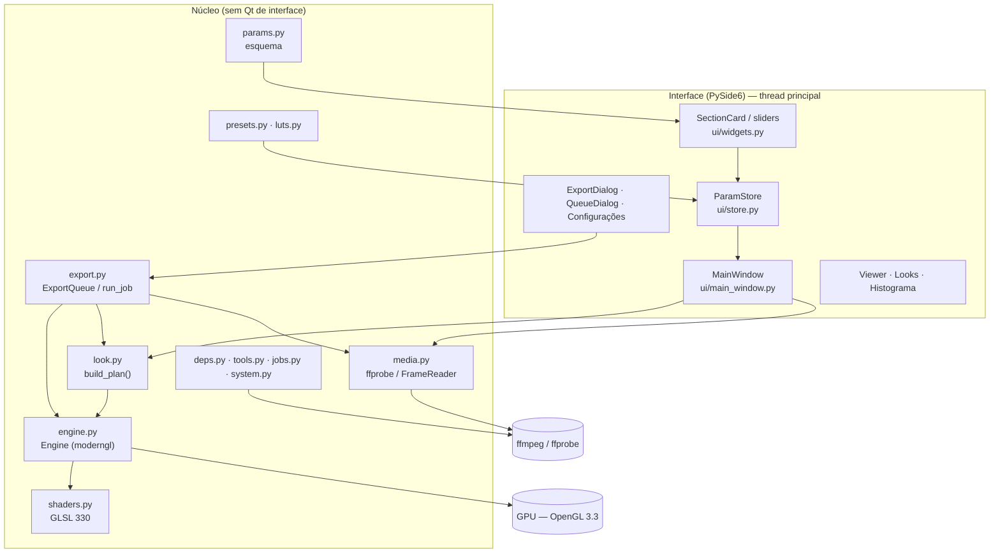
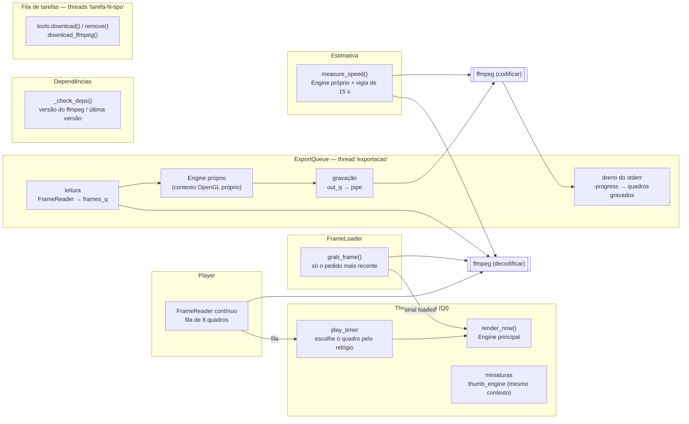
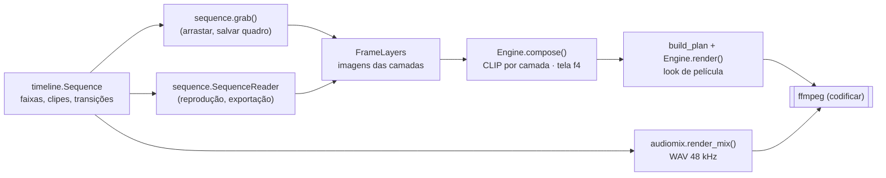
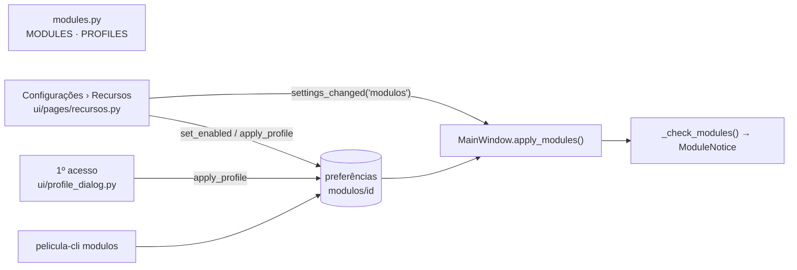
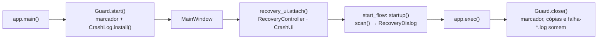

# Arquitetura do PeliculaConverter

Mergulho técnico no funcionamento interno: camadas, pipeline de GPU, gestão de cor, threads,
comunicação com o ffmpeg, exportação e persistência. Para regras de contribuição e receitas
rápidas, veja [AGENTS.md](../AGENTS.md); para o significado de cada ajuste, [EFEITOS.md](EFEITOS.md).

## Sumário

1. [Visão geral](#1-visão-geral)
2. [Mapa dos módulos](#2-mapa-dos-módulos)
3. [Dos ajustes aos uniforms](#3-dos-ajustes-aos-uniforms)
4. [Pipeline de GPU](#4-pipeline-de-gpu)
5. [Gestão de cor](#5-gestão-de-cor)
6. [Determinismo e independência de resolução](#6-determinismo-e-independência-de-resolução)
7. [Threads e processos](#7-threads-e-processos)
8. [Leitura de quadros com o ffmpeg](#8-leitura-de-quadros-com-o-ffmpeg)
9. [Exportação](#9-exportação)
10. [Dependências externas (deps.py)](#10-dependências-externas-depspy)
11. [Persistência e arquivos](#11-persistência-e-arquivos)
12. [Testes](#12-testes)
13. [Modo Edição](#13-modo-edição)
14. [Laboratório: emulação por densidade](#14-laboratório-emulação-por-densidade)
15. [Plugin do DaVinci Resolve (`resolve.py`)](#15-plugin-do-davinci-resolve-resolvepy)
16. [Módulos (recursos opcionais)](#16-módulos-recursos-opcionais)
17. [Componentes externos (`tools.py`)](#17-componentes-externos-toolspy)
18. [Fila de tarefas (`jobs.py`)](#18-fila-de-tarefas-jobspy)
19. [Notificações do sistema (`notify.py`)](#19-notificações-do-sistema-notifypy)
20. [Recuperação automática e relatórios de erro (`recovery.py`, `crashlog.py`)](#20-recuperação-automática-e-relatórios-de-erro-recoverypy-crashlogpy)
21. [Componentes de IA: receitas com o uv e o CorridorKey](#21-componentes-de-ia-receitas-com-o-uv-e-o-corridorkey)
22. [Base da 1.5: receita do quadro, formato 3, chaves, transparência e clipes sem arquivo](#22-base-da-15-receita-do-quadro-formato-3-chaves-transparência-e-clipes-sem-arquivo)
23. [Texto, legendas e transcrição](#23-texto-legendas-e-transcrição)
24. [Chaves na interface e tempo](#24-chaves-na-interface-e-tempo)
25. [Sequências de imagens, exportar com transparência, geradores e títulos](#25-sequências-de-imagens-exportar-com-transparência-geradores-e-títulos)
26. [Transições de película](#26-transições-de-película)
27. [Legendas na interface, transcrição e silêncios](#27-legendas-na-interface-transcrição-e-silêncios)
28. [Base da 1.6: formato 4](#28-base-da-16-formato-4)
29. [Entrada da câmera na 1.6](#29-entrada-da-câmera-na-16)
30. [Grão e textura na 1.6](#30-grão-e-textura-na-16)
    - [30.7 Grão físico: o modelo booleano no negativo](#307-grão-físico-o-modelo-booleano-no-negativo)
31. [Cor simples e cor por planos](#31-cor-simples-e-cor-por-planos)
33. [Câmera, formato e montagem na 1.6](#33-câmera-formato-e-montagem-na-16)

---

## 1. Visão geral



Três ideias guiam o projeto:

1. **Um único caminho de renderização.** Prévia, miniaturas, "Salvar quadro", estimativa de tempo
   e exportação chamam as mesmas funções: `look.build_plan(values, w, h, frame, fps, lut_info,
   dither)` e `Engine.render(plan, depth)`.
2. **Esquema declarativo.** `params.SECTIONS` descreve todos os ajustes (tipo, faixa, padrão,
   rótulo, dica). A interface é gerada a partir dele e o motor lê os valores pelas chaves.
3. **O núcleo não depende da interface.** `look`, `engine`, `media`, `export`, `presets`, `luts`,
   `deps`, `tools` e `jobs` funcionam sem janela (são usados assim pelos testes). A exceção é `edgetext`, que usa
   `QPainter` sobre `QImage` e precisa de uma `QGuiApplication` existente (sem ela, o texto de
   borda simplesmente não é desenhado).

## 2. Mapa dos módulos

| Módulo | Responsabilidade |
|---|---|
| `PeliculaConverter.pyw` | Abre o app sem console (`pythonw`). |
| `pelicula/__main__.py` | `python -m pelicula`. |
| `pelicula/__init__.py` | `__version__` e `APP_NAME`. |
| `pelicula/app.py` | `main()`: `QApplication`, estilo Fusion, paleta e folha de estilo, ícone; bloqueio do macOS (desativado); oferta de `pip install` se faltar `moderngl`/`numpy`/`glcontext`; sessão da recuperação e registro de erros antes da janela (`recovery_ui.Guard`); cria a `MainWindow` e liga as notificações do sistema e a recuperação; aviso de recuperação antes das boas-vindas; arquivos da linha de comando; gancho `PELICULA_SCREENSHOT`. |
| `pelicula/params.py` | `Param`, `Section`, `Schema` (esquema genérico: padrões e limpeza), `SECTIONS`/`FILM`, `PARAMS`, `defaults()`, `sanitize()`. |
| `pelicula/look.py` | Tabelas de bitolas (`GAUGES`), cópias (`PRINTS`), scan (`SCAN_FORMATS`), filtros P&B, viragens, primárias e matrizes de gamut; Laboratório (negativos, cópias, processos, calibração `lab_paths`); `build_plan()` → `Plan`. |
| `pelicula/shaders.py` | GLSL: `VERT`, `COMMON` (curvas, transferências log, look, cópia, LUT), `BASE`, `EXTRACT`, `BLUR`, `NOISE`, `FINAL`, `BAKE`. |
| `pelicula/engine.py` | `Engine`: contexto moderngl, programas, alvos de render, textura de entrada, LUT 3D, texto da borda; `render()` e `bake_lut()`; cache de LUTs por `mtime`. |
| `pelicula/frame.py` | `Recipe`: a receita única de um quadro (montagem → valores do look no quadro → `build_plan` → `render`/`render_fit`), usada por todo lugar que mostra ou grava um quadro (seção 22.1). |
| `pelicula/keyframes.py` | Chaves de animação (sem Qt): `Key`, as quatro curvas, `value_at`, limpeza e JSON (`"chaves"`), `look_values_at` (look) e `ffmpeg_expr` (volume do som); âncora nas edições em `timeline.Clip.key_off` (seção 22.3). |
| `pelicula/presets.py` | `FILM_BASE`, `BUILTIN` (44 presets), presets do usuário (JSON), importar/exportar. |
| `pelicula/luts.py` | Ler/gravar `.cube`, palpite do espaço de entrada, LUTs instalados (Premiere, Resolve, Meus LUTs), instalar LUTs. |
| `pelicula/media.py` | Localizar ffmpeg/ffprobe, `probe()` → `MediaInfo`, `NamedPipe` (Windows), `FrameReader`, `grab_frame()`, `Perf`, detecção de codificadores e hwaccels; transparência (`has_alpha`, `decodes_alpha`, leitura RGBA pré-multiplicada, seção 22.4). |
| `pelicula/export.py` | `CODECS`, qualidades prontas, `ExportSettings`, `output_size()` (resolução = lado menor, ou o quadro fixo), `build_encoder_cmd()`, `frame_pipeline()`/`preview_frame()` (a receita de `frame.py` com os ajustes da exportação), `ExportJob`, `ExportQueue`, `run_job()` (gravação segura num parcial, volume alvo, duas passadas do tamanho alvo), `measure_speed()`, `save_still()`. |
| `pelicula/platforms.py` | Exportação por plataforma: `PLATFORMS` (YouTube, Instagram, TikTok, WhatsApp, Discord…, com fonte oficial), `settings_for()` → `ExportSettings`, `limits_text()`, `warnings()`, áreas seguras (`SAFE_AREAS`). Sem Qt (seção 9.5). |
| `pelicula/fit.py` | Encaixe num quadro de outra proporção (cortar, bordas, fundo desfocado): `plan()` → `Fit`, a geometria usada pela exportação e pela prévia dela (seção 9.6). |
| `pelicula/loudnorm.py` | Volume alvo da exportação: medida (`measure`) e filtro da 2ª passada (`filter_for`) do `loudnorm` do ffmpeg (seção 9.8). |
| `pelicula/deps.py` | Versão do ffmpeg, download verificado (gyan.dev / BtbN), extração segura (`extract_archive`, `safe_member`), pasta do app, pacotes Python, `pip_install()`. |
| `pelicula/tools.py` | Componentes externos: registro `TOOLS` (versão, URL e SHA-256 fixos), `download()` com troca atômica, `remove()`, `status()`, `disk_usage()`, detecção de programas do sistema (seção 17); receitas de IA (código + ambiente Python pelo uv + modelos): `Recipe`, `build_env()`, `fetch_file()` retomável, `install_recipe()`, `run_process()` (seção 21). |
| `pelicula/fontfile.py` | Leitor de TrueType (métricas, `cmap`, contornos da `glyf`, nomes) e cópia com nome de família único para o banco de fontes do Qt (seção 23.1). |
| `pelicula/textrender.py` | Texto em RGBA igual em qualquer sistema: catálogo das fontes OFL de `data/fontes`, `TextStyle`, `layout()`, `render()` (contorno, sombra, caixa, destaque por palavra; 8/16 bits, alfa direto), `paste()` (seção 23.1). |
| `pelicula/subtitles.py` | Legendas: `Word`, `Cue`, `Subtitles` (presas ao arquivo ou da sequência), `map_cues` pela montagem, `cues_from_words`, SRT/WebVTT, estilos prontos (`STYLES`), faixa na exportação (`export_file`, `encoder_args`) e `overlay` gravado no vídeo. Sem Qt (seção 23.2). |
| `pelicula/transcribe.py` | Transcrição local pelo whisper.cpp (módulo Beta `legendas_auto`): WAV 16 kHz, linha de comando, progresso, volta para a CPU, leitura do JSON, `transcribe_file`/`transcribe_sequence`, `make_job`. Sem Qt (seção 23.3). |
| `pelicula/silences.py` | Silêncios (níveis RMS/pico por janela, limiar relativo, duração mínima, folga) e "Cortar pelo texto" (palavras escolhidas → trechos do arquivo). Sem Qt (seção 23.4). |
| `pelicula/subedit.py` | Edição das legendas no tempo da montagem, guardadas no tempo do arquivo (`items`, `Mapping`, mover, aparar, dividir, juntar, busca e troca, importar, `remove_time`, `words`). Sem Qt (seção 27.1). |
| `pelicula/subauto.py` | Legendas automáticas da montagem: trechos de cada arquivo com som (`spans_for`), vários trechos num trabalho da fila (`make_job`), junção (`apply`). Sem Qt (seção 27.5). |
| `pelicula/rangecut.py` | Tirar trechos de tempo de todas as faixas destravadas (`remove_ranges`, `to_frames`), silêncios no som mixado (`find_silences`) e cortar pelo texto (`text_ranges`). Sem Qt (seção 27.6). |
| `pelicula/corridorkey.py` | CorridorKey (módulo Beta `recorte_ia`): requisitos da placa (`nvidia-smi`, capacidade 8.0+), linha de comando e progresso do `infer.py`, `run()` num processo separado com pasta parcial, aviso de entrada (log/HDR/RAW). Sem Qt (seção 21). |
| `pelicula/data/` | Dados lidos em tempo de execução: listas travadas com hash e manifestos de código das receitas (`corridorkey/`); fontes OFL (`fontes/`, com `SOURCE.txt`). Gerados por `uv pip compile` e `tools/gerar_manifesto.py`. |
| `pelicula/jobs.py` | Fila de tarefas em segundo plano: `Job`, `JobQueue` (limite por tipo, GPU 1 por vez), `shared()` (seção 18). |
| `pelicula/notify.py` | Notificações do sistema sem Qt: tipos (`KINDS`), preferências `notificacoes/…`, `decide()` (avisar, tocar som, piscar), textos (`Notice`) e o resumo da fila (`queue_notices`) (seção 19). |
| `pelicula/recovery.py` | Recuperação depois de um travamento, sem Qt: marcador da sessão (pid + hora de início), cópias automáticas com rodízio, fila de exportação guardada, `scan()` das sessões que travaram (seção 20). |
| `pelicula/crashlog.py` | Relatórios de erro e de travamento em `<pasta do app>/logs/`: `faulthandler`, `sys.excepthook` e `threading.excepthook`, pasta de tamanho limitado (seção 20). |
| `pelicula/system.py` | Processador, núcleos, RAM, GPUs NVIDIA (`nvidia-smi`), abrir pasta/arquivo no sistema, gravação segura (`partial_path`, `replace_file`, `atomic_write`). |
| `pelicula/edgetext.py` | Máscara do texto impresso na borda da película. |
| `pelicula/testimage.py` | Cena de teste (cartela de 24 cores, janela clara, lâmpadas, faixa de matiz, rampa de cinza). |
| `pelicula/timeline.py` | Modo Edição: `Source`, `Clip`, `Track`, `Layer`, `Marker`, `Sequence` (montagem, tempo, transições, marcadores, emendas de som, JSON) e `History` (desfazer). Sem Qt. |
| `pelicula/timemap.py` | Tempo de um clipe: `TimeMap` (velocidade, rampa por âncoras, reverso; forma fechada e inversa exata; `pieces` para o som), `clean_ramp`, presets de rampa. Sem Qt (seção 24.2). |
| `pelicula/chapters.py` | Capítulos a partir dos marcadores: texto para o YouTube (com as regras dele) e arquivo FFMETADATA para a exportação (MP4, MOV, MKV). Sem Qt. |
| `pelicula/loudness.py` | Loudness ITU-R BS.1770-4 / EBU R128 em numpy: ponderação K, momentânea, curto prazo, integrada (portões), LRA, pico e true peak (`LoudnessMeter`, `measure`). Sem Qt. |
| `pelicula/editparams.py` | Esquemas dos ajustes por clipe (`VIDEO`, `AUDIO`), cores do HSL, ajustes rápidos. |
| `pelicula/compositor.py` | Ajustes do clipe → uniforms do `CLIP` (`clip_uniforms`), enquadramento (`fit_box`, `transform`), `auto_adjust`. |
| `pelicula/editshaders.py` | GLSL do modo Edição: `CLIP` (uma camada sobre a tela; com `u_tex_alpha`, textura RGBA pré-multiplicada) e `OUT` (tela → 8/16 bits inteiros). |
| `pelicula/resolve.py` | Plugin do DaVinci Resolve: gera os DCTLs (Cor, Textura, Projetor e os de cada preset), os LUTs e o `LEIA-ME`; instala na pasta de LUTs do Resolve. |
| `pelicula/modules.py` | Módulos (recursos que o usuário liga e desliga): `MODULES`, `GROUPS`, `PROFILES`, `is_enabled()`, `apply_profile()`, `current_profile()`, `used_by()`. Sem Qt (veja a seção 16). |
| `pelicula/ui/settings_dialog.py` / `ui/pages/` | Janela de Configurações: páginas numa barra lateral (`Page(dialog)` por arquivo); `pages/recursos.py` liga e desliga os módulos. |
| `pelicula/ui/profile_dialog.py` / `module_notice.py` | Perfil de recursos do primeiro acesso (`ProfileDialog`, cartões `ProfileCard`); faixa de aviso "recursos desligados em uso" (`ModuleNotice`). |
| `pelicula/ui/edit_model.py` | `TimelineModel`: a sequência da edição, seleção, histórico e as edições que a interface pede (sinal `changed`). |
| `pelicula/ui/timeline_view.py` | `TimelineEditor`: barra de ferramentas, régua, cabeçalhos das faixas, clipes, forma de onda, arrastar/aparar/lâmina/ímã, marcadores e transição de som. |
| `pelicula/ui/markers.py` | `MarkerDialog` (nome, nota, cor, capítulo) e `ChaptersDialog` (copiar os capítulos para o YouTube, com os avisos). |
| `pelicula/ui/meter.py` | `AudioMeter`: picos L/R em dBFS com retenção e as leituras M, S, I e TP ao lado da prévia (módulo `medidor_som`). |
| `pelicula/ui/edit_panels.py` | `MediaBin` (Mídia) e `ClipInspector` (ajustes do clipe gerados de `editparams`). |
| `pelicula/ui/keyframes_ui.py` | Losangos das chaves: `KeyRows` (inspetor e look), `KeyStrip` (faixas do look), desenho e junção das chaves (seção 24.1). |
| `pelicula/ui/tempo_ui.py` | Tempo do clipe na interface: `TempoPanel` (rampa, reverso), menu do clipe e "Congelar este quadro" (seções 24.2 e 24.5). |
| `pelicula/ui/scopes.py` | Medidores: histograma, forma de onda, parada RGB e vetorscópio. |
| `pelicula/ui/sequence_dialog.py` / `resolve_dialog.py` | Resolução e fps da sequência; instalação do plugin do DaVinci. |
| `pelicula/ui/corridorkey_dialog.py` | Janela não modal "Recorte por IA (CorridorKey)": arquivo, opções e o trabalho GPU na fila (seção 21). |
| `pelicula/ui/subtitles_ui.py` / `subtitle_lane.py` / `subtitles_panel.py` / `subtitle_style.py` | Legendas na janela: `SubtitleController` (seleção e edições, um passo de desfazer cada), `SubtitlesUI` (botão, menu, painel encaixável, receita com a legenda gravada), faixa Legendas da linha do tempo, painel e editor de estilo (seção 27.2). |
| `pelicula/ui/transcribe_dialog.py` / `silences_dialog.py` / `text_cut.py` | "Gerar legendas" (Beta, não modal, pela fila), "Remover silêncios" (análise na fila, lista para revisar) e a aba "Cortar pelo texto" (seções 27.5 e 27.6). |
| `pelicula/sequence.py` | Quadros da sequência: `grab` (acesso direto), `SequenceReader` (em ordem, com pré-abertura), `media_info`; geradores dos clipes sem arquivo (`RENDERERS`, `render_source`, seção 22.5). |
| `pelicula/audiomix.py` | Mixagem do som da sequência com o ffmpeg (`render_mix`), fades nas emendas e transição de som, chave da prévia (`mix_key`), forma de onda (`peaks`), som do arquivo para o medidor (`decode_wav`, `WavReader`). |
| `pelicula/ui/main_window.py` | Janela principal, carregamento de quadros, reprodução, presets, LUTs, exportação, atalhos, checagem de dependências. |
| `pelicula/ui/store.py` | `ParamStore`: valores atuais, sinal `changed`, desfazer/refazer (agrupado por 400 ms, até 300 passos). |
| `pelicula/ui/widgets.py` | `FilmSlider`, `ToggleSwitch`, linhas de parâmetro, `LutRow`, `SectionCard`, `Segmented`, `Histogram`, `Timeline`, `timecode()`. |
| `pelicula/ui/viewer.py` | Visualizador: modos de comparação, zoom livre (10%–1600%) e pan, espiar o original, modo de tela cheia (sem borda, fundo preto, dica das teclas), arrastar e soltar; área segura das plataformas por cima (`SafeAreaButton`, só na tela). |
| `pelicula/ui/looks.py` | Painel de miniaturas dos presets com busca. |
| `pelicula/ui/export_dialog.py` | Janela de exportação: plataforma (limites, avisos, prévia do resultado), qualidade, opções do arquivo, desempenho e estimativa. |
| `pelicula/ui/queue_dialog.py` | Janela da fila. |
| `pelicula/ui/settings_dialog.py` / `pages/` | Configurações em páginas; `pages/componentes.py` mostra os componentes (ffmpeg, ferramentas, programas do sistema), o espaço em disco e o sistema (placa de vídeo, bibliotecas). |
| `pelicula/ui/job_bridge.py` | `JobBridge`/`bridge()`: eventos da fila de tarefas como sinais do Qt na thread principal; `on_finished`. |
| `pelicula/ui/notifier.py` / `pages/notificacoes.py` | `Notifier` da janela (`MainWindow.notifier`) e os backends: bandeja/toast (`QSystemTrayIcon`), D-Bus (`org.freedesktop.Notifications`) e nulo (testes); página Configurações › Notificações (seção 19). |
| `pelicula/ui/recovery_ui.py` / `crash_dialog.py` / `pages/recuperacao.py` | `Guard` (sessão + registro de erros de uma execução), `RecoveryController` (cópias automáticas, fila guardada), `RecoveryDialog` (aviso depois de um travamento), `ErrorDialog` (erro inesperado) e a página Configurações › Recuperação (seção 20). |
| `pelicula/ui/theme.py` / `icons.py` | Cores, fontes, folha de estilo; ícones vetoriais e ícone do app (usa `assets/logo-*.png` quando existem). |

## 3. Dos ajustes aos uniforms

```
params.SECTIONS ──► interface (SectionCard) ──► ParamStore.values (dict)
                                                     │
                     presets.builtin_values() ───────┤  (FILM_BASE + valores do preset, sanitize)
                                                     ▼
          look.build_plan(values, largura, altura, quadro, fps, lut_info, dither)
                                                     │
                                                     ▼
   Plan(uniforms, soft_sigma, chains[hal/bloom/mist], grain_size, grain_seed, lut_path, edge_text)
                                                     │
                                                     ▼
                                   Engine.render(plan, depth=8|16)
```

`build_plan()` é uma função pura: dado o mesmo dicionário de valores, o mesmo tamanho e o mesmo
número de quadro, devolve exatamente os mesmos uniforms. Ela:

- converte px@1080 para pixels reais (`scale = altura / 1080`);
- aplica os multiplicadores da bitola (`GAUGES`) e do ISO (`(ISO/250)^0,35` na força,
  `(ISO/250)^0,18` no tamanho do grão);
- soma exposição, temperatura, tonalidade, cintilação, clarões e cor instável num ganho em EV por
  canal (`u_gain`);
- calcula o tremor (`u_shift`, `u_rot`, `u_zoom`) e os eventos de defeitos com `_hash()`/`_vnoise()`
  sobre o número do quadro e as sementes;
- monta as **cadeias de brilho** (`Chain`): halação (só luminância, limiar `0,18·2^limiar`, raio ×
  fator da bitola, máscara alfa quando há scan), bloom (colorido) e névoa (sem limiar);
- decide maciez/nitidez (`soft_sigma` = √(maciez_bitola² + (raio·maciez·2)²)·scale);
- calcula o tamanho do grão em pixels (mínimo 1 px) e a semente (`semente·7919 + quadro` se
  animado);
- converte as tabelas de cópia, filtros P&B, viragens e a cor da base do scan;
- com LUT ligado e `lut_info` válido, preenche tamanho, domínio e a matriz de gamut inversa do
  espaço que o LUT espera;
- com scan ligado, escolhe o formato (`SCAN_FORMATS`), a janela de visão em mm e o texto da borda.

## 4. Pipeline de GPU

Todos os passos desenham um quadrilátero de tela cheia (`VERT`) num *framebuffer*. Alvos usados
(criados sob demanda e reaproveitados enquanto o tamanho não muda):

| Alvo | Formato | Tamanho | Conteúdo |
|---|---|---|---|
| `input_tex` | RGB `f1` (8 bits) ou `nu2` (16 bits normalizado) | quadro | Quadro vindo do ffmpeg |
| `lin` | RGBA `f2` (half float) | quadro | Luz linear após o passo base; alfa = máscara da imagem no scan |
| `tmp`, `soft` | RGBA `f2` | quadro | Desfoque separável da maciez |
| `hi` | RGBA `f2` com mipmaps | quadro | Luzes extraídas para uma cadeia de brilho |
| `<cadeia>_a`, `<cadeia>_b` | RGBA `f2` | reduzido (`w >> nível`) | Desfoque horizontal e vertical de halação, bloom e névoa |
| `noise` | RGBA `f2` | `w / tamanho_do_grão` | Quatro canais de ruído gaussiano |
| `out8` / `out16` | RGB `f1` / `nu2` | quadro | Resultado lido de volta para a CPU |
| `bake` | RGB `f4` | `n² × n` | Grade de um LUT sendo exportado |

### 4.1 Passo base (`BASE`)

1. **Tremor**: `weave()` aplica zoom, rotação e deslocamento em pixels.
2. **Lente**: `lens()` aplica a distorção radial normalizada (o canto continua no canto) e, com
   aberração cromática, amostra R, G e B com escalas `1 + ca`, `1` e `1 − ca`.
3. **Entrada**: `toLinear(código, perfil, cv)` desfaz a curva (Rec.709 neutra, N-Log, S-Log3, LogC3,
   V-Log, Cineon, DaVinci Intermediate, Log3G10, Blackmagic Gen 5, LogC4, Apple Log, HLG, PQ) e `u_gamut`
   converte o gamut para Rec.709. Com `cv` (curva em código de 10 bits e fonte em faixa legal expandida,
   seção 5.1) o valor volta ao código da câmera antes da curva.
4. **Exposição e balanço**: `× exp2(u_gain)` por canal.
5. **Vinheta** (bitola + lente) em EV.
6. **Scan** (se ligado): converte o pixel para milímetros na tira (`u_scan_view`), calcula em qual
   quadro (`k`) ele cai, a distância com sinal ao retângulo arredondado do quadro (com rugosidade
   `fbm2`), os furos (retângulos arredondados periódicos), a densidade da base, o texto da borda
   (textura `t_text`) e a área fora da película. O vídeo é encaixado no quadro (caber/preencher) e
   os vizinhos mostram o mesmo quadro (como num scan estático). Alfa = dentro da imagem.

### 4.2 Maciez (`BLUR` × 2)

Gaussiana separável em resolução cheia com `soft_sigma`. O passo final usa `lin + (lin − soft) ×
nitidez` sobre a mistura escolhida, o que implementa ao mesmo tempo a maciez e a "recuperação de
detalhe" (máscara de nitidez).

### 4.3 Halação, bloom e névoa (`EXTRACT` + mipmaps + `BLUR`)

Para cada cadeia:

1. `EXTRACT` separa as luzes com joelho suave (`smoothstep(0,5·limiar, 1,5·limiar, L)`), limita a
   energia (`e / (1 + e/limite)`, evita que um pixel de 50× domine), multiplica pelo alfa do scan
   quando pedido e, na halação, reduz a luminância.
2. `build_mipmaps()` gera as reduções.
3. Escolhe-se o nível `n` tal que `σ / 2ⁿ ≤ 6` (até 8 níveis); o desfoque horizontal lê o mipmap
   nesse nível com `textureLod` e grava num alvo reduzido; o vertical completa. Raios de 250 px
   em 4K custam o mesmo que raios pequenos. O núcleo tem raio `3σ`, limitado a 48 amostras.

### 4.4 Ruído do grão (`NOISE`)

Uma textura com `⌈w / tamanho⌉ × ⌈h / tamanho⌉` texels recebe quatro números gaussianos
independentes por texel (Box–Muller sobre o hash PCG de `(x, y, semente)`). O passo final amostra
essa textura com **interpolação bicúbica** em duas escalas (fina e ~2,3× maior, misturadas pela
aspereza), mistura um canal comum (monocromático) com três independentes (grão colorido) e aplica a
resposta por luminância (gaussianas em L = 0,10 / 0,45 / 0,88).

### 4.5 Passo final (`FINAL`)

Em ordem:

1. `lin` → maciez/nitidez (`t_soft`).
2. Névoa: `mix(lin, névoa, 0,3·força) + névoa·0,35·força`.
3. Bloom (`+ bloom·força·0,22`), halação (`+ halo·cor·força·0,32`) e vazamento de luz (duas
   gaussianas coloridas que passeiam pelas bordas).
4. `colorPipe(lin)`:
   - **Laboratório** (se ligado): `lin` passa por `labPipe` (negativo → copiadora → cópia, seção 14)
     e volta para luz linear pela curva neutra inversa; daí em diante o resto do caminho vale igual;
   - **neutro** = curva neutra de exibição;
   - **LUT no lugar do look** → `mix(neutro, LUT(codificado no espaço do LUT), força)`;
   - senão **filmLook** (P&B com pesos do filtro → stops → saturação em log → contraste e
     deslocamento por canal → curva por canal com ombro/pé suaves → densidade → matiz de verdes,
     azuis e pele → tons de sombra/luz com pivô → viragem), misturado por *Intensidade do look*;
   - **printStage**: volta de exibição para stops (curva neutra inversa), saturação, gama e
     deslocamento por canal e curva da cópia; misturado por *Força da cópia*;
   - **envelhecimento**: dessatura 40%, levanta o preto (`×0,82 + 0,075`) e puxa para o magenta;
   - **LUT depois do look**: reencoda para o espaço que o LUT espera (Rec.709 usa o valor de
     exibição direto) e mistura.
5. Grão (no valor de exibição, como numa cópia).
6. Defeitos (`damage()`), em coordenadas px@1080: manchas, fio de cabelo (curva amostrada em 40
   segmentos), marca de troca de rolo, emenda, poeira (células de 90 px, 3×3 vizinhas, partículas
   elípticas) e riscos (até 6).
7. **Força geral**: `mix(código_original, resultado, u_mix)`.
8. **Moldura**: distância com sinal a um retângulo arredondado na proporção pedida, com borda suave
   e irregular, cor das barras (desligada quando o scan está ligado).
9. **Pontilhado**: ruído triangular de ±1 LSB em 8 bits (só quando `dither=True`).
10. `clamp(0, 1)` e gravação em `out8`/`out16`, lido com `fbo.read()`.

### 4.6 Exportar LUT (`BAKE`)

`Engine.bake_lut(values, n, legal=False)` desenha uma grade `n² × n` (R varia mais rápido, depois G, depois B —
a ordem do `.cube`) e roda só `toLinear → gamut → ganho → colorPipe`, com o projetor desligado e sem
pontilhado. O resultado vai para `luts.save_cube()` (domínio 0–1, valores limitados a 0–1). A grade está no
domínio da própria curva (`legal=False`: código de 10 bits no S-Log3/V-Log/N-Log, como os LUTs dos
fabricantes); `legal=True` é o clipe de faixa legal expandido (o gráfico *Curva* de um vídeo comum e a
referência do plugin do Resolve com *Faixa do vídeo = Vídeo*).

### 4.7 Coordenadas

Os shaders usam **coordenadas de imagem com y para baixo**: a linha 0 do array numpy (topo da
imagem) é enviada como linha 0 da textura e lida de volta como linha 0 do framebuffer. Como nada é
invertido no caminho, `v_uv.y = 0` é o topo. Toda geometria escrita à mão (tremor, scan, defeitos,
vazamento, marca de rolo no canto superior direito) segue essa convenção.

## 5. Gestão de cor

- **Espaço de trabalho**: luz linear de cena com primárias Rec.709/D65; cinza médio = 0,18.
- **Gamut**: matrizes calculadas em `look.py` a partir das primárias xy (Rec.709, Rec.2020,
  S-Gamut3.Cine, ARRI Wide Gamut 3/4, V-Gamut, DaVinci Wide Gamut, REDWideGamutRGB, Blackmagic Wide
  Gamut), todas com branco D65; enviadas como `mat3` coluna-maior (`mat3_uniform`).
- **Curvas de câmera** em GLSL: N-Log, S-Log3, LogC3 (EI 800), V-Log, Cineon (685/300 com preto
  offset), DaVinci Intermediate, Log3G10, Blackmagic Film Gen 5, LogC4, Apple Log, HLG e PQ —
  decodificação e codificação (a codificação serve para alimentar LUTs que esperam log). Os perfis da 1.6
  (Canon, Fujifilm, DJI, S-Log2, L-Log e o LogC3 de outros EI) ficam em `camDec`/`camEnc` (seção 29.3).
- **HLG e PQ** (BT.2100): HLG é a OETF inversa × `HLG_SCALE` (o cinza da BT.2408, 38% do sinal, vira
  0,18); PQ é a EOTF da ST 2084 (cd/m²) seguida da OOTF inversa do HLG a 1000 cd/m² (γ = 1,2 pela
  luminância BT.2100, como a conversão PQ → HLG da BT.2408) e da mesma escala. Acima de 1000 cd/m² não há
  corte; valores negativos (pé da faixa legal) não geram NaN. Constantes em `look.HLG_*`/`PQ_*`, repetidas
  no GLSL e no plugin (`tests/test_entrada.py` confere).
- **Curva neutra de exibição** (`D_SLOPE = 0,155` por stop, `D_MID = 0,45`, `D_P = 4`): uma
  sigmoide de *soft clip* em stops, **inversível**. Ela é usada para levar Rec.709 até a luz linear
  e de volta, então com todos os efeitos desligados o vídeo sai igual ao que entrou (a menos do
  pontilhado). `look.display_to_lin()` é a mesma inversa em Python (usada para a cor da base do
  scan).
- **Curva da película** (`curve()`): mesma família, com inclinação = `D_SLOPE × contraste`, tom
  médio, preto, branco e expoentes de ombro (`ps`) e pé (`pt`) controlados pela suavidade
  (`4 → 1,15`).
- **Saída**: valores de exibição BT.709. O codificador recebe RGB e o ffmpeg converte para YUV com
  matriz BT.709 em faixa limitada (BT.601 em faixa cheia para JPEG/WebP), gravando as tags
  `bt709` de primárias, transferência e matriz.

### 5.1 Faixa do arquivo e domínio das curvas

O `FrameReader` expande o vídeo YUV de faixa legal (`in_range=limited`): em 10 bits o shader recebe
v = (código − 64)/876, a fração de "IRE" — o mesmo valor que o DaVinci Resolve tem de um clipe em *Video
levels*. Vídeo de faixa cheia (`pc`, `yuvj`) e imagens RGB chegam como v = código/1023. Cada curva declara em
`look.INPUT_DOMAIN` em que escala o fabricante escreveu a fórmula (fontes no comentário do código):

| Domínio | Perfis | O que o shader faz |
|---|---|---|
| `"cv"`: código de 10 bits, gravado como está | S-Log3 (Sony), V-Log (Panasonic), N-Log (Nikon) | com `u_legal = 1`: CV = (v·876 + 64)/1023 antes da curva; com faixa cheia, CV = v |
| `"sinal"`: o próprio sinal E′ (quantização padrão 64 + 876·E′) | LogC3, LogC4, Blackmagic Gen 5, DaVinci Intermediate, Log3G10, Cineon, Apple Log, HLG, PQ, Rec.709, linear | usa v como está |

O fluxo da faixa:

```
arquivo ──ffprobe──► MediaInfo ──media.legal_range()──┐
montagem (Edição) ──sequence.legal_range()─────────────┤  (faixa da maioria dos clipes de vídeo)
                                                       ▼
build_plan(..., legal) → u_legal ; INPUT_DOMAIN[entrada] e log_reescalado → u_input_cv
                                                       ▼
          BASE / BAKE: toLinear(código, u_input, u_input_cv == 1 && u_legal == 1)
```

- **Quem passa a faixa**: prévia, miniaturas, gráfico *Curva* e "Salvar quadro" (`MainWindow._source_legal`),
  exportação (`export._encode`, também na estimativa) e o terminal (`quadro`, `exportar`).
- **Modo Edição**: cada clipe é decodificado com a sua faixa e a tela montada guarda esses valores; o look
  usa a faixa da maioria dos clipes de vídeo (empate: o primeiro; imagens só contam sem vídeo). Clipes log de
  faixas diferentes na mesma montagem ficam com uma faixa só, a não ser que tenham perfil de câmera próprio
  (1.6, §29.5: cada um é convertido com a faixa do próprio arquivo).
- **`log_reescalado`** (avançado, fora dos presets): gravação externa em que a câmera mandou o log já
  reescalado para 64–940 (saída HDMI *Limited*, comum na Nikon) — desliga a volta ao código.
- **LUTs**: o LUT externo (`lutEncode`) e os `.cube` exportados (`Engine.bake_lut`, padrão `legal=False`)
  usam o domínio da própria curva — o código de 10 bits nas curvas `"cv"`, a convenção dos LUTs "Full" dos
  fabricantes e das IDTs do ACES (que aplicam a fórmula direto na entrada). Assim um LUT oficial da Sony
  recebe 420/1023 no cinza, venha o arquivo em faixa legal ou cheia.
- **Plugin do Resolve**: o nó recebe o valor que o Resolve tem do clipe, sem saber a faixa do arquivo; o
  controle *Faixa do vídeo* (padrão *Vídeo* = `bake_lut(legal=True)`, *Cheia* = `legal=False`) faz o papel de
  `u_legal` (seção 15).
- **Super-brancos** (1.6): até a 1.5 a saída RGB inteira do decodificador cortava em 1,0 o que passa do código
  940 (no S-Log3, que usa códigos até ~1000, as luzes mais de ~6,7 stops acima do cinza). Agora log de câmera
  num vídeo de faixa legal é lido em ponto flutuante (`media.float_input`): v passa de 1 (e fica abaixo de 0
  no pé) e a curva recebe o código certo. Sem o zscale no ffmpeg, a leitura de antes (seção 29.1).

## 6. Determinismo e independência de resolução

- **Nada aleatório de verdade.** Em Python, `_hash(i, semente)` (hash inteiro de 32 bits) e
  `_vnoise(x, semente)` (ruído de valor suave) geram tremor, cintilação, clarões, emendas, fio de
  cabelo, manchas, cor instável e vazamento a partir de `t = quadro / fps`, do índice do quadro e
  das sementes. Em GLSL, `pcg()`/`rnd(uvec3)` geram grão, poeira, riscos e pontilhado a partir de
  coordenadas inteiras, quadro e semente.
- **Mesmo quadro, mesmo resultado.** A prévia chama `build_plan(..., self.frame_idx, info.fps)`; a
  exportação chama `build_plan(..., first_index + i, fps_saída)`. Com a mesma resolução, o
  resultado é idêntico — uma exportação FFV1 16 bits foi conferida bit a bit contra
  `Engine.render()`.
- **Troca de fps.** Quando a exportação muda os quadros por segundo, os índices passam a contar na
  nova taxa (o primeiro quadro é `round(início · fps_saída / fps_original)`) e `build_plan` recebe
  o fps de saída; os efeitos ligados ao tempo (`t`) continuam no mesmo ritmo.
- **px@1080.** Todas as distâncias do esquema são em pixels de um quadro de 1080 linhas e
  multiplicadas por `altura / 1080`; os defeitos são desenhados num sistema de coordenadas de
  1080 linhas de altura. O grão é a única textura cujo padrão exato depende da resolução (o
  tamanho estatístico é o mesmo); por isso a dica da prévia recomenda a resolução máxima para
  julgar o grão.

## 7. Threads e processos



| Thread | Onde | O que faz | Como fala com a interface |
|---|---|---|---|
| Principal (Qt) | `MainWindow` | Recebe quadros, chama `build_plan` + `Engine.render` (8 bits) para a prévia, desenha o visualizador, o histograma e as miniaturas (com `thumb_engine`, que compartilha o contexto do `engine` principal). | — |
| `FrameLoader` | `main_window.FrameLoader` | Decodifica um único quadro com `media.grab_frame()`. Se chegarem vários pedidos (arrastando a linha do tempo), só o mais recente é atendido. | Sinais `loaded` / `failed` (fila do Qt). |
| `Player` | `main_window.Player` | Um `FrameReader` contínuo a partir do quadro atual; põe `(índice, imagem)` numa fila de 8. Repete o trecho se a repetição estiver ligada. | `play_timer` (timer preciso) lê a fila e mostra o quadro certo para o tempo decorrido, descartando quadros atrasados. |
| `exportacao` | `export.ExportQueue` | Executa os trabalhos um de cada vez. O `Engine` é criado **dentro** dessa thread (contexto OpenGL próprio, atual nela). | `QTimer` de 500 ms na janela e de 250 ms na fila leem o estado do `ExportJob`. |
| leitura / gravação / dreno | `export.run_job` | Leitura: `FrameReader` → `frames_q`. GPU: laço na thread `exportacao`. Gravação: `out_q` → pipe do codificador. Dreno: lê o `stderr` do ffmpeg, interpreta `frame=` do `-progress` e guarda as mensagens de erro. As filas têm o tamanho do *buffer* escolhido (mínimo 2). | Campos do `ExportJob` (`done`, `fps_rate`, `eta`, `status`, `error`). |
| estimativa | `export_dialog._start_estimate` | `measure_speed()` cria **outro** `Engine`, exporta até 60 quadros num arquivo temporário (sem áudio), descarta os 8 primeiros (aquecimento) e para sozinho depois de 15 s (thread vigia). | `_Bridge.done` (sinal). Uma nova mudança cancela a medição anterior (`threading.Event`). |
| dependências | `MainWindow._check_deps` | Confere o ffmpeg e a última versão publicada (guardada em `deps.cached_latest_version()`). | `_DepsBridge.result`. |
| fila de tarefas | `jobs.JobQueue` (`jobs.shared()`) | Um thread por trabalho rodando: downloads e remoções de componentes (página Componentes), depois análises e IA. No máximo 1 trabalho de GPU. | `ui/job_bridge.JobBridge`: sinais `added`/`changed`/`finished` e `on_finished` na thread principal. |

Regras que decorrem disso:

- **Um contexto OpenGL por thread.** Um `Engine` só é usado na thread que o criou. A exportação e
  a estimativa criam os seus; a interface nunca toca neles.
- **Nada de Qt de interface fora da thread principal.** As threads de trabalho só trocam dados por
  sinais, filas ou campos simples.
- **Cancelamento cooperativo.** `ExportJob.cancel` (`threading.Event`) é conferido na leitura, na
  GPU e na gravação; o processo do codificador é morto e o parcial é apagado (arquivo ou pasta da
  sequência). O destino antigo nunca é tocado (veja a gravação segura em 9.2).
- **Exceção sem tratamento numa thread.** `threading.excepthook` (de `crashlog.CrashLog`) grava o
  relatório na própria thread; o aviso na tela chega à thread principal por um sinal em fila
  (`ui/crash_dialog.CrashUi`). Veja a seção 20.

## 8. Leitura de quadros com o ffmpeg

`media.probe()` roda `ffprobe -print_format json -show_streams -show_format` e monta o
`MediaInfo`: resolução (trocada em vídeos girados 90°), fps (`r_frame_rate`, imagens = 24),
quadros (`nb_frames` ou duração × fps), formato de pixel e profundidade, codec e perfil, taxa de
bits, metadados de cor, áudio e se é imagem.

`media.FrameReader` monta:

```
ffmpeg -v error -nostdin [-hwaccel X] [-threads N] [-ss (quadro−0,45)/fps]
       -i arquivo -map 0:v:0 -an -sn -dn
       -vf [fps=F,]scale=L:A:flags=…:in_color_matrix=M:in_range=R:threads=N,format=rgb24|rgb48le
       [-filter_threads N] [-frames:v K] -f rawvideo -pix_fmt rgb24|rgb48le <pipe>
```

- A busca usa `-ss` antes do `-i` meio quadro antes do alvo (rápido e preciso).
- A matriz de entrada vem dos metadados (`bt709`, `bt601`, `bt2020`, `smpte240m`; sem metadado,
  BT.709 a partir de 720 linhas); a faixa vem de `color_range`/`yuvj` (`_in_range`). `media.legal_range(info)`
  diz se o leitor expandiu a faixa legal — é o `legal` do `build_plan` (seção 5.1).
- `MediaInfo.color_transfer` (`arib-std-b67` = HLG, `smpte2084` = PQ) sugere o perfil de entrada
  (`media.detect_profile`/`auto_profile`) ao abrir um arquivo; nada no leitor muda com isso. Na 1.6,
  `media.suggest_input` (§29.6) sugere também os perfis log pelas etiquetas (`MediaInfo.tags`).
- Prévia: `bicubic+full_chroma_int`. Exportação e "Salvar quadro": `lanczos+accurate_rnd+full_chroma_int`.
- 8 bits → `rgb24`; 16 bits → `rgb48le` (textura `nu2`).
- Log de câmera num vídeo de faixa legal (`profile=` o perfil do look; `media.float_input`), em qualquer
  profundidade: `media._exact_graph` = `scale=L:A:flags=…:in_range=limited:out_range=limited,format=yuv444p16le,
  zscale=matrixin=M:rangein=limited:range=full,format=gbrpf32le` → float32 (textura `f4`) sem cortar em 0–1
  (seção 29.1). 16 bits de vídeo de faixa legal (`FrameReader.exact16`): o `rgb48le` de sempre, com a cor levada
  de 0–65280 para 0–65535 em `read` (`media._legal16`, seção 29.2).
- **Windows**: `NamedPipe` cria `\\.\pipe\pelicula_<uuid>` com buffer de 1 MiB; o ffmpeg escreve
  nele como se fosse um arquivo. A conexão espera o ffmpeg abrir o pipe e destrava sozinha se ele
  morrer antes (timeout de 60 s). Isso é bem mais rápido que `stdout` para quadros 4K.
- **Linux/macOS**: `stdout`/`stdin` comuns.
- Prioridade: no Windows por `creationflags` (abaixo/acima do normal); no Linux, `os.nice(10)`
  para *Baixa*.

Codificadores e acelerações são descobertos com `ffmpeg -encoders` e `ffmpeg -hwaccels`
(em cache; `media.reset_cache()` limpa depois de trocar o ffmpeg). NVENC, QSV e AMF aparecem na
lista mesmo sem hardware compatível, então `encoder_works()` codifica 0,1 s de teste antes de
oferecê-los.

## 9. Exportação

### 9.1 Do diálogo à fila

`ExportDialog` monta um `ExportSettings` (codec, recipiente, formato de pixel, qualidade,
velocidade, perfil, taxa de bits, resolução, fps, áudio, *tune grain*, pontilhado, as opções de
desempenho e as da exportação por plataforma) e um `ExportJob` com uma **cópia** dos valores atuais. A
janela principal guarda a pasta, a qualidade, a plataforma (`export_platform`) e o desempenho escolhidos
e põe o trabalho na `ExportQueue`.

Campos da exportação por plataforma (1.4), todos com padrão neutro: um `to_dict()` antigo, sem eles,
exporta exatamente como antes (`tests/test_export_neutral.py` compara os comandos do codificador com os
da 1.3.1 gravados em `tests/export_cmds_1_3.json`).

| Campo | Padrão | O que faz |
|---|---|---|
| `platform` | `""` | id da plataforma que preencheu as opções (só informativo) |
| `frame` | `""` | quadro fixo `"LxA"`; vazio = `resolution` e a proporção do vídeo |
| `fit` | `"cortar"` | encaixe no quadro fixo: `cortar`, `bordas`, `desfocado` |
| `target_mb` | `0` | tamanho alvo em MB (1.000.000 bytes), duas passadas no x264/x265 |
| `maxrate` | `0` | teto de taxa (Mb/s) com qualidade constante no x264/x265 |
| `loudness` | `0` | volume alvo em LUFS (negativo); 0 = o som não muda |
| `true_peak` | `-1` | pico real máximo (dBTP) com volume alvo |
| `net_grain` | `False` | "Grão para redes" |

### 9.2 `run_job()`

1. Tamanho de saída (`output_size`), fps, profundidade (`high_depth`: 16 bits se o formato tiver
   10/12/16 bits, `p010`, RGB 48 ou for ProRes/FFV1), trecho em quadros e total de quadros na taxa de
   saída. A resolução escolhida (`"2160"`, `"1080"`, `"720"`…) é o **lado menor** do quadro, como no
   YouTube e nos celulares: deitado, ela é a altura (1920 × 1080); em pé, a largura (1080 × 1920); o
   outro lado segue a proporção. Codecs de vídeo recebem dimensões pares (arredondadas para baixo);
   FFV1, GIF, imagens e sequências ficam com o tamanho exato. A janela mostra em cada opção o tamanho
   que sai (`ExportDialog._res_labels`) e o terminal aceita `--resolucao 1080` ou `1080p`.
2. **Gravação segura** (`_prepare_output` / `_commit_output` / `_discard_output`): o codificador nunca
   grava no destino. Ele recebe `system.partial_path()` — `video.parcial-pelicula.mp4`, ao lado do
   destino, com a extensão real no fim para o ffmpeg escolher exatamente o mesmo formato (mp4, mov,
   matroska, gif, image2…) sem `-f` nem tabela própria de formatos — ou, nas sequências,
   `quadros.parcial-pelicula/quadros_%06d.png`. A marca não é só `.parcial` porque essa é uma palavra
   comum (`entrevista.parcial.mp4` pode ser da pessoa). Um parcial que sobrou de uma exportação
   interrompida é apagado antes de começar; se um arquivo de **entrada** tem o nome do parcial
   (`partial_clash`), a exportação é recusada em vez de apagá-lo. Só quando tudo deu certo o resultado
   vai para o lugar do destino com `os.replace` (`system.replace_file`, que tenta de novo por até 2 s
   quando o Windows segura o arquivo): o arquivo antigo fica intacto até esse instante. Nas sequências,
   uma pasta nova troca de nome inteira; se a pasta já existe, cada quadro é movido, os quadros que
   sobram de uma exportação anterior mais longa (`nome_NNNNNN.ext` além do último) saem, e arquivos da
   pessoa na pasta nunca são apagados. Cancelado ou com erro (inclusive exceção no meio), o parcial é
   apagado. Se o destino não puder ser trocado (aberto num player), o trabalho vira `erro` e o resultado
   completo fica no parcial, com o caminho na mensagem. A janela e o terminal perguntam (ou pedem `-y`)
   antes de substituir um arquivo ou uma pasta de sequência que já tem quadros (`output_exists`).
3. Pipe nomeado de saída (Windows) e comando do codificador (`build_encoder_cmd`):
   - entrada 0: `rawvideo` RGB (8/16 bits) pelo pipe, com `-progress pipe:2`;
   - entrada 1 (se houver áudio e o formato aceitar): o arquivo original com `-ss`/`-t` do trecho,
     mapeando `1:a:0?`;
   - conversão para YUV com `scale=out_color_matrix=…:out_range=…:flags=accurate_rnd+full_chroma_int`
     (GIF usa `palettegen`/`paletteuse`);
   - argumentos do codec (CRF/CQ/QP/bitrate, preset, perfil, `-tune grain`, `-x265-params`,
     `-tag:v hvc1`, opções de NVENC/QSV/AMF, FFV1 nível 3 com GOP 1 e 16 *slices*, TIFF com
     *deflate* etc.);
   - tags de cor BT.709, `+faststart` em MP4/MOV, áudio conforme `_audio_args()`.
4. `FrameReader` em alta qualidade (`open_reader`, no tamanho do encaixe da seção 9.6). Com troca de fps,
   o leitor aplica o filtro `fps=` desde o começo e pula os quadros antes do trecho.
5. Três etapas em paralelo (leitura → GPU → gravação) com filas do tamanho do *buffer*. A GPU usa
   `FramePipeline.render()` — montagem (modo Edição), `look.build_plan()` e o encaixe — o mesmo objeto que
   `preview_frame()` usa na prévia da janela de exportação. Antes disso, com volume alvo, vem a medida do
   som (seção 9.8); com tamanho alvo, as etapas 3–7 rodam duas vezes (seção 9.7).
6. Progresso: quadros **gravados** pelo ffmpeg (`frame=` do `-progress`) ou, antes disso, quadros
   processados; velocidade e tempo restante a partir daí.
7. Fim: fecha o pipe, espera o ffmpeg, confere código de saída e erros de escrita; troca o destino
   pelo parcial e só então marca `concluido`; ou `erro` (com o final do `stderr`) ou `cancelado`, com o
   parcial apagado.

Os outros arquivos que o usuário grava seguem a mesma regra: "Salvar quadro" e `pelicula-cli quadro`
usam `export.save_still()` (ffmpeg no parcial + `replace_file`); LUTs `.cube` (`luts.save_cube`, também
no pacote do DaVinci) e presets exportados (`presets.export_file`) usam `system.atomic_write()`. Os
projetos `.plc` já eram gravados num `.tmp` e trocados com `os.replace`.

### 9.3 Qualidades prontas e codecs

`export.quality_presets(info)` devolve a lista conforme o arquivo (imagem ou vídeo) e o que o
ffmpeg instalado oferece (`available()`). *Original — mesmo formato* é derivado do arquivo:
ProRes → mesmo perfil; DNxHD → DNxHR HQ/HQX; VP9/WebM → VP9; H.265 ou >8 bits → x265 10 bits com
o mesmo croma; senão x264 com o mesmo croma.

### 9.4 Áudio

`_audio_args()` copia quando o codec do original cabe no recipiente (tabela por recipiente) e senão
converte: WebM → Opus, AVI → MP3, MOV → PCM 24 bits, demais → AAC 320. PCM em MP4 vira AAC. GIF,
imagens e sequências não têm áudio. Com volume alvo ou tamanho alvo o som nunca é copiado
(`_audio_mode`): "Copiar original" vira o formato do recipiente (AAC 128 kb/s no tamanho alvo) e a janela
avisa (`audio_reencoded_for_volume`).

### 9.5 Plataformas (`platforms.py`)

`PLATFORMS` é a tabela de alvos prontos: id ASCII que nunca muda (fica nas preferências como
`export_platform` e nos scripts com `--plataforma`), nome, grupo (`GROUPS`) e o alvo — quadro fixo ou lado
menor mantendo a orientação, fps máximo, codec/recipiente/formato de cor, CRF e teto de taxa, som, duração e
tamanho máximos, tamanho alvo, volume alvo, área segura e uma nota. Cada entrada tem a fonte oficial em
comentário ("conferido em 2026-10"); quando a plataforma não publica especificação (Kwai, status do
WhatsApp), os valores são conservadores e `official=False` (a janela diz isso).

- `settings_for(id, info, base, duration, fit_mode)` → `ExportSettings`: as opções de desempenho e o
  pontilhado vêm de `base`; o fps é o da origem dividido pelo menor inteiro que cabe no máximo (`fps_for`:
  59,94 → 29,97, 50 → 25); o encaixe é o da plataforma ou `auto_fit` (cortar quando as proporções diferem
  até 25%, senão fundo desfocado); sem quadro fixo, nunca aumenta um vídeo menor (só o YouTube 1440p/4K,
  de propósito); com tamanho alvo, a resolução é a que a taxa disponível sustenta (`resolution_for_rate`).
- `limits_text()` e `warnings()` dão o resumo e os avisos da janela e do terminal.
- A janela (`ExportDialog`) mostra a lista em grupos, preenche tudo e deixa mudar qualquer opção; escolher
  uma qualidade pronta volta para "Nenhuma". Avisos: duração acima do máximo (com "Exportar só os primeiros
  N s", que encurta o trecho do `ExportJob`), tamanho estimado acima do máximo (`estimate_bytes` com a
  medida de `measure_speed(stats=...)`), duas passadas e som recodificado. A estimativa de tempo conta as
  duas passadas.
- Terminal: `pelicula-cli plataformas [--json]` e `exportar --plataforma ID` (não combina com
  `--qualidade`), com `--quadro`, `--encaixe`, `--tamanho-alvo`, `--volume`, `--pico` e `--grao-redes`.
- Nada é enviado: a exportação só grava o arquivo. A exportação por plataforma é parte do núcleo (não é um
  módulo de `modules.MODULES`): exportar é sempre visível, e a lista só preenche opções que já existiam.

### 9.6 Encaixe no quadro (`fit.py`)

Com quadro fixo (`frame`), `output_size()` devolve esse quadro e `fit.plan()` calcula uma vez a geometria
(`Fit`) que `FramePipeline` usa:

- **cortar**: o vídeo é recortado na proporção do quadro **antes** do look — no modo Película no
  decodificador (`FrameReader(crop=...)`, em pixels do arquivo), no modo Edição numa tela montada maior, da
  qual só o centro sai (`Engine.compose(crop=...)`). Vinheta, bordas do scan, halação e grão (px@1080)
  seguem o quadro final.
- **bordas** e **desfocado**: o vídeo inteiro cabe no quadro (`box`); o look é desenhado nesse tamanho e
  `Engine.render_fit()` (programa `FIT` de `shaders.py`) o põe sobre o fundo — preto, ou a própria imagem
  com o look ampliada para cobrir o quadro, desfocada (`BLUR_PX` px@1080) e escurecida (`DIM`). Uma passada
  determinística na GPU, com y para baixo como o resto.
- Sem quadro fixo, ou com a mesma proporção (até 1 px de diferença), nada muda (`mode == ""`).

A prévia da janela de exportação chama `preview_frame()` numa thread com o próprio `Engine` (um contexto
por thread), com `scale` < 1: o mesmo plano em tamanho menor. `tests/test_fit.py` confere que o quadro da
prévia em escala 1 é igual ao quadro gravado (FFV1 16 bits) nos dois modos.

### 9.7 Tamanho alvo (duas passadas)

`target_bitrate()` desconta do tamanho alvo o som (5% acima da taxa nominal), o recipiente (48 kB + 1,5 kB
por segundo) e uma folga de 4% (`TARGET_MARGIN`), e `_encode_passes()` roda o x264/x265 com `-pass 1` e
`-pass 2` num diretório temporário (o registro `pelicula_2passadas` fica lá e é apagado no fim). A GPU
renderiza o vídeo duas vezes ("leva cerca do dobro do tempo"); `ExportJob.passes`/`pass_index` fazem o
progresso encher metade em cada passada e `stage` mostra "Passada 1 de 2" na fila e no terminal. Se a 2ª
passada ainda passar do alvo (raro), uma 3ª refaz só ela com a taxa corrigida; se não couber, o trabalho
vira `erro` com a explicação. Cancelar ou errar em qualquer passada apaga o parcial e mantém o arquivo
antigo (a gravação segura da seção 9.2 vale para todas). Taxa de vídeo abaixo de `MIN_TARGET_RATE` (0,05
Mb/s) é recusada antes de começar.

### 9.8 Volume alvo (`loudnorm.py`)

Só quando o som é recodificado. 1ª passada (`measure`): `loudnorm=I:TP:LRA:print_format=json` sobre o som
que vai para o arquivo — o trecho do original (modo Película) ou o WAV de `audiomix.render_mix` (modo
Edição); a fila mostra "Medindo o volume do som…". 2ª passada: o filtro de `filter_for()` com os valores
medidos e `linear=true` entra no comando do codificador (um ganho só; se o ganho passaria do pico, o próprio
`loudnorm` limita), saída a 48 kHz. Silêncio (abaixo de −70 LUFS) fica como está. Alvos: −14 LUFS nas
redes e no streaming, −16 no Spotify (podcast, pico −2 dBTP), −23 no festival (EBU R 128); pico real −1
dBTP. `tests/test_export_platforms_e2e.py` mede o arquivo com `ebur128` (±1 LU).

### 9.9 Grão para redes e área segura

- **Grão para redes** (`net_grain`): `look.build_plan(net_grain=...)` recebe quantos pixels da imagem
  processada valem um pixel da saída; o grão fica com pelo menos `NET_GRAIN_MIN_PX` pixels da saída, um
  pouco mais forte (`NET_GRAIN_BOOST`) e com menos cor (`NET_GRAIN_CHROMA`), para sobreviver à recompressão.
  Desligado (padrão) o plano é idêntico ao de sempre; ligado é determinístico (`tests/test_net_grain.py`).
  A prévia da janela de exportação mostra o efeito.
- **Área segura**: `platforms.SAFE_AREAS` (TikTok, Reels, Shorts — medidos no quadro 9:16 — e título/ação
  da TV, EBU R 95). O botão da barra da prévia (`viewer.SafeAreaButton`, preferência `safe_area`, desligado
  por padrão) faz o `Viewer` escurecer onde a interface do app cobre o vídeo. Só o visualizador desenha;
  nada passa pela exportação.

## 10. Dependências externas (`deps.py`)

| Item | Valor |
|---|---|
| Versão mínima recomendada | `MIN_VERSION = (7, 0)`; builds de desenvolvimento (`N-…-AAAAMMDD`) são "desatualizados" depois de 540 dias |
| Fonte Windows | `https://www.gyan.dev/ffmpeg/builds/ffmpeg-release-essentials.zip` + `.sha256`; versão atual em `…/release-version` |
| Fonte Linux | `https://github.com/BtbN/FFmpeg-Builds/releases/latest/download/ffmpeg-master-latest-linux64-gpl.tar.xz` + `checksums.sha256` |
| Plataformas | `PLATFORM_ENABLED = {"win32": True, "linux": True, "darwin": False}` |
| Pasta do app | Windows `%LOCALAPPDATA%\PeliculaConverter`; Linux `$XDG_DATA_HOME/PeliculaConverter` (padrão `~/.local/share/…`); macOS `~/Library/Application Support/…` |
| Instalação | `ffmpeg/bin/` dentro da pasta do app, com `ORIGEM.txt` (URL, fonte, SHA-256) |

`download_ffmpeg()`:

1. baixa o arquivo de hash publicado e extrai o SHA-256 esperado (no Linux, a linha do arquivo
   certo dentro de `checksums.sha256`);
2. baixa o pacote para uma pasta temporária calculando o SHA-256 em *streaming* (cancelável);
3. se o hash não conferir, para sem instalar nada;
4. extrai (zip com checagem de caminhos suspeitos; tar com `filter="data"`), localiza `ffmpeg` e
   `ffprobe`, copia para `bin.novo`, marca como executável no Linux e troca a pasta `bin` de uma
   vez (`rename`);
5. apaga a pasta temporária.

`media.configure()` procura nesta ordem: pasta escolhida pelo usuário → pasta do app
(`deps.ffmpeg_dir()`) → `PATH` → pastas comuns do sistema.

`missing_python_modules()` e `pip_install()` só valem rodando pelo código-fonte; no executável do
PyInstaller as bibliotecas já estão embutidas (`sys.frozen`).

O ffmpeg é a **exceção** do registro de componentes (seção 17): como os builds mudam o tempo todo e
os antigos saem do ar, ele não tem versão nem SHA-256 fixos no código — vale sempre o build mais
recente, conferido com o checksum publicado pelo autor do build. A interface é o cartão do ffmpeg em
Configurações › Componentes; o download roda na fila de tarefas (seção 18). `latest_version()` guarda
a versão consultada (`cached_latest_version()`), e a página mostra essa versão sem consultar a rede de
novo.

## 11. Persistência e arquivos

| O quê | Onde |
|---|---|
| Sessão e preferências | `QSettings("PeliculaConverter", "PeliculaConverter")` — registro `HKCU\Software\PeliculaConverter\PeliculaConverter` no Windows, `~/.config/PeliculaConverter/PeliculaConverter.conf` no Linux. Chaves: `session_values` (JSON dos ajustes), `session_preset`, `geometry`, `splitter`, `compare`, `preview_quality`, `advanced`, `last_dir`, `export_dir`, `export_quality`, `export_perf`, `ffmpeg_dir`, `ffmpeg_skip`. A sessão é gravada no `closeEvent` da janela. |
| Módulos | Nas mesmas preferências: `modulos/<id>` (`"1"`/`"0"`; sem valor vale o padrão), `modulos/perfil` e `modulos/mostrar_testes` (seção 16). |
| Notificações | Nas mesmas preferências: `notificacoes/<tipo>` (`"1"`/`"0"`, um por tipo de `notify.KINDS`; sem valor = ligado), `notificacoes/so_sem_foco`, `notificacoes/som` e `notificacoes/piscar` (seção 19). |
| Recuperação automática | Preferências `recuperacao/intervalo` (minutos: 1, 2, 5, 10 ou 15) e `recuperacao/versoes` (1–20). Arquivos em `<pasta do app>/recuperacao/` (`deps.app_data_dir()`): marcadores das sessões, cópias automáticas e fila guardada — nunca no `.plc` (seção 20). |
| Relatórios de erro | `<pasta do app>/logs/`: `falha-<sessão>.log` (`faulthandler`) e `erro-<data>-<sessão>.txt`; no máximo 20 arquivos de até 256 KB (seção 20). |
| Presets do usuário | `presets.user_dir()` = `$APPDATA/PeliculaConverter/presets` (sem `APPDATA`, a pasta pessoal) — um `.json` por preset, nome derivado do título. |
| Meus LUTs | `luts.user_dir()` = `$APPDATA/PeliculaConverter/luts`. |
| ffmpeg baixado | `deps.ffmpeg_dir()` (veja a seção 10). |
| Ferramentas baixadas | `tools.tools_dir()` = `<pasta do app>/ferramentas/<id>/<versão>/`, cada versão com `pelicula-origem.json` (URL, SHA-256, data). Pastas `.novo-*` (instalação em andamento) e `.removendo-*` (remoção) são temporárias. |
| Temporários | `pelicula_seta.png` (seta das listas), `pelicula_cena_de_teste.png` (cena de teste), `pelicula_medida_*` (estimativa, apagada no fim), `pelicula_ffmpeg_*` (download, apagada no fim). |
| Parciais | `nome.parcial-pelicula.ext` (e a pasta `nome.parcial-pelicula/` das sequências) ao lado do destino enquanto uma exportação, um quadro, um LUT ou um preset é gravado; trocam de nome no fim. Um que sobrou de uma exportação interrompida é apagado na próxima com o mesmo destino. |

Formato do preset: `{"nome", "desc", "app": "PeliculaConverter", "versao": 1, "valores": {…}}`.
`params.sanitize()` completa as chaves que faltam com o padrão, descarta chaves desconhecidas,
limita números à faixa e recusa escolhas inválidas — presets antigos continuam abrindo quando
parâmetros novos surgem.

## 12. Testes

A suíte fica em `tests/` (configuração em `pytest.ini`, que já põe a raiz no `sys.path`):

- `@pytest.mark.gpu` usa a fixture `gl_engine` e é pulado sem OpenGL 3.3 (CI, máquinas virtuais);
- `@pytest.mark.ffmpeg` usa `ffmpeg_ok` e é pulado sem ffmpeg/ffprobe;
- `APPDATA` é redirecionado para uma pasta temporária em todos os testes, então presets e LUTs do
  usuário nunca são tocados;
- os testes de componentes (`test_tools.py`, `componentes_ui_cases.py`) redirecionam também
  `LOCALAPPDATA`/`XDG_DATA_HOME` (a pasta do app, onde ficam o ffmpeg e as ferramentas baixadas) e não
  usam a rede: pacotes locais, `file://` e um servidor HTTP em 127.0.0.1;
- os testes da recuperação e das notificações (`test_recovery*.py`, `test_crashlog.py`,
  `recovery_ui_cases.py`, `notify_ui_cases.py`) também redirecionam a pasta do app e nunca mostram uma
  notificação de verdade: a `MainWindow` nasce com o backend nulo e os casos usam backends falsos (até um
  servidor D-Bus de mentira); os travamentos são de verdade, em subprocessos (`os._exit`,
  `faulthandler._sigsegv`).

```bash
.venv\Scripts\python -m pytest -q      # Windows
.venv/bin/python -m pytest -q          # Linux
QT_QPA_PLATFORM=offscreen python -m pytest -q   # sem tela (como no CI)
```

## 13. Modo Edição

O modo Edição monta uma **sequência** (faixas de vídeo e de som com clipes) que vira a entrada do look
de película. A regra do caminho único continua: tudo que muda a imagem de um clipe vive em
`compositor.clip_uniforms()` + `editshaders.CLIP` / `Engine.compose()`; tudo que muda o tempo vive em
`timeline.Sequence` (`src_frame`, `layers_at`); tudo que muda o som vive em `audiomix.py`. Prévia, "Salvar
quadro", terminal e exportação chamam as mesmas funções.



### 13.1 Modelo (`timeline.py`)

- **Tempo da sequência** em quadros inteiros no fps da sequência; **tempo do arquivo** em segundos
  (`Clip.src_in`), para misturar fps diferentes e arquivos só de som.
- `Sequence.src_frame(clip, t)` = `floor((src_in + (t − start)/fps · velocidade) · fps_do_arquivo + 1e-6)`,
  limitado ao arquivo; imagens e "congelar quadro" usam sempre o mesmo quadro. É a única regra de
  mapeamento: o leitor em ordem e a busca direta dão o mesmo quadro.
- Faixa 0 = V1/A1, a de baixo. Vídeo e som do mesmo arquivo nascem **ligados** (`Clip.link`): mover,
  aparar, dividir, mudar a velocidade e apagar valem para o grupo, com o deslocamento limitado pelo membro
  mais restrito (o grupo nunca sai de sincronia). Faixas travadas não mudam (arrastar um clipe travado
  não mexe em nada).
- Colocar um clipe sobre outro **sobrescreve** (`_clear_range`: apaga, encurta ou divide o que estava
  embaixo). `delete(ripple=True)` fecha o espaço; `close_gaps()` junta os clipes de uma faixa. Inserir,
  Q/W, cortes J/L e a faixa principal magnética: seção 13.8.
- Velocidade: `set_speed()` mantém o trecho do arquivo e muda a duração (sem invadir o clipe seguinte).
- `layers_at(t)` resolve as transições: surgir/sumir no preto ou branco (`Layer.fade`), "dissolver"
  (o clipe anterior da mesma faixa continua por baixo, além do fim — `Layer.extension`) e "sumir
  mostrando a faixa de baixo" (`Layer.alpha`).
- `is_trivial()`: a sequência é só "o arquivo inteiro, sem ajustes" → o modo Película lê o arquivo
  direto (exatamente o caminho de antes do modo Edição).
- **Marcadores** (`Marker`: `id`, `frame`, `color` de uma paleta fixa `MARKER_COLORS` com chaves ASCII,
  `name`, `note`, `chapter`) ficam no tempo da sequência, não nos clipes. No JSON, a lista opcional
  `"marcadores"` (`{id, quadro, cor, nome, nota, capitulo}`), só quando há algum: o formato não muda e as
  versões antigas ignoram a chave. Mover, aparar e dividir clipes não mexe neles; `delete(ripple=True)` da
  sequência inteira (todas as faixas) puxa os que vêm depois do trecho apagado e leva os de dentro para o
  ponto do corte; mudar o fps (`TimelineModel.set_settings`) mantém o tempo deles. Ser capítulo é uma
  escolha explícita (desligada por padrão); capítulo sem nome vira "Capítulo N".
- **Emendas de som**: `micro_fade` (JSON `"micro_fades": true`, só quando ligado; ausente = desligado,
  então projeto antigo soa igual) liga os fades curtos; sequências novas (`for_source`, projeto novo,
  janela recém-aberta) nascem com ele ligado. `continues(a, b)` diz se `b` continua `a` sem emenda
  (mesma faixa, colados, mesmo arquivo do ponto exato, mesma velocidade). A transição de som fica no clipe
  que entra (`values["transicao"]`, 0–5 s, padrão 0; `_cut` zera a da parte da direita) e
  `audio_crossfade(clip)` devolve `(anterior, antes, depois)`: centrada no corte, usando o arquivo além do
  ponto de saída do anterior e antes do ponto de entrada deste; sem sobra de um lado o outro fica com o
  resto, sem sobra nenhuma ela encolhe até zero, e cada lado usa no máximo metade do clipe.
- `History`: desfazer/refazer por instantâneos JSON (até 200).

### 13.2 Decodificação (`sequence.py`)

- `decode_size()`: cada clipe é decodificado no tamanho da sua caixa na tela (encaixe × escala, sem passar
  da resolução do arquivo). Na prévia a tela é menor (`canvas_size(seq, altura)`), então a decodificação
  também é.
- `grab()` usa `media.grab_frame()` com um cache LRU de 16 imagens (arrastar a linha do tempo).
- `SequenceReader` mantém um `FrameReader` por clipe ativo, anda só para a frente (lê e descarta até o
  quadro pedido; reabre se o salto passar de 2 s), repete o último quadro em câmera lenta e **abre antes**
  (thread `seq-prefetch`) os leitores dos clipes que começam no próximo 1,5 s, para os cortes não
  engasgarem. Com `fps_out`, o quadro i da saída é `start + floor(i · fps_seq / fps_out)`.
- O leitor devolve só imagens (`FrameLayers`); a montagem é feita na thread da GPU.
- `media.probe_source()` abre vídeos, imagens e arquivos só de som (`media.AUDIO_EXT`).
- Fontes com transparência (`Source.has_alpha`) leem RGBA pré-multiplicado (4 canais); as outras, RGB como
  sempre (seção 22.4).

### 13.3 Montagem na GPU (`compositor.py`, `editshaders.py`, `Engine.compose`)

| Passo | Como |
|---|---|
| Tela | Dois alvos RGBA f4 (`canvas_a`/`canvas_b`) alternados; começa com a cor de fundo da sequência. |
| Camada | `CLIP` lê o clipe (`t_clip`) e a tela anterior (`t_dst`), aplica detalhe → cor → vinheta/desbotar → fade e mistura (normal, tela, multiplicar, sobrepor, adicionar, clarear, escurecer) com a opacidade (vezes o alfa do clipe, se ele tem transparência: seção 22.4). |
| Enquadramento | `u_xf` (mat3) leva o pixel da tela ao uv do clipe: caixa do encaixe, escala, rotação (positivo = horário), posição (fração da tela, y para baixo) e espelhos. A borda do corte tem antisserrilhado analítico (distância em px). |
| Exatidão | Clipe neutro com o tamanho da tela usa `texelFetch` (`u_exact`) e a saída `OUT` arredonda para inteiros (`u1`/`u2`): o resultado é **bit a bit** o arquivo, em 8 e 16 bits. |
| Cor | Exposição e balanço de branco em luz (código^2,2); tons por canal (pontos preto/branco, realces/sombras, curva de 4 faixas, brilho, contraste em S); levantar/gama/ganho das rodas; saturação, vibração, matiz e HSL de 8 faixas. |
| Rodas | Ponto [x, y] no disco: matiz = `atan2(y, x)` em graus como no HSV (0° vermelho em +x, sentido anti-horário com y para cima: 60° amarelo, 120° verde, 180° ciano, 240° azul, 300° magenta); força = distância (≤ 1). O desvio de cor não muda a luminância. |
| Detalhe | Bilateral 5×5, desfoque por mipmap (12 amostras), nitidez (máscara de nitidez) e clareza (mipmap bem desfocado); passos proporcionais à altura do clipe. |

`neutral=True` mantém enquadramento, opacidade e transições mas desliga cor e detalhe: é a imagem
"original" da comparação no modo Edição. `auto_adjust()` (numpy) calcula exposição, balanço de branco e
níveis com a mesma matemática do shader; `editparams.apply_quick_look()` aplica um ajuste rápido.

### 13.4 Som (`audiomix.py`)

Um WAV de 48 kHz estéreo em 24 bits por trecho. Cada clipe de som vira uma entrada (`-ss`/`-t` no trecho
usado do arquivo) com a cadeia: `aresample` → `atempo` (encadeado fora de 0,5–2) → volume do clipe +
da faixa → realce de voz (`highpass` + `acompressor`) → `bass`/`equalizer`/`treble` → `afftdn` →
`loudnorm` → balanço (`pan`) → `afade` de entrada e saída (no tempo do clipe) → `atrim` no trecho →
`adelay` até a posição. Tudo é somado com `amix=normalize=0` sobre um `anullsrc` com a duração exata do
trecho. Grafos longos vão por `-filter_complex_script`. A prévia guarda o WAV da sequência inteira e só
o refaz quando `mix_key()` muda. `peaks()` decodifica o som em mono numa taxa baixa para desenhar a forma
de onda (com cache por arquivo).

**Emendas** (`segments()` calcula; `_chain()` monta os filtros):

- *Fade curto* (`Sequence.micro_fade`): `afade` linear de `timeline.MICRO_FADE` = 5 ms nas bordas que
  cortam o arquivo no meio — começo com `src_in > 0`, fim antes do fim do arquivo (`dur < max_dur`).
  Fica de fora onde o fade do clipe já é ≥ 5 ms, onde há transição de som e num corte não mexido
  (`continues`, com o vizinho tocando). 5 ms some com o degrau que estala (passa de um quarto de ciclo
  até em 50 Hz) e fica abaixo do que o ouvido percebe como fade. As pontas naturais do arquivo não
  ganham fade: a sequência "arquivo inteiro" soa igual ao arquivo.
- *Transição de som*: com `(antes, depois)` de `audio_crossfade`, o clipe que entra começa `antes`
  segundos mais cedo (`-ss` recuado) e o que sai termina `depois` segundos mais tarde (`-t` maior); os
  dois cruzam `afade … curve=qsin` (entra com sen, sai com cos) na mesma janela, e sen² + cos² = 1 mantém a
  potência constante. Nessa borda o fade do clipe é ignorado (ele silenciaria a sobra); o menu zera os
  dois ao criar a transição. Exportar um trecho recorta a parte além do corte como o resto.
- **Neutralidade**: sem `micro_fades` e com `transicao` = 0, `build_graph()` gera exatamente o grafo
  de antes (`tests/test_audio_fades.py` compara com o da 1.3).

### 13.5 Exportação e projetos

- `ExportJob.sequence`: `run_job()` mixa o som do trecho num WAV temporário (cancelável), passa-o como
  entrada de áudio **sem** `-ss` (`build_encoder_cmd(audio_path=…)`), lê com `SequenceReader` e chama
  `engine.compose()` antes de `build_plan`/`render`. O número do quadro do look é o quadro da sequência,
  como na prévia — a exportação FFV1 16 bits de uma edição é conferida bit a bit (`tests/test_sequence.py`).
- `sequence.media_info(seq)`: `MediaInfo` virtual (tamanho, fps, duração, som, formato do 1º vídeo) usado
  pela janela de exportação, pela estimativa (`measure_speed(..., sequence=seq)`) e pelo terminal. Como a
  resolução da exportação vale para o lado menor, uma sequência vertical (1080 × 1920) continua vertical
  nas qualidades prontas (*Redes sociais 1080p* → 1080 × 1920, *Leve 720p* → 720 × 1280). A faixa
  da tela para o look vem de `sequence.legal_range(seq)` (a dos clipes de vídeo), nunca desse `MediaInfo`.
- Plataformas (seção 9.5): com quadro fixo, "cortar" monta a tela num tamanho que cobre o quadro e só o
  centro sai (`Engine.compose(crop=...)`), antes do look; "bordas" e "desfocado" montam a tela no tamanho
  encaixado e passam por `Engine.render_fit()`. O volume alvo mede o WAV da mixagem.
- **Capítulos**: com marcadores de capítulo e recipiente MP4/MOV/MKV, a janela de exportação mostra
  *Incluir capítulos* (ligado). `ExportJob.chapters` leva `[(quadro, título)]`; `run_job()` grava o
  FFMETADATA do trecho (`chapters.export_file`: tempos a partir da entrada, `TIMEBASE=1/1000`, o capítulo
  que já valia no começo do trecho passa a começar em 0) e o apaga no fim; `build_encoder_cmd(...,
  chapters_path=…)` põe `-f ffmetadata -i <arquivo>` antes do primeiro `-map` e `-map_chapters <n>` no fim.
- `.plc`: a sequência vai em `"edicao"` (cada fonte com caminho absoluto e `"relativo"`, reencontrada
  como a mídia principal) e o modo em `"modo"`. O formato gravado é o menor que o projeto precisa: `1` sem
  sequência, `2` com sequência, `3` com algum recurso da 1.5 (seção 22.2).
- Terminal: `exportar`/`quadro` de um `.plc` com edição renderizam a montagem (`cli.project_sequence`); o
  comando `resolve` (`davinci`) instala ou grava o plugin do DaVinci Resolve.

### 13.6 Na janela (`ui/main_window.py`)

- Seletor **Película | Edição** no topo (`set_mode`). Na Edição aparecem a Mídia (esquerda), a linha do
  tempo (embaixo da prévia) e o inspetor com medidores (direita); a barra da prévia ganha *Com
  película*, *Sequência* e desfazer/refazer da edição.
- `_refresh_source()` escolhe a fonte da prévia: na Edição, sempre a sequência; na Película, a
  sequência só quando ela não é trivial (senão o arquivo, pelo caminho antigo). A prévia trabalha com
  uma **cópia** da sequência (`src_seq`), entregue às threads de leitura; `TimelineModel.changed`
  com `"values"` só remonta o quadro atual na GPU (as camadas já decodificadas recebem os ajustes
  atuais), o resto recarrega a fonte.
- O `FrameLoader` e o `Player` aceitam arquivo ou sequência (`sequence.grab` / `SequenceReader`);
  a montagem (`Engine.compose`) acontece na thread principal, com o mesmo contexto da prévia.
- Som da prévia da sequência: `audiomix.render_mix` num WAV temporário em segundo plano (troca de nome
  a cada versão, porque o player segura o arquivo aberto), refeito quando `mix_key()` muda.
- O que a prévia mostra é o que sai: no modo Edição sem *Com película*, exportar e salvar quadro
  saem só com a montagem (look "Original").
- Marcadores: `M` põe um no cursor no modo Edição (no Película o `M` continua sendo o som; `Shift+M` é o
  som nos dois modos), `Shift+↑/↓` pulam entre eles nos dois modos e a barra de tempo do Película mostra os
  da montagem (`_sync_film_markers`). Mudança só de marcadores emite `changed("markers")`, que não
  recarrega a prévia nem o som (inclusive ao desfazer).

### 13.7 Medidor de som (`loudness.py`, `ui/meter.py`)

- `loudness.LoudnessMeter` recebe blocos (`add`) e mede a qualquer momento: ponderação K com os
  coeficientes de 48 kHz da norma (outras taxas pelo protótipo analógico + transformação bilinear),
  aplicada como FIR por FFT com estado entre blocos; sub-blocos de 100 ms; momentânea (400 ms), curto prazo
  (3 s), integrada com os portões de −70 LUFS e −10 LU, LRA (EBU Tech 3342), pico de amostra e true peak
  (sobreamostragem 4× abaixo de 96 kHz, BS.1770 anexo 2). Conferido com casos da EBU Tech 3341 e com o
  `ebur128` do ffmpeg (`tests/test_loudness.py`).
- Na janela, o `AudioMeter` fica à direita da prévia e lê **o mesmo som que toca**: no modo Edição (ou
  montagem no Película) o WAV da mixagem da prévia (`_mix_path`, amostra = tempo × 48000); com o arquivo
  aberto no Película, o som do arquivo decodificado uma vez (`audiomix.decode_wav`, thread `medidor-som`,
  prioridade baixa) num `pelicula_medidor_<pid>_<n>.wav` temporário, reaproveitado enquanto o arquivo
  (caminho + data) é o mesmo e apagado ao trocar de arquivo, desligar o módulo ou fechar a janela.
- Um `QTimer` de 40 ms (só tocando e com o módulo ligado) lê com `WavReader` o trecho entre a última
  leitura e o relógio da prévia (`_play_f0/fps + perf_counter() − _play_t0`, o mesmo que escolhe o quadro)
  e empurra picos e medidas. A medição recomeça no play, ao pular, na volta do loop, num salto de mais de
  5 s e no clique no medidor; parado, as barras descem e as leituras ficam apagadas.
- Nada do medidor vai para a exportação; com o módulo desligado não há decodificação nem timer.

### 13.8 Ferramentas de corte (`timeline.py`, `ui/edit_model.py`, `ui/timeline_view.py`)

Tudo é feito com as primitivas que já existiam (`_cut`, `split`, `trim_start`/`trim_end`, `move`, `delete`,
`_clear_range`) e passa pelo `TimelineModel` (um instantâneo no histórico por operação; faixas travadas
nunca mudam). A composição dos quadros e a mixagem não mudam: só a posição e a duração dos clipes.

- **Inserir** (`Sequence.open_space(t, d, targets, exclude, all_tracks, split)`): nas faixas-alvo o clipe que
  atravessa `t` é dividido (`split`, com os ligados); tudo o que começa em `t` ou depois anda `d`, junto com
  os ligados — em **todas as faixas destravadas** (`all_tracks`, padrão: como o *insert* do Premiere/Resolve
  com todas as faixas sincronizadas, para nada sair de sincronia) ou só nas faixas-alvo (usado pela faixa
  magnética, que acerta o resto depois). O que atravessa `t` em outra faixa fica inteiro (uma música de
  fundo não é cortada). Marcadores a partir de `t` andam, a não ser que um clipe travado tenha ficado depois
  do ponto (o tempo dele não andou). `insert_media(insert=True)` abre o espaço com a duração do arquivo antes
  de pôr os clipes; `move_insert()` abre o espaço no destino (sem contar o próprio grupo) e chama `move()` —
  o lugar de origem fica vazio. Sobrescrever continua o padrão e não mudou.
- **Q / W** (`ripple_trim_start` / `ripple_trim_end`, alvo por `trim_target`): apara o grupo com
  `trim_start`/`trim_end` e fecha o espaço com `_pull`: nas faixas do grupo, o que começa a partir do novo
  começo (Q) ou do fim antigo (W) anda para a esquerda; nas outras faixas (e nos marcadores) só se o trecho
  tirado ficou livre em todas elas — a mesma regra de `delete(ripple=True)`. O alvo é o clipe sob o cursor
  na faixa do clipe selecionado; senão, na faixa destravada mais de cima (V mais alta → V1 → A1 → …).
- **Cortes J/L**: `trim_start_only`/`trim_end_only` aparam um membro do grupo sem os ligados (zeram o
  `link` só durante a chamada). `cut_pair(clip, left)` acha o corte entre dois pares imagem + som ligados
  (um de cada tipo, colados na mesma faixa de vídeo e na mesma de som) e `split_edit(cid, left, offset)`
  **rola** o corte do som para `offset` quadros do corte da imagem (negativo = J, positivo = L, 0 =
  alinhado), limitado pelo arquivo além do corte (`_head_room` / `max_dur`) e por 1 quadro de cada som. O
  menu do corte usa `timeline.SPLIT_EDIT_S` = 1 s.
- **Pares com entrada/saída diferentes** continuam um grupo ligado comum: `move` e `delete` já valem para o
  grupo; `split(t)` passa o membro que não foi dividido e fica inteiro depois de `t` para o link da parte
  da direita (dividir no som que entra antes não separa a imagem do som dela); `set_speed` de um grupo com
  começos/durações diferentes (`_set_speed_offset`) mantém a imagem no lugar e muda as diferenças na
  proporção (a sincronia `start − src_in·fps/velocidade` fica igual para todos) e encolhe o fim de todos
  juntos se o arquivo acabar ou se encostar no clipe seguinte.
- **Faixa principal magnética** (`Sequence.magnetic`, JSON `"faixa_magnetica": true` só quando ligada;
  ausente = desligada, também em sequências novas — projeto antigo abre e salva igual). Vale com a V1
  destravada (`magnet_active`). Toda edição estrutural do modelo roda dentro de `with seq.keep_main():`,
  que guarda um retrato (`_snapshot`) e no fim chama `settle_main(snap)`:
  1. a V1 fica de ponta a ponta a partir do quadro 0, na ordem; os ligados a ela andam o mesmo que o
     primeiro clipe da V1 do grupo (e cobrem como um `move`);
  2. cada clipe das outras faixas (com os ligados, uma "unidade") que a edição **não mexeu** acompanha a
     imagem da V1 que estava sob o começo dele: `_main_warp(p)` procura onde foi parar o mesmo instante do
     mesmo arquivo (no mesmo clipe ou numa parte nova — divisão, inserção — da V1); imagem que sumiu leva
     ao ponto do corte; um buraco antigo da V1 também; depois do fim da V1, a distância até o fim fica;
     imagem parada e quadro congelado acompanham o próprio clipe;
  3. o que a edição mexeu (arrastou, aparou, acabou de entrar) fica onde ela deixou e é posto primeiro;
     ninguém cobre ninguém (`_fit_shift` empurra para a direita até caber);
  4. marcadores não mexidos pela edição seguem a mesma função.

  Alongar um clipe da V1 não cobre o vizinho: `room_for_end`/`room_for_start`/`room_for_speed` abrem o
  espaço antes (`open_space(..., all_tracks=False, split=False)`); `delete(ripple=True)` de um clipe da V1
  vira um delete comum (a V1 se fecha sozinha). Ligar a opção (`set_settings(magnetic=True)`), remover uma
  faixa ou mudar o fps chamam `settle_main()` sem retrato (a montagem atual é a referência). Escolhemos
  "acompanhar a imagem" (como as conexões do Final Cut) em vez de "andar o mesmo que o clipe da V1 logo
  abaixo" porque continua certo em dividir, inserir, aparar e mudar a velocidade, sem guardar conexões no
  projeto.
- **Na linha do tempo**: `TimelineCanvas.insert_mode` (botão *Inserir*, ícone `insert_mode`) e
  `insert_for(mods)` — **Ctrl** inverte ao soltar um arquivo (`filesInserted` em vez de `filesDropped`) ou
  ao terminar de mover; **Alt** durante o arraste (ou ao soltar) de uma borda chama `trim_start/trim_end(...,
  solo=True)` e o fantasma mostra só o clipe. O menu do corte tem *Corte J*, *Corte L* e *Alinhar*
  (`split_edit_actions`). A Mídia emite `placeRequested(caminhos, inserir)` (menu e teclas `,`/`.`); a
  janela põe no cursor, na V1/A1, e leva o cursor ao fim do que entrou.
- **J/K/L** (`MainWindow.shuttle`, `_set_shuttle`, `_reverse_tick`, `_shuttle_halt`): para a frente, o
  `Player` de sempre com `_play_rate` (1, 2, 4, 8) multiplicando o relógio de `_play_tick` (que já pula
  quadros atrasados). Para trás não há leitor em ordem: um `QTimer` de 40 ms calcula o quadro do relógio
  andando para trás e pede ao `FrameLoader`, que só decodifica o pedido mais recente — a interface não trava
  e o quadro mostrado é exato (pode pular quadros se a busca for lenta). Entrada/saída e *Repetir* valem
  nos dois sentidos. Som e medidor só a 1× para a frente (`start_play` não toca o som fora disso). K
  segurado (`keyReleaseEvent`; `changeEvent` solta ao perder o foco) faz J/L andarem um quadro. O L do
  *Repetir* foi para o **Ctrl+L** (`QShortcut`).

## 14. Laboratório: emulação por densidade

Uma alternativa física à curva paramétrica do look, toda dentro de `colorPipe` (entra no LUT exportado
e no plugin do Resolve). Tabelas e calibração em `look.py`; GLSL em `shaders.COMMON` (`labSoftplus`,
`labCurve`, `labPath`, `labPipe`).

1. **Negativo**: `e = sens · lin` (sensibilidade das camadas, linhas somam 1) → `le = log10(e / 0,18)`
   → densidade `dn = ii · curva(le)`; a curva característica é um *softplus duplo*
   `g·w·(sp((x−pé)/w) − sp((x−ombro)/w))` (pé, trecho reto com gama `g`, ombro) e `ii` é a diafonia
   entre camadas (efeitos de interimagem) no espaço de densidade. A revelação forçada multiplica a gama
   (`1 + 0,12·push`) e sobe o pé (`+0,08·push`).
2. **Copiadora**: a exposição da cópia é `off − dn`, onde `off` = calibração + luzes da copiadora
   (`0,025 log E` por ponto, 12 pontos = 1 stop).
3. **Cópia**: `dl = curva_da_cópia(off − dn)`; densidade final `d = dye · dl + (key · dl)` (diafonia dos
   corantes e, no Technicolor, a chave preta; na retenção de prata, a prata somada às três cores).
   Exibição: `10^(−d / 2,6)`.
4. **Sem cópia** (negativo escaneado): inversão digital `(dn − meio) / (g · 0,30103)` em stops e a curva
   neutra de exibição.
5. **Processos**: o caminho A é o negativo + cópia escolhidos; Technicolor 3 tiras / 2 cores usam um
   caminho B (registros P&B, corantes puros, chave) misturado por *Força do processo*.

A **calibração** (`look.lab_paths`, com `lru_cache`) acha por Newton/mínimos quadrados o `off` que leva
o cinza 18% ao código 0,45 em todos os canais, para toda combinação negativo × cópia × processo × push ×
diafonia × chave (no Technicolor 2 cores, só duas camadas de corante: sobra um tom mínimo, < 0,006).
`look.lab_eval()` é a referência em numpy usada nos testes. Com `lab_on` desligado o plano só leva
`u_lab_on = 0` e a imagem não muda.

## 15. Plugin do DaVinci Resolve (`resolve.py`)

`build_package(pasta)` grava `PeliculaConverter/` com:

| Arquivo | Conteúdo |
|---|---|
| `PeliculaConverter Cor.dctl` | Perfil de entrada, exposição/balanço, Laboratório, look de película, pele, cópia, envelhecimento, força geral. Só cor (funciona também como LUT). |
| `PeliculaConverter Textura.dctl` | Grão animado (`TIMELINE_FRAME_INDEX`), halação, bloom, névoa, maciez, nitidez, aberração, distorção, vinheta. |
| `PeliculaConverter Projetor.dctl` | Tremor, cintilação, clarões, cor instável, emendas, vazamento, poeira, riscos, fio de cabelo, manchas, marcas de rolo, moldura. |
| `Presets/` | Os DCTLs de cada preset (Cor, Textura e, se o preset usa, Projetor) com os valores do preset como padrão. |
| `LUTs/` | Um `.cube` por preset (assado com `Engine.bake_lut` numa thread com contexto próprio) — Resolve gratuito, Premiere etc. |
| `LEIA-ME.txt`, `VERSAO.txt` | Guia (PT-BR e EN) e marcador de versão para a instalação. |

- **Um código, dois dialetos**: `source(kind, dialect)` gera o mesmo kernel em DCTL (para o Resolve) ou
  em GLSL (para os testes, com os controles como uniforms). `tests/test_resolve.py` roda o dialeto GLSL
  com o moderngl e compara com o app: a cor bate com `Engine.bake_lut` (≤ 8e-7 nos 44 presets e em todos os controles novos, < 1,3e-4
  na varredura das 180 combinações do Laboratório); textura e projetor ficam a 1/255 de
  `Engine.render`, exceto halação/bloom/névoa (aproximação de passo único por amostragem esparsa).
- **Faixa do vídeo**: o nó não sabe a faixa do arquivo; o controle *Faixa do vídeo* (só do plugin, logo
  depois do *Perfil do video*) diz se o valor chegou expandido (*Vídeo*, padrão: clipe em Data Levels
  Auto/Video) ou já é o código (*Cheia*). A tabela `PC_IN_CV` (de `look.INPUT_DOMAIN`) marca as curvas em
  código de 10 bits; `B_INPUT` volta ao código como o `toLinear` do app. No OpenFX, presets e looks `.json`
  não mudam o perfil nem a faixa (`ofx.KEEP_ON_PRESET`, campo `keep` de `pc_param_def`).
- **Laboratório no DCTL**: a calibração das luzes da copiadora é resolvida no próprio kernel, em forma
  fechada (a curva da cópia tem pé zero e se inverte exatamente; as densidades das camadas saem de um
  sistema 3×3), então qualquer push, diafonia, chave e força funciona sem tabelas enormes.
- **Restrições do DCTL** respeitadas pelo gerador: texto ASCII, sem *swizzles*, sem sobrecarga de
  funções (OpenCL), literais com `f`, até 64 controles por tipo e 5 seletores de cor, tabelas
  `__CONSTANT__`. Tudo vem das tabelas de `look.py`/`params.py`/`presets.py` — o plugin não deriva do app.
- `install()` grava numa pasta temporária e troca a antiga de uma vez; recusa uma pasta
  `PeliculaConverter` que não foi criada por ele. `lut_dirs()` procura a pasta de LUTs do Resolve no
  Windows, Linux e macOS.

## 16. Módulos (recursos opcionais)

Todo recurso que o usuário pode dispensar — inclusive os que já existiam — é um **módulo** que liga e
desliga em **Configurações › Recursos**. A regra de ouro: desligar um módulo **só esconde a ferramenta**
na janela. `look`, `compositor`, `engine`, `export` e os comandos de renderização da CLI nunca consultam
`modules`, então um projeto ou preset que usa um módulo desligado sai idêntico (prévia e exportação).



- **Registro** (`modules.py`, sem Qt): `Module(id, name, description, group, status, requires)`. O `id` é
  sem acento e nunca muda (fica gravado). `status` é `estavel`, `beta` ou `experimental`.
- **Estado**: `modulos/<id>` = `"1"`/`"0"` nas preferências (`ui/prefs.settings()`). Sem valor vale o
  padrão: estável ligado (quem atualiza não perde nada), em teste desligado. `modulos/mostrar_testes`
  faz a página listar os recursos Beta e Experimentais (um recurso em teste ligado aparece sempre, para
  poder desligá-lo).
- **Perfis** (`PROFILES`): Simples ⊂ Criador ⊂ Cinema ⊂ Tudo. `apply_profile()` grava só os módulos
  estáveis (recursos em teste nunca são ligados por perfil) e `modulos/perfil`; `current_profile()` acha
  o perfil que bate exatamente com os estáveis ligados (`None` = *Personalizado*).
- **Primeiro acesso**: `app.choose_profile()` mostra o `ProfileDialog` logo depois do idioma (quatro
  cartões, *Tudo* marcado). Quem já tinha idioma salvo nunca vê essa escolha.
- **Página Recursos** (`ui/pages/recursos.py`): cartões dos perfis (`ProfileCard`, os mesmos do primeiro
  acesso), a lista por grupo (`GROUPS`) com selo de estado e chave, e *Mostrar recursos em teste*. Toda
  mudança grava com `set_enabled`/`apply_profile` e emite `settings_changed("modulos")`, que chega em
  `MainWindow.apply_modules()`.

### 16.1 Na janela

`MainWindow.apply_modules()` roda na abertura e a cada mudança. As ferramentas de cada módulo estão
em `_module_tools()` (widgets e `QAction`s que recebem `setVisible`); os casos especiais ficam no próprio
`apply_modules()`:

| Módulo | O que some |
|---|---|
| `edicao` | O seletor Película/Edição e os atalhos `Ctrl+2` e `Ctrl+I`. Se a janela estava no modo Edição, volta para o Película **sem mexer na montagem** (que continua sendo a entrada do look); `set_mode("edicao")` e `import_paths` ficam no Película. |
| `laboratorio`, `defeitos`, `scan`, `luts` | As seções `lab`, `desgaste`, `scan` e `lut` do painel de ajustes (`params.SECTIONS`). |
| `exportar_lut` | *Exportar a cor como LUT .cube* (33 e 65 pontos) e *Exportar todos os presets como LUTs* no menu do preset. |
| `scopes` | Os medidores (histograma, forma de onda, parada RGB, vetorscópio) dos dois modos. |
| `curva` | A chave *Curva* e o gráfico (a preferência `show_curve` fica como estava). |
| `davinci` | *Plugin para o DaVinci Resolve…* no menu de Configurações. |
| `medidor_som` | O medidor de som ao lado da prévia (`AudioMeter`); desligado, também não decodifica nem mede. |
| `titulos_geradores` | O botão **Novo** da Mídia; os editores de gerador e de título no inspetor não aparecem (`set_allowed`, em `apply_modules`). Os clipes que já estão na montagem saem iguais (seção 25.5). |
| `notificacoes`, `recuperacao` | Ainda sem ferramenta na janela: entram em `_module_tools()` quando ganharem uma. |

**Notificações e Recuperação** não escondem nada na janela; as páginas delas em Configurações explicam o
estado e oferecem **Ligar**. `notificacoes` desligado: nenhuma notificação nem som, só o ícone da barra de
tarefas pisca no fim de uma exportação, como antes (seção 19). `recuperacao` desligado: nenhuma cópia nem
fila guardada e nenhuma pergunta ao abrir; o marcador da sessão e os relatórios de erro continuam, porque
são diagnóstico e não mudam o trabalho (seção 20).

**Aviso de uso** (`_check_modules()`): depois de abrir um projeto, aplicar um preset, soltar um LUT ou
mudar os módulos, `modules.used_by(valores, montagem)` diz o que o trabalho usa de fato (`lab_on`,
`desg_on`, `scan_on`, `lut_on` com arquivo, montagem que não é só o arquivo inteiro). Se algum desses
módulos está desligado, a faixa `ModuleNotice` (abaixo da barra do topo) mostra os nomes, lembra que a
imagem e a exportação não mudam e oferece **Ligar** (religa e emite `settings_changed("modulos")`) ou
fechar. Fechado, o aviso só volta nesta sessão se aparecer um módulo novo na lista ou se o módulo for
religado e desligado de novo.

**Terminal**: `pelicula-cli modulos` lista os módulos (id, nome, estado, ligado) e aceita
`--perfil P`, `--ligar ID` e `--desligar ID` (repetíveis) e `--json`. Ele só grava as preferências da
janela; exportar pelo terminal nunca depende dos módulos.

**Testes**: `tests/test_modules.py` (registro sem Qt) e `tests/test_modules_ui.py` (casos de
`modules_ui_cases.py` num subprocesso offscreen com um `.ini` próprio: página, perfil do primeiro acesso
e a janela inteira, que se pula sem OpenGL 3.3).

## 17. Componentes externos (`tools.py`)

Registro dos programas externos que o app usa, mostrado em **Configurações › Componentes**
(`ui/pages/componentes.py`). Sem Qt.

| Tipo | O que o app faz | Exemplos |
|---|---|---|
| `BAIXADO` | baixa da fonte oficial, confere o SHA-256 fixo no código e instala na pasta do app | ffmpeg (exceção, veja abaixo); uv; CorridorKey (receita, seção 21); whisper.cpp (compilado no CI), modelos de fala e Silero VAD (seção 23.3) |
| `SISTEMA` | só detecta (`DETECTORS`, leitura), nunca baixa nem instala | DaVinci Resolve (agora), Blender (depois) |

`Tool`: id ASCII (é o nome da pasta; nunca muda), nome, descrição, ícone de `ui/icons.py`, site
oficial, licença e URL da licença, módulos que usam (`modules.MODULES`), `core` (núcleo do app),
`consent` (condições da licença que o usuário aceita antes de baixar), `backend` e `source_url`.
`Artifact` (um por sistema): versão, URL `https`, SHA-256, tamanho, pacote (`zip`, `tar.gz`, `tar.xz`
ou `arquivo`), executáveis dentro da pasta, tamanho extraído e origem.

**De onde vêm os arquivos** (o teste `test_registry_is_consistent` confere o registro):

- versão, URL, SHA-256 e tamanho **fixos no código** — o hash nunca é lido do mesmo servidor na hora do
  download;
- binário oficial do autor quando ele publica checksums (`origin=OFICIAL`); sem isso, compilado no CI do
  PeliculaConverter a partir do código-fonte oficial (`source_url`) e publicado numa release do projeto
  com `SHA256SUMS.txt` (`origin=CI`);
- só `https`; nada de instaladores nem de administrador;
- licença com condições → `consent` (a página pede o aceite); pesos e modelos com licença não comercial
  não entram — com uma exceção registrada no AGENTS.md: o CorridorKey (Corridor Key Licence), baixado à
  parte das fontes oficiais no computador do usuário, nunca redistribuído (seção 21).

**Exceção: o ffmpeg** (`backend="ffmpeg"`) segue o fluxo de `deps.py` (seção 10). No registro ele
aparece para a página mostrar versão, local e espaço, atualizar, remover e escolher outra pasta.

`download(tool, progress, cancel, root=None, keep_old=False)`:

1. confere o esquema da URL (`https`; `file://` e `http://127.0.0.1` só servem aos testes) e o espaço
   livre;
2. cria `ferramentas/<id>/.novo-XXXX` (no mesmo disco do destino) e baixa calculando o SHA-256 em
   *streaming*, parando se passar do tamanho fixado ou se pedirem para cancelar;
3. confere o SHA-256 **antes** de extrair — não conferiu, nada é instalado;
4. extrai com `deps.extract_archive()` (recusa caminhos absolutos, `..`, letra de unidade e `:`; no tar,
   o filtro `data` barra links para fora), confere os executáveis e os marca como executáveis no Linux;
5. grava `pelicula-origem.json` e troca de uma vez: `rename` da pasta nova para
   `ferramentas/<id>/<versão>` (uma instalação anterior da mesma versão sai antes e volta se a troca
   falhar);
6. sem `keep_old`, remove as outras versões; apaga a pasta temporária em qualquer caso.

Uma trava por ferramenta impede dois downloads simultâneos da mesma ferramenta. Sobras `.removendo-*`
somem no próximo download ou remoção; `.novo-*`, só depois de 12 h (podem ser o download de outra
janela do app).

Outras funções: `installed()` (versões com marcador válido, a mais nova primeiro), `current()`,
`executable(tool, nome)` (o caminho que um módulo usa para rodar a ferramenta), `status()` (estado para
a página: `AUSENTE`, `INSTALADO`, `DESATUALIZADO` ou `INDISPONIVEL`, versão, espaço, selo `verified`,
fonte), `remove()` (`rename` para `.removendo-*` e depois apaga; com arquivo em uso, erro e nada muda),
`disk_usage()` (ferramentas + ffmpeg do app) e `used_by()` (módulos de `Tool.modules` e de
`Module.requires`).

**Página Componentes**: um cartão por componente — ícone, para que serve, versão, espaço em disco, local
com "Abrir pasta", site oficial, licença, fonte do download, selo "verificado (SHA-256)", módulos que usam
e os botões Baixar/Atualizar/Remover —, o espaço total e a seção Sistema (placa de vídeo e OpenGL,
processador, memória, bibliotecas Python). Downloads e remoções rodam na fila de tarefas (seção 18) com a
chave `componente:<id>`: continuam com a janela fechada e reaparecem com o progresso ao reabrir. O fim de
um download do ffmpeg (tirar a pasta escolhida das preferências e chamar `media.configure()`) roda em
`on_finished`, na thread principal, mesmo com a página fechada. A página nunca consulta a rede sozinha:
a versão mais nova do ffmpeg vem da checagem ao abrir o app ou do botão "Procurar versão nova".
`MainWindow.show_deps(reason, auto_download)` abre a página com o aviso e, se pedido, já baixando o
ffmpeg (ffmpeg ausente ou antigo ao abrir o app).

## 18. Fila de tarefas (`jobs.py`)

Base dos trabalhos longos em segundo plano: downloads de componentes agora; análises e IA nas próximas
versões. O núcleo não usa Qt; `ui/job_bridge.py` faz a ponte com a interface.

```python
def analisar(job):
    for i in range(total):
        job.check_cancel()                      # levanta jobs.Cancelled se pediram para cancelar
        job.report(_("Analisando…"), i, total)  # etapa e progresso (total 0 = sem porcentagem)
    return resultado                            # vira job.result

job = bridge().submit(analisar, _("Analisar cenas"), kind=jobs.GPU, key="analise:cenas",
                      on_finished=self._guardar_no_projeto)  # chamado na thread principal
```

| Peça | O que faz |
|---|---|
| `Job` | título, tipo (`CPU`, `GPU`, `REDE`), `key` (a interface acha o trabalho por ela), `data`, estado (`ESPERANDO`, `RODANDO`, `CONCLUIDO`, `ERRO`, `CANCELADO`), etapa, `done`/`total`, `progress`, `result`, `error`, `cancel_event` |
| `JobQueue` | limite de simultâneos por tipo (`CPU` 2, `REDE` 3, **`GPU` sempre 1**), ordem de chegada dentro de cada tipo, uma thread por trabalho rodando (`tarefa-N-tipo`), `cancel`/`cancel_all`, `find(key)`, `active()`, `wait_all()`, `shutdown()`; ouvintes recebem `ADDED`, `STARTED`, `PROGRESS` e `FINISHED` na thread do evento |
| `jobs.shared()` | a fila do app inteiro; ao fechar o Python (`atexit`) cancela o que estiver rodando e espera até 2 s para as pastas temporárias serem limpas |
| `ui/job_bridge.JobBridge`, `bridge()` | leva os eventos para a thread principal (sinais `added`, `changed` e `finished`; progresso no máximo a cada 50 ms por trabalho) e chama `on_finished(job)` lá |

- **Cancelamento cooperativo**: na espera, o trabalho sai da fila na hora; rodando, a função confere
  `job.check_cancel()` ou `job.cancelled`. Uma exceção depois do pedido de cancelar conta como
  `CANCELADO` (`deps.DownloadCancelled` é um `jobs.Cancelled`).
- **Erros** viram `ERRO`, com a mensagem em `job.error`; a fila continua.
- **GPU**: o trabalho cria o seu próprio `Engine` dentro da função (um contexto OpenGL por thread) e nunca
  usa o da janela; a fila garante um de cada vez.
- **Resultado no projeto** (análises e IA): quem pediu guarda `job.result` em `on_finished`, na thread
  principal. Nada da fila entra no caminho de renderização (determinismo por quadro).
- Ligue os sinais a métodos de widgets (o Qt desliga sozinho quando o widget some) e use `on_finished`
  para o que precisa acontecer mesmo com a janela fechada. Outros recursos (as notificações do sistema,
  por exemplo) podem ouvir `bridge().finished` para avisar quando um trabalho termina.

## 19. Notificações do sistema (`notify.py`)

Avisos do sistema operacional quando algo termina com o app em segundo plano. Módulo `notificacoes`
(estável, ligado por padrão). A notificação é local: nada sai do computador.

| Peça | O que faz |
|---|---|
| `notify.py` (sem Qt) | tipos de evento (`KINDS`), preferências, a decisão `decide()`, os textos (`Notice`) e o resumo da fila (`queue_notices`) |
| `ui/notifier.py` | `Notifier` (um por janela, `MainWindow.notifier`): decide, mostra pelo backend, toca o som, pisca o ícone e trata o clique |
| `ui/pages/notificacoes.py` | Configurações › Notificações: um liga/desliga por tipo (a lista sai de `KINDS`), as opções e *Testar notificação* |

**Tipos** (o id fica gravado nas preferências: nunca renomear):

| Id | Quando | Clique |
|---|---|---|
| `exportacao_concluida` | uma exportação terminou | mostra o arquivo selecionado na pasta (`system.reveal`); sequência de imagens: abre a pasta dos quadros |
| `exportacao_falhou` | uma exportação parou com erro (a última linha do erro vai no texto) | abre a fila |
| `fila_concluida` | a fila esvaziou depois de duas ou mais exportações; substitui o aviso da última | abre a pasta (todas deram certo, na mesma pasta) ou a fila |
| `componente_baixado`, `componente_falhou` | um download de Configurações › Componentes terminou (inclusive o ffmpeg oferecido ao abrir o app) | abre Configurações › Componentes |
| `atualizacao_disponivel` | a checagem automática achou uma versão nova que não foi pulada | abre a janela da atualização |

**Decisão** (`decide(tipo, módulo_ligado, janela_em_foco, prefs)`), na ordem:

1. módulo desligado → nenhuma notificação nem som; nas exportações (`LEGACY_FLASH`) o ícone ainda pisca,
   como antes do módulo existir;
2. tipo desligado → nada;
3. *Só quando a janela não está em foco* (`notificacoes/so_sem_foco`, padrão ligado) com a janela em foco
   → nada (o resultado já aparece nela). Em foco = app ativo (`QGuiApplication.applicationState()`) e
   janela não minimizada;
4. senão → notificação, mais o som (`notificacoes/som`, padrão desligado) e o piscar
   (`notificacoes/piscar`, padrão ligado).

*Testar notificação* ignora o tipo e o foco. Com *Fila concluída* desligado, a última exportação de uma
fila avisa por conta própria.

**Backends** (`system_backend()`; qualquer falha vira "não mostrou", nunca uma exceção na janela):

| Sistema | Backend | Clique | Se não houver |
|---|---|---|---|
| Windows | `TrayBackend`: `QSystemTrayIcon.showMessage` — toast do Windows 10/11. O ícone na bandeja só aparece durante o aviso (some depois de 20 s). | `messageClicked` (ou clique no ícone) | nada |
| Linux | `DBusBackend`: `org.freedesktop.Notifications.Notify` pelo `PySide6.QtDBus`, com o ícone do app, a ação `default` e as dicas `desktop-entry` e `sound-name`/`suppress-sound` | sinal `ActionInvoked` | `TrayBackend` (bandeja do ambiente); sem bandeja, nada |

O `Notify` exige `replaces_id` como `uint32` (assinatura `susssasa{sv}i`) e o PySide6 converte `int` em
`int32`; por isso a chamada passa por `QMetaObject.invokeMethod` com argumentos tipados
(`Q_ARG("uint", 0)`) sobre o `QDBusInterface`. O serviço é procurado uma vez (registrado ou ativável): sem
barramento de sessão ou sem serviço, o backend cai para a bandeja.

- **Som**: `QApplication.beep()` — no Windows o "Aviso padrão" do esquema de sons (MessageBeep), no X11 o
  sinal do servidor. Não precisa de arquivo de som nem de biblioteca nova (o `QtMultimedia` traria plugins
  de áudio e um arquivo só para isso). No Linux com D-Bus quem toca é o servidor de notificações (som do
  tema, `sound-name` = `message-new-instant`) e o `beep` fica de fora. No Windows o toast tem o som
  próprio, que segue as configurações de notificação do sistema.
- **Piscar**: `QApplication.alert(janela)` (barra de tarefas no Windows, *urgency hint* no X11); só faz
  efeito com a janela fora de foco.
- **Clique** (`Notifier.activate`): traz a janela para a frente; arquivo que existe → `system.reveal`;
  pasta → `system.open_path`; arquivo que sumiu → a pasta dele; sem arquivo → `Notifier.actions[ação]`
  (`show_queue`, `show_settings("componentes")`, `show_update`). Os 50 avisos mais recentes ficam
  guardados pelo número da notificação.

**De onde vêm os eventos**:

- `MainWindow._queue_tick` (o timer de 500 ms que já via o fim das exportações) junta as que terminaram
  em `notify.Finished` e chama `notifier.export_progress(terminadas, idle=not queue.busy)` — no lugar do
  antigo `QApplication.alert`; o `Notifier` guarda o lote da fila para o resumo.
- `Notifier.watch_jobs(bridge())`: `JobBridge.finished` dos trabalhos `componente:<id>` com
  `data["acao"] == "baixar"` (página Componentes e `MainWindow.show_deps`).
- `MainWindow._update_found`: checagem automática com versão nova (a manual já abre a janela).

**Testes e automações nunca mostram nada**: a `MainWindow` cria o `Notifier` com o `NullBackend`; só o
`app.main()` liga o backend do sistema. Os casos de `tests/notify_ui_cases.py` usam backends falsos e um
objeto Qt com o método `Notify` no lugar do servidor D-Bus (a mesma chamada tipada).

Tipo novo: receita *Nova notificação* em [AGENTS.md](../AGENTS.md#nova-notificação).

## 20. Recuperação automática e relatórios de erro (`recovery.py`, `crashlog.py`)

Se o app fecha de repente (travamento, falta de luz), o trabalho que ainda não estava salvo volta na
próxima abertura. Módulo `recuperacao` (estável, ligado por padrão). O `.plc` da pessoa nunca é tocado:
tudo fica na pasta do app (`deps.app_data_dir()`: `%LOCALAPPDATA%\PeliculaConverter` no Windows,
`$XDG_DATA_HOME/PeliculaConverter` ou `~/.local/share/PeliculaConverter` no Linux).

```
<pasta do app>/
  recuperacao/
    sessoes/<sessão>.json       marcador de cada janela aberta: app, sessao, pid, inicio, versao_app,
                                executavel e vivo_em (sinal de vida, renovado a cada 5 min)
    <sessão>/copia-000001.json  cópias automáticas (ficam as recuperacao/versoes mais novas; padrão 5)
    <sessão>/fila.json          exportações esperando ou rodando (ExportJob.to_dict)
  logs/
    falha-<sessão>.log          faulthandler: vazio enquanto nada acontece; apagado ao fechar normalmente
    erro-<data>-<sessão>.txt    exceção sem tratamento: traceback, versão, sistema, Python, Qt e placa
```

O id da sessão é `AAAAMMDDhhmmss` + 8 dígitos hexadecimais (sem `-`, que separa os campos nos nomes dos
logs).



**Uma execução** (`ui/recovery_ui.py`):

1. `app.main()`, logo depois da `QApplication` (antes do idioma e da janela): `Guard.start()` grava o
   marcador (`recovery.Session.start`) e liga o registro de erros (`crashlog.CrashLog.install`) — uma falha
   ao iniciar o OpenGL já fica registrada. Não roda com `PELICULA_SCREENSHOT` nem nos testes que só criam
   a janela.
2. Depois da `MainWindow`: `recovery_ui.attach()` cria o `RecoveryController` (cópias, fila, sinal de
   vida) e o `CrashUi` (aviso de erro) e passa o nome da placa de vídeo para os relatórios.
3. `start_flow` (primeira volta do laço de eventos): `RecoveryController.startup()` procura sessões que
   travaram e, havendo cópia ou fila, mostra o aviso **antes** das boas-vindas (que não aparecem se a
   pessoa recuperou) e das novidades.
4. Fechamento normal (`app.exec()` voltou; `finally` de `main()`): `Guard.close()` para os timers e apaga
   o marcador, a pasta da sessão e o `falha-*.log` vazio. As cópias só servem depois de um travamento.

**Detectar um travamento** (`recovery.scan`): um marcador de outra sessão cujo processo não é mais aquela
sessão. `process_info(pid)`, sem dependências: no Windows `OpenProcess` + `GetExitCodeProcess`
(`STILL_ACTIVE`) + `GetProcessTimes` (hora de criação); no Linux `os.kill(pid, 0)` + a hora de início em
`/proc/<pid>/stat` (zumbi conta como morto). `pid_alive()`:

| Situação | Resultado |
|---|---|
| o processo não existe (ou o marcador não dá para ler) | travou |
| existe e começou até `START_TOLERANCE` (10 s) depois do `inicio` do marcador | a mesma sessão: outra janela aberta, **não** é travamento |
| existe, mas começou depois disso | o pid foi reaproveitado por outro programa: travou |
| existe e não dá para saber a hora de início (sem permissão, sem `/proc`) | aberta, a menos que o `vivo_em` tenha mais de 7 dias (`STALE_BEAT`) |

Reutilização de pid: só o último caso pode esconder um travamento (outro programa com o mesmo pid e sem
hora de início conhecida), até o `vivo_em` envelhecer. Na dúvida, a sessão conta como aberta — o app nunca
pergunta sobre uma janela que ainda está aberta. Pastas de sessão sem marcador com mais de 30 dias
(`ORPHAN_AGE`) são apagadas.

**Cópia automática** (`RecoveryController.autosave`, timer de `recuperacao/intervalo` minutos, padrão 1):
só com mudanças não salvas (`is_dirty()`) e se algo mudou desde a última cópia; também em
`MainWindow._recovery_point()`, antes de exportar (`export_dialog`) e de importar um arquivo novo
(`_probe_source`). Depois de salvar (`_write_project`), ou sem mudanças não salvas, as cópias da janela
saem: uma cópia velha nunca parece mais nova que o `.plc`. A gravação roda na thread principal — o JSON é
pequeno (`_make_project(backup=True)`: sem miniatura e sem fechar o passo de desfazer em andamento) e é
gravado de uma vez (`system.atomic_write`); ficam as `recuperacao/versoes` mais novas (padrão 5, máximo 20).

| Campo da cópia | O quê |
|---|---|
| `app`, `tipo` = `"recuperacao"`, `formato`, `sessao`, `salvo_em`, `versao_app` | identificação |
| `projeto` | `project.Project.to_json()`: o mesmo JSON do `.plc`, com a montagem do modo Edição e caminhos absolutos |
| `projeto_original` | o `.plc` aberto ("" se o projeto nunca foi salvo) |
| `nome` | o que o aviso mostra (nome do `.plc`, do vídeo ou "Edição sem título") |
| `interface` | modo, quadro, comparação, clipes selecionados, zoom e rolagem da linha do tempo |

**Fila guardada**: a cada segundo `persist_queue()` confere as exportações esperando ou rodando e, se a
lista (id, estado) mudou, regrava `fila.json` com `ExportJob.to_dict()` (mídia, ajustes,
`ExportSettings.to_dict()`, destino, trecho, nome e a montagem); lista vazia apaga o arquivo.
`ExportJob.from_dict()` monta um trabalho novo (aguardando, do começo); `run_job` não muda.

**O aviso** (`RecoveryDialog`, "O PeliculaConverter fechou inesperadamente"): nome do projeto, hora da
cópia, as exportações interrompidas (caixa *Pôr de volta na fila*, avisando que recomeçam do início) e o
relatório do travamento (`crashlog.report_for`) com *Copiar relatório*. Uma sessão por abertura (a mais
recente); as outras ficam para a próxima.

| Escolha | O que acontece |
|---|---|
| **Recuperar** | `project.from_json(dados, "")` + `MainWindow.show_project(p, remember=False)`; `project_path` volta a ser o `.plc` original (ou nenhum) e o projeto fica **modificado** (`_saved_state = {}`: *Salvar* grava no `.plc` original ou pede um nome); o estado da tela volta e a sessão nova já grava uma cópia. Se a cópia não abrir: um aviso, e nada é apagado. |
| **Abrir o salvo** (só se o `.plc` existe) | `open_project(original)` |
| **Descartar** | nada abre |
| fechar o aviso | nada muda: a pergunta volta na próxima abertura |

Nos três primeiros casos os parciais das exportações interrompidas são apagados — só os da fila guardada
(`export.partial_output`/`_discard_output` a partir do destino de cada uma; nenhuma pasta é varrida) —, as
exportações marcadas voltam para a fila (as que perderam a mídia ficam de fora) e a sessão travada é
esquecida (`recovery.forget`: marcador e pasta). Sessão travada sem cópia nem fila é esquecida sem
pergunta; o relatório fica na pasta de logs.

**Relatórios de erro** (`crashlog.py`, sempre ligado — é diagnóstico, não muda o trabalho):

- *Travamento* (o processo morreu: falha de memória no driver de vídeo, `abort`…): o `faulthandler`
  escreve as pilhas de todas as threads em `falha-<sessão>.log`, aberto ao iniciar.
- *Erro sem tratamento*: `sys.excepthook` e `threading.excepthook` gravam `erro-<data>-<sessão>.txt`
  (traceback, versão do app, sistema, Python, Qt/PySide6 e placa de vídeo) e avisam o `CrashUi`, que leva
  o aviso para a thread principal por um sinal em fila: `ErrorDialog` com *Copiar relatório* e *Abrir
  pasta*, no máximo 3 por sessão e um de cada vez. O app continua aberto. `KeyboardInterrupt` e
  `SystemExit` não viram relatório.
- Limites (`MAX_FILES`, `MAX_BYTES`): no máximo 20 arquivos (os mais antigos saem; o `falha-*.log` de uma
  janela aberta nunca) e 256 KB por relatório. Nada é enviado.

**Módulo desligado** (`recuperacao`): sem cópias, sem fila guardada e sem pergunta ao abrir; as cópias
desta janela saem na hora. O marcador e os relatórios continuam (o marcador diz quais `falha-*.log` são de
janelas abertas). Cópias de sessões que travaram ficam até o módulo voltar ou até *Apagar cópias*.

**Página Configurações › Recuperação** (`ui/pages/recuperacao.py`): intervalo (1, 2, 5, 10 ou 15 min),
número de cópias (1–20), espaço usado, *Abrir pasta de recuperação*, *Apagar cópias* (as desta janela e as
de sessões que travaram; as de outras janelas abertas ficam) e o último relatório de travamento ou erro
(ver, copiar, abrir a pasta). Com o módulo desligado, explica e oferece **Ligar**.

**Testes**: `tests/test_recovery.py` (marcador, rodízio, pid vivo ou reaproveitado, `scan`, fila e
travamentos de verdade em subprocessos com `os._exit(1)` e `faulthandler._sigsegv()`),
`tests/test_crashlog.py`, `tests/test_recovery_ui.py` (casos de `recovery_ui_cases.py`: controlador,
aviso, página e a janela inteira, que se pula sem OpenGL 3.3) e `tests/test_recovery_app.py` (o
`app.main()` inteiro depois de um travamento simulado). A pasta do app vai para uma pasta temporária
(`LOCALAPPDATA`/`XDG_DATA_HOME`).
## 21. Componentes de IA: receitas com o uv e o CorridorKey

Ferramentas de IA não cabem num pacote só: precisam de um código num commit fixo, de um ambiente
Python próprio (PyTorch com CUDA) e de modelos de gigabytes. Uma **receita** (`Tool.recipe`,
`backend="receita"`) descreve tudo isso com versões e hashes fixos no código; `tools.download()` chama
`install_recipe()`. A primeira receita é o **CorridorKey 2.0** (Corridor Digital), no módulo Beta
`recorte_ia`; a 1.8 reaproveita a mesma receita para o ambiente PyTorch próprio da "Cor por planos".

```python
Recipe(version="2.0-485f5e9",
       env=PythonEnv(python="3.12.15", torch="cu128",                       # índice do PyTorch (ou "cpu")
                     requirements={"win32": "corridorkey/requirements-windows.txt",   # pelicula/data/
                                   "linux": "corridorkey/requirements-linux.txt"},
                     size={"win32": ..., "linux": ...}),                   # bytes baixados (progresso)
       code=(SourceZip(codeload_url_do_commit, "corridorkey/codigo-485f5e9.sha256", dest="codigo"),
             SourceZip(utils3d_url, "corridorkey/utils3d-83bfa5b.sha256", dest="utils3d", package=True)),
       files=(Piece(url_com_revisao_fixa, sha256, tamanho, "codigo/weights/..."), ...),
       workdir="codigo", check=("scripts/smoke_test_runtime.py", "--load_model"),
       check_env={"HF_HUB_OFFLINE": "1", "TRANSFORMERS_OFFLINE": "1"},
       download_size={...}, disk_size={...})
```

**O uv** (Astral, 0.13.5) é um componente `BAIXADO` comum (`tools.UV`, SHA-256 fixo); `uv_command()` baixa a
versão `UV_VERSION` se faltar e guarda as outras (`keep_old`: cada receita usa a versão com que foi
testada). `build_env(spec, venv, python_dir=, cache=, uv=)` é a receita genérica:

1. `uv python install <versão> --install-dir <ferramentas/<id>/python> --no-bin [--no-registry]` — o Python
   base (python-build-standalone, conferido pelo próprio uv) numa pasta do componente, sem atalhos no
   PATH nem registro do Windows; `uv python find --managed-python` confirma que é o dessa pasta;
2. `uv venv <venv> --relocatable`;
3. `uv pip install --require-hashes --only-binary :all: -r <lista travada> --torch-backend <índice>
   --system-certs` (o antigo `--native-tls`: certificados do sistema, que funcionam com antivírus que
   examinam HTTPS; o uv 0.13 avisa que `--native-tls` saiu);
4. pacotes locais já conferidos (`SourceZip(package=True)`) com `--no-deps --no-build-isolation --offline`.

O uv roda com `UV_CACHE_DIR`, `UV_PYTHON_INSTALL_DIR`, `UV_NO_CONFIG=1`, `UV_PYTHON_DOWNLOADS=manual` e sem as
variáveis `UV_*`, `PIP_*`, `PYTHON*`, `VIRTUAL_ENV`, `CONDA_*` do usuário (`clean_environ`). As listas
travadas saem de `uv pip compile requirements.in --generate-hashes --torch-backend cu128 --python-version
3.12 --python-platform <alvo>` (o comando está no topo de cada arquivo); os manifestos de código, de
`tools/gerar_manifesto.py repo commit saída`, que confere cada arquivo do zip contra o blob do git no commit.

**Instalação** (`install_recipe`), numa ordem que mostra cedo os problemas comuns (rede, TLS, espaço):

```
requisitos (REQUIREMENTS[id]: placa; espaço livre) → uv → código (zip do commit, conferido arquivo por
arquivo; .bat/.sh deles ficam de fora) → Python e bibliotecas (build_env) → modelos (fetch_file) →
teste da receita (check, sem rede) → troca .novo-* → <versão> → o Python ainda roda na pasta nova
(sys.prefix) → pelicula-origem.json → apaga o cache
```

Duas armadilhas e como foram resolvidas:

- **O venv não é relocável e a pasta `.novo-*` muda de nome no fim.** O Python base fica fora da pasta
  trocada (`ferramentas/<id>/python`), o venv é criado com `--relocatable` (scripts e `pyvenv.cfg` sem o
  caminho da pasta temporária) e, depois da troca, `python -c "import sys; print(sys.prefix)"` confere que
  o ambiente aponta para a pasta final — só então o marcador é gravado. A troca tenta de novo por até 30 s
  (o antivírus do Windows segura por instantes o `python.exe` recém-criado).
- **`_clean_stale()` apaga `.novo-*` com mais de 12 h** (um download de 7 GB pode passar disso, e o
  usuário pode continuar outro dia). Tudo o que é retomável fica em `ferramentas/<id>/cache/`, que a
  limpeza nunca toca: `cache/uv` (wheels já baixadas — o uv não continua um arquivo pela metade, mas não
  baixa de novo os inteiros) e `cache/arquivos/<sha256>` (modelos; `fetch_file` continua o `.part` com
  `Range` e confere o SHA-256 antes do nome final). Os modelos entram na instalação por *hard link*
  (instantâneo; sem suporte, movendo e devolvendo ao cache se algo falhar). O cache só é apagado depois
  da instalação; "Remover" apaga tudo, inclusive um download incompleto. Já a pasta `.novo-*` de uma
  instalação cujo app fechou ou travou no meio (gigabytes do venv) sai na próxima instalação, sem esperar
  12 h: ela guarda o PID do dono em `.dono` (`_clean_orphans`).

`run_process(cmd, cwd=, env=, cancel=, on_line=, timeout=)` roda programas externos lendo a saída linha a
linha (também as terminadas em `\r`), num grupo próprio sem janela (`CREATE_NEW_PROCESS_GROUP | NO_WINDOW`;
`start_new_session` no Linux); cancelar encerra o processo e os filhos (`taskkill /T /F`, `killpg`).
`runtime_environ()` dá o ambiente do Python da receita: saída sem buffer em UTF-8, `PYTHONNOUSERSITE`,
caches do Hugging Face e do PyTorch na pasta do app e pastas na frente do PATH.

**Página Componentes** com receita: requisitos que faltam no lugar do botão de baixar (`Status.blocked`),
download incompleto guardado (`Status.partial`, "Continuar download"), créditos (`Tool.notes`), licenças
dos modelos de terceiros (`Tool.licenses`), selo com o SHA-256 da receita (listas, manifestos e modelos) e
o botão **Testar** (`test_installed`, trabalho `GPU` na fila). O tamanho da pasta é guardado por pasta
(`recipe_size`), sem varrer dezenas de milhares de arquivos a cada atualização.

**CorridorKey** (`corridorkey.py`, sem Qt):

- requisitos: `nvidia-smi --query-gpu=index,name,memory.total,driver_version,compute_cap` — precisa de
  capacidade 8.0+ (bfloat16: RTX série 30 em diante); nenhum número de driver é fixado (o teste da
  instalação confirma CUDA). Com várias placas, o recorte usa a melhor (`CUDA_VISIBLE_DEVICES`);
- instalação: código no commit `485f5e9`, `utils3d` no commit `83bfa5b`, pesos na revisão `cf44a8d` do
  Hugging Face e os três modelos de terceiros (C-RADIOv4, MoGe-2, RVM) nas revisões e pastas do
  `scripts/download_weights.py` desse commit (sem os `*.pth.tar`);
- `run(opts)`: `<python do ambiente> infer.py --input … --output_dir <pasta parcial> --outputs cutout alpha
  [fg checker] [--output_format exr] --despill_strength … --temp_dir <cache do app>/corridorkey/… [dica]
  [--low_vram]`, com cwd na pasta do código, o ffmpeg do app primeiro no PATH (eles gravam com o ffmpeg do
  PATH: `prores_ks -profile:v 4 -pix_fmt yuva444p10le` para o recorte), `HF_HUB_OFFLINE=1`,
  `TRANSFORMERS_OFFLINE=1`. O progresso vem das linhas deles (`ProgressParser`: carregando, quadros,
  análises, `window i/N`; depois da última janela, uns 40 s sem saída viram "Gravando os arquivos…").
  Caminhos com acentos: vídeos (entrada, dica, saída, EXR) passam, porque eles abrem vídeo pelo FFmpeg;
  já a máscara do primeiro quadro é lida com `cv2.imread`, que no Windows não abre caminho com acento,
  então vai uma cópia num caminho só com ASCII (nome curto 8.3 na pasta temporária do recorte ou em
  `%ProgramData%`), apagada no fim. Os arquivos (`<clipe>_cutout.mov`, `_alpha.mp4`, `_fg.mp4`,
  `_checker_comp_despill050.mp4`, pastas `_exr`, `_settings.txt`) saem em
  `<saída>/<clipe>-corridorkey.parcial-pelicula/` e só trocam de lugar no fim; cancelado ou com erro,
  nada muda no destino;
- **nunca roda no processo do app** (PyTorch, CUDA e os `.py` da NVIDIA que o C-RADIO executa ficam no
  processo filho); a renderização do app nunca usa o CorridorKey;
- entrada Rec.709: `source_warning()` avisa para RAW (codec/extensão), HDR (`media.detect_profile`) e
  perfil de entrada log do look; converter antes fica para depois.

Na janela: ação "Recorte por IA (CorridorKey)…" no menu Configurações, visível só com o módulo ligado e o
componente instalado (`MainWindow._sync_corridorkey_action`, chamada em `apply_modules` e ao abrir o
menu — fora de `_module_tools`, porque Beta começa desligado). `ui/corridorkey_dialog.py` usa o arquivo
aberto (Película) ou o arquivo de origem do clipe de vídeo selecionado (Edição) e põe o trabalho na fila
com a chave `recorte_ia`; a janela pode ser fechada e mostra o andamento ao reabrir.

**Testes**: `test_ambiente.py` (uv falso `tests/uv_falso.py`: dois ambientes que não se tocam, retomada,
hash errado, cancelar, instalação inteira e troca de pasta), `test_corridorkey.py` (requisitos pelo
`nvidia-smi` falso, instalação falsa no formato do CorridorKey e `infer.py` falso num processo de
verdade), `corridorkey_ui_cases.py` e casos em `componentes_ui_cases.py`/`modules_ui_cases.py`. O teste
de ponta a ponta de verdade (`test_corridorkey_real.py`, ~7,6 GB) só roda com
`PELICULA_TESTE_CORRIDORKEY=1` e instala em `PELICULA_TESTE_CORRIDORKEY_DIR`.

## 22. Base da 1.5: receita do quadro, formato 3, chaves, transparência e clipes sem arquivo

### 22.1 A receita única do quadro (`frame.py`)

Todo lugar que mostra ou grava um quadro usa `frame.Recipe`; ninguém monta o quadro à mão:

```
entrada (imagem h × w × 3 ou sequence.FrameLayers)
  → Recipe.montage      Engine.compose no tamanho da receita (neutral = sem a cor dos clipes; recorte do encaixe)
  → Recipe.look_values  ajustes do look com as chaves avaliadas no quadro (22.3); sem chaves, os próprios ajustes
  → Recipe.plan         look.build_plan(..., legal=, dither, LUT, net_grain)
  → Recipe.look         Engine.render, ou Engine.render_fit quando o encaixe compõe o quadro
```

| Campo | O que é |
|---|---|
| `values` | ajustes do look; `None` = só a montagem (modo Edição sem película, na prévia) |
| `fps` / `src_fps` | fps da saída (o tempo do look é `index / fps`) e da fonte (as chaves do look estão nos quadros da fonte) |
| `depth`, `dither` | 8 ou 16 bits; pontilhado só em 8 bits |
| `legal`, `lut` | faixa da fonte (`media.legal_range`/`sequence.legal_range`) e `engine.lut_info` do LUT ligado |
| `seq`, `fit`, `size` | a montagem; o encaixe da exportação (`fit.Fit`); sem encaixe, o tamanho da montagem (a prévia reduzida) |
| `net_grain`, `keys` | "Grão para redes"; chaves de animação do look |

Quem chama e com quais campos:

| Quem | Como monta a receita | Campos que mudam |
|---|---|---|
| prévia da janela (Película e Edição) | `MainWindow.frame_recipe()` | tamanho da prévia, 8 bits, pontilhado do look; decodifica sem `hq` (rápido) e reaproveita o envio da imagem enquanto só os ajustes mudam (`look(upload=False)`) |
| miniaturas dos presets | `Recipe.for_source(v, 24, 8)` | quadro 3 a 24 quadros/s, sem pontilhado |
| "Salvar quadro" | `MainWindow.frame_recipe(16, full=True)` → `still_frame()` | tamanho do arquivo, 16 bits, look da exportação (`_export_look`) |
| exportação, medição de velocidade, `pelicula-cli exportar` | `export.frame_pipeline()` em `_encode` | tamanho, profundidade e fps da saída, encaixe |
| prévia da janela de exportação | `export.preview_frame()` | o mesmo de `_encode`, reduzido por `scale` |
| `pelicula-cli quadro` | `Recipe.for_source(values, fps, 16, size=original)` | tamanho do arquivo, 16 bits |

Com os mesmos campos o quadro é o mesmo bit a bit: `tests/test_frame.py` exporta em FFV1 16 bits e confere a
prévia da exportação, a receita aplicada à mão e `pelicula-cli quadro` (um arquivo e uma montagem);
`fundacao_ui_cases.py` confere "Salvar quadro" da janela contra a exportação nos modos Película e Edição (com e
sem película). O "Salvar quadro" do modo Edição sem película passou a usar o look "Original", como a exportação
(antes gravava a montagem crua; em 16 bits o "Original" difere da montagem em até ~70/65535). Em 8 bits sem
pontilhado o "Original" devolve a mesma imagem, por isso a prévia sem película mostra a montagem direto.

Armadilha: o JSON da montagem grava `entrada` (início no arquivo) com 6 casas. Um clipe cortado em 8/24 s volta
como 0,333333 s e o primeiro quadro de origem dele é o 7, não o 8. A prévia, a exportação, os projetos e a fila
usam sempre uma cópia por JSON (`Sequence.copy()`), então concordam entre si; não compare uma montagem "viva"
com a exportação dela (a exportação copia). Mudar isso mudaria quadros de projetos antigos.

### 22.2 Formato 3 do `.plc` e migração (`project.py`, `timeline.py`)

O app **lê** até `project.FORMAT` = 3 e **grava o menor formato** que o projeto precisa
(`project.needed_format`), para o arquivo abrir nas versões antigas sempre que der:

| `"formato"` | Quando | Quem abre |
|---|---|---|
| 1 | só o arquivo inteiro, sem montagem | todas as versões |
| 2 | com o bloco `"edicao"` (montagem) e nada da 1.5 | 1.3 em diante |
| 3 | usa algum recurso da 1.5, listado em `"recursos"` (ex.: `["alfa", "chaves"]`) | 1.5 em diante |

Os recursos vêm de dois registros, cada um `id ASCII → teste`:

- `timeline.FEATURES` (da montagem; `Sequence.features()`): `"alfa"` (alguma fonte usada com transparência),
  `"gerador"` (alguma fonte que não é arquivo, seção 22.5), `"chaves"` (algum clipe com chaves de animação,
  seção 22.3);
- `project.FEATURES_V3` (do projeto; `Project.features()` junta os dois): `"chaves_look"` (chaves de animação
  do look, seção 22.3).

Uma frente nova (texto, legendas, gerador…) acrescenta **uma linha** num desses registros — por exemplo
`timeline.FEATURES["legendas"] = lambda seq: any(s.kind == "legenda" for s in seq.used_sources())` — e grava o
campo dela no JSON **só quando usado**. Com isso, um projeto que não usa nada novo continua no formato 1 ou 2
(e a 1.4 abre), e um que usa vai para o 3 e a 1.4 recusa com "O projeto foi salvo por uma versão mais nova do
app" em vez de abrir sem o recurso. O bloco `"edicao"` tem o próprio `"formato"` (`timeline.FORMAT` = 2 quando a
montagem usa um recurso; `FORMAT_BASE` = 1 sem nada novo), conferido por `Sequence.from_json` (`FormatError`
quando é mais novo; o projeto transforma em `ProjectError`) — vale também para a fila de exportação guardada
pela recuperação, que leva só a montagem.

**Abrir um formato antigo** passa por passos puros (recebem e devolvem um dicionário novo), um por formato:

| Passo | O que faz |
|---|---|
| `project._v1_to_v2` | modo válido (`"pelicula"` quando falta, como nos projetos até a 1.2); bloco `"edicao"` quebrado sai |
| `project._v2_to_v3` | o bloco `"edicao"` vai para o formato atual (`timeline.migrate`); `"recursos"` começa vazio |
| `timeline._seq_v1_to_v2` | cada fonte ganha `"tipo": "arquivo"` e `"alfa"` deduzido do `pix_fmt` gravado (`media.pix_has_alpha`; a 1.4 não guardava) |

`project.migrate`/`timeline.migrate` aplicam os passos do formato do arquivo até o atual. Os projetos gravados
pela 1.4.0 em `tests/data/projetos_1_4/` (um simples e uma montagem com cortes, transições, velocidade, quadro
congelado, imagem, fades e transição de som, marcadores e volume de faixa) e o que a 1.4 fez ao abri-los
(`referencia.json`: valores, camadas e uniforms de cada quadro, planos do look, grafo do som e JSON da montagem)
são conferidos por `tests/test_project_migration.py`. O único efeito visível da migração em projetos antigos é
o de propósito: uma fonte com alfa (ProRes 4444, PNG com transparência…) passa a ser composta com a
transparência (seção 22.4); em 1.4 ela cobria o fundo com preto.

A cópia da recuperação automática guarda o JSON do projeto dentro do envelope dela (`recovery.FORMAT` continua
1): o formato do projeto vai junto e a leitura passa pela mesma migração.

### 22.3 Chaves de animação (`keyframes.py`)

Uma **chave** é `(tempo, valor, curva)` (`keyframes.Key`). Entre duas chaves o valor é interpolado com a curva da
chave **da esquerda**; antes da primeira e depois da última vale a ponta. São exatamente quatro curvas (ids ASCII
gravados nos projetos, nunca renomear): `linear`, `suavizar_entrada` (s²), `suavizar_saida` (1 − (1 − s)²) e
`suavizar` (3s² − 2s³). Números, cores `[r, g, b]` e rodas `[x, y]` interpolam componente a componente; escolhas
e liga/desliga mudam de degrau (não precisamos de uma curva "constante").

**Quem anima** é marcado no esquema (`Param.animatable`, padrão `False`):

| Esquema | Ajustes animáveis |
|---|---|
| clipe de vídeo (`editparams.ANIMATABLE_VIDEO`) | `pos_x`, `pos_y`, `escala`, `rotacao`, `opacidade` e todo ajuste numérico ou roda das seções de cor (`COLOR_SECTIONS`: luz, cor, rodas, curva, HSL, detalhe, efeitos) |
| clipe de som (`editparams.ANIMATABLE_AUDIO`) | `volume` |
| look (`params.ANIMATABLE_KINDS`) | todo `float` e toda cor; escolhas (bitola, negativo…), liga/desliga, inteiros (sementes, eixos) e arquivos não |

**JSON** (compacto, limpo pelo esquema na leitura, `keyframes.clean_keys`): `{"ajuste": [[tempo, valor],
[tempo, valor, "curva"], …]}` — a curva só aparece quando não é `linear`, tempos inteiros saem inteiros, valores
fora da faixa são limitados, entradas inválidas e ajustes que não animam são descartados e tempos repetidos ficam
com a última chave. No clipe: `"chaves"` e `"chaves_ref"` (o `key_off`, só quando não é 0); no projeto, `"chaves"`
no topo (look). Os dois só aparecem quando há chaves (registros `"chaves"` e `"chaves_look"`, seção 22.2).

**Âncora das chaves do clipe**: tempo do clipe `τ = t − clip.start + clip.key_off`, em quadros da sequência
(`Sequence.clip_time`/`seq_time`). Como `start` e `key_off` são inteiros, as edições comuns mudam τ só por soma de
inteiros e a avaliação continua exata:

| Edição | O que acontece com as chaves | Por quê |
|---|---|---|
| mover (`move`, `close_gaps`, apagar com ripple) | nada | τ anda com `start`: a animação vai junto |
| aparar o começo (`trim_start`, corte da cabeça em `_clear_range`) | `key_off += delta` (`Clip.shift_head`) | a imagem fica no mesmo quadro da sequência; a animação também |
| aparar o fim (`trim_end`) | nada | |
| dividir (`_cut`/`split`, sobrescrever no meio) | as duas metades levam as chaves; a da direita com `key_off + (t − start)` | cada quadro avalia exatamente como antes |
| velocidade (`set_speed`, e `set_values` quando muda a velocidade) | `τ' = (τ_chave − key_off) × v_antiga / v_nova`, `key_off = 0` (`Clip.rescale_keys`) | a animação acompanha a imagem (o mesmo instante do arquivo tem o mesmo valor) |
| fps da sequência (`TimelineModel.set_settings`) | `rescale_keys(fps_novo / fps_antigo)` | o tempo em segundos fica |
| relocalizar (`relink`), apagar | nada (as chaves vão com o clipe) | |
| copiar/colar a cor (`copy_values`/`paste_values`) | as chaves das seções de cor vão presas ao começo do clipe (`local_keys`/`paste_keys`); colar sem animação tira a da cor do destino | |
| desfazer/refazer | o histórico guarda o JSON da sequência, com as chaves | |

Quadro congelado: τ continua andando (a imagem para; a animação, não). Uma operação nova que muda o começo de um
clipe com a imagem parada no lugar chama `shift_head(delta)`; uma que estica o tempo do clipe chama
`rescale_keys(ratio)`.

**Avaliação, num lugar só**:

- imagem: `Sequence.values_at(clip, t)` (sem chaves devolve o próprio `clip.values`) → `Layer.values`, preenchido
  por `layers_at` (também na cauda do "dissolver") e lido por `compositor.clip_uniforms`/`transform`/`fit_box`/
  `is_identity`; a prévia refaz `Layer.values` com o clipe atual (`MainWindow._live_layers`);
- som: `audiomix._chain` troca `volume=XdB` por `volume='pow(10,(EXPR)/20)':eval=frame`, com `EXPR =
  keyframes.ffmpeg_expr(chaves, τ)` (a mesma conta de `value_at`, escrita em `if(lt(…))` aninhados) e
  `τ = (t − pre) × fps + key_off` (`t` é o tempo da cadeia do clipe, que começa `pre` segundos antes por causa da
  transição de som); o volume da faixa soma em dB. A prévia e a exportação usam o mesmo grafo
  (`build_graph`), e `mix_key` muda com as chaves (o JSON do clipe as inclui). `eval=frame` avalia a cada bloco de
  som (~21 ms a 48 kHz);
- look: `keyframes.look_values_at(values, keys, quadro)`, chamado por `frame.Recipe.look_values(index)` com o
  quadro da fonte `index × src_fps / fps` (com troca de fps na exportação, o quadro da saída volta para o tempo da
  fonte). As chaves do look estão em quadros do arquivo (modo Película) ou da montagem (modo Edição com película).

`sequence.decode_size` decodifica o clipe na **maior** escala das chaves (`keyframes.max_value`): o tamanho não
muda no meio do clipe.

**Neutralidade**: sem chaves nada muda — `values_at` devolve o mesmo dicionário, o grafo do som é o mesmo texto,
o JSON é o mesmo e os quadros são os mesmos bit a bit (`tests/test_keyframes.py`, `test_project_migration.py`).

**Onde ficam e quem chama (sem interface ainda)**: as chaves do look vivem em `ParamStore.keys` (o mesmo passo de
desfazer guarda valores e chaves), vão para `Project.look_keys`, `ExportJob.look_keys` (`"chaves"` na fila
guardada), `export.frame_pipeline/preview_frame/measure_speed(..., keys=)`, a janela de exportação
(`look_keys=`) e a linha de comando (`cli.look_keys`: um `--preset` tira a animação; um `--set` fixa o ajuste dado).
Abrir outro arquivo (não um projeto) tira as chaves do look (estavam no tempo do arquivo anterior). A frente da
interface (losangos na linha do tempo, botão de chave no inspetor) só desenha e chama:

| Onde | API (tempos em quadros da sequência/do arquivo; cada mudança é um passo do desfazer) |
|---|---|
| `ui/edit_model.TimelineModel` | `add_key(cid, ajuste, quadro, valor=None, curva="linear")` (valor None = o valor que o ajuste tem ali; mesmo quadro troca a chave), `move_key(cid, ajuste, de, para)`, `remove_key(cid, ajuste, quadro)`, `clear_keys(cid, ajuste=None)`, `keys_of(cid, ajuste)` → `[(quadro, valor, curva)]`, `value_at(cid, ajuste, quadro)`; emitem `changed("values")` |
| `ui/store.ParamStore` (look) | `add_key(ajuste, quadro, valor=None, curva)`, `move_key`, `remove_key`, `clear_keys`, `keys_of`, `value_at`, `values_at(quadro)`, `keys_json()`, `set_all(valores, keys=…)`; emitem `changed(ajuste)` |
| `timeline.Sequence` | as mesmas operações sem histórico (`set_key`, `move_key`, `remove_key`, `clear_keys`, `keys_of`, `values_at`, `local_keys`, `paste_keys`) |

Enquanto um ajuste tem chaves, o valor fixo dele (o do inspetor) não aparece; a frente da interface decide se
mexer no controle cria ou troca a chave do quadro atual.

### 22.4 Transparência (canal alfa)

O defeito que motivou: o `_cutout.mov` do CorridorKey (ProRes 4444 com alfa) aparecia sobre fundo **preto** — o
alfa era jogado fora na decodificação (`rgb24`/`rgb48le`). Agora um clipe com transparência deixa ver as faixas
de baixo (ou o fundo da sequência), com opacidade, corte, transições e todos os modos de mesclagem.

**Detecção** (`media.stream_has_alpha`, guardada em `MediaInfo.has_alpha` e `Source.has_alpha`, `"alfa"` no
`.plc`, recurso `"alfa"` do formato 3): formato de pixel com alfa (`yuva*` — o ProRes 4444 sai yuva444p12le —,
`gbrap*`, `rgba`/`bgra`/`argb`/`abgr`, `rgba64*`, `ya8`/`ya16`, `ayuv`/`vuya`); VP8/VP9 com a marca
`alpha_mode=1` (o ffprobe mostra yuv420p porque o decodificador nativo descarta o alfa); PNG com paleta
(`pal8`) só se a paleta tem transparência de fato (`_palette_alpha` decodifica o quadro e olha o alfa). Fila de
exportação e projetos antigos, sem o campo, abrem como opacos.

**Decodificação** (`media.FrameReader(..., alpha=True)` / `grab_frame(..., alpha=True)`; `sequence.grab` e
`SequenceReader` pedem `alpha=src.has_alpha`): só as fontes com alfa leem 4 canais — as outras continuam com os
mesmos bits de antes. `media.decodes_alpha(info)` decide: o VP8/VP9 precisa do `libvpx`/`libvpx-vp9` antes do
`-i` (`alpha_decoder`); sem ele nesta compilação do ffmpeg o clipe sai opaco, sem erro. Sem `-hwaccel` com alfa.
Os filtros (`media._alpha_graph`):

| Arquivo | Caminho |
|---|---|
| 8 bits (PNG, VP9, yuva420p…) | `split` → cor pelo mesmo `scale` da leitura normal até `rgb24`; alfa copiado à parte (`alphaextract`) → `alphamerge` → `premultiply` → tamanho pedido → `rgba`. A 16 bits, `read()` amplia ×257 (exato). Paleta e cinza com alfa viram `rgba` antes. |
| Mais de 8 bits (ProRes 4444, yuva…p10/12/16) | `scale` com a matriz do arquivo → `gbrap16le` → `premultiply` → tamanho pedido → `rgba64le`/`rgba`. |

Por que assim (medido no ffmpeg 9): o swscale converte yuva420p de **8 bits** errado para os formatos com alfa
(`gbrap`, `rgba64le` e, com `accurate_rnd`, até `rgba`): cores trocadas de até 140/255 no VP9 com alfa. A cor
pelo caminho `rgb24` e o alfa copiado plano a plano saem certos com qualquer filtro. A pré-multiplicação vem
**antes** do redimensionamento: a borda reduzida não puxa a cor dos pixels transparentes (sem franja escura).

**Convenção**: toda `LayerImage` de 4 canais (e o que um gerador de `RENDERERS` devolve, 22.5) é RGBA
**pré-multiplicado**, uint8 ou uint16. `Engine._clip_texture` cria a textura com 4 componentes (refaz se o
número muda) e passa `u_tex_alpha = 1`. O `CLIP` (`editshaders.py`) filtra pré-multiplicado (bilinear, mipmaps,
desfoque) e devolve a cor do clipe dividindo pelo alfa antes da cor e do detalhe; o alfa entra na cobertura:
`a = corte × opacidade × transição × alfa`, e cada modo de mesclagem mistura com a tela por `a` (como já fazia
com a opacidade). A saída da tela continua RGB.

**Pontas firmes** (`clipAlpha` no shader): alfa a menos de 1/256 de 0 ou de 1 vira 0 ou 1 (o meio é esticado
de leve). Motivo: as conversões de profundidade do ffmpeg não são exatas no alfa (8→16 bits por deslocamento dá
65280; yuva444p12le→gbrap12le soma 8 ao "transparente") e o ProRes 4444 gravado pelo ffmpeg guarda o opaco como
4083/4095. Sem isso o fundo vazaria ~0,3% onde o recorte é opaco e não seria exato onde é transparente; com
isso o fundo sai **bit a bit** onde o alfa é 0 (`tests/test_alpha.py`).

**Película**: um arquivo com alfa aberto direto no modo Película passa pela montagem (`Sequence.direct_file()` é
None para ele; `is_trivial` continua dizendo "sem edição", então o projeto segue simples, formato 1) e sai sobre
o fundo da sequência (preto por padrão). A linha de comando faz o mesmo (`cli.alpha_sequence`). A exportação
com alfa ("Fundo transparente") e as sequências de imagens estão na seção 25.

### 22.5 Clipes sem arquivo (`Source.virtual`, `sequence.RENDERERS`)

A casa dos clipes gerados. Os geradores do app (cor sólida, degradê, ponta com contagem) e os títulos usam este
gancho e estão na seção 25; o gerador de `tests/test_virtual_sources.py` é só de teste.

**A fonte** (`timeline.Source`): `kind` (`"tipo"` no JSON, só quando não é `"arquivo"`) é um dos
`SOURCE_KINDS` reservados — `"cor"`, `"gerador"`, `"texto"`, `"legenda"`, `"ajuste"` (nunca renomear) —, e
`data` (`"dados"`, só quando há) guarda os parâmetros do gerador (valores de JSON, chaves sem acento;
`"nome"` é o nome na Mídia e no clipe). `Source.virtual(tipo, largura, altura, fps, seconds=None, data=,
alpha=True)` cria uma: o caminho é um id `"<tipo>:<hex>"` (chave em `Sequence.sources` e `Clip.src`, nunca um
arquivo), sem som, RGB de faixa cheia. `seconds=None` = sem fim (`Source.unbounded`): entra com
`IMAGE_SECONDS` e estica até `MAX_HOLD_SECONDS` como uma imagem, mas o quadro anda (`src_frame`, com aparar,
velocidade e congelar). Usar uma deixa o projeto no formato 3 (recurso `"gerador"`; com `alpha`, também
`"alfa"`).

**O gerador**:

```python
# sequence.py
RENDERERS[tipo] = fn(seq, clip, quadro_da_fonte, largura, altura, profundidade) -> np.ndarray
```

| Regra | Por quê |
|---|---|
| Devolve h × w × 4 RGBA **pré-multiplicado** (ou × 3, opaco); uint8 em 8 bits, uint16 em 16 (uint8 em 16 vira ×257; float 0–1 é convertido; outro formato é `ValueError`) | a mesma convenção das camadas com transparência (22.4) |
| `quadro` é o da fonte; o tamanho é o de decodificação (`decode_size`: a caixa do clipe na tela, na prévia menor) | o gerador desenha só o conteúdo; posição, escala, giro, corte, opacidade, cor e transições o `CLIP` aplica depois |
| Puro e determinístico: só `seq`, `clip`, o quadro, o tamanho e `src.data` (nada de `random`/`time`) | regra 2 do AGENTS: o quadro N da prévia é o exportado |
| Sem OpenGL e sem widgets; pode rodar em duas threads ao mesmo tempo (prévia e exportação) | roda na thread de quem lê; um `QImage`/`QPainter` serve, com a `QGuiApplication` criada |
| Cache, se precisar, é do gerador | `grab` não guarda os quadros gerados |

`sequence.render_source(seq, clip, quadro, w, h, profundidade)` chama o gerador e confere a saída; `grab`
(prévia, "Salvar quadro") e `SequenceReader` (exportação) passam por ela — prévia = exportação. Tipo sem gerador
registrado (projeto de uma versão mais nova, por exemplo): camada transparente. Erro no gerador: `grab`
propaga; o `SequenceReader` desenha transparente e mostra o erro no fim (`reader.error`).

**Quem ignora ou trata as fontes sem arquivo**: `sequence.missing_sources` e `export.job_inputs` (só arquivos);
`Sequence.relink` e `project._relink_sequence` (não mudam); o `.plc` não grava `"relativo"` para elas;
`is_trivial`/`direct_file` (None: não há o que ler direto); `first_video_source`, `media_info` (o nome e o
formato vêm do primeiro arquivo) e `legal_range` (contam como imagem: só numa montagem sem vídeo);
`audiomix.segments` (sem som); na janela, a forma de onda (`_peaks_for`), a miniatura da Mídia
(`sequence.source_thumbnail`: o gerador no quadro 0), o tipo na Mídia (`edit_panels.source_kind` →
`"gerado"`), o "localizar arquivo" ao abrir um projeto, o arquivo do projeto (`_make_project`) e o perfil de
câmera do primeiro clipe. `MainWindow.adopt_source(src)` põe uma fonte (arquivo ou gerada) na Mídia uma vez só;
inserir continua sendo `model.insert_media(src, …)` ou arrastar da Mídia.

## 23. Texto, legendas e transcrição

Núcleo sem interface da 1.5 (issue #37): desenhar texto igual em qualquer computador, guardar e
exportar legendas que acompanham a montagem, transcrever a fala no próprio computador e achar
silêncios. A interface (editor de legendas, títulos, painel de transcrição) usa estes módulos e não
reimplementa nada deles.

### 23.1 Fontes e renderizador de texto (`fontfile.py`, `textrender.py`)

**Fontes**: `pelicula/data/fontes/` traz 11 famílias SIL OFL 1.1 do repositório google/fonts, commit
`ddf386ba1b9fbc6b2c818f1ddcd9148f54ced94b` (37 arquivos `.ttf` + o `OFL.txt` de cada família, 3,08 MB):
Atkinson Hyperlegible (padrão, feita para leitura fácil), Poppins, Barlow Condensed, Bebas Neue, Anton,
Archivo Black, DM Serif Display, Crimson Text, Courier Prime, Patrick Hand e Pacifico. O `SOURCE.txt`
lista a origem e o SHA-256 de cada arquivo; `tests/test_textrender.py` confere os hashes, que todo
`.ttf` tem a licença ao lado e que o catálogo (`FAMILIES`) só aponta para arquivos que existem. Os
`.ttf` são binários no `.gitattributes` (sem conversão de fim de linha). Só fontes que vêm com o app: um
projeto sai igual em qualquer máquina e nada depende das fontes instaladas no sistema.

**Por que não `QPainter.drawText`**: o motor de fontes do sistema (DirectWrite no Windows, FreeType no
Linux) arredonda posições, *hinting* e curvas de jeitos diferentes, e um título não pode mudar de um
pixel entre a prévia no Windows e a exportação no Linux. Então:

1. `fontfile.FontFile` lê o `.ttf` (métricas `head`/`hhea`/`OS/2`, `cmap` 4/12, contornos simples e
   compostos da `glyf`, nomes) e gera uma cópia com nome de família único (`renamed`), registrada no
   `QFontDatabase` do Qt — uma fonte do sistema de mesmo nome nunca entra (`NoFontMerging`);
2. o *shaping* (kerning, ligaduras, acentos combinados) é do `QTextLayout` (HarfBuzz) num tamanho de
   1 em = unidades da fonte, sem *hinting*, com as posições arredondadas para unidades inteiras;
3. os contornos vêm do nosso leitor da `glyf` e são preenchidos pelo rasterizador de caminhos do Qt
   (`QPainter` em `QImage` ARGB32 pré-multiplicada, software); o alfa é a cobertura;
4. contorno (`QPainterPathStroker`), sombra (desfoque de caixa com somas inteiras) e caixa atrás do
   texto (por linha ou por bloco, cantos arredondados) são compostos em numpy float32.

O CI (Windows e Linux, `QT_QPA_PLATFORM=offscreen`) gera exatamente os mesmos hashes que a máquina de
desenvolvimento (Windows, DirectWrite) para os 7 casos de `tests/test_textrender.py` (texto simples,
efeitos, estilo Reels, serifa, script, destaque por palavra, 4K em 16 bits).

**API** (sem widgets; segura em threads de trabalho; resultados em `lru_cache`, matrizes só de
leitura):

- `TextStyle` (congelado): fonte, peso, itálico, tamanho, cor, opacidade, alinhamento, entrelinha,
  espaçamento, largura máxima (quebra de linha), maiúsculas, contorno, sombra, caixa. JSON com chaves
  sem acento (`fonte`, `peso`, `tamanho`, `cor`, `contorno`, `sombra_desfoque`, `caixa_modo`…),
  `from_json` limpa valores fora da faixa (`sanitized`). Padrões neutros: sem contorno, sem sombra, sem
  caixa.
- `layout(texto, estilo, altura) → Layout` (linhas, caixas de cada palavra, tinta) e `measure()`;
- `render(texto, estilo, altura, overrides=None, depth=8, offset=(0, 0)) → TextImage(rgba, left, top,
  layout)`: `overrides` muda cor, escala e caixa de palavras específicas (`WordOverride`, o destaque da
  palavra falada); `depth` 8 ou 16 bits;
- `paste(destino, imagem, x, y)` compõe sobre um quadro; `parse_color`/`color_hex`; `credits()` (para o
  README e o "Sobre"); `missing_chars()` avisa de caracteres que a fonte não tem.

Convenções: tamanhos e distâncias em **px@1080** (× `altura / 1080`); cores são códigos RGB 0–1 do vídeo
(já codificados); a saída é **RGBA com alfa direto** (não pré-multiplicado), e onde o alfa é 0 a cor
também é 0; linha 0 = topo. Precisa de uma `QGuiApplication` (`ensure_app()` cria uma no terminal e nos
testes).

### 23.2 Legendas (`subtitles.py`)

Sem Qt; tudo puro e determinístico.

- `Word(start, end, text)` (JSON `[ini, fim, texto]`) e `Cue(start, end, text, words, italic, bold)`
  (JSON `inicio`, `fim`, `texto`, `palavras`, `italico`, `negrito`).
- `Subtitles`: `sources` (legendas **presas a um arquivo**, em segundos do arquivo, como
  `Clip.src_in` — o que a transcrição e a importação produzem), `cues` (legendas **da sequência**, em
  segundos da sequência), `language`, `style` (`SubStyle`: um pronto ou ajustado), `burn` (`"nao"`, `"copia"`,
  `"digital"`) e `embed` (pôr a faixa de legenda no arquivo exportado). JSON:
  `{"versao": 1, "idioma", "estilo", "gravar", "faixa", "fontes": {caminho: [legendas]}, "sequencia":
  [legendas]}`. `relink` acompanha arquivos que mudaram de lugar.
- **Tempo pela montagem**: `map_cues(seq, caminho, legendas)` leva cada legenda presa ao arquivo para
  todos os clipes que mostram aquele trecho (`Sequence.src_time` de cada clipe; os clipes de som do
  arquivo, ou os de vídeo não congelados quando o arquivo não tem som na sequência). Uma palavra fica
  quando o meio dela cai dentro do clipe; o texto é refeito com as palavras que ficaram; pedaços
  cortados com menos de 0,25 s somem; repetições somem. `timeline_cues(seq)` junta as presas e as da
  sequência em tempo da sequência: é o que a exportação, o `.srt` exportado e o desenho usam.
- `cues_from_words(palavras)` agrupa a transcrição em legendas (pausa longa, fim de frase, 2 linhas de
  42 caracteres, 7 s; pelo menos 0,8 s na tela) e `balance_lines` divide em linhas parecidas.
- **Arquivos**: `parse`/`load` leem SRT e WebVTT (BOM UTF-8/UTF-16, CP-1252 de reserva, CRLF,
  numeração faltando, `<i>`/`<b>`, tags de cor e `{\an8}` ignoradas, blocos NOTE/STYLE/REGION, tempos
  por palavra do VTT); `to_srt`/`to_vtt`/`save` gravam UTF-8; `relative` recorta e desloca para o
  trecho exportado.
- **Estilos prontos** (`STYLES`, `SubStyle` = `TextStyle` + posição, margem, largura, palavras por
  tela e destaque): `youtube` (Atkinson com caixa escura, embaixo), `reels` (Poppins Black em
  maiúsculas, contorno, 3 palavras por tela, palavra falada em amarelo e um pouco maior, no meio) e
  `cinema` (Atkinson clara com sombra suave, embaixo). Ids e chaves nunca mudam.
- **Faixa na exportação**: `job_payload(legendas, idioma)` vai no `ExportJob` (chave `"legendas"`);
  `run_job` chama `export_file(...)`, que grava o trecho exportado num `.vtt` temporário (apagado no
  fim), e `export.build_encoder_cmd(..., subtitles=Embed)` acrescenta `-f webvtt -i <arquivo>` antes
  do primeiro `-map` e `-map N:s:0 -c:s <codec> -metadata:s:s:0 language=<ISO 639-2>` no fim
  (`EMBED_CODECS`: `mov_text` no MP4/MOV, `srt` no MKV, `webvtt` no WebM; na 1ª passada do tamanho
  alvo não entra). O intermediário é sempre WebVTT porque o leitor de SRT do ffmpeg come texto entre
  `<` e `>`; limitação conhecida do ffmpeg: os codificadores `srt` e `webvtt` não escapam `<`/`&`.
- **Gravada no vídeo**: `overlay(legendas, quadro, fps, estilo, largura, altura, depth)` devolve a
  imagem (via `textrender`) e a posição da legenda ativa, com paginação por `palavras_por_tela` e o
  destaque da palavra falada; `"copia"` compõe antes do look (a legenda passa pelo grão e pela cor),
  `"digital"` depois (nítida). A composição em si fica na integração com o render.
- O bloco `"legendas"` do projeto marca o formato 3 do `.plc` (`FEATURE_ID = "legendas"`).

### 23.3 Transcrição local (`transcribe.py`) e o whisper.cpp compilado no CI

Módulo Beta `legendas_auto` (grupo Edição, começa desligado). **Nada sai do computador**: o som é
transcrito pelo [whisper.cpp](https://github.com/ggml-org/whisper.cpp) (MIT) com um modelo baixado uma
vez. Componentes (`tools.TOOLS`, Configurações › Componentes):

| id | O quê | Tamanho | Origem (fixa) | Licença |
|---|---|---|---|---|
| `whisper_cpp` | `whisper-cli` + bibliotecas ggml, CPU e Vulkan | 18 MB (Windows) / 21 MB (Linux); 59/65 MB instalado | release `componente-whisper-cpp-1.9.5` deste repositório, compilada pelo CI | MIT |
| `whisper_small` | modelo `ggml-small-q8_0.bin` | 264 MB | HF `ggerganov/whisper.cpp` @ `5359861c` | MIT (pesos do Whisper, OpenAI) |
| `whisper_turbo` | modelo `ggml-large-v3-turbo-q5_0.bin` | 574 MB | HF `ggerganov/whisper.cpp` @ `5359861c` | MIT (pesos do Whisper, OpenAI) |
| `silero_vad` | `ggml-silero-v6.2.0.bin` | 0,9 MB | HF `ggml-org/whisper-vad` @ `9ffd54a1` | MIT |

Escolhas: o small em q8_0 tem quase o mesmo acerto do f16 com metade do tamanho; o turbo em q5_0 é o
mais preciso que ainda cabe numa placa de 4 GB e roda na CPU (o q8_0 tem 874 MB e quase nenhum ganho).
O VAD é o arquivo oficial que o `models/download-vad-model.sh` do whisper.cpp baixa.

**Por que compilar no CI**: o whisper.cpp publica binários só para Windows, sem checksums, e nenhum para
Linux. A regra do AGENTS.md ("Nova ferramenta externa") manda compilar do código
oficial no nosso CI e publicar numa release do projeto com `SHA256SUMS.txt`. O workflow
`.github/workflows/componentes.yml`:

- entrada manual (`workflow_dispatch`): componente, versão (`1.9.5`), commit esperado
  (`d1be6fde11ac6e0407606b4e42fe72d34add8037`) e `publicar`; um push que muda o próprio workflow roda
  só a compilação (teste, sem publicar);
- matriz Windows (windows-2022, MSVC com runtime estático: nada de "Visual C++ Redistributable") e Linux
  (ubuntu-22.04, glibc 2.35, `RPATH=$ORIGIN`) × variantes `vulkan` e `cpu`; o Vulkan SDK 1.4.363.0 vem
  do LunarG com SHA-256 conferido;
- CMake: `BUILD_SHARED_LIBS=ON`, `GGML_BACKEND_DL=ON` (cada *backend* é uma biblioteca carregada na
  hora), `GGML_CPU_ALL_VARIANTS=ON` (uma versão da CPU por geração de processador, escolhida na hora:
  SSE4.2 até AVX-512/AMX), `GGML_NATIVE=OFF`, `GGML_OPENMP=OFF`;
- confere o commit da tag, que o Windows não importa o runtime do Visual C++ (`dumpbin`) e transcreve
  um áudio de exemplo com o modelo tiny e o VAD (o Linux Vulkan também roda no lavapipe, só como
  diagnóstico); empacota com o `LICENSE` e um `ORIGEM.txt` (versão, commit, opções);
- com `publicar=true`: junta os pacotes, gera o `SHA256SUMS.txt` e cria a release
  `componente-whisper-cpp-<versão>` como **pre-release** e **não latest** (recusa se já existir). A tag
  não começa com `v`: o `build.yml` (tags `v*`) e o atualizador do app (`releases/latest`, que nunca
  devolve pre-release) não a veem.

O app baixa a variante `vulkan` (que também tem todas as de CPU): sem driver Vulkan, o `ggml-vulkan`
não carrega e o whisper.cpp roda na CPU sozinho. A variante `cpu` fica publicada como reserva.

**Caminho da transcrição** (`transcribe.py`, sem Qt):

1. `engine(modelo)` acha o `whisper-cli`, o modelo e o VAD (`tools.executable`); faltando algo,
   `TranscribeError` diz o que baixar em Componentes (`missing()`/`available()`/`installed_models()`);
2. o som vira WAV 16 kHz mono 16 bits pelo ffmpeg: `transcribe_file(caminho, opções, início, fim)`
   (trecho do arquivo; tempos do arquivo → legendas presas a ele, que acompanham a montagem) ou
   `transcribe_sequence(seq, opções, início, fim)` (mixagem da sequência pelo `audiomix.render_mix`,
   depois reamostrada; tempos da sequência);
3. `command()`: `whisper-cli -m <modelo> -f <wav> -of <base> -oj -l <idioma> -t <threads> -ml 1 -sow
   -sns -pp --vad -vm <vad> [-ng]` — uma palavra por segmento (`-ml 1 -sow`: os tempos já vêm
   corrigidos pelo VAD para o tempo original), sem sons como "[música]" (`-sns`), progresso em
   "progress = N%" (`-pp`); idioma `auto`, `pt`, `en`, `es` (ou outro código do whisper);
4. roda por `tools.run_process` (cancelar encerra a árvore de processos); se a tentativa com a placa
   falhar (driver com defeito, memória), recomeça uma vez no processador (`-ng` e
   `GGML_VK_VISIBLE_DEVICES` vazio: o módulo Vulkan não abre nenhuma placa) e avisa no progresso;
5. `parse_output()` lê o JSON: pontuação solta vai para a palavra de antes, a que abre ("¿") para a
   seguinte; marcadores como `[BLANK_AUDIO]` saem; um segmento com espaços é dividido pelo tamanho das
   palavras; tempos cortados no fim do trecho;
6. `Result(words, cues, language, device, path, start, end)`: palavras em tempo do arquivo (ou da
   sequência), legendas por `subtitles.cues_from_words`, idioma reconhecido e onde rodou (`gpu`/`cpu`);
   `merge(doc, result)` põe no `Subtitles` trocando só o trecho transcrito.

`make_job(opções, título, path=… | seq=…)` monta o `jobs.Job` (chave `legendas_auto`): tipo `GPU` quando
há o carregador do Vulkan no sistema (`vulkan_available()`: `vulkan-1.dll` / `libvulkan.so.1`), senão
`CPU`. No Windows o `whisper-cli` recebe a linha de comando na página de código do sistema: caminhos com
acentos vão pelo nome curto 8.3 (`corridorkey.short_path`); a pasta de trabalho é
`<pasta do app>/cache/transcricao/t-*`, apagada no fim.

Erros para o usuário (PT-BR): componentes faltando, arquivo sem som, sequência sem som no trecho, falta
de memória (sugere o modelo Rápido), falha com as últimas linhas do motor.

**Testes**: `tests/test_transcribe.py` usa um `whisper-cli` falso em Python (`tests/whisper_falso.py`:
mesmos argumentos, progresso e JSON do verdadeiro; modos falha da placa, falha, memória, lento, mudo e
marcadores), sem rede nem modelo: comando, progresso, leitura do JSON, volta para o processador,
cancelamento, erros, mensagem de componentes faltando, fila, arquivo e sequência com som de verdade pelo
ffmpeg. O teste com o whisper.cpp de verdade só roda com `PELICULA_TESTE_WHISPER=1` e
`PELICULA_TESTE_WHISPER_ARQUIVO=<vídeo com fala>` (baixa motor, small e VAD numa pasta temporária).

### 23.4 Silêncios e "Cortar pelo texto" (`silences.py`)

Sem Qt; devolve trechos **em segundos do arquivo** (como `Clip.src_in`); aplicar na linha do tempo é com
a montagem.

- `levels(caminho, início, duração)`: o ffmpeg decodifica mono 16 kHz em float32 por um *pipe*, lido em
  blocos de 20 s (a memória não cresce com a duração); `Levels` guarda RMS e pico em dBFS por janela de
  10 ms (`levels_from_samples` faz o mesmo de amostras na memória, para testes e para o som já
  decodificado).
- `detect(níveis, threshold=-30, min_duration=0.5, padding=0.1, relative=True, bridge=0.06)`: janela
  silenciosa = RMS abaixo do limiar; o limiar é **relativo ao volume do trecho** (percentil 95 das
  janelas com som: a mesma regulagem serve para gravação baixa e alta) ou absoluto em dBFS. Estalos de
  até `bridge` dentro de um silêncio não o quebram; silêncios menores que `min_duration` ficam; cada
  silêncio encolhe `padding` do lado que encosta na fala (o começo e o fim do trecho não). `Silence(start,
  end, level)` com o RMS médio. `find_silences()` = `levels` + `detect`.
- **Cortar pelo texto**: `transcript(palavras)` é o texto que o editor mostra; `indices_for_text(palavras,
  trechos)` converte seleções de texto em palavras inteiras; `text_cut_ranges(palavras, índices,
  padding=0.03, merge_gap=0.15)` dá os trechos a remover — cada sequência de palavras escolhidas vai do
  fim da palavra de antes (+ folga, sem entrar na escolhida) até o começo da de depois (− folga, sem
  entrar nela), os vãos vão junto e trechos a menos de `merge_gap` viram um só; `remaining_words()` diz
  o que sobra.

**Testes**: `tests/test_silences.py` com som sintético determinístico (senos e ruído com semente):
níveis, limiar relativo igual com ganho diferente, absoluto diferente, duração mínima, folga, estalo,
tudo mudo, leitura pelo ffmpeg igual à da memória, arquivo sem som, cancelar e os cortes pelo texto.

## 24. Chaves na interface e tempo

As chaves de animação da 1.5 (seção 22.3) ganham a interface (losangos no inspetor, no look e na linha do
tempo) e o clipe ganha tempo variável: rampa de velocidade, reverso e "Congelar este quadro". A conta do tempo
continua num lugar só (`timeline.Sequence` com `timemap.TimeMap`); a interface só chama o modelo.

### 24.1 Losangos das chaves (`ui/keyframes_ui.py`)

| Peça | O que faz |
|---|---|
| `KeyButton` | o losango: **cheio** (chave no cursor), **vazado** (ajuste animado), **apagado** (fixo); dica em PT-BR por estado |
| `KeyControl` | losango + setas ◀ ▶ (só aparecem com o ajuste animado); vai no cabeçalho de cada linha (`row.top` de `NumberRow`, `ColorRow`, `WheelRow`) |
| `KeyRows(store, target, cards)` | os controles de um painel: `set_frame` (atualiza só as linhas animadas: barato na reprodução), estados, adicionar/apagar/limpar, curva (`menu_for`: "Curva até a próxima chave" com as 4 curvas de `keyframes.EASING_LABELS`), anterior/próxima (`seekRequested`) |
| `ClipKeys(model, clip_id)` | alvo do clipe: as chaves vão pelo `TimelineModel` (tempo da montagem; fora de `[start, end)` ou em faixa travada não grava) |
| `ParamStore` como alvo | o look: as chaves ficam no `ParamStore` (tempo do arquivo no modo Película, da montagem na Edição) |
| `KeyStrip` | faixa fina de losangos com mapeamento tempo ↔ x injetado: clique (Shift/Alt soma) vai até a chave, arrastar move com ímã de 8 px no cursor, Delete apaga, Esc tira a escolha |

O valor mostrado no cursor vem de `ParamStore.shown(key)` (`keyframes.value_at` no `view_frame`); sem
`view_frame` (nada escolhido, cursor fora do clipe) os controles mostram o valor fixo, como antes. **Chave
automática**: com o ajuste animado, `ParamStore.set` grava a chave no `view_frame` (mantendo a curva que já
estava ali); no inspetor do clipe isso vira `TimelineModel.add_key(..., record=False)`, que só grava no
histórico quando o arraste termina (o mesmo temporizador dos ajustes comuns: um arraste = um passo).

**Linha do tempo** (`TimelineCanvas`, métodos novos e separados da pintura dos clipes: `_paint_keys`,
`key_marks`, `key_at`, `key_press`/`key_drag`/`key_release`, `delete_keys`, `key_tooltip`): as chaves de todos
os ajustes do clipe escolhido, juntas por quadro (`merged_marks`), a 55% da altura do clipe; a lâmina ignora os
losangos. Arrastar move todas as chaves escolhidas de uma vez (`TimelineModel.move_keys` → `keyframes.move_keys`,
na ordem que não atropela; um passo do desfazer), preso ao clipe e com ímã no cursor. O Delete da janela tenta
`canvas.delete_keys()` antes de apagar clipes.

**Onde ficam as chaves do look.** No modo Película, numa faixa sob a barra da prévia (`MainWindow.look_strip`,
dentro de `scrub_box`), que usa a mesma conta de x da barra: o tempo das chaves do look é o do arquivo, o mesmo
da barra, então a chave fica embaixo do quadro que ela anima. No modo Edição, na linha **Look** no topo da
linha do tempo (`look_lane`, via `TimelineEditor.add_lane`), com o mapeamento da linha do tempo, porque ali o
look anima a montagem; ela só aparece com *Com película* ligado e com chaves. Separar as faixas dos clipes
evita misturar losangos de duas coisas diferentes no corpo de um clipe. As duas somem sem chaves
(`_sync_look_strips`).

### 24.2 Mapa de tempo do clipe (`timemap.py`)

`TimeMap(src_in, speed, ramp, reverse)` responde nos dois sentidos, em forma fechada (a conta está no
cabeçalho do módulo): `src_at(x)` (segundo do arquivo no instante x desde o começo do clipe), `out_at(s)` (o
inverso), `rate_at(x)` (velocidade efetiva V·r), `room_after/room_before(length)` (quanto a saída ainda pode
andar até a ponta do arquivo) e `pieces(x0, x1)` (para o som, 24.3).

- **Rampa** = âncoras `(s, r)` em segundos do arquivo: r² linear em s entre âncoras ⇒ velocidade linear no
  tempo da saída; G(s) = ∫ds/r tem forma fechada e inversa exata por trecho; fora das âncoras a velocidade é
  constante. `clean_ramp` ordena, limita (r de 0,05 a 20, até 64 âncoras), arredonda a 6 casas e devolve `[]`
  se tudo é 1×.
- **Reverso**: o arquivo corre para trás desde `src_in`, que no reverso é o ponto **mais alto** do trecho. O
  quadro mostrado é o de `src_time(t + 1)` (`Sequence.src_frame`): o espelho exato do clipe para a frente com o
  mesmo trecho. Congelado em reverso, o primeiro quadro que ele mostrava.
- **Um lugar só**: `Sequence.time_map(clip)` e `src_time`/`src_frame`. Quem precisava de "src_in + V·x" agora
  pergunta a eles quando o clipe tem rampa ou reverso (`Clip.retimed`): `max_dur`, `source_room` (sobra do
  arquivo antes/depois, para a transição e os fades curtos do som), `_head_room`, `_frames_left`, `continues`,
  `audio_crossfade`, `_main_warp` (V1 magnética), a forma de onda (`TimelineCanvas._paint_wave`) e o som. Sem
  rampa nem reverso, os caminhos são os de antes (mesmos bits, mesmo grafo de som, mesmo JSON).

**Aplicar** (`Sequence.retime(cid, ramp=, reverse=)`): o clipe e os ligados **do mesmo arquivo** mudam juntos
(ligados de outro arquivo continuam como estão); a âncora é o vídeo. O trecho do arquivo que cada um mostra
fica (`source_range`: se o clipe termina a menos de um quadro da ponta do arquivo, a ponta conta como
mostrada — sem isso, tirar uma rampa presa ao fim do arquivo perdia um quadro); a posição de cada ligado sai do
mapa da âncora (um corte J/L continua em sincronia; no reverso, o som que sobrava depois da imagem vem antes
dela, sem entrar no clipe de som anterior). A duração acompanha, sem invadir o clipe seguinte nem passar da
ponta do arquivo (o fim encolhe igual para todos); as chaves esticam junto (`rescale_keys`, como na mudança
de velocidade): ficam na mesma fração do tempo do clipe, e no reverso não trocam de lugar (um fade de entrada
animado continua no começo). Prender cada chave ao quadro do arquivo inverteria a animação no reverso, o que
surpreende mais do que ajuda. Na V1 magnética,
`room_for_retime` abre o espaço antes (como `room_for_speed`). Imagens e clipes congelados não têm rampa nem
reverso. Rampa e reverso combinam: as âncoras são do arquivo, então no reverso o trecho lento fica no mesmo
pedaço da imagem (uma entrada lenta vira uma saída lenta). Aparar, dividir (`_cut` copia `ramp`/`reverse`),
mover e mudar a velocidade não mexem nas âncoras: a rampa fica presa à imagem.

**Presets** (`PRESETS`, ids ASCII; só geram âncoras — o projeto guarda as âncoras): intensidade i dá lento =
1/(1+3i) e rápido = 1+3i (padrão 50%: 0,4× e 2,5×); a duração de cada transição é em segundos do arquivo
(padrão 0,5 s). `u` vai de 0 a 1 na ordem em que o clipe toca.

| id | Rótulo | Forma (u → r) |
|---|---|---|
| `acelerar` | Acelerar | 1× até o meio, rápido depois |
| `desacelerar` | Desacelerar | 1× até o meio, lento depois |
| `impacto` | Impacto (rápido–lento–rápido) | rápido, lento de 0,4 a 0,6, rápido |
| `lento_meio` | Câmera lenta no meio | 1×, lento de 0,35 a 0,65, 1× |
| `entrada_lenta` | Entrada em câmera lenta | lento até 0,3, 1× depois |
| `saida_lenta` | Saída em câmera lenta | 1×, lento a partir de 0,7 |

**JSON** (só quando usados; nada muda num projeto sem eles): `"rampa": [[s, r], ...]` e `"reverso": true` no
clipe; `timeline.FEATURES["rampa"]` e `FEATURES["reverso"]` (formato 3). A `"entrada"` de um clipe com rampa ou
reverso vai com 12 casas: com 6 (o de sempre, armadilha da 22.1) o espelho do reverso trocava um quadro depois
de salvar ou copiar (`Sequence.copy()` passa pelo JSON).

**Interface** (`ui/tempo_ui.py`): `TempoPanel` no fim do cartão *Velocidade* do inspetor (imagem e som):
**Reverso**, preset, **Intensidade**, **Transição**, **Aplicar rampa** / **Tirar a rampa** e uma linha de estado;
`add_clip_actions` põe **Reverso**, o submenu **Rampa de velocidade** e **Congelar este quadro…** no botão
direito do clipe; o rótulo do clipe mostra *rampa*/*reverso*. Cada ação é um passo do desfazer
(`TimelineModel.set_ramp`, `apply_ramp_preset`, `set_reverse`, `freeze_frame`).

### 24.3 Som com rampa e reverso (`audiomix._retimed_chain`)

Escolha: o som **acompanha** a imagem com o tom preservado (calar o som numa rampa seria mais simples, mas
quebraria o uso mais comum — fala e música em câmera lenta). Como o `atempo` do ffmpeg não aceita velocidade
que muda com o tempo (o `asendcmd` + `atempo` testado escorregava segundos), o som vira **pedaços de
velocidade constante**:

1. `TimeMap.pieces(−pre, dur + post)`: um pedaço onde a velocidade não muda; pedaços de até 0,1 s da saída numa
   transição (até 400). As pontas caem exatamente no mapa, então o erro não se acumula.
2. `_groups`: os pedaços em blocos de até `GROUP_S` = 10 s do arquivo; cada bloco é uma entrada do ffmpeg
   (`-ss/-t -i`), com `aresample`, `aformat`, `areverse` no reverso (o tempo do bloco corre do fim) e `asplit`.
   No reverso um pedaço longo é partido (o `areverse` guarda o bloco inteiro): **a memória fica no bloco**.
3. Cada pedaço: `atrim` da janela (com sobra de `MARGIN_S` para o `atempo` estabilizar), `atempo` (cadeia de
   `_atempo`) na velocidade |sb − sa| / (xb − xa), recorte no ponto exato, cruzamento linear de `XFADE_S` = 8 ms
   com os vizinhos (não nas pontas de fora) e `adelay` em **amostras** até o instante dele.
4. O atraso do `atempo` é compensado: cada filtro adianta cerca de `ATEMPO_LAG_S` = 15 ms da própria entrada
   (meia janela; medido no ffmpeg 9, de 0,25× a 4×), e o filtro k da cadeia recebe o tempo já multiplicado
   pelos anteriores (`_atempo_lag`).
5. `amix normalize=0` dos pedaços, `asetpts=N/SR/TB` (o primeiro bloco de silêncio do `adelay` sai sem tempo,
   NOPTS, e o `apad`/`atrim` seguinte se perdia: o som inteiro saía mudo), `apad` + `atrim` na duração da cadeia
   e o mesmo fim de cadeia de um clipe comum (`_chain_tail`: volume e chaves, equalizador, voz, ruído,
   normalizar, balanço, fades, recorte, atraso).

Medido (`tests/test_tempo_media.py`, estalos de 20 ms): cada estalo no quadro certo (erro < 1/24 s, sem
acumular ao longo da rampa, volume igual). Um clipe comum gera o mesmo grafo de antes (`_chain` só ganhou o
índice da entrada, que muda só quando há clipes com rampa/reverso antes dele). Grafos longos vão para um
arquivo por **`-/filter_complex`** (o `-filter_complex_script` saiu do ffmpeg 8; o `-/opção` existe desde o 7.0,
a mínima do app).

### 24.4 Reverso na leitura (`sequence._ReverseStream`)

`grab` já está certo (o quadro vem de `src_frame`). A leitura em ordem (`SequenceReader`, usada pela prévia
tocando e pela exportação) não pode buscar quadro a quadro para trás num clipe longo (cada busca decodifica do
quadro-chave). `_ReverseStream` lê **blocos para a frente** — um `FrameReader` que termina no quadro pedido, de
até `REVERSE_MAX_FRAMES` = 48 quadros e `REVERSE_BUDGET` = 192 MB — e entrega de trás para a frente; enquanto um
bloco é mostrado, o anterior do arquivo é decodificado ao fundo (uma thread por clipe). Memória: dois blocos.
Custo: uma busca por bloco em vez de uma por quadro (em 4K 16 bits o bloco cai para poucos quadros, e cada
busca volta ao quadro-chave). Câmera lenta e rampa no reverso repetem/pulam quadros dentro do bloco sem
decodificar de novo; pedir um quadro fora dos dois blocos (outro clipe, salto) lê um bloco novo terminando nele.

### 24.5 Congelar este quadro (`Sequence.freeze_frame`)

`freeze_target(cid, t)` escolhe o vídeo (o próprio clipe, o vídeo ligado a um som, ou o de cima no cursor);
recusa imagens, clipes já congelados, faixas travadas e cursor fora do clipe. `freeze_frame(cid, t, dur,
insert)`:

- o quadro é `src_frame(clip, t)` (com rampa, reverso e velocidade) e os ajustes são `values_at(clip, t)` (o
  look animado daquele instante), sem chaves, rampa nem reverso; `congelar` ligado, transições em corte;
- `src_in = (quadro + 0,5) / fps`: o meio do quadro, para o arredondamento do JSON (6 casas) não trocar de quadro;
- **inserir** (`open_space` nas faixas do clipe e do som ligado que atravessa o cursor; todas as faixas fora da
  V1 magnética, como `insert_media(insert=True)`): o resto do clipe e tudo depois andam `dur`;
- **sobrescrever**: divide o grupo no cursor e em `t + dur` (os ligados continuam ligados) e limpa o trecho
  nas mesmas faixas; o resto fica no lugar;
- o som ligado fica com um buraco (silêncio) no trecho e continua em sincronia depois.

`TimelineModel.freeze_frame` (um passo do desfazer, o quadro parado fica escolhido) é chamado por
`tempo_ui.freeze_at`: o menu pergunta a duração (padrão `FREEZE_SECONDS` = 2 s, guardada em
`canvas.freeze_seconds` durante a sessão); o **Shift+F** do modo Edição usa a última. Inserir ou sobrescrever
segue o botão **Inserir** da linha do tempo (`canvas.insert_mode`). A caixa *Congelar quadro* do inspetor não
mudou (congela o clipe inteiro em `src_in`).

### 24.6 Testes

| Arquivo | O que confere |
|---|---|
| `tests/test_chaves_ui.py` (`chaves_ui_cases.py`) | losangos do inspetor e do look, chave automática, arraste = um passo, setas, menu de curvas, linha do tempo (juntas, dica, clique, arrastar com ímã, Shift, Delete, desfazer), `KeyStrip`, janela |
| `tests/test_timemap.py` | o mapa (linha reta, monótono, inversa exata, forma fechada = integral numérica), presets, JSON, rampa presa à imagem, V1 magnética, reverso = espelho (velocidade, dividir, aparar, J/L, rampa), blocos do som |
| `tests/test_freeze.py` | inserir/sobrescrever, silêncio e sincronia, look do instante, JSON, recusas, V1 magnética, desfazer |
| `tests/test_tempo_media.py` | ffmpeg (+ GPU): quadros da rampa e do reverso por `SequenceReader` e `grab` (blocos de 5), sincronia do som da rampa, som do reverso = arquivo ao contrário (com emenda de blocos), quadro congelado igual ao do arquivo e ao quadro de antes na tela |
| `tests/test_tempo_ui.py` (`tempo_ui_cases.py`) | cartão Velocidade, aplicar/tirar com desfazer, menu, Reverso, congelado, "Congelar este quadro…" e Shift+F na janela |

### 24.7 Limitações conhecidas

- `subtitles.map_cues` (legendas presas ao arquivo, levadas para a montagem) ainda supõe velocidade
  constante: num clipe com rampa ou reverso o tempo das legendas não acompanha (precisa usar
  `Sequence.time_map(clip).out_at`).
- Num trecho muito rápido (4×) o `atempo` borra sons curtos; o tempo continua certo.
- O som de um clipe comum com velocidade constante continua com o atraso do `atempo` de sempre (até ~30 ms em
  0,5×): compensar mudaria o som de projetos antigos.
- A duração do "Congelar este quadro" não fica salva entre sessões.

## 25. Sequências de imagens, exportar com transparência, geradores e títulos

Quatro peças da 1.5 que usam a base da seção 22 (receita do quadro, transparência e clipes sem arquivo) e o
`textrender` da 23. Nenhuma muda o que já existia: sem sequência de imagens, sem "Fundo transparente", sem
gerador e sem título, os comandos do ffmpeg, o grafo do som e os quadros são os de antes.

### 25.1 Sequências de imagens (`media.py`, `timeline.Source.seq_start`)

**Detecção** (`media.find_sequence(caminho)`): de um arquivo `plano_0001.png` (prefixo + número + extensão de
`SEQUENCE_EXT`: PNG, TIFF, JPEG e, só se o ffmpeg desta máquina tem o decodificador, EXR e DPX) ou de uma pasta
(o maior grupo de imagens numeradas). Com zeros à esquerda vira `%0Nd` (só os números de N dígitos); sem, `%d`.
A sequência é o trecho **seguido** que contém o arquivo escolhido (`ImageSequence(padrão, primeiro, quadros,
números)`; `gaps` são os buracos, que a janela mostra); menos de dois quadros seguidos não é sequência. O `%` de
um nome de arquivo vira `%%` no padrão.

**Leitura**: `probe_sequence(achada, fps)` faz o `MediaInfo` pelo primeiro quadro (tamanho, cor, alfa) com a
velocidade escolhida; `sequence_input(info, quadro)` são as opções antes do `-i`
(`-f image2 -framerate F -start_number N`): o `FrameReader` e o `grab_frame` começam **no número do quadro
pedido**, sem `-ss` (buscar por tempo numa image2 não é exato). EXR entra como o ffmpeg o entrega (sem
`-apply_trc`: linear).

**Fonte** (`Source.seq_start`, `"sequencia": {"inicio": n}` no JSON só quando é sequência; recurso
`"sequencia_imagens"` do formato 3): o caminho guardado é o padrão (`…/plano_%04d.png`). `media.path_exists` e
`sequence.present` conferem o primeiro quadro (no lugar de `os.path.exists`); relocalizar recebe um quadro da
pasta nova (`relink(..., seq_start=)`); `direct_file()` é None para ela (a velocidade escolhida só existe na
fonte), então o modo Película abre a sequência pela montagem, com `is_trivial` dizendo "sem edição". Nomes
derivados (exportação, quadro salvo) usam `sequence_stem` (sem o `%04d`).

**Janela** (`ui/imageseq_dialog.py`): importar ou soltar imagens numeradas pergunta "sequência ou só esta
imagem" (com quadros, buracos e a velocidade, padrão a da montagem); `MainWindow._offer_sequences` faz isso
para cada grupo e deixa passar o que não é imagem numerada.

### 25.2 Exportar com transparência

**O pedido**: `Sequence.transparent` (*Fundo transparente* em Configurar a sequência; `"fundo_transparente"` no
JSON e recurso do formato 3 só quando ligado) e um formato com alfa escolhido na janela Exportar (*Manter a
transparência*). `frame.Recipe(alpha=True)` (`export.frame_pipeline` liga quando `wants_alpha(s)`; "Salvar
quadro" em PNG/TIFF também) faz a receita inteira devolver RGBA de **cor direta**.

**Montagem** (`Engine.compose(alpha=True)`): a tela começa com alfa 0 só com `seq.transparent`; o `CLIP` já
mistura a cobertura no alfa da tela (22.4). Na saída (`alphashaders.PREMUL` + `CANVAS_OUT`), os pixels
totalmente transparentes recebem a cor dos vizinhos visíveis (mipmap da tela pré-multiplicada): os desfoques do
look (difusão, halação, bloom) não puxam a cor do fundo para dentro da borda.

**Look** (`Engine.render(plan, alpha=True)` com entrada RGBA): a **cor sai bit a bit igual** à da exportação
opaca (o `ALPHA` lê a cor pronta com `texelFetch`). O alfa é a cobertura da montagem movida pela geometria do
look: o próprio `shaders.BASE` desenha a transparência da entrada (1 − alfa) com os uniforms neutros de cor de
`alphashaders.ALPHA_GEOMETRY`. Regras:

| Efeito | Alfa |
|---|---|
| Tremor, zoom, giro, lente, quadro do scan | andam junto com a imagem |
| Tira do scan, furos, borda, lado de fora do filme | opacos |
| Moldura | barras transparentes (fora da janela da moldura) |
| Grão, halação, bloom, névoa, vinheta, defeitos | só cor (o alfa não muda) |
| Intensidade do look (`mix_geral`) | mistura o alfa como a cor |
| Encaixe (`render_fit`) | bordas: transparente fora da caixa; fundo desfocado: opaco |
| Entrada sem alfa (arquivo opaco direto) | alfa todo opaco (`frame.opaque_alpha`) |

**Formatos** (`export.ALPHA_PIX`, o par opaco → com alfa; o com alfa entra no fim de `CODECS[c]["pix"]`):
Apple ProRes → `yuva444p10le` com o perfil 4 (4444) forçado; VP9 (WebM) → `yuva420p` (o libvpx só tem alfa em
8 bits); PNG/TIFF (sequência e quadro) → `rgba`/`rgba64`. O codificador recebe `rgba`/`rgba64le` só quando
`wants_alpha(s)`; os comandos opacos não mudam. `save_still` com RGBA usa `STILL_ALPHA_ARGS` (PNG/TIFF; outra
extensão é `ValueError`). Na linha de comando, `--pix` com alfa pede o mesmo; `pelicula-cli quadro` guarda a
transparência em PNG/TIFF quando a montagem do projeto é transparente.

**Prévia** (`ui/alphaview.py`): o quadro RGBA aparece sobre um xadrez (`over_checker`, células de 8 px), e as
miniaturas da Mídia de fontes com alfa também. A prévia da exportação usa a mesma receita.

### 25.3 Geradores (`generators.py`)

| Item do menu | Fonte | Duração | Campos (`Source.data`) |
|---|---|---|---|
| Cor sólida | `"cor"` (opaca) | sem fim (5 s) | `cor` (#rrggbb) |
| Degradê | `"gerador"`, `gerador: "degrade"` (opaco) | sem fim (5 s) | `forma` (linear/radial), `angulo` (0° esquerda → direita, 90° cima → baixo), `cores` ("2"/"3"), `cor1`, `cor2`, `cor3`, `meio` |
| Ponta com contagem | `"gerador"`, `gerador: "contagem"` (opaco) | 8 s no fps da sequência | `bipe` (bool) |

Os campos são `Field`s (chave ASCII, padrão, limites, `when` para mostrar só quando outro campo pede); o que vier
errado no projeto volta ao padrão (`values`). Os geradores se registram **ao importar `sequence`**
(`generators.register()`: `RENDERERS`, `audiomix.TONES`, `sequence.THUMBNAIL_FRAME`), na janela e no terminal.

- **Degradê**: guardado por tamanho (não anda com o tempo); em 8 bits, pontilhado ordenado (Bayer 4 × 4) para
  não fazer faixas.
- **Ponta**: 8 → 3, um número por segundo, com o ponteiro varrendo no sentido horário a partir do alto, cruz e
  dois círculos; o **2** fica um quadro (`two_frame(fps) = ceil(6 × fps)`) e depois é preto até os 8 s. Os
  números são do `textrender` (Atkinson Hyperlegible, negrito), centrados pela tinta. Cinza num canal só,
  repetido nos três. Não tem hash fixo nos testes (usa ângulo e raio do numpy, que podem variar de um ulp
  entre sistemas): é conferida por medidas.
- **O bipe** (`audiomix.TONES[tipo] = fn(seq, clip) -> [(quadro_da_fonte, n_quadros, Hz, dBFS)]`): 1 kHz a
  −20 dBFS durante o quadro do 2. `audiomix.tones(seq, a, b)` acha os quadros da **sequência** que mostram
  aquele quadro da fonte (`src_frame`: aparar, velocidade) e vira cada tom numa entrada `aevalsrc` estéreo
  (amplitude exata, fase contínua) + `atrim=end_sample` + `adelay=…S` (atraso em amostras): começa na amostra
  do quadro (±1 a 48 kHz), na prévia e na exportação (o mesmo `build_graph`). Faixa de vídeo escondida ou *Bipe
  no 2* desligado: sem tom. Sem tons, o grafo e a impressão do som (`mix_key`) são os de antes.

**Janela** (`ui/generators_ui.py`): o botão **Novo** da Mídia (`MediaBin.set_new_menu`) lista os geradores
(`MENU_ORDER`) e os itens de `EXTRA_ITEMS` (o título). `MainWindow.new_generated(id)` passa para o modo Edição,
cria a fonte, põe na Mídia (`adopt_source`) e insere no cursor (no começo, se a montagem está vazia) na faixa
de vídeo mais baixa destravada e livre em `[cursor, cursor + duração)` (`_free_video_track`; nenhuma: uma faixa
nova em cima), já escolhida. O `GeneratorEditor` (no alto do inspetor, `ClipInspector.add_source_editor`) monta
os controles dos `Field`s com o mesmo `SectionCard` dos ajustes; cada mudança vai para
`TimelineModel.set_source_data(caminho, dados, record=False)` (desfazer; arrastar agrupa em 400 ms; faixa
travada recusa e o painel volta ao projeto). `_sync_generated_sources` (250 ms depois de cada mudança da
montagem) atualiza nome e miniatura na Mídia, também depois de desfazer.

### 25.4 Títulos (`titles.py`, `ui/titles_panel.py`)

**Dados** (`Source.virtual("texto", …, seconds=None, alpha=True)`; `title_of(data)` confere tudo):

| Chave | O que é |
|---|---|
| `texto`, `nome` | o texto (Enter quebra a linha) e o nome na Mídia (a primeira linha com texto, até 40 caracteres) |
| `estilo` | o JSON de `textrender.TextStyle` (`fonte`, `peso`, `italico`, `tamanho` px@1080, `cor`, `contorno`, `sombra`, `caixa`, `alinhamento`, `entrelinha`, `espacamento`, `largura`, `maiusculas`…) |
| `pos_x`, `pos_y` | frações do quadro: na horizontal, a borda esquerda, o centro ou a borda direita do bloco (conforme o alinhamento); na vertical, o meio do bloco |
| `entrada`, `saida`, `dur_entrada`, `dur_saida` | animações (`ANIMATIONS`) e durações em segundos |
| `estilo_pronto` | de que estilo pronto o título partiu (informativo) |

**Estilos prontos** (`PRESETS`, ids ASCII): `titulo_grande`, `terco_inferior`, `cartela_cinema`, `creditos`,
`legenda_filme`, `maquina`. Trocar o estilo na janela muda letra, posição e animações e mantém o texto.

**Animações** (`ANIMATIONS`, ids ASCII; nunca renomear, acrescente no fim): `aparecer` (opacidade), `subir`
(40 px@1080 + opacidade), `deslizar` (160 px@1080 + opacidade), `maquina` (um glifo por vez, em ordem de leitura),
`letra` (cada letra aparece em 4 letras de sobreposição), `zoom` (0,8 → 1 na entrada, 1 → 1,1 na saída, em volta
do centro do bloco, + opacidade), `revelar` (máscara com borda suave de 60 px@1080 da esquerda para a direita) e
`creditos` (o bloco sobe do pé ao alto do quadro durante o clipe inteiro). A curva é cúbica (desacelera no fim),
um polinômio. **Tempo**: `clip_time` conta em quadros da fonte entre o primeiro e o último quadro que o clipe
mostra (`src_frame`): a entrada começa no primeiro quadro (opacidade 0) e a saída termina no último (opacidade 0),
com aparar e velocidade; quadro congelado mostra o título inteiro.

**Desenho** (`draw`): o `textrender.render(..., depth=16, offset=fração)` desenha o bloco com alfa **direto**; o
título pré-multiplica (o contrato de `RENDERERS`) e aplica a animação só com contas elemento a elemento em
float32 (opacidade, máscaras, zoom bilinear `_resample`; o deslocamento usa a fração de pixel do próprio
`textrender`) e arredonda para 8 ou 16 bits. Sem seno, ângulo nem aleatório: o mesmo quadro no Windows e no
Linux (`tests/test_titles.py` guarda hashes de 10 casos). A ordem de leitura das letras (`_glyph_map`) vem do
layout do `textrender` (glifos por linha, a coluna de cada um). As chaves de animação e os ajustes do clipe
(posição, escala, opacidade, cor) entram depois, no `CLIP`, como em todo clipe. Custo a 1080p: ~4 ms parado
(o `textrender` guarda a imagem), 10–35 ms com deslocamento, zoom ou créditos.

**Editor** (`TitleEditor`, no alto do inspetor quando o clipe escolhido é um título): texto (`QPlainTextEdit`;
digitar agrupa em 120 ms + 400 ms do modelo), *Estilo pronto* e os controles em seções (Letra, Contorno e sombra,
Caixa, Posição, Animação), tudo por `set_source_data`. Avisa os caracteres que a fonte não tem
(`titles.missing` → `textrender.missing_chars`). **Novo ▸ Título…** põe o cursor no texto, já escolhido. A tela
*Sobre* lista as fontes do app com a licença (`textrender.credits()`, SIL OFL 1.1). `generators.needs_text(seq)`
diz ao terminal que crie a `QGuiApplication` (`textrender.ensure_app`) antes de exportar um projeto com títulos
ou ponta.

### 25.5 Módulo "Títulos e geradores"

`titulos_geradores` (grupo Edição, **estável**): ligado por padrão para quem já usava o app (regra dos
estáveis), fora do perfil *Simples* e dentro do *Criador* (e, por herança, *Cinema* e *Tudo*) — títulos, cartelas
e fundos são o dia a dia de quem faz vídeo para redes, e o *Simples* fica com o mínimo. Desligado: some o botão
**Novo** da Mídia (`_module_tools`) e os editores do inspetor não aparecem (`set_allowed`, em `apply_modules`);
a renderização não consulta o módulo, e `modules.used_by` conta uma montagem com clipe sem arquivo como uso do
módulo (o aviso oferece religar). **Sequências de imagens e exportação com transparência ficam no núcleo**: são
formas de abrir e de gravar arquivos, como um formato a mais, sem ferramenta própria na janela para esconder.

### 25.6 Testes

`tests/test_image_sequences.py`, `tests/test_transparency_export.py`, `tests/test_generators.py`,
`tests/test_titles.py` e os casos de interface de `tests/alfa_titulos_ui_cases.py` (rodados por
`tests/test_alfa_titulos_ui.py`, num subprocesso *offscreen*). Pontos que valem lembrar: as idas e voltas com alfa
gravam e leem de verdade com o ffmpeg (ProRes 4444, PNG 8/16, TIFF 16, VP9); o bipe é medido no som mixado; os
hashes dos títulos são os mesmos no Windows e no Linux (mudou o desenho de propósito: confira a imagem, atualize
e explique no commit).

## 26. Transições de película

Transições da 1.5 (issue #37), módulo `transicoes` ("Transições de película"). As de antes (corte,
dissolver, surgir do preto/branco, sumir no preto/branco, sumir mostrando a faixa de baixo) continuam
exatamente como eram: mesmas camadas, mesmos uniforms e o mesmo programa `editshaders.CLIP`, bit a bit.

### 26.1 Modelo

- **Tipos** (`editparams`): acrescentados no **fim** das escolhas, nunca renomeados nem reordenados.
  `entrada_tipo` ganhou `fusao`, `exposicao`, `queima`, `emenda`, `ponta`, `iris`, `empurrar`, `cortina`,
  `zoom` (`EXTRA_IN`); `saida_tipo` ganhou `exposicao`, `queima`, `iris` (`EXTRA_OUT`). Os de dois clipes
  (`EXTRA_TWO_CLIP`: fusão, queima, íris, empurrar, cortina, zoom) mostram a cauda do clipe anterior da faixa
  por baixo, como o "dissolver".
- **Ajustes por tipo** (chaves novas, padrão neutro, na seção "Transições"): `entrada_direcao`,
  `entrada_suavidade` (px@1080), `entrada_centro_x`/`_y` (fração da tela, y para baixo), `entrada_anel`
  (px@1080, 0 = sem anel), `entrada_ponta` (preta/clara), `entrada_zoom` (×), `entrada_quadros` (1–3, a
  emenda conta quadros) e `entrada_clarao` (EV); na saída, `saida_suavidade`, `saida_centro_x`/`_y` e
  `saida_anel`. `transitions.PARAMS` diz quais o inspetor mostra para cada tipo.
- **JSON enxuto** (`editparams.SPARSE_KEYS`, `stored_values`): ajuste de clipe que veio depois da 1.4 só
  vai para o JSON quando fora do padrão; um clipe de montagem antiga grava exatamente o JSON de antes e a
  leitura completa com o padrão. Ajuste novo de clipe (de qualquer frente) entra nesse conjunto.
- **Camadas** (`Sequence.layers_at`): `Layer.transitions` é uma tupla de `Transition(kind, side, role,
  progress, index, frames, owner)` — vazia nas camadas sem transição nova (o caminho de sempre). `role` é
  `entra` (o clipe que entra), `sai` (o clipe que sai pela saída) ou `base` (a cauda do clipe anterior, com o
  mesmo andamento). Andamento como o `k` de antes: entrada `(quadro + 1)/(n + 1)`, saída `1 − (resto + 1)/(n
  + 1)`; nunca chega a 0 nem a 1 na linha do tempo. `transition_frames(clipe, lado)` dá `n` (a emenda usa
  `entrada_quadros`). Um tipo antigo de um lado e novo do outro funcionam juntos (o antigo continua no
  `alpha`/`fade`).
- **Formato 3**: `timeline.FEATURES["transicoes"]` (`Sequence.uses_extra_transitions`) — algum clipe de
  vídeo com um tipo novo. Um ajuste novo fora do padrão com um tipo antigo não pede a 1.5 (a 1.4 o ignora e
  desenha igual).

### 26.2 Uniforms e geometria (`transitions.py`)

Puro (sem GPU nem Qt). `compositor.clip_uniforms(..., light=)` chama `transitions.apply` quando a camada
traz transições; `active()` descarta as que não mudam nada no quadro (entra com andamento ≥ 1, sai ou base
com ≤ 0, e a base dos tipos que não mexem na geometria) e aí a camada volta ao `CLIP`. Com alguma ativa,
os uniforms são os do programa `CLIP_TR` (`u_tr_*`, duas vagas: entrada e saída).

- **Geometria na CPU**, composta na matriz `u_xf` (com `u_exact = 0`): empurrar desloca o clipe novo de
  `(1 − e)·L` e o anterior de `−e·L` (L = largura ou altura, e = 3p² − 2p³); zoom amplia o novo `Z^(1−e)`
  e o anterior `Z^e` em volta do centro (e `u_px_per_uv` acompanha); a emenda desce a imagem 8 e 3 px@1080
  nos dois primeiros quadros. Andamento 0 de um tipo de dois clipes: `u_alpha = 0` (só o que está por baixo, exato).
- **Desfoque de movimento** (`u_tr_blur`): obturador de 180°, meio quadro do movimento, em 9 amostras (reto
  no empurrar, radial no zoom); só quando passa de 0,75 px.
- **Semente**: `seed_of(id do dono)` = crc32 do id; o ruído usa a semente e `Transition.index` (o quadro
  dentro da transição): o mesmo clipe dá o mesmo quadro em qualquer ponto da linha do tempo, reaberto ou não.
  Posições sorteadas na CPU (linha da emenda, furo da ponta) usam `_unit(semente, k)`, também por crc32.

### 26.3 Luz (`CLIP_TR`, `light_of`)

`CLIP_TR` é o cabeçalho do `CLIP` (uniforms, detalhe, cor, mesclagem; o mesmo texto) + as curvas de câmera
de `shaders.COMMON` (de `D_SLOPE` até a parte de cor) + as funções das transições + um `main` novo. As
misturas acontecem na **luz da curva de entrada do look**: `transitions.light_of(valores do look, legal)`
dá `(look.INPUT_IDS[entrada], código de 10 bits)` com o domínio da curva (`look.INPUT_DOMAIN`) e a faixa do
arquivo, como em `look.build_plan(..., legal=)`; sem look (modo Edição sem película) é rec709, o mesmo do
look "Original" da exportação sem película. `frame.Recipe.montage` passa `light=` a `Engine.compose`, que
compila o `CLIP_TR` na primeira vez (`_lazy_program`) e o usa só nas camadas com `u_tr_kind`.

As fórmulas mantêm as pontas exatas e o cinza neutro (canal a canal), sem depender de a curva voltar exata
(a de exibição do vídeo comum não volta: o preto vira ~0,0008):

- `lightMix(a, b, w) = mix(a, b, w) + E(mix(D(a), D(b), w)) − mix(E(D(a)), E(D(b)), w)`;
- `lightGain(c, g)`: a mesma mistura com o "preto da curva" (luz 0; 0 no vídeo comum);
- `lightAffine(c, m, add) = c + E(D(c)·m + add) − E(D(c))` (clarão, brilho da queima, anel da íris).

A opacidade e o alfa do clipe continuam misturando no código como no `CLIP` (o fim da transição emenda sem
pulo no caminho de sempre); a transição mistura na luz por cima disso.

### 26.4 Cada tipo

- **Fusão ótica**: `lightMix(tela, clipe, p)` — as exposições somam, as altas luzes atravessam primeiro.
- **Exposição** (entrada e saída): `lightGain` com ganho `p` (ou `1 − p`): a luz da copiadora sobe ou desce.
- **Queima**: distância irregular ao centro (fbm fixo na transição + borbulhas que mudam a cada quadro,
  sempre ≥ a distância real, até 176 px@1080 a mais); o furo cresce com `p^1,4` até passar do canto; em
  volta, borda branca, halo laranja e película chamuscada somados na luz (`lightAffine`), com força que
  nasce e some nas pontas (`smoothstep`). Na saída o furo mostra a faixa de baixo.
- **Emenda**: 1 a 3 quadros com clarão (ganho `2^(EV·f)` e véu, f = 1; 0,45; 0,18), a linha da emenda e o
  véu da fita no primeiro quadro (perto do topo ou da base, sorteado) e o pulo da imagem.
- **Ponta**: os quadros viram ponta preta (ou clara) em luz, com poeira por células, 1 a 3 riscos que tremem
  e, no quadro do meio, o furo de perfuração (luz do projetor).
- **Íris**: círculo de borda suave que abre (ou fecha, na saída) no centro escolhido; anel preto opcional
  logo fora dele.
- **Empurrar** (4 direções), **cortina** (4 direções, borda suave em px@1080) e **zoom** (troca em
  `smoothstep(0,35; 0,65; p)` na luz): mesmo modelo e mesmo programa.

### 26.5 Interface e módulo

`ui/transitions_ui.py` com três ganchos pequenos: `ClipInspector.transitions` (ícones e dicas nos tipos,
só os ajustes do tipo escolhido, tipos novos escondidos com o módulo desligado — o do clipe continua), o
submenu "Transição" no menu de contexto do clipe (`add_menu`: metade esquerda = entrada do clipe; metade
direita = entrada do próximo clipe colado ou a saída do último) e `paint` no `TimelineCanvas.paintEvent`
(a faixa da transição com ícone e nome; os triângulos antigos ficam para os tipos antigos).
`TimelineModel.set_transition(cid, lado, tipo, segundos=None)` troca tipo e duração (a que já havia ou a
última usada, `last_transition_s`, 1 s no começo) num passo só do desfazer e respeita faixa travada. O som
não muda: a transição de som continua sendo a de sempre. Módulo estável, ligado em Criador, Cinema e Tudo;
`modules.used_by` avisa quando a montagem usa um tipo novo com ele desligado; `MainWindow.apply_modules`
chama `transitions_ui.apply_module`. A renderização nunca consulta o módulo.

### 26.6 Testes

`tests/test_transitions.py`: modelo (ordem das escolhas, JSON enxuto e ida e volta, formato 3, camadas e
andamentos de cada tipo, divisão do clipe), uniforms de `CLIP_TR` completos, geometria, luz do look; na GPU,
pontas 0/1 iguais aos clipes puros em 8 e 16 bits, determinismo (também reaberto e mais tarde na linha do
tempo), cinza neutro em rec709/S-Log3/LogC3, fusão e exposição conferidas com as fórmulas das curvas,
prévia = exportação (FFV1 16 bits, `grab`, `SequenceReader` em 8 bits) e as transições antigas iguais à
BASE (`tests/transicoes_base.py` + `tests/data/transicoes_base.json`: camadas, uniforms e o texto do `CLIP`
em qualquer máquina; os hashes dos quadros na placa em que foram gravados). `tests/transicoes_ui_cases.py`:
inspetor, menu do corte, desfazer, faixa travada, desenho e o módulo na janela.

## 27. Legendas na interface, transcrição e silêncios

A interface da 1.5 em cima do núcleo da [seção 23](#23-texto-legendas-e-transcrição): editar as legendas na
linha do tempo e num painel, estilos, gravar no vídeo, entregar na exportação, gerar pela fala e tirar trechos
da montagem (silêncios e pelo texto). Os módulos sem Qt ficam em `subedit.py`, `subauto.py` e `rangecut.py`; a
interface em `ui/subtitles_ui.py` (controle e integração com a janela), `ui/subtitle_lane.py`,
`ui/subtitles_panel.py`, `ui/subtitle_style.py`, `ui/transcribe_dialog.py`, `ui/silences_dialog.py` e
`ui/text_cut.py`. Módulos: `legendas` (painel, faixa, estilos, arquivos, gravar), `legendas_auto` (Beta: gerar
pela fala e cortar pelo texto) e `silencios` (remover silêncios).

### 27.1 Editar no tempo da montagem, guardar no tempo do arquivo (`subedit.py`)

O que aparece na tela é `Subtitles.timeline_cues(seq)` (tempo da sequência); o que fica guardado são as
legendas presas aos arquivos (`sources`, segundos do arquivo) e as da sequência (`cues`). `subedit` faz a ponte:

- `subtitles.mapped(seq, caminho, legendas)` dá, para cada pedaço na tela, o índice da legenda e o `Mapping`
  do clipe que a mostra (`to_seq`/`to_file`: `t0 + (a_arquivo − a) / velocidade`); `map_cues` usa o mesmo
  caminho, então `subedit.items(seq, subs)` é exatamente o que a exportação desenha;
- `Item(ref, cue, mapping)`: `Ref(caminho | None, índice)` aponta para a legenda guardada; `fixed` = da
  sequência (sem clipe por baixo);
- `set_times`/`move` voltam pelo `Mapping` (só a borda que mudou; arrastar numa parte com velocidade 2× anda
  o dobro no arquivo), `split` (palavras pelo meio, senão o texto na proporção), `merge` (só da mesma lista),
  `set_text` (mantém os tempos das palavras quando o número delas não muda; texto vazio apaga), `add`
  (presa ao arquivo sob o cursor, `anchor_at`: o som do arquivo, senão o vídeo de cima; imagens, geradores e
  congelados não), `delete`, `matches`/`replace_all`, `import_cues` (num arquivo ou na sequência; trocar o
  que já há no tempo ou juntar);
- `remove_time(subs, a, b)`: as legendas **da sequência** acompanham uma remoção de tempo (as presas aos
  arquivos acompanham sozinhas, pelos clipes);
- `words(itens)`: as palavras na tela, em ordem (a transcrição do "Cortar pelo texto").

Toda mudança passa por `TimelineModel.edit_subtitles(fn)` (um passo de desfazer, aviso `"subtitles"`). Os
números do JSON das legendas são sempre `float` (`float(round(x, 6))`): o histórico compara instantâneos em
texto, e `1` × `1.0` faria o desfazer criar um passo novo e perder o refazer (`tests/test_legendas_projeto.py`).
O `SubtitleController` (Qt, sem widgets) guarda a seleção como pares (caminho, legenda) e a reencontra por
igualdade depois de cada mudança ou desfazer; `apply(fn)` é o caminho único das edições da interface.

**Desfazer nos dois modos**: as legendas estão no histórico da montagem. Ctrl+Z / Ctrl+Y vão para o modelo no
modo Edição ou quando o foco está no painel (`SubtitlesUI.owns_focus`, também no modo Película); o painel tem
ainda os botões Desfazer/Refazer.

### 27.2 Faixa, painel e estilos

- **Faixa "Legendas"** (`SubtitleLane`): desenhada pela `TimelineCanvas` por ganchos pequenos (`canvas.lane`:
  `paint`, `paint_header`, `press`/`move`/`release`/`double_click`/`key` no começo de cada evento, e a altura
  em `content_height`). Fica embaixo da última faixa, só quando o módulo está ligado **e** há legendas ou o
  painel está aberto: sem legendas a geometria da linha do tempo não muda (`rows()` não muda nunca). Clicar
  escolhe e leva o cursor; arrastar o corpo move, as bordas aparam (ímã nos cortes, no cursor e nas outras
  legendas, `canvas.snap_frame`; Shift inverte); duplo clique edita (ou cria no vazio); Delete/Enter/Esc com
  a faixa ativa; menu com Nova legenda aqui, Editar o texto, Dividir no cursor, Juntar com a próxima e
  Excluir. As da sequência aparecem tracejadas.
- **Painel** (`SubtitlesPanel`, num `QDockWidget` "SubtitlesDock", Ctrl+Shift+L ou o botão Legendas da
  barra): lista (Início/Fim/Texto) com busca e "Substituir todas", editor com início, fim, itálico, negrito,
  texto (aplica ao sair ou com Ctrl+Enter) e as palavras com o tempo de cada uma; Nova (Ctrl+Shift+Enter),
  Dividir, Juntar, Excluir (Delete), Importar, Exportar, "Gerar…" (Beta); "Gravar no vídeo" (o modo do
  projeto) e "Ver na prévia".
- **Estilos** (`StyleEditor`, aba Estilo): parte de um pronto (`youtube`, `reels`, `cinema`) e ajusta fonte,
  peso, maiúsculas, tamanho, cor, contorno, caixa, sombra, posição, margem, largura, palavras por tela e
  destaque; cada mudança é um passo de desfazer e a prévia mostra na hora. `SubStyle.to_json` grava
  `"destaque": null` quando o destaque foi desligado num pronto que tem (senão voltaria ao abrir). O aviso de
  letras que a fonte não tem usa `textrender.missing_chars` sobre o texto de todas as legendas.

### 27.3 Gravadas no vídeo: `frame.Recipe.burn`

`subtitles.Burn(mode, style, cues)` (congelado, JSON `{"modo", "estilo", "legendas"}`) é o campo `burn` da
receita do quadro, então prévia, "Salvar quadro", exportação, `pelicula-cli quadro` e `exportar` passam pelo
mesmo código (`Recipe.look`):

1. `"copia"`: `burn.apply(img, t)` por cima da **imagem montada, antes do look**, no tamanho do conteúdo — a
   legenda ganha grão, halação, tremor e a cor da película, como numa cópia de cinema legendada. Se o quadro
   tem legenda, a imagem é enviada de novo à GPU (a prévia reaproveita o envio quando só os ajustes mudam);
2. o look (ou nada, no modo Edição sem película);
3. `"digital"`: `burn.apply(out, t)` por cima do **quadro final**, no tamanho da saída (com o encaixe) — nítida.

`t = índice / fps` da saída. `Burn.active(t)` acha a legenda por busca binária (`_starts` + a mais longa);
`overlay` desenha com `textrender` (precisa da `QGuiApplication`: a exportação chama `textrender.ensure_app()`
quando há legenda gravada). `subtitles.composite(quadro, overlay)` devolve uma cópia: em RGB **pré-multiplica**
(`rgb·a + fundo·(1 − a)` em float32, arredondado; a saída do `textrender` é alfa direto), em RGBA usa
`textrender.paste`. Sem legenda no instante, `apply` devolve o mesmo objeto (nada é copiado).

Na janela, `MainWindow.frame_recipe(depth, full)` pede `SubtitlesUI.burn(full)`: o modo do projeto; na prévia,
sem gravar e com "Ver na prévia", as legendas aparecem como "digital" (como num player) — o "Salvar quadro"
(`full`) sai como a exportação. O `Burn` fica guardado enquanto a lista de itens (mesma identidade), o modo e o
estilo não mudam. Desligar o módulo `legendas` não muda o que sai (a renderização não consulta `modules`).

### 27.4 Na exportação e no terminal

`subtitles.DELIVERY = ("nao", "faixa", "copia", "digital", "srt", "vtt")`; a janela de exportação mostra a
linha "Legendas" só quando o projeto tem legendas, começando por `default_delivery(subs, recipiente)` (o modo
gravado do projeto; senão a faixa, se ele pede e o recipiente guarda; senão o `.srt`). "Faixa" fica desligada
nos recipientes sem faixa (`EMBED_CODECS`: MP4/MOV `mov_text`, MKV `srt`, WebM `webvtt`) e vira `.srt` ao
lado. `delivery_fields(escolha, subs, legendas, recipiente)` dá os três campos do `ExportJob`:

| Campo | JSON do trabalho | Quando |
|---|---|---|
| `subtitles` | `"legendas"` (já existia) | faixa no arquivo |
| `burn` | `"legendas_gravadas"` (`Burn.to_json`) | gravada na cópia ou digital |
| `subtitle_file` | `"legendas_arquivo"` (`sidecar_payload`: legendas, idioma, `formato`) | `.srt`/`.vtt` ao lado |

As chaves novas só vão para o JSON quando usadas (trabalhos antigos na fila abrem iguais). O arquivo ao lado
(`write_sidecar`: mesmo nome do vídeo, tempos do trecho exportado por `relative`) é gravado **depois** de o
vídeo ser confirmado no lugar; se falhar, o trabalho termina em erro com a mensagem "O vídeo foi exportado, mas
não foi possível gravar o arquivo de legendas". A prévia da janela de exportação passa o mesmo `Burn`
(`preview_frame(..., burn=)`); `measure_speed` não desenha legendas.

`pelicula-cli exportar --legendas {projeto,nao,faixa,copia,digital,srt,vtt}` (padrão `projeto` =
`default_delivery`) e `pelicula-cli quadro` (grava como o projeto pede) usam `cli.project_subtitles(projeto)`
— a sequência inteira, mesmo quando ela é só o arquivo.

### 27.5 Legendas automáticas (`subauto.py`, `ui/transcribe_dialog.py`)

Módulo Beta `legendas_auto`. A janela "Gerar legendas" não é modal (pode ser fechada; o trabalho segue na
fila e o fim chega pela `JobBridge`):

- **o que ouvir**: no modo Película com o arquivo sem montagem, o arquivo inteiro (`whole_file`); senão a
  montagem inteira ou os clipes escolhidos (`spans_for(seq, ids)`): para cada arquivo com som que a montagem
  mostra (os clipes de `subtitles.clips_for`, sem faixas mudas, com a velocidade de cada clipe), a união dos
  trechos usados, juntando os que ficam a menos de `GAP` = 30 s. **Decisão**: transcrever por arquivo, não a
  mixagem da sequência (`transcribe_sequence`), porque as legendas saem presas aos arquivos e acompanham os
  cortes que vierem depois — cortar um silêncio depois de gerar não desalinha nada;
- idioma (`languages()`: detectar, português, inglês, espanhol, francês, italiano, alemão, japonês), modelo
  Rápido/Preciso com o tamanho do download, caracteres por linha e linhas (`Options.max_chars`/`max_lines`),
  placa de vídeo; preferências em `transcricao/*` do QSettings;
- faltando o motor, o modelo ou o VAD (`transcribe.missing`), a janela diz o quê e "Abrir Componentes…" abre
  Configurações › Componentes — nada é baixado sem o usuário pedir;
- `subauto.make_job(opções, título, trechos)`: um trecho é o próprio `transcribe.make_job` (resultado em
  lista); vários rodam um depois do outro no mesmo trabalho (mesma chave `legendas_auto` e mesmo tipo
  GPU/CPU; um Cancelar para tudo; "Trecho N de M • etapa" no progresso; a volta da placa para o processador é
  a de `transcribe.run_engine`);
- no fim, `subauto.apply(doc, resultados)` (`transcribe.merge` de cada um: troca só o que havia nos trechos
  ouvidos) dentro de **um** `edit_subtitles`; resultados de arquivos que não estão mais na sequência (outro
  projeto aberto no meio) não entram. O painel abre; a mensagem diz quantas, o idioma e onde rodou.

### 27.6 Remover silêncios e cortar pelo texto (`rangecut.py`)

Os dois terminam em `TimelineModel.remove_ranges(quadros)` → `rangecut.remove_ranges(seq, quadros)` dentro de
`Sequence.keep_main()`, **um** passo de desfazer:

- cada trecho [a, b) sai de **todas as faixas destravadas** e o que vem depois encosta (do último trecho para o
  primeiro, para os quadros de antes não mudarem): clipe dentro some; que cruza o começo perde o fim; que
  cruza o fim perde o começo (`src_in`, `shift_head`: as chaves ficam com a imagem); que atravessa vira duas
  partes encostadas (`Sequence._cut`, emenda seca, as partes da direita ligadas entre si; um ligado inteiro
  depois do corte vai com elas, como em `Sequence.split`). Som e imagem continuam em sincronia;
- marcadores depois andam junto, os de dentro ficam no ponto do corte; as legendas da sequência seguem por
  `subedit.remove_time`, as presas aos arquivos pelos clipes; faixas travadas não mudam (ficam fora de
  sincronia por escolha do usuário, como numa exclusão com fechamento);
- `to_frames(seq, segundos)` arredonda para dentro (nunca tira um quadro a mais do que o trecho pede).

**Remover silêncios** (módulo estável `silencios`, botão "Silêncios" na barra da linha do tempo,
`TimelineEditor.btn_silences`): `find_silences(seq, ids, limiar, duração mínima, folga)` mixa o som da montagem
(`audiomix.render_mix`, o mesmo da exportação) — com clipes escolhidos, numa cópia só com o som deles, e os
silêncios ficam dentro deles — e mede com `silences.levels` + `detect` (limiar relativo ao volume do trecho).
Tudo mudo não vira "cortar tudo": erro "Não há som neste trecho da montagem". A janela roda a análise na fila
(`jobs.CPU`, chave `silencios`, numa cópia da sequência), lista os trechos com caixas de marcar (clicar leva o
cursor), mostra o total e "Tirar os marcados" aplica. **Decisão**: módulo próprio e estável, fora do
`legendas_auto`, porque não precisa de transcrição nem de componente baixado.

**Cortar pelo texto** (aba do painel, com `legendas_auto` e o modo Edição ligados, `ui/text_cut.py`): o texto
corrido das palavras na tela (`silences.transcript`; o HTML das marcas não muda as posições do texto puro);
selecionar e "Marcar" (de novo desmarca), clicar numa palavra leva o cursor; "Cortar os marcados" →
`text_ranges` (`silences.text_cut_ranges`, segundos da sequência) → `remove_ranges`. Só legendas com o tempo
de cada palavra (as da transcrição) aparecem; qualquer mudança limpa as marcas.

### 27.7 Testes

- `tests/test_subedit.py`: itens = `timeline_cues`, cortes, velocidade e aparo, âncora, texto, tempo,
  dividir/juntar, busca e troca, importação, `remove_time`, `map_cues` depois de edições e cortes;
- `tests/test_legendas_projeto.py`: JSON estável no vaivém (o desfazer não perde o refazer);
- `tests/test_legendas_gravadas.py`: `Burn` (JSON, busca), composição pré-multiplicada (8/16 bits, RGBA, fora do
  quadro), escolhas da exportação, arquivo ao lado (tempo do trecho, erro de gravação); na GPU, "cópia" =
  look(imagem + legenda) e "digital" = look + legenda; exportação (FFV1 16 bits) = `preview_frame` = `quadro`
  do terminal, nos dois modos; `exportar` com faixa (o ffprobe vê `subrip` no MKV) e `--legendas srt`;
- `tests/test_subauto.py`: trechos (cortes, perto/longe, velocidade, seleção, faixa muda, sem som, imagem e
  gerador), fila com o `whisper-cli` falso (um trecho, vários com a placa falhando, cancelar, componentes
  faltando);
- `tests/test_rangecut.py`: arredondamento, todas as faixas e sincronia, trechos sobrepostos, faixa travada,
  chaves/marcadores/legendas, corte J/L, cortar pelo texto, silêncios de verdade (tom, silêncio, tom pelo
  ffmpeg) na montagem e só nos clipes escolhidos, tudo mudo;
- `tests/legendas_ui_cases.py` (subprocesso *offscreen*, `tests/test_legendas_ui.py`): controle, faixa (altura,
  clique, arrasto, aparo, ímã, duplo clique, Delete), painel, estilos, janela de exportação, janela principal
  (botão, painel, faixa, módulo desligado, receita com a legenda, desfazer com o foco no painel), "Gerar
  legendas" (módulo, componentes faltando, fila, um passo de desfazer, erros, cancelar, outro projeto),
  "Remover silêncios" e "Cortar pelo texto".

## 28. Base da 1.6: formato 4

A 1.5 lê projetos até o formato 3 e descarta, sem avisar, o que não conhece: chave de ajuste desconhecida e
opção de escolha que não está na lista (`params.Schema.sanitize`). Um projeto da 1.6 com um perfil de câmera
novo ou um ajuste novo abriria nela sem o efeito. Por isso a 1.6 grava o **formato 4** quando o projeto usa algo
dela, e a 1.5 recusa com "O projeto foi salvo por uma versão mais nova do app".

- **Retrato da 1.5** (`pelicula/data/conhecidos_1_5.json`, `params.known_1_5()`): as chaves de cada esquema
  (`"look"` = `params.FILM`, `"video"`/`"audio"` = ajustes de clipe) e, nas escolhas, as opções da 1.5.0.
  Nunca editar; `tests/test_project_migration.py` confere que nenhuma chave ou opção dele sumiu do app (o que
  também pega renomeações).
- `params.beyond_1_5(schema, known, values, keys)`: True com um ajuste fora do retrato e fora do padrão, uma
  opção nova numa escolha antiga ou chaves de animação num ajuste novo. Ajuste novo no padrão não conta: um
  projeto antigo salvo de novo continua no formato dele.
- **Registros:** `project.FEATURES_V4` (do projeto; já tem `"ajustes_1_6"` = o look e as chaves do look) e
  `timeline.FEATURES_V4` (da montagem; já tem `"ajustes_clipe_1_6"` = os ajustes e as chaves dos clipes). Uma
  **estrutura nova** no JSON (campo ou bloco que a 1.5 ignoraria) ganha uma linha num deles. Os da 1.5
  continuam em `project.FEATURES_V3` e `timeline.FEATURES`.
- **Formatos:** projeto 4 (`project.FORMAT`; `FORMAT_15` = 3 para algo da 1.5); bloco `"edicao"` 3
  (`timeline.FORMAT`; `FORMAT_15` = 2), escolhido por `Sequence.block_format()`. Os passos `project._v3_to_v4` e
  `timeline._seq_v2_to_v3` só trocam o número: a 1.6 só acrescenta campos.

## 29. Entrada da câmera na 1.6

O que a câmera gravou chega ao look sem perdas: a leitura guarda os super-brancos do log, os perfis de câmera
ganham as curvas que faltavam, cores muito saturadas podem ser protegidas, o modo Edição normaliza clipes de
câmeras diferentes e os metadados do arquivo sugerem o perfil. Com os ajustes padrão
nada muda (referência da BASE em `tests/entrada_base.py`, conferida por `tests/test_entrada_base.py`: uniforms,
quadros do look em 8 e 16 bits, LUTs exportados, montagem do modo Edição, nó Cor do plugin e leitura de 8 bits).

### 29.1 Super-brancos na leitura de log

Até a 1.5 o `FrameReader` pedia ao swscale RGB inteiro (`rgb24`/`rgb48le`) com a faixa legal expandida: tudo
acima do código 940 virava 1,0 e tudo abaixo do 64 virava 0. As câmeras gravam log acima do 940 (o S-Log3 vai a
~1000; o F-Log e o V-Log também passam), então as luzes mais altas se perdiam antes do shader.

- `media.float_input(info, perfil)`: verdadeiro para um perfil log de câmera (todos menos `DISPLAY_PROFILES` =
  Rec.709, linear, HLG e PQ) num vídeo YUV de faixa legal, com o zscale no ffmpeg (`media.has_zscale`, lido de
  `ffmpeg -filters`; `reset_cache` esquece). Imagens, RGB e vídeo de faixa cheia não têm o que expandir.
- `FrameReader(..., profile=)` / `grab_frame(..., profile=)`: nesse caso os filtros são os de
  `media._exact_graph` com saída `gbrpf32le` (planar G, B, R; `read` devolve h × w × 3 float32 intercalado) em
  qualquer `depth`. O swscale redimensiona como sempre, mas para YUV 4:4:4 de 16 bits sem mexer na faixa (o
  código de 10 bits vira código·64, exato, também acima do 940); o zscale só aplica a matriz e expande a faixa.
  Redimensionar no zscale mudaria a reconstrução do croma nas bordas de cor (até 17% num padrão de teste com
  bordas de 1 pixel), por isso ele não redimensiona. O valor é o mesmo v = (código − 64)/876 de antes, sem corte; o shader não
  muda: `toLinear` volta ao código das curvas `"cv"` (`legalToCv`) ou usa o sinal das `"sinal"` como sempre.
  `Engine.set_input` envia float32 como textura `f4`.
- **Quem passa o perfil**: `frame.Recipe.profile` (o `entrada` dos ajustes) na exportação (`export.open_reader`,
  `preview_frame`), no terminal (`quadro`) e no "Salvar quadro"; a prévia (`FrameLoader.request`, `Player.start`)
  usa o perfil atual e lê o quadro de novo quando a troca de perfil muda a leitura (`MainWindow._on_param`).
- **Visualização**: a imagem "antes" da comparação, o histograma e os escopos convertem float32 para 8 bits só
  para ver (`qimage_from`, `scopes._subsample`); legendas gravadas na cópia compõem em float sem cortar
  (`subtitles.composite`).
- **Mesmo arquivo, mesmo resultado em 8 e 16 bits**: a leitura em float não depende da profundidade da saída.
- **Fora**: transparência (o caminho do alfa continua em inteiros), HLG/PQ (a 1.6 deixa como estava: a região
  acima de 940 no HDR é rara e a leitura em float custa 4× a banda da prévia de 8 bits), o modo Edição com
  montagem de verdade (a tela da montagem é inteira; veja 29.5) e ffmpeg sem zscale (leitura de antes).
- **Custo**: 12 bytes por pixel no cano (1080p ≈ 25 MB por quadro, 4× o de 8 bits), só nos arquivos log.
- **ffmpeg 8+**: ao gerar vídeo de teste a partir de `rawvideo`, a faixa vai também como opção de entrada
  (`-color_range tv` antes do `-i`); sem ela o ffmpeg converte o "sem faixa" para a legal e corta os códigos
  fora de 64–943 (`tests/entrada_base.synthetic_video`).

### 29.2 16 bits exatos na faixa legal

O swscale expande a faixa legal para RGB de 16 bits como se fosse 8 bits · 256 (`rgb48le`/`gbrap16le`: o branco
940 sai em 65280–65283, 0,4% abaixo; acima do 940, até 65535 — o super-branco fica *acima* do branco). Isso pegava
a exportação em 16 bits (ProRes, FFV1, DNxHR 444…) e o "Salvar quadro", sempre em 16 bits. Na 1.6, 16 bits de
um vídeo de faixa legal (`FrameReader.exact16`, com ou sem transparência de mais de 8 bits) saem do swscale como
sempre e `read` leva a cor para 0–65535 (`media._legal16`): c = mín(c, 65280); c += c >> 8 — o mesmo c·257/256 do
passo de 8 para 16 bits, sem cópia (o buffer é nosso) e sem depender do zscale. O alfa não muda (já vai a 65535).
Preto 0 e branco 65535 exatos; cada cinza a até 2 de 65535 de round((código − 64)/876 · 65535) em 4:4:4, 4:2:2 e
4:2:0 de 10 bits e no 8 bits com `hq` (3), com ou sem redimensionamento (`tests/test_entrada_leitura.py`). A
reconstrução do croma nas bordas de cor é a do swscale de sempre: o 16 bits continua igual ao 8 bits a menos de
1/255 (`test_16bit_matches_8bit_and_keeps_the_chroma_of_swscale`).

- **Por que não o zscale aqui**: a primeira versão levava os 16 bits pelo `_exact_graph` (o mesmo da leitura em
  float); a matriz do zscale sobre o YUV 4:4:4 redimensionado pelo swscale muda o croma nas bordas de cor (até
  7/255 do 8 bits com `lanczos`), e o 16 bits deixava de bater com a prévia. O float do log (29.1) fica no
  zscale porque precisa passar de 1,0; ele é o mesmo na prévia e na exportação.
- **Sem mudança**: 8 bits (`rgb24` do swscale já arredonda certo), faixa cheia, imagens RGB e alfa de 8 bits (já
  ampliado ×257, exato). O 8 bits sem `hq` (prévia) segue arredondado a 8 bits pelo swscale também em 16 bits.
- **Versões**: conferido com o ffmpeg 9.0.2 (gyan.dev, o que o app baixa) e com uma compilação de dezembro de
  2023 (entre a 6.1 e a 7.0): o branco 940 sai em 65283 nas duas. A CI roda o 6.1 do Ubuntu 24.04.
- **Para as notas da versão**: a exportação em 16 bits e o "Salvar quadro" de vídeo em faixa legal ficam até
  0,4% mais claros nas luzes (o branco volta a 100%); o log de câmera ganha as luzes acima do código 940.

### 29.3 Perfis de câmera novos

Oito perfis no fim de `params.ENTRADAS` (e de `LUT_ENTRADAS`), com ids novos em `look.INPUT_IDS`; os 14 de antes
mantêm chave, posição e id. Fórmulas dos documentos públicos dos fabricantes, citados em `shaders.camDec`,
`look.INPUT_DOMAIN` e `tests/test_entrada.py` (a colour-science, BSD-3, só como conferência; nenhum PDF no
repositório).

| Chave | id | Domínio | Gamut | Fonte |
|---|---|---|---|---|
| `clog2` | 14 | sinal | `cinemagamut` | Canon, "Canon Log Gamma Curves – Input Transform Version 201612" (v1) |
| `clog3` | 15 | sinal | `cinemagamut` | idem (reta entre ±0,014 em x/0,9) |
| `flog` | 16 | cv | `2020` (F-Gamut) | Fujifilm, "F-Log Data Sheet" Ver.1.1 |
| `flog2` | 17 | cv | `2020` (F-Gamut) | Fujifilm, "F-Log2 Data Sheet" |
| `flog2c` | 18 | cv | `fgamutc` | Fujifilm, "F-Log2 C Data Sheet" Ver.1.0 (a curva do F-Log2) |
| `dlog` | 19 | cv | `dgamut` | DJI, "White Paper on D-Log and D-Gamut of DJI Cinema Color System" (2017) |
| `slog2` | 20 | sinal | `sgamut` | Sony, "S-Log2 Technical Paper" (2012) |
| `llog` | 21 | sinal | `2020` | Leica, "L-Log Reference Manual" V1.9 (2026) |

- **Shader**: as curvas novas ficam em funções novas (`clog2Dec`…`llogEnc`, `camDec`/`camEnc` em
  `shaders.COMMON`, antes de `legalToCv`); `toLinear`, `lutEncode` e o `trEnc` das transições
  (`editshaders.CLIP_TR`) ganham só um `if (id >= 14)`. Os ids 0–13 seguem o mesmo caminho, bit a bit
  (`tests/test_entrada_base.py`).
- **Domínio**: Fujifilm e DJI dão tabelas em código de 10 bits igual a 1023·fórmula ("cv", como o S-Log3); Canon
  v1, S-Log2 e L-Log dão o sinal ("sinal"). O L-Log é gravado em faixa cheia no h.264/h.265 (código = 1023·L) e
  reescalado para 64–940 no ProRes (tabela 2 do manual: código 897 → 88% IRE no ProRes); nos dois casos o valor
  lido já é L.
- **Gamuts** (`look._PRIMARIES`, branco D65): Cinema Gamut (Canon, 2014), F-Gamut C, D-Gamut (a matriz para
  BT.709 que a DJI publica bate com a calculada em 2·10⁻⁴) e S-Gamut. O F-Gamut é o BT.2020; o L-Log usa o
  BT.2020 (a SL tipo 601 grava BT.709 e não tem perfil próprio).
- **EI do ARRI LogC3** (`logc3_ei`, escolha "160"…"1600", padrão "800", avançado, em `presets.SOURCE_KEYS` e
  `ofx.KEEP_ON_PRESET`): `look.LOGC3_EI` traz (corte, a, b, c, d, e, f) da tabela SUP 3.x da ARRI ("ALEXA Log C
  Curve – Usage in VFX"). Com o EI 800 nada muda (`u_input` = 4, a curva de sempre). Com outro EI,
  `look.input_id` dá `u_input = LOGC3_EI_ID + k` (22 + a posição do EI) e o shader usa `logc3eDec` com a tabela
  `shaders.LC3` (constante, sem uniforms novos: o `CLIP_TR` das transições inclui as curvas). Um parâmetro e não
  onze perfis: a lista fica curta, o cinza é o mesmo em todos e o EI é um dado do clipe, como a faixa. As
  transições misturam na luz do mesmo EI (`transitions.light_of` usa `look.input_id`); o LUT externo
  (`lut_entrada` = LogC3) fica no EI 800.
- **Plugin**: `pc_cam_dec` e `pc_logc3e_dec` em `resolve.K_DECODE`; tabela `PC_LC3` (6 números por EI, sem o `a`)
  e `PC_LC3_STD`; o controle *EI do LogC3* logo depois de *Faixa do video* nos nós Cor e Laboratório (e no OFX,
  `tools/gerar_ofx.py`). `tests/test_resolve.py` confere cada perfil e o EI contra o app na GPU.
- **LUTs**: `luts.guess_input` reconhece CanonLog2/3, FLog/FLog2/FLog2C, DLog (não o D-Log M), SLog2 e L-Log/Leica
  pelo nome, antes do N-Log ("CanonLog" contém "nlog").
- **Leitura**: todos são log de câmera, então um arquivo de faixa legal é lido em float (29.1).
- **Fora**: Apple Log 2 (a Apple não publicou a curva nem as primárias do Apple Wide Gamut; a documentação do
  AVFoundation só cita o nome) e o D-Log M da DJI (sem documento público da curva).

### 29.4 Proteger cores saturadas

`proteger_cores` (seção "entrada", 0 a 100%, padrão 0, em `presets.SOURCE_KEYS` e `ofx.KEEP_ON_PRESET`): LED,
neon e céu muito saturado gravados num gamut largo saem da matriz da câmera (`u_gamut`) com um canal negativo no
Rec.709 linear do app; o `max(…, 0)` de `imageLin` o zera e o tom muda de repente (o negativo do Laboratório vê
um canal "sem exposição", plano M4). `shaders.protectGamut` comprime essas cores logo depois da matriz, antes do
`max`, da exposição, do look e do negativo, em `imageLin` (prévia e exportação) e no `BAKE` (LUT exportado).

- **Algoritmo**: o da *ACES Reference Gamut Compression* (Academy Software Foundation / AMPAS; a especificação,
  docs.acescentral.com/rgc/specification, é CC BY 4.0, e a fórmula foi escrita a partir dela, sem copiar código).
  A = máx(r, g, b); por canal, d = (A − c)/|A|; abaixo do limiar t nada muda; acima,
  d' = t + (d − t)/(1 + ((d − t)/s)^p)^(1/p), com s escolhido para o limite l ir a 1 (a borda do gamut);
  c' = A − d'·|A|. Limiares (ciano, magenta, amarelo) 0,815, 0,803, 0,880 e p = 1,2, os da ACES
  (`look.GC_THRESHOLDS`, `GC_POWER`; no shader, `GC_THR`/`GC_PWR`). A ACES comprime para o AP1; aqui o alvo é o
  Rec.709 linear do app.
- **Limites por perfil** (`look.gamut_limits`, uniform `u_gc_lim`): a maior distância das cores da fronteira do
  gamut da câmera (faces do cubo RGB dela com um canal em 0) levadas ao Rec.709, nunca abaixo dos limites da ACES
  (1,147, 1,264, 1,312). Com 100% o gamut inteiro da câmera cabe no Rec.709, sem canal negativo; no Rec.709 os
  limites são os da ACES (nada fora do cubo vem do arquivo).
- **Força**: `mix(c, comprimida, u_gc_amt)`. Com 0 o shader nem chama a compressão (`u_gc_amt > 0.0`): a cor é a
  de sempre, bit a bit. `u_gc_amt` e `u_gc_lim` só vão no plano com o efeito ligado, então o plano de um projeto
  antigo continua o mesmo (`tests/test_project_migration.py`); como um programa guarda o último valor de cada
  uniform, o Engine manda antes do plano os neutros de `look.SPARSE_UNIFORMS` (`u_gc_amt` = 0) nos passos
  "base" e "bake". Abaixo de 100% as cores mais extremas ainda passam da borda (é uma mistura).
- **Edição**: a montagem entrega a imagem antes do look; a proteção vale para o look sobre ela, como o perfil.
- **Plugin**: `pc_gamut_compress` em `resolve.K_DECODE`, aplicado no fim de `B_INPUT`; tabela `PC_GCL` (3 limites
  por perfil) e `PC_GC_THR_R/G/B`, `PC_GC_PWR`; o controle logo depois de *Tonalidade* nos nós Cor e Laboratório
  (e no OFX).
- **Testes** (`tests/test_entrada_gamut.py`): a fórmula de referência em float64 (dentro do limiar nada muda, o
  limite vai à borda, monótona, sem quina no limiar); a GPU contra ela; a fronteira de cada gamut sem canal
  negativo com 100%; manchas em S-Gamut3.Cine varrendo a saturação com saída contínua em três presets; 0% igual
  a não ter o ajuste, também no LUT. `tests/test_resolve.py` confere o plugin contra o app.

### 29.5 Perfil de câmera por clipe (modo Edição)

O look lê a montagem inteira com um perfil só (`entrada`, a faixa de `sequence.legal_range` e o EI). Para misturar
câmeras, cada clipe de vídeo ganhou o cartão **Câmera** (`editparams` seção `"camera"`, a última de
`VIDEO_SECTIONS`, fechada por padrão): `camera_entrada` (escolha, `"look"` = "Igual ao do look", o padrão, e depois
as chaves de `params.ENTRADAS` na mesma ordem), `camera_reescalado` e `camera_ei` (avançados, como
`log_reescalado` e `logc3_ei` do look). As três estão em `editparams.SPARSE_KEYS`: um clipe no padrão grava o JSON
de sempre, não são cor ("Restaurar cor" não as toca) e não são animáveis. Com qualquer uma fora do padrão o
retrato da 1.5 (`conhecidos_1_5.json`) não as conhece e `Sequence.features()` dá `"ajustes_clipe_1_6"`: o projeto
pede o formato 4.

- **Espaço comum = a entrada do look** (`camera.Target`: o `look.input_id`, o gamut de `look.INPUT_GAMUT` e se o
  look volta ao código de 10 bits). Um clipe com perfil próprio passa, antes do `CLIP`, pelo `editshaders.CAMERA`
  (`Engine._camera_pass`, textura f4 do mesmo tamanho): `toLinear` com a curva, a faixa (do arquivo do clipe,
  `media.legal_range(source)`) e o gamut dele → Rec.709 linear → `lutEncode` com a curva e o gamut do look → a faixa
  legal expandida, se o look lê o código de 10 bits. As mesmas funções do look (`shaders.COMMON`), sem uniforms
  novos no `_CURVES` nem mudança no `CLIP`/`CLIP_TR` (os hashes de `test_transitions` ficam). Por que o espaço do
  look e não um linear novo: os ajustes de cor do clipe, as transições da 1.5 (que já misturam na luz da entrada
  do look, `transitions.light_of`) e o próprio look continuam vendo o que sempre viram; um clipe convertido fica
  igual a um clipe da câmera do look.
- **Leitura**: `camera.read_profile` dá o perfil para `media.FrameReader`/`grab_frame` (`sequence.grab`,
  `_ClipStream`, `_ReverseStream`, cache com o perfil na chave): log de câmera em faixa legal vem em float32 com
  os super-brancos (29.1); `Engine._clip_texture` aceita float32 (f4). Clipes que seguem o look são lidos como
  sempre (inteiros: os super-brancos deles continuam cortados; para guardá-los, escolha o perfil do clipe).
- **Tela em float** (`Engine.compose(camera=, float_out=)`, `editshaders.OUT_FLOAT`): com algum clipe de perfil
  próprio (`camera.uses_profiles`) e o look ligado, `Recipe.montage` devolve a tela f4 inteira em float32, sem
  cortar em 1,0 nem arredondar, e o look a recebe como a leitura em float da 29.1. Sem look (prévia do modo Edição
  sem película) a saída é inteira, como antes, e o espaço é o Rec.709 (`Target()`): o mesmo da exportação "Sem
  película", que desenha o preset "original" (entrada Rec.709) sobre a montagem, então prévia e exportação
  continuam vendo a mesma montagem. Com transparência (`alpha`) a saída continua inteira.
- **Sem perfil próprio nada muda**: `Recipe.montage` só passa `camera`/`float_out` se `uses_profiles`; os
  programas e alvos são outros (`clip_cam*`, `canvas_outf`). `Sequence.is_trivial()` dá None com um perfil de
  clipe (a montagem muda a imagem), então o modo Película deixa de ler o arquivo direto.
- **Sem compressão de gamut no passo** (a "Proteger cores saturadas", 29.4, vale para a montagem no look): um
  clipe de gamut largo num look Rec.709 pode chegar com canais negativos, que a tela em float guarda e o
  `max(…, 0)` do look zera, como num arquivo daquela câmera.
- **Testes** (`tests/test_entrada_camera.py`): padrões, chaves esparsas, JSON de ida e volta e formato 4; a receita
  só pede o passo com perfis; clipe Rec.709 num look em S-Log3, LogC4, LogC3, Canon Log 3, linear, HLG e PQ igual
  ao look em Rec.709; clipes "Igual ao do look" intactos com `camera`; luz acima de 1,0 na tela; transparência; e
  dois vídeos de verdade (S-Log3 e V-Log em 10 bits 4:4:4 de faixa legal, com super-brancos) numa montagem com o
  look em S-Log3: cada um sai igual ao look lendo o arquivo dele com o próprio perfil, na prévia e na leitura
  em sequência da exportação. `tests/entrada_ui_cases.py`: o cartão no inspetor e a escolha num clipe só.

### 29.6 Perfil sugerido pelos metadados

`media.suggest_input(info) -> id | None`, função pura sobre o `MediaInfo`: regras em ordem (`media.SUGGEST_RULES`),
a primeira que responde vale.

1. `_rule_hdr`: `color_transfer` HLG/PQ (`detect_profile`).
2. `_rule_linear`: EXR (codec ou extensão) ou `color_transfer` = `linear` → `linear`.
3. `_rule_tags`: etiqueta cuja chave (a última parte, depois do ponto) tem *gamma*, *transfer*, *curve* ou
   *color space*, com o nome de um perfil reconhecido por `luts.guess_input` (o texto como está e sem separadores:
   "LOG-C" → LogC3; D-Log M fica de fora, como nos LUTs). Rec.709 e Cineon não contam.
4. `_rule_apple_log`: marca Apple, primárias BT.2020 e transferência que não é HDR → `applelog` (dedução: o HDR do
   iPhone vem marcado HLG e o vídeo comum BT.709; a Apple não marca o Apple Log).

Nunca devolve `rec709`: muitas câmeras marcam o log como BT.709 e o padrão já é o Rec.709.

- **Etiquetas** (`MediaInfo.tags`, último campo, `compare=False`; preenchido em `_info_from` por
  `media.camera_tags`): só a marca e as etiquetas de curva das tags do format e do fluxo de vídeo, mais as do
  XML da Sony (`media.sidecar_tags`: `<nome>M01.XML` ao lado do vídeo, até 1 MB, `Item name=… value=…` cuja
  chave tem uma das palavras acima, e o `manufacturer` do `Device`). Local, datas, número de série e título
  ficam de fora (a fila da exportação guarda o `MediaInfo` inteiro). `Source.to_info()` dá tags vazias.
- **Película** (`MainWindow._offer_input`, `ui/input_notice.py` `InputNotice`): ao abrir um arquivo novo
  (`load_media(detect=True)`, depois do `_detect_profile` da 1.4) e no primeiro vídeo de uma montagem vazia
  (`_adopt_format`), se a sugestão difere do perfil do look, a faixa abaixo da barra do topo oferece "Usar este
  perfil" (`store.set` + `commit`: entra no desfazer). Some ao fechar, ao abrir outro arquivo ou projeto
  (`show_project`, `new_project`, `load_media` sem `detect`), quando o perfil do look passa a ser o sugerido
  (`_on_param`) e na prévia em tela cheia (volta ao sair). O look nunca muda sozinho.
- **Edição** (`TimelineModel.clip_profile_for`, chamado em `insert_media` no mesmo passo do desfazer; a janela
  liga `MainWindow._clip_profile_for`): os clipes de vídeo novos de um arquivo recebem `camera_entrada` =
  `camera.prefill(sugestão, ajustes do look, info)`: a sugestão quando difere da entrada do look; sem sugestão,
  num look HLG/PQ, um arquivo de transferência SDR (`camera.SDR_TRANSFERS`; o `bt2020-10` não entra, porque
  câmeras gravam HLG marcado assim) entra como `rec709`. O primeiro vídeo de uma montagem vazia fica em "Igual
  ao do look" (o look se ajusta a ele). O `MediaInfo` vem de `media.probe_source(path, infos)` (o dicionário
  `MainWindow._file_infos`), porque a `Source` não guarda etiquetas. Projetos reabertos, colar e duplicar não
  passam por aí.
- **Testes**: `tests/test_entrada_sugestao.py` (tabela de dicionários do ffprobe por `media._info_from`, o XML da
  Sony, as etiquetas guardadas, `camera.prefill`) e `tests/entrada_ui_cases.py` (a faixa, o preenchimento num
  passo do desfazer e a janela nos dois modos, com `media.suggest_input` falso).

## 30. Grão e textura na 1.6

Os modelos novos de grão e textura ficam em `pelicula/grao.py`; `look.build_plan`, os shaders, o `Engine` e o
plugin só ganham ganchos pequenos. Todo ajuste novo começa num padrão neutro e, nele, o plano, os quadros, o LUT
exportado e o plugin saem bit a bit os da BASE: `tests/grao_base.py` gravou a referência no código da BASE
(`tests/data/grao_base.json`: planos de todos os presets e de looks com grão, halação, maciez e Laboratório;
quadros do modo Película e do modo Edição em 8 e 16 bits; LUTs; nós do plugin em GLSL; o OpenFX compilado) e
`tests/test_grao.py` confere (os hashes da GPU e do OpenFX só na mesma placa e no mesmo compilador da gravação).
O comportamento de cada ajuste ligado fica em `tests/test_grao_efeitos.py`.

### 30.1 Patentes conferidas antes da estrutura pela densidade (M1)

Lidas em 29/10/2026, nas reivindicações publicadas (Google Patents):

- **US 12,705,810 B2** (Northwestern University, "Real time film grain rendering and parameter estimation";
  provisório 63/490,545 de 16/03/2023, pedido 18/608,381, concedida em 11/08/2026). As reivindicações
  independentes (1, método; 12, sistema) recebem uma imagem, acham regiões de valor constante, tiram delas
  estatísticas de segunda ordem (variância e correlação) e sintetizam um ruído correlacionado dependente do
  sinal a partir dessas estatísticas; as dependentes cobrem o modelo booleano filtrado (centros de Poisson com
  um parâmetro de densidade, raios i.i.d.). **Não conflita** com o grão do app enquanto ele não for estimado de
  um quadro ou de um scan: os parâmetros vêm dos ajustes e das constantes σD dos datasheets.
- **US 9,438,821 B1** (Suny Behar Parker, o Livegrain; prioridade 11/04/2014, concedida em 06/09/2016, em vigor
  até cerca de 10/04/2035). Reivindicações 1, 12 e 20: receber "assets" de grão ligados a níveis de exposição,
  dividir a imagem em mattes delimitados pela luminância, somar a cada matte um asset diferente e combinar
  (2 a 5: três ou cinco mattes no pé, na reta e no ombro da curva D log E). A descrição usa placas de grão
  escaneadas de um cartão cinza de −6 a +6 stops.
- **US 9,692,987 B2** (continuação da anterior; concedida em 27/06/2017, em vigor até cerca de 10/04/2035).
  Reivindicações 1 e 9: somar "um tratamento de grão diferente" a cada um de dois ou mais mattes delimitados
  pela luminância e combinar. Reivindicação 16: aplicar um primeiro tratamento de grão a uma primeira faixa de
  luminância e um segundo tratamento, diferente, a uma segunda faixa (sem mattes). Não exige grão escaneado.

**Decisão: a M1 ficou de fora.** A proposta do plano (algumas camadas de ruído, cada uma com tamanho,
aglomeração e assimetria próprios, misturadas por pesos suaves da densidade local) lê quase ao pé da letra as
reivindicações 1 e 16 da US 9,692,987, e mesmo uma estrutura que muda de forma contínua com a densidade pode ser
lida como "tratamentos de grão diferentes por faixa de luminância". Fica como pergunta para o usuário (e, se for
o caso, para um advogado). O que a 1.6 faz com o grão continua sendo **um** campo procedural por quadro: a M3
soma esse campo na densidade de cada camada do negativo e quem molda o grão visível é a curva da cópia (a
transferência física do modelo), sem mattes nem tratamentos por faixa (§30.3).

Depois, por decisão do usuário, a M1 entrou com outra forma (§30.7): um processo físico só (o modelo booleano), com
um conjunto só de parâmetros, e o quadro das reivindicações dessas três patentes contra o código.

### 30.2 Maciez pelo grão (M2)

`grao_maciez` (seção Grão, 0–100%, padrão 0%) soma `sig_grao = k · s · quantidade` na mesma raiz quadrada da
maciez (`soft = √(sig_g² + sig_u² + sig_m² + sig_grao²) · scale`), só com o grão ligado. `s` é o tamanho
natural do grão em px@1080 (`grao.grain_size_1080`: `0,8 · Tamanho · bitola · ISO`, sem o mínimo de 1 px da
grade, para valer igual em qualquer resolução) e `k = 1/√3` (`grao.GRAIN_SOFT_K`): a grade de gaussianas do
ruído é interpolada por B-spline cúbica, a convolução de quatro caixas de uma célula, com variância `4·s²/12`
por eixo; com 100% a imagem recebe a gaussiana desse mesmo envelope e deixa de ser mais nítida que o grão. Em 0%
`sig_grao = 0` e a soma é exatamente a de antes. O nó *Textura* e o OpenFX fazem a mesma conta
(`PC_GRAIN_SOFT_K`, de `resolve._grao_tables`).

### 30.3 Diferença de nitidez entre camadas (M7)

`mtf_camadas` (seção Película, ao lado do MTF; 0–100%, padrão 0%) dá a cada canal a maciez da sua camada. Os
dados: os pontos das curvas de MTF de cada camada lidos dos datasheets públicos (regra 8), em
`pelicula/data/datasheets/H-1-5207.json` (VISION3 250D, revisão 3-26, p. 3) e `H-1-2383.json` (cópia 2383,
revisão 3-22, p. 4), cada um com a publicação, a página, a figura, as condições, o SHA-256 do PDF lido, o método
da leitura (as imagens raster dos gráficos, a escala pela grade, o centro das linhas coluna a coluna) e o erro
(±1 px ≈ ±1,2–1,7%). `tools/ajustar_grao.py` (numpy, offline) toma a camada mais nítida como referência e dá a
cada outra camada a gaussiana que, em quadratura, leva a resposta da referência à dela:
`MTF_c/MTF_ref ≈ exp(−2π²·Δσ²·f²)`, Δσ² = média de `−ln(razão)/(2π²f²)` entre 20 e 62 ciclos/mm (abaixo, o
efeito de adjacência passa de 100%; acima, a cauda das curvas cai mais devagar que uma gaussiana). O resultado
fica em `grao.MTF_NEG_DSIGMA_UM` (R 4,261, G 2,167, B 0 µm) e `grao.MTF_PRINT_DSIGMA_UM` (R 2,291, G 0,
B 4,462 µm), e `tests/test_grao_efeitos.py` confere que são as do ajuste e que a gaussiana fica a menos de 8%
(negativo) e de 18% (cópia, cujo azul cai mais devagar) das razões publicadas entre 25 e 50 ciclos/mm.

O modelo (`grao.layer_sigmas`): sem cópia, o Δσ do negativo; com cópia (`grao.print_chosen`: a *Cópia* do look
com força > 0, ou o Laboratório ligado com uma cópia que não seja "sem cópia"), negativo e cópia em quadratura
por camada, menos a camada mais nítida do caminho (em quadratura), para que ela continue com a maciez escalar de
antes. µm → px@1080 por `1920 / largura da imagem da bitola` (as larguras de `look.SCAN_FORMATS`; 8 mm, 65 mm
e IMAX pela abertura de câmera publicada, em `grao.FRAME_W_MM_EXTRA`; "nenhuma" usa o 35 mm), vezes
`2 · quantidade` (50% = o medido, como a *Quantidade do MTF*). O gancho `grao.layer_softness(plan, v, soft,
scale)`, logo depois da maciez em `build_plan`, soma em quadratura `soft` e o Δσ de cada canal e grava
`Plan.soft_sigma3` (`soft_sigma` = o maior, `u_soft_on = 1`, `u_soft_mix = 1`); em 0% não mexe em nada.

A máquina do desfoque é a mesma da maciez: com `soft_sigma3`, o `Engine` usa `shaders.BLUR3` (a gaussiana
separável do BLUR com um `vec3` de sigma, raio pelo maior; compilado no primeiro uso por `_lazy_program`) nas
duas passadas da maciez. O FINAL não muda (a mistura `u_soft_mix` e a nitidez são as de antes). O nó *Textura*
faz a mesma gaussiana 2D por canal no laço da maciez: os pesos viram `float3` só com a diferença ligada (sem ela,
`pc_s3(w0)` dá os mesmos bits de antes no GLSL dos testes, onde um segundo laço mudava a compilação do
primeiro). Como o nó não vê a cópia dos nós *Cor*/*Laboratorio*, ganhou o controle interno `ui_mtf_copia`
("MTF - Camadas com copia"), cujo padrão vem de `grao.print_chosen` (`resolve.DERIVED`, preenchido por
`_with_defaults` e por `ui_uniforms`); o OpenFX tem a cópia nos próprios valores, então o pula (`ofx.SKIP`) e o
`pc_core.cpp` faz a conta com `copia`, `copia_forca`, `lab_on` e `lab_copia` (`blur_pass3`). As tabelas
`PC_PX_MM` e `PC_MTF_LAYERS` e os índices `PC_COPIA_NENHUMA`/`PC_LAB_COPIA_NENHUMA` saem de
`resolve._grao_tables`.

### 30.4 Grão no negativo (M3)

`lab_grao` (seção Laboratório, depois da revelação; padrão desligado) vale com o Laboratório e o grão ligados
(`grao.negative_grain_on`). O gancho `grao.negative_grain(U, v, k)`, no fim do bloco do grão de `build_plan`, tira
o grão da saída e o põe no negativo com `u_grain_on = 2` (1 = o grão de sempre) e `u_ngrain` = a amplitude por
pixel de cada camada R, G, B. Nenhum uniform novo entra nos planos de sempre (`u_ngrain` só é lido com
`u_grain_on = 2`, e esse plano sempre o grava; os planos dos projetos da 1.4 seguem iguais). A grade do ruído (`grain_size`, `grain_seed`, NOISE) é a de sempre. No FINAL, `negGrain(uv)` faz a mesma
mistura de aspereza e de cor do `applyGrain`, **sem** a resposta por tom, e grava a global `g_ng` (COMMON) antes
do `colorPipe`; `labPath` soma `g_ng` à densidade do negativo (`dn += g_ng`), nos dois caminhos do Laboratório e
também no "sem cópia". O BAKE nunca escreve `g_ng` (fica zero): o LUT exportado não muda, e o teste confere bit a
bit. É um campo procedural só (sem mattes nem tratamentos por faixa, §30.1): a curva da cópia é que esconde o grão
nos pretos e nas altas luzes estouradas.

A amplitude: `NEG_SIGMA_D` é a média da granularidade rms difusa de cada camada (sigma D numa abertura de 48 µm)
lida de H-1-5207 p. 3 (`pelicula/data/datasheets/H-1-5207.json`): R 0,00611, G 0,00709, B 0,01262. O app põe
grão por pixel; para que a média numa abertura de 48 µm tenha esse sigma D, divide-se pelo sigma da média do campo
do grão (variância 1 por pixel) nessa abertura, `GRAN_APERTURE_SIGMA = 0,43215`, na referência: célula de 0,8
px@1080 (35 mm, ISO 250, Tamanho 1) e abertura de 48 µm · 1920 / 24,9 mm = 3,70 px@1080. `tools/ajustar_grao.py`
calcula esse sigma pela integral exata `∫∫ C(r)·K(r) d²r` (autocovariância do campo = B-spline cúbica
correlacionada consigo mesma em x e em y; `K` = área comum de dois círculos / área²); a lei de Selwyn (sigma ∝ s/D)
daria uns 15% a mais nessa abertura pequena, e uma simulação em numpy no teste confirma o valor exato. A amplitude
final é `NEG_GRAIN_AMP · Intensidade · bitola · ISO · compensação · revelação · redes` (o mesmo multiplicador do
grão de sempre). Medido no 35 mm com a 2383 e os ajustes padrão do grão: no cinza médio o verde fica com ≈ 1,4× o
grão de sempre e o azul com ≈ 1,6× o verde; 4 stops acima do cinza (altas luzes estouradas) e 6 abaixo, menos de
um terço do grão dos tons médios (`tests/test_grao_efeitos.py` confere essas relações e que o brilho médio de cada
faixa muda menos de 0,003).

Plugin: `pc_lab_path` ganhou o argumento `gn` (`dn = dn + gn`; o nó *Cor* passa zero). O nó *Laboratorio* ganhou
`lab_grain_controls()` (o modo e os ajustes do grão que ele usa) e `B_NGRAIN` (no lugar de `/*NGRAIN*/` de
`B_LAB`): a mesma grade do Textura (`pc_noise`, `K_RAND` + `K_TEXTURA`) e `pc_neg_grain` (`K_NGRAIN`), com
`PC_NG_AMP` de `_grao_tables`. Como o nó de cor também serve de LUT, ele não usa `TIMELINE_FRAME_INDEX` (o teste
`test_frame_index_is_version_guarded` exige isso): no DCTL o grão no negativo fica parado (semente sem o quadro).
O OpenFX tem o controle `lab_grao` (`ofx.controls()` soma `lab_grain_controls()`; os outros já vêm do Textura),
gera `pc_colorpipe_ng(V, lin, gn)` (o mesmo `B_LAB` com `gn = gn_in`) e, com o modo ligado, faz a cor exata por
pixel com a densidade do grão (sem o LUT rápido, que não tem a posição) e não soma o grão na saída.

### 30.5 Halação física

`hal_modelo` (seção Halação; `"brilho"` = a de sempre, o padrão; `"fisica"`). O gancho
`grao.physical_halation(plan, U, v, scale)`, logo depois da cadeia da halação em `build_plan`, troca a cadeia `hal`
por uma sem limiar e sem misturar os canais (`Chain("hal", 0, sigma, HAL_PHYS_LIMIT, False, scan)`), com
`sigma = hal_raio · FRAME_W(35 mm) / FRAME_W(bitola) · scale` (o anel tem o mesmo tamanho na película: ~2 ·
espessura da base · tan(ângulo crítico) ≈ 0,23 mm), e põe `u_hal_on = 2` e `u_hal_amt = hal_forca · HAL_PHYS_K`.
Nenhum uniform novo. No FINAL, antes do `colorPipe` (logo, antes da cópia e do Laboratório):

    lin += a / (1 + a) · (halo.r − e(E)),   a = Cor · u_hal_amt,   e(E) = E / (1 + E / HAL_PHYS_LIMIT)

com `E` = o vermelho de `t_lin` no ponto vezes o alfa (a máscara do scan; 1 sem ele), a mesma fonte do EXTRACT
(`halSource` no FINAL, com a constante `HAL_PHYS_LIMIT` igual à de `grao`, o teste confere). A parte uniforme do
reflexo (a de uma área lisa) já está nas curvas do filme, medidas com ele; só o desvio local entra, e uma área lisa
fica igual em qualquer cor (com o arredondamento das texturas f2 da cadeia, < 1/4 de código de 8 bits). O limite
suave da fonte (16, ~6,5 stops acima do cinza) existe porque o valor de uma luz estourada no arquivo é um palpite da
entrada (o Rec.709 abre o branco do vídeo até ~700): sem ele, o halo de um ponto estourado cresceria sem fim.
`HAL_PHYS_K = 0,18` (11% com a Intensidade padrão, na ordem de uma película sem anti-halo) não vem de datasheet: é
escolhido para que o halo em volta de uma luz estourada tenha a força do modelo brilho com os mesmos ajustes
(medido: 0,41 / 0,21 / 0,05 contra 0,41 / 0,19 / 0,05 de diferença no R, G, B logo fora de uma luz de 12 px, no
35 mm). A cor não muda com a bitola (ela vem do filme, e não há dado publicado por bitola): só o raio.

Plugin: o nó *Textura* tem o controle `hal_modelo` e, no modo físico, troca a flag `hal` por `halp` (a mesma
espiral numa passada de `_glow`, sem limiar, `PC_HAL_PHYS_LIMIT`, sem misturar canais, raio `PC_HAL_PX[bitola]`)
e soma o desvio local com `pc_extract` no próprio pixel. O OpenFX faz o mesmo na cadeia de verdade (`hal_phys` em
`pc_core.cpp`). Tabelas em `_grao_tables`: `PC_HAL_PX`, `PC_HAL_PHYS_K`, `PC_HAL_PHYS_LIMIT`, `PC_HAL_FISICA`.

### 30.6 Respiração por camada

`grao_respiracao` (seção Grão; 0 = desligada, o padrão; vale com `grao_on`, mesmo com a Intensidade em 0). O modelo
(`grao.breath_density`): cada camada tem, em cada quadro, um desvio de densidade do negativo

    dD_c(q) = BREATH_SIGMA_D · Respiração · (0,8 · rápido_c(q) + 0,6 · lento_c(q))

com `rápido = (look._hash(q, s_c) · 2 − 1) · √3` (de quadro em quadro) e `lento = look._vnoise(q / 24, s_c + 101) ·
BREATH_SLOW_NORM` (ao longo da fita), os dois com variância 1 (`BREATH_SLOW_NORM = 2,0098` = 1 / desvio da
`_vnoise`, conferido no teste), `s_c = semente · 3 + 7001 + c`. As camadas são independentes; a correlação de um
quadro para o seguinte fica em ~0,36 (a parte lenta) e some em ~48 quadros. Está em quadros, não em segundos: o que
varia é a fita. O desvio vira exposição pelo gama do negativo (`dlog E = dD / 0,6`) e o gancho
`grao.breathing(U, v, frame)` grava `u_breath` = o fator `10^(dD/0,6)` de cada camada; o FINAL faz `lin *= u_breath`
logo antes do `colorPipe` (depois de halação, bloom, névoa e vazamento: tudo o que expõe o quadro). O BAKE não o
lê: o LUT exportado não muda. Sem a respiração o plano não grava `u_breath` (os planos de sempre não mudam) e o
`Engine` põe o neutro `(1, 1, 1)` no FINAL antes do plano (`Engine.FINAL_NEUTRAL`), para que um quadro anterior com
a respiração não deixe o valor no programa (o teste confere). `BREATH_SIGMA_D = 0,015` (100% ≈ 0,025 log E = um
ponto de copiadora) não vem de datasheet.

Plugin: `K_BREATH` (`pc_breath`, a mesma conta com `pc_hash`/`pc_vnoise`) no nó *Textura* e no OpenFX. O nó
*Textura* vem depois da cor e usa `TIMELINE_FRAME_INDEX` (os nós de cor não podem): multiplica a luz da saída
(`pc_code_to_lin`) pelo mesmo fator, o que é igual ao app com a cor neutra (teste de paridade) e uma aproximação com
uma cópia ou o Laboratório. O OpenFX multiplica a luz antes da cor, como o app.

### 30.7 Grão físico: o modelo booleano no negativo

`lab_grao_modelo` (seção Laboratório, logo depois de `lab_grao`; `"ruido"` = a M3 de §30.4, o padrão; `"fisico"`)
troca o **gerador** do grão no negativo. Vale só quando a M3 vale (`grao_fisico.on(v)` = `grao.negative_grain_on(v)`
e o modelo físico); a linha fica escondida pelo módulo Beta **"grao_fisico"** (desligado, fora de todos os perfis;
`ui/grao_fisico_ui.py`). Desligar o módulo só esconde a linha: `build_plan` nunca consulta `modules`, e um projeto
com `"fisico"` sai igual (`modules.used_by` o aponta).

**O modelo.** Um processo estocástico só, com um conjunto só de parâmetros para a imagem inteira: o modelo booleano
(Matheron, 1975) de discos opacos de raio `r` com centros de Poisson. A intensidade local vem do valor da própria
camada pela lei da cobertura:

- Nutting (1913): uma camada com uma fração `u` coberta por partículas opacas transmite `T = 1 − u`, e a densidade é
  `D = −log10 T`.
- Newson, Delon e Galerne (2017): no modelo booleano com raios de segundo momento `E[r²]`, a cobertura média `u`
  pede `λ = −ln(1 − u) / (π·E[r²])` centros por unidade de área. Com `u = 1 − 10^(−D)`: `λ·πr² = D·ln 10`.

A covariância da cobertura a uma distância `h` é `(1 − u)²·(e^{λγ(h)} − 1)` (`γ` = área comum de dois discos;
`grao_fisico.covariance`); em `h = 0` dá `u(1 − u)`. O que se vê **sai da lei**, nada é escolhido por faixa: numa
camada fina (D pequeno) há grãos isolados (assimetria positiva), numa densa há buracos isolados (assimetria
negativa), e a variância é máxima no meio (`u = 1/2`). Os raios são globais (um só `R_K · s`, `s` =
`grao.grain_size_1080`). Implementado a partir dos artigos, sem código de terceiros.

**Do negativo ao pixel.** Os grãos de verdade (nuvens de corante de ~0,25 µm) são muito menores que um pixel de 1080
linhas. O app usa discos do tamanho do grão visível e uma fração `a` da transmitância por camada: com `û` = a
cobertura vista pelo spot do pixel e `T̂ = 1 − û`, `T' = (1 − a)·T + a·T̂` (a transmitância média fica a do
negativo) e o desvio de densidade é `dD = −log10(T'/T) = −log10(1 + a·(T̂ − T)/T)`. `a = KAPPA_c · Intensidade ·
bitola · ISO · revelação · redes` (o mesmo multiplicador do grão de sempre, **sem** a compensação da prévia
reduzida, para valer igual em qualquer resolução), com teto `AMP_MAX = 0,95`. O desvio entra no mesmo lugar do
`g_ng` (`dn += …` em `labPath`), e a cópia molda o grão como na M3.

**Calibração** (`tools/ajustar_grao.py`, offline; `tests/test_grao_fisico.py` confere que as constantes são as da
ferramenta):

- `R_K = 0,759`: o raio que dá a mesma meia-distância de correlação do campo de ruído da M3 (0,99 célula) no verde
  da densidade de referência; o grão físico tem o mesmo tamanho visível do "ruido".
- `REF_DENSITY` (R 0,96198, G 0,96198, B 0,94202): a densidade de cada camada no cinza médio do VISION3 250D
  (`look.lab_paths`).
- `KAPPA` (R 0,02564, G 0,02975, B 0,05393): a fração que dá, na densidade de referência, o sigma D numa abertura
  de 48 µm igual a `grao.NEG_SIGMA_D` (H-1-5207, §30.4) no 35 mm com ISO 250 e *Tamanho* 1 (a abertura =
  3,70 px@1080). O sigma da média na abertura vem da integral exata da covariância do modelo com a área comum de
  dois círculos (passo de 0,01 raio). Medido no shader do look: R 0,00599, G 0,00695, B 0,01232 (−2,0%, −2,0%,
  −2,4% do datasheet; azul > verde > vermelho).

**A aproximação em tempo real** (`grao_fisico.GLSL`; o mesmo caminho na prévia e na exportação):

- O spot do pixel são `N_SAMPLES = 16` pontos fixos (espiral de Vogel com raios pelos quantis de uma gaussiana de
  sigma `FILTER_K = 0,75` raio), em px@1080: o mesmo número de pontos na prévia e na exportação, e a estatística
  não depende da resolução. `û` = a fração dos pontos cobertos.
- Grade de células de lado `CELL = REACH` (≈ 2,97 raios, o alcance do spot mais um raio); só as células que tocam o
  círculo de alcance são visitadas. Em cada célula, os centros são as chegadas de Poisson no **eixo da
  intensidade** (`t += −ln U` com o hash `pcg` de (célula, processo, semente)): o disco `i` existe numa camada se
  `t_i < λ·área da célula`. Isso dá a contagem de Poisson do λ local e é aninhado (mais densidade = os mesmos
  grãos e mais alguns). Teto de 64 discos por célula e processo (`CAP`; a média em `D_MAX = 3` é ≈ 19).
- *Grão colorido*: um processo comum às três camadas (fração `1 − grao_cor` de λ) e um próprio de cada uma
  (`grao_cor`); a soma continua Poisson(λ). Em 0 as três camadas têm os mesmos grãos.
- Determinístico: a semente é `plan.grain_seed` (a do grão de sempre: muda a cada quadro com *Muda a cada quadro*).
- Erro contra a referência numpy (`tests/test_grao_fisico.py`: rasterização global de Poisson com o mesmo spot)
  e contra a variância exata do modelo:

| D | `u` | média GPU | variância GPU / exata | assimetria GPU / numpy |
|---|---|---|---|---|
| 0,05 | 0,1087 | 0,1084 | −0,5% | +1,74 / +1,73 |
| 0,3 | 0,4988 | 0,4964 | +0,2% | −0,14 / −0,15 |
| 1,0 | 0,9000 | 0,8998 | −0,3% | −1,88 / −1,88 |
| 2,0 | 0,9900 | 0,9898 | +1,8% (sorteio) | −4,88 / −5,02 |

  Meia-distância de correlação: 1,43 r (numpy 1,40 r) em D = 0,3 e 1,29 r (1,28 r) em D = 1. A mesma cena em 1080 e
  em 2160 linhas tem a mesma média e o mesmo desvio (±5%) depois de reduzida.
- Custo (RTX 3060, cena de teste, render + leitura): o FINAL com "ruido" ≈ 2,2 ms em 1080p e ≈ 7 ms em 4K; com
  "fisico" ≈ 13 ms e ≈ 41 ms. Com 8 pontos em vez de 16 cairia uns 10–25%; células de meio alcance ficaram mais
  lentas (20/76 ms) e de dois alcances, iguais. A prévia e a exportação usam a mesma conta.

**Onde está.** O gancho `grao_fisico.negative_grain(plan, U, v, gauge, scale, amt, net_grain)`, logo depois de
`grao.negative_grain` em `build_plan`, troca `u_grain_on = 2` por `3`, tira `u_ngrain` e grava `u_pg_r`, `u_pg_k`
(`1/scale`), `u_pg_amp`, `u_pg_chroma` e `u_pg_seed`; `plan.grain_size = 0` (sem a passada do NOISE). Com "ruido"
o gancho não faz nada. O `Engine` (`_final_program`) usa `grao_fisico.FINAL_PG` só com `u_grain_on == 3`: o FINAL
de sempre com `physGrain` somado depois de `dn += g_ng` e a posição `g_pg_pos = gl_FragCoord.xy · u_pg_k` (linha 0
= topo), compilado no primeiro uso (`_lazy_program`). O FINAL e o BAKE continuam letra por letra: com "ruido" os
planos, os quadros e o LUT são os de antes (`tests/test_grao.py`, `tests/test_cor_base.py`), e o LUT exportado nunca
tem o grão físico (o BAKE não o escreve; teste). Nenhum uniform novo nos planos de sempre: os `u_pg_*` só existem
no programa `final_pg`, e o plano que o usa sempre grava todos.

Plugin: `K_PGRAIN` (`pc_pg_coverage`/`pc_pg_grain`, a mesma conta) e as constantes de `_pgrain_tables`
(`PC_PG_OFS`, `PC_PG_RK`, `PC_PG_KAPPA`…). `pc_lab_path` ganhou `ga, gq, gs` (fração por camada, posição/raio/
fração própria, semente) e o marcador `/*PGRAIN*/`, que só o nó *Laboratorio* e o OpenFX preenchem
(`B_PGRAIN_LAB`); o nó *Cor* fica sem ele. Controle `lab_grao_modelo` em `lab_grain_controls()`. No DCTL o grão fica
parado (como a M3); o OpenFX gera `pc_colorpipe_pg` e o anima (`pc_core.cpp`, semente `semente·7919 + quadro`).
Paridade na GPU: `test_resolve.py` (nó *Laboratorio* × app: média < 0,5/255, menos de 0,2% dos pixels acima de
2,5/255 — um disco exatamente na borda de um ponto do spot pode cair do outro lado pela última casa do float) e
`test_ofx.py` (quadros 0, 7 e 61). Custo do nó *Laboratorio* no harness GLSL (aproximação do DCTL, mesma placa):
14,6 → 27,4 ms em 1080p e 52,6 → 95,3 ms em 4K; o OpenFX na CPU: 236 → 762 ms em 1080p.

**Patentes: quadro das reivindicações.** Leitura factual das reivindicações publicadas contra o que o código faz.
**Não é parecer jurídico**; a decisão de publicar é do usuário (e, se for o caso, de um advogado).

| Patente / reivindicação | O que a reivindicação exige (resumo) | O grão físico |
|---|---|---|
| US 9,692,987 B2, reiv. 1 e 9 | gerar dois ou mais mattes delimitados pela luminância; somar a cada um "um tratamento de grão diferente"; combinar | não há mattes nem divisão da imagem; uma função só, com os mesmos parâmetros em todos os pixels |
| US 9,692,987 B2, reiv. 16 | um primeiro tratamento de grão numa primeira faixa de luminância e um segundo, diferente, numa segunda faixa | não há faixas nem limites: `physGrain(D, posição, semente)` não tem ramo por valor; λ é uma função contínua da densidade da camada (a lei de Nutting, a física da transmitância), o mesmo processo em toda a imagem |
| US 9,438,821 B1, reiv. 1, 12 e 20 | receber "assets" de grão ligados a níveis de exposição; mattes pela luminância; um asset diferente por matte; combinar | não há assets, placas nem scans: os discos são gerados pelo hash; não há mattes |
| US 12,705,810 B2, reiv. 1 e 12 | receber uma imagem; achar regiões de valor constante; estimar delas estatísticas de segunda ordem; sintetizar ruído correlacionado dependente do sinal a partir delas (as dependentes cobrem o modelo booleano filtrado) | nada é estimado de um quadro ou de um scan: os parâmetros vêm dos ajustes e das constantes dos datasheets (`NEG_SIGMA_D`, `R_K`, `KAPPA`, calculadas offline). O modelo booleano das dependentes só pesa se os passos da independente existirem |

Anterioridade (datas para conferência):

- P. G. Nutting, "On the absorption of light in heterogeneous media", *Philosophical Magazine* 26 (1913): a densidade
  de uma camada de partículas opacas pela fração coberta.
- E. W. H. Selwyn, "A theory of graininess", *Photographic Journal* 75 (1935): a granularidade de um modelo de grãos
  aleatórios e a lei `σ_D·√A` ≈ constante (o sigma D numa abertura, a medida usada pelos datasheets).
- G. Matheron, *Random Sets and Integral Geometry* (Wiley, 1975): o modelo booleano.
- ITU-T H.264 | ISO/IEC 14496-10, Anexo D, mensagem SEI *film grain characteristics* (das extensões FRExt, de
  2004; na edição ITU-T H.264 de 03/2005): parâmetros de grão sintético transmitidos com o vídeo, com intervalos
  de intensidade e um modelo de grão por intervalo — grão dependente do nível do sinal antes de 2014.
- A. Newson, J. Delon e B. Galerne, "A Stochastic Film Grain Model for Resolution-Independent Rendering",
  *Computer Graphics Forum* 36(8) (2017): o modelo booleano para renderizar grão, a relação λ ↔ cobertura e o
  filtro do spot (anterior ao provisório de 2023 da US 12,705,810).

## 31. Cor simples e cor por planos

Frente de cor da 1.6 (#38): máscaras de pele e de posição, "Cor por planos" no look (Beta), cor simples nos
clipes do modo Edição, grupos de clipes e ferramentas da prévia (zebra, falsa cor e referência). Com os padrões
nada muda: `tests/cor_base.py` grava na BASE (575c6f5) os planos do look de todos os presets, os uniforms dos
clipes, o texto do plugin e os hashes dos quadros (8 e 16 bits), dos LUTs exportados e da montagem;
`tests/test_cor_base.py` confere tudo (os hashes só na placa da gravação).

### 31.1 Máscaras (`masks.py`)

Funções em GLSL (`masks.GLSL`, incluído nos programas que usam) com a referência em numpy; `tests/test_masks.py`
compara os dois na GPU.

- **Pele** (`skin_mask` / `skinMask(code, vec2(centro, meia largura))`): a cor como vídeo (0 a 1) vai à luz com
  gama 2,2 e ao OkLab (Ottosson 2020). Três janelas suaves: matiz OkLCh (centro `SKIN_HUE` = 64,5°, meia largura
  21°, borda 7°), `C/L` entre 0,004–0,014 (tira cinzas) e 0,17–0,21 (tira laranja forte, madeira avermelhada,
  tijolo) e claridade acima de 0,10–0,20. `C/L` e o matiz não mudam com a exposição (o OkLab é a raiz cúbica da
  luz). No look a luz da cena passa antes pela curva neutra de exibição (`stopsToDisp(linToStops(lin))`): a
  máscara vê a pele como ela aparece. Acertada com a escala Monk Skin Tone (Ellis Monk/Google, CC BY 4.0): os 10
  tons entram no quadro e 1 stop abaixo; laranjas, madeiras escuras/avermelhadas, areia amarelada e cinzas
  ficam de fora. Limite conhecido: nenhuma máscara só de cor separa a pele de madeira clara ou areia da mesma
  cor; o conta-gotas (`skin_hue_of`, o matiz da média da luz de uma área) recentra a janela e a largura a estreita.
- **Degradê** (`gradient_mask` / `gradMask(p, g, k)`, uniforms de `gradient_uniform`): `p` em px@1080 do centro
  do quadro, y para baixo (`frame_points` / `framePoint(uv, aspecto)`). Linear: linha pelo centro escolhido, valor
  1 do lado da direção (0° = para cima, 90° = para a direita); radial: 1 dentro do raio. Suavidade em px@1080
  (0 = borda seca); "Inverter" troca os lados. Por ser em px@1080, a máscara cai no mesmo lugar em qualquer
  resolução.
- **Uniformizar a pele** (`skin_even` / `skinEven(lab, centro, k)`): no OkLab, o matiz se aproxima do centro
  (70% com k = 1) e o `C/L` acima de 0,12 cai pela metade; a claridade não muda. `lch_adjust` / `lchAdjust` gira o
  matiz e multiplica o croma.

### 31.2 Cor por planos no look (`planes.py`, módulo Beta "cor_planos")

- **Seção** `params.SECTIONS[-1]` ("planos", chave `planos_on`, acrescentada no fim): geometria do degradê
  (`planos_tipo`, `_angulo`, `_pos_x`, `_pos_y`, `_raio`, `_suavidade`, `_inverter`, em px@1080), cinco ajustes
  por plano (`planos_{frente,fundo}_{exposicao,temperatura,tonalidade,saturacao,contraste}`), pele
  (`planos_proteger_pele` = True, `planos_pele_{matiz,saturacao,luz,uniformizar}`) e a janela da máscara
  (`planos_pele_centro`, `planos_pele_largura`, avançados). Todos os efeitos com padrão 0.
- **Onde**: `look.build_plan` chama `planes.uniforms(v)` (um gancho depois de `u_vig`). Sem nada a fazer (seção
  desligada ou ajustes em zero) devolve `{}` e o plano é o de sempre; com ajuste, os uniforms `u_cp_*` fazem o
  `Engine._base_program` usar `planes.BASE_CP` — o `shaders.BASE` letra por letra, com `imageLin` renomeada para
  `imageLinRaw` e uma `imageLin` nova que passa por `planes(lin, uv)` (compilado só na primeira vez). Assim a
  mudança das outras frentes dentro de `imageLin` (entrada) vem junto sem conflito, e um look sem a seção usa o
  mesmo programa da BASE. `tests/test_planes.py` confere que tirar o gancho devolve `shaders.BASE`.
- **Matemática** (`planes.apply` em numpy = `planes()` no GLSL): frente = degradê (linear com o lado invertido:
  a direção aponta para o fundo; radial: miolo); cada plano = ganho por canal (`2^(EV + mistura de
  temperatura/tonalidade)`), contraste na luminância em stops em torno de 0,18 e saturação em torno da luminância;
  os dois planos saem da mesma luz e se misturam pelo degradê; com "Proteger a pele", o resultado volta à luz
  original na medida da máscara da pele. A pele é ajustada na cor exibida (curva neutra → vídeo → OkLab:
  `skinEven` e `lchAdjust`), volta à luz pela curva inversa e recebe a luz (ganho). A máscara da pele lê a luz
  pela curva neutra (`stopsToDisp(linToStops(lin))`).
- **Fora do `colorPipe`**: o `BAKE` (LUT exportado) e o plugin do DaVinci não mudam (`tests/test_cor_base.py`,
  `tests/test_planes.py`); `docs/DAVINCI.md` diz que o plugin não tem a seção e a mensagem do LUT exportado avisa.
- **"Ver planos"** (`Engine.plane_view(plano, valores)`): o `BASE_CP` com `u_cp_view = 1` e a vinheta zerada
  devolve (frente·(1 − proteção·pele), fundo·(1 − proteção·pele), pele, cobertura) num alvo f4; `ui/planes_ui`
  pinta (laranja, azul, contorno da pele em 0,5) e a camada vai ao `Viewer` por `ui/preview_tools`. O conta-gotas
  lê a luz da cena (`Engine.scene_light`) em volta do clique, passa pela curva neutra e usa `masks.skin_hue_of`.
- **Interface** (`ui/planes_ui.py`): o `SectionCard` gerado é reagrupado (barra com Prontos, conta-gotas da pele e
  "Ver planos"; geometria; blocos Frente, Fundo e Pele). Prontos (`planes.PRONTOS`) só preenchem os controles, um
  passo do desfazer. A janela liga tudo por `ui/cor_ui.py` (`install`, `after_render`, `module_tools`,
  `apply_modules`, Esc cancela o conta-gotas).

### 31.3 Cor simples no modo Edição (`colorsimple.py`, módulo "cor_simples")

- **Ajustes de clipe**: três seções de cor acrescentadas no fim de `editparams.VIDEO_SECTIONS` e de
  `COLOR_SECTIONS` — "pele" (`pele_natural`, `pele_centro`), "alvo" (`alvo_matiz`, `_largura`, `_desvio`,
  `_sat`, `_luz`) e "degrade" (`degrade_tipo`, `_angulo`, `_x`, `_y`, `_raio`, `_suavidade`, `_inverter`,
  `_exposicao`, `_temperatura`, `_tonalidade`, `_saturacao`). Seções à parte porque o cartão HSL só mostra as
  linhas de uma faixa; o inspetor as põe perto das parecidas (`ui/edit_panels.DISPLAY_AFTER`). Todas em
  `SPARSE_KEYS` (JSON só fora do padrão) e, por serem de cor, entram em `color_active`, nos ajustes rápidos,
  no "Restaurar cor", no copiar/colar e nas chaves de animação. Fora do padrão o projeto vai para o formato 4
  ("ajustes_clipe_1_6").
- **Shader**: `compositor.clip_uniforms` acrescenta `colorsimple.uniforms(v)` quando a cor do clipe está ligada;
  sem nenhum dos três ajustes devolve `{}`. Com `u_cs_on`, o `Engine.compose` usa `editshaders.CLIP_CS` (ou
  `CLIP_TR_CS` com transição): o `CLIP`/`CLIP_TR` letra por letra mais `colorsimple.GLSL` (as funções de
  `masks.GLSL` e `colorSimple`) e, em volta do `colorCorrect`, `vec3 c_in = c;` e `c = colorSimple(c_in, c, uv);`
  (`tests/test_colorsimple.py` confere a reconstrução). O `CLIP` não muda (o hash dele está em
  `tests/test_transitions.py`).
- **`colorSimple(cin, c, uv)`**, na ordem: cor escolhida (peso pelo matiz HSV da cor do arquivo `cin`, cheio até
  metade da largura e zero na largura, vezes `smoothstep(0,02; 0,2; saturação)`; muda matiz, saturação e valor
  de `c`); degradê (`gradMask(framePoint(uv, aspecto do clipe))`: ganho por canal na luz, `exp2((EV + mistura
  do balanço)·g)`, e saturação em volta da luminância); pele natural (máscara `skinMask(cin)` × força; no OkLab,
  a claridade de `c` com o `a, b` de `cin` na mesma proporção `C/L`, depois `skinEven`). `colorsimple.apply` é a
  mesma conta em numpy (`tests/test_colorsimple.py` compara com a GPU).
- **Ferramentas** (funções puras em `colorsimple`, interface em `ui/color_tools.py`):
  `white_balance_from(rgb)` resolve exatamente `want = média(log2) − log2(luz)` = EV + mistura da temperatura e da
  tonalidade (a mesma de `compositor.wb_gains_ev`); `sample_frames(clip)` dá 9 quadros no meio de partes iguais
  do clipe e `auto_adjust_frames` passa os quadros empilhados ao `compositor.auto_adjust` (o clique do
  "Automático"; "Só o quadro atual" no menu do botão chama o de antes); `match_adjust(src, ref, protect_skin)`
  mede a mediana da luz, a média dos canais nos tons médios, a cor média e o desvio da luminância (as duas
  últimas relativas à luminância média), sem os pixels de pele, e `match_values` soma a diferença aos ajustes
  da referência (outro clipe) ou a zero (uma imagem); `pick_target`/`nearest_band` dão o matiz HSV e a faixa do
  HSL. O ponto clicado vira uv do clipe por `compositor.transform` (`clip_point`) e a cor vem da imagem
  decodificada da camada (antes dos ajustes).
- **Grupos de cor**: `Clip.color_group` (JSON "grupo" só quando usado; `timeline.FEATURES_V4["grupos_cor"]`).
  `TimelineModel.set_clip_values` passa as chaves de cor que mudaram para os outros clipes de vídeo do grupo
  (`_group_follow`, no mesmo passo do desfazer); `set_color_group`, `group_selected`, `ungroup_selected`,
  `select_color_group`. As chaves de animação continuam de cada clipe.

### 31.4 Ferramentas da prévia (`exposure.py`, `ui/preview_tools.py`, `ui/preview_bar.py`, módulo "scopes")

- **Camadas da tela**: `PreviewTools` chama, depois de cada `render_now` (`cor_ui.after_render`), os provedores
  registrados — "planos" (`planes_ui`), "falsa_cor" e "zebra" (`preview_bar`), nessa ordem — e junta o RGBA deles
  (`over`) numa imagem que o `Viewer` desenha só sobre o lado processado (`set_overlay`). A receita do quadro
  (`frame.Recipe`, a mesma da exportação e do "Salvar quadro") não sabe dessas camadas; um provedor que falha só
  grava `last_error`.
- **Luz medida** (`Context.light`): `Engine.scene_light(plano)` roda o `BASE` do look num alvo f4 (RGB = luz da
  cena, A = quanto do pixel é imagem). No modo Película e na Edição com película, o plano é o do look da prévia
  (entrada `toLinear` pelo perfil e pela faixa do arquivo, gamut, exposição, balanço, lente, vinheta e a geometria
  do scan, então a camada cai no lugar certo); na Edição sem película, `exposure.decode_values` — o padrão com só a
  seção "Entrada e exposição" do look (qualquer ajuste novo dela vem junto) e sem a vinheta da bitola. A leitura é
  sempre a do shader do look (nenhuma cópia das curvas), então os perfis novos da entrada valem aqui sem mudança.
- **`exposure`**: `stops = log2(Y/0,18)` (Y Rec.709 da luz); `false_color` (faixas `BANDS`, o resto em cinza de
  −6 a +6); `zebra` (listras diagonais de período `altura/90` px, determinísticas, alfa 0,85 a partir do limite
  `ZEBRA_LEVELS`).
- **Referência**: `Viewer.set_reference(QImage)` e `set_compare_reference(True)`: em Dividido, Lado a lado,
  Original e no botão direito, `_other()` devolve a referência (rótulo "REFERÊNCIA") no lugar do original; uma
  referência de outra proporção fica inteira e centralizada (`_fit_in`).
- **Conta-gotas** (`Viewer.start_pick`/`pick_at`/`cancel_pick`, sinais `picked(fx, fy)` e `pickCanceled`): o
  próximo clique esquerdo na imagem processada dá a fração do ponto; botão direito ou Esc cancelam. Usado pela pele
  da Cor por planos e pelo neutro e pela cor da cor simples.

### 31.5 Módulos da cor

- **"cor_planos"** (Beta, começa desligado, fora dos perfis): esconde o cartão "Cor por planos" do look. A máscara
  da pele só por cor ainda erra em madeira clara e areia, e a separação frente/fundo é só um degradê (a
  profundidade fica para a 1.8), por isso Beta.
- **"cor_simples"** (estável, grupo "cor", nos perfis Criador, Cinema e Tudo; fora do Simples): esconde a barra
  "Cor simples" do inspetor e os cartões "Pele natural", "Cor escolhida" e "Degradê". Estável porque cada
  ferramenta só preenche ajustes comuns do clipe (temperatura, HSL, exposição…), que o usuário vê e desfaz, e os
  três cartões novos começam neutros. Quem já tinha escolhido o perfil Simples não ganha a ferramenta ao atualizar
  (`modules.is_enabled` segue o perfil). `used_by` só o aponta quando um clipe tem grupo de cor ou um dos ajustes
  novos muda a imagem (`colorsimple.active`).
- **Zebra, falsa cor e referência** entram no módulo **"scopes"** que já existia (a mesma família: medir a
  imagem), só com a descrição nova; por ficarem na barra da prévia, `cor_ui.apply_modules` os esconde, fora de
  `_module_tools` (que já usa a chave "scopes" para o painel).
- Nenhum arquivo da renderização importa `modules` (`tests/test_modules_cor.py`): desligar só esconde, e um
  projeto salvo sai igual.

## 33. Câmera, formato e montagem na 1.6

Frente E da 1.6 (#38). Sete recursos, todos com padrão neutro (o plano e os bits de sempre com eles desligados) e
pelo caminho único `frame.Recipe` (prévia = exportação). Os módulos novos ficam em `ui/filme_ui.py` (um ponto só de
ligação com a janela: `install`, `module_tools`, `apply_modules`).

### 33.1 Obturador de película (`tempo_camera.py`, módulo Beta "camera_cinema")

Vídeo rápido (≥ 2× a taxa da saída, `tempo_camera.MIN_RATIO`) vira o rastro de movimento de um obturador de cinema:
cada quadro da saída é a média, **na luz linear**, dos quadros do arquivo que caem na janela aberta (ângulo/360 do
período; 180° = metade). `window_weights` dá os pesos pela sobreposição de cada quadro com a janela (somam 1, no
máximo `MAX_FRAMES`); fechando a janela, sobra o quadro mais próximo, o mesmo do filtro `fps` do ffmpeg.

- **Onde mora.** No modo Película com o arquivo direto, é um ajuste do look (seção "obturador"; o ângulo é uma
  escolha, então não anima: a janela decide quais quadros ler). Só vale quando a exportação muda a taxa: a
  exportação e a "prévia da exportação" leem o arquivo na taxa dele (`tempo_camera.WindowReader` em
  `export.open_reader`; `grab_window` em `export.preview_frame`). A prévia da janela, "Salvar quadro" e o `quadro` da
  linha de comando trabalham na taxa do arquivo: lá não há o que misturar. No modo Edição o obturador é **por
  clipe**: `Sequence.src_window(clip, t, ângulo)` (a janela entre `src_time(t)` e `src_time(t+1)`, com a manivela)
  só existe quando o clipe passa ≥ 2 quadros do arquivo por quadro da sequência (60 qps numa sequência de 24, ou um
  clipe acelerado). A troca de taxa da sequência para a exportação continua no quadro mais próximo.
- **Leitura.** `sequence.grab(..., shutter=)` e `SequenceReader(..., shutter=)` devolvem `LayerImage.stack`
  ((imagens…), (pesos…)); a leitura em sequência guarda os últimos quadros do `_ClipStream` (`keep`) para as janelas
  que se sobrepõem, sem quebrar o leitor contínuo; o reverso usa o cache de blocos de sempre. Sem obturador, `stack`
  é None e nada muda. A janela principal relê o quadro quando o obturador muda (`MainWindow._shutter`).
- **Mistura.** `Engine.temporal_blend` (programas `shutter_acc`/`shutter_enc`, compilados no primeiro uso): 4
  quadros por passo, decodifica pela curva (`toLinear` da entrada do look, ou do perfil de câmera do clipe com a faixa
  do arquivo dele: `Recipe._blend_layer`), acumula e volta à curva em float32 (a imagem que o look ou o compositor
  leem). Alfa pré-multiplicado. `tempo_camera.blend_numpy` é a referência.
- **Custo** (GPU da máquina de desenvolvimento, 1080p): 11,5 ms com 2 quadros, 13 ms com 3 (60 → 24 a 180°), 17 ms
  com 6 (8 ou 16 bits); mais a decodificação de 2,5× quadros (60 → 24), que domina a exportação.

### 33.2 Manivela (`tempo_camera.py`, ajuste de clipe "manivela")

Câmera de manivela a 16/18/20/22 qps projetada na taxa da sequência: trocar a cadência multiplica a velocidade do
clipe por `crank_factor` (`Sequence.set_values`, 24 ÷ 16 = 1,5×; voltar a "Normal" desfaz e preserva a velocidade
manual), então a duração, o som (atempo, pela velocidade de sempre) e os vínculos seguem o caminho da velocidade. A
"Oscilação da mão" desloca o instante de cada imagem (`Sequence.src_frame` → `crank_offset`, ruído de valor com a
semente do clipe, no máximo `CRANK_JITTER_S` = 50 ms, nunca acumula nem volta). Só a imagem oscila (o som segue a
velocidade média): pergunta aberta. Por que por clipe e não no look: o tempo pertence a `timeline.Sequence`, e o
modo Película não pode mudar a duração do arquivo. O cartão fica no inspetor logo depois de "Velocidade"
(`edit_panels.DISPLAY_AFTER`).

### 33.3 Lente anamórfica (`anamorfico.py`, módulo Beta "anamorfico")

Seção "anamorfico" do look. No BASE, `filmLight(uv, vuv)` (desligado é `imageLin(uv) * vignette(vuv)`, bit a bit):
desespremer (1,33/1,5/1,8/2×) em caixa de letra (`(y − 0,5)·S + 0,5`, borda suave), barril horizontal maior na
linha do meio e bordas macias (5 amostras horizontais com raio ∝ x²). Uniform `u_anam` (neutro em
`look.SPARSE_UNIFORMS`; `imageLin` ganhou um protótipo antes de `filmLight`, para o `planes.BASE_CP` compilar). O
risco de luz é a cadeia "streak" (`Chain` com esse nome, sem campo novo no `Plan`): `Engine._streak` extrai num alvo
sem mipmaps, reduz só a largura pela metade a cada passo (altura inteira: nada vaza na vertical) e termina com uma
gaussiana; o FINAL soma `t_streak × u_streak_col × u_streak_amt` ao lado do bloom (`u_streak_on` neutro em
`Engine.FINAL_NEUTRAL`). Com o scan ligado o anamórfico não desespreme: o scan mostra o negativo espremido, como um
scan de verdade (o risco vale). O plugin não tem o anamórfico (geometria e desfoque horizontal longo fora do nó
Textura).

Nota de compilação: chamar `filmLight` (ou qualquer código novo) no meio do caminho do scan mudou o código gerado
pelo driver e alguns pixels em 1/2048; por isso a data entra no scan só no fim do `main` e a tira deitada é outra
variante do programa (33.5). `Engine._alpha_out` agora manda `look.SPARSE_UNIFORMS` antes do plano (um programa
"base" que só serviu à Cor por planos não guarda valores velhos).

### 33.4 Data impressa (`data_impressa.py`, módulo Beta "data_impressa")

Sete segmentos procedurais (`shaders.dateMask`, segmentos com bordas suaves, itálico de 0,1), glifos em
`u_date_g0..g2` (bits a=1…g=64, 128 = apóstrofo, 0 = espaço), caixa em px@1080 do quadro da câmera (`layout`; a
mesma posição e tamanho em qualquer resolução; com o anamórfico, dentro da caixa de letra). **Etapa:** a câmera
expõe o negativo com o mostrador, então a data é luz da cena no BASE, somada depois da vinheta: passa pela halação
(o brilho em volta), pela cor do negativo e da cópia, e o grão fica por cima. `u_date_on` neutro em
`SPARSE_UNIFORMS` e desligado em `alphashaders.ALPHA_GEOMETRY` (é luz, não transparência). Sem relógio: ano, mês e
dia são parâmetros.

### 33.5 Formatos de foto no scan (`scanformatos.py`)

135 (36 × 24 mm, 8 furos KS, passo 38 mm), meio quadro (18 × 24, 4 furos, 19 mm) e 120 (6 × 6 a cada 60 mm e
6 × 4,5 a cada 45 mm, 61,5 mm de largura, sem furos: o furo fica em x < 0, fora da película) no fim de
`SCAN_FORMATS`, `GAUGES`, `GAUGE_SCAN`, `params.BITOLAS` e da escolha `scan_formato`; textos de borda próprios
(`scanformatos.EDGE_TEXTS`). O grão segue o lado maior do quadro (`grao.FRAME_W_MM_EXTRA`: 36, 24, 56 mm). 135, meio
quadro e 6 × 6 mostram a tira deitada: `scanformatos.rotated` gira o sistema de coordenadas da película no `main`
do scan por substituição de texto (do BASE ou do BASE da Cor por planos) e `Engine._base_program` escolhe
`base_rot`/`base_cp_rot` quando o plano traz `u_scan_rot` (uma marca, não um uniform); o BASE de sempre não muda. As
bitolas novas entram nas tabelas do plugin (`resolve._gauge_tables`), com paridade (`tests/test_resolve.py`; chave
`plugin` de `tests/data/cor_base.json` regravada).

### 33.6 Máquina do tempo (`maquina.py`, `ui/maquina_ui.py`, módulo estável "maquina_tempo")

Ano 1920–2020 × lugar (cinema, televisão, filme caseiro) → uma linha de `maquina.ROWS` com título, motivo histórico
e valores. Toda linha escreve as mesmas chaves (`maquina.KEYS`, completadas por `maquina.BASE`), então o resultado
não depende do que estava nelas; o resto do look fica. A janela (botão no painel de looks, modo Película) mostra a
época, o motivo e cada ajuste que muda (de → para); "Aplicar" chama `ParamStore.set_all` (um passo de desfazer) e
avisa na barra de status. A cadência da manivela das épocas mudas e do Super 8 aparece como sugestão (é tempo da
montagem, por clipe). Estável e no perfil Criador porque só escreve ajustes estáveis que o usuário vê e desfaz.

### 33.7 A montagem comanda a película (`montagem_filme.py`, módulo Beta "montagem_pelicula")

`frame.Recipe.plan` calcula, com a seção ligada e uma montagem, `montagem_filme.edit_info(seq, índice, fps)`: os
quadros da saída desde o último corte seco da V1 (clipe com `entrada_tipo` "corte" e início > 0; corte com
transição não é emenda) e o número do corte; `look.build_plan(..., edit=)` chama `montagem_filme.apply` depois dos
defeitos. A emenda (com a probabilidade "Emendas visíveis" e a semente) usa o desenho da Emenda (`u_splice`) no
primeiro quadro; o clarão soma exposição (quente) no primeiro e um pouco no segundo quadro; o pulo desloca o quadro
(`u_shift`). Rolos de Super 8: 3 600 quadros (50 pés) = 200 s a 18 qps ou 150 s a 24, contados no tempo da saída
(valem também no modo Película sem montagem); velamento crescente nos últimos 2,5 s e na ponta do rolo seguinte
pelo vazamento de luz (`u_leak*`), pulo no primeiro quadro do rolo novo. Nenhum programa novo nem estrutura nova no
JSON (só parâmetros do look; sem linha em `FEATURES_V4`).

### 33.8 Módulos e plugin

Beta (começam desligados, fora dos perfis): "camera_cinema" (cartão Obturador + cartão Manivela do inspetor),
"anamorfico", "data_impressa", "montagem_pelicula" — efeitos novos de imagem cujo resultado ainda precisa de
olho humano. Estável: "maquina_tempo" (só preenche ajustes estáveis). Formatos de foto não são módulo: são
entradas novas nos registros da bitola e do scan (módulo "scan" de sempre). O plugin do DaVinci recebe só as
bitolas novas; obturador, manivela e montagem são tempo da linha do tempo do app, e anamórfico e data ficam fora
do nó Textura (docs/DAVINCI.md).

### 33.9 Testes

`tests/test_camera_tempo.py` (pesos, 180° = meio período, barras em movimento num FFV1 sem perdas com a energia
conservada, desligado = leitor de sempre, prévia da exportação = exportação, `grab` = `SequenceReader`, tabelas da
manivela, oscilação limitada e determinística), `tests/test_formato_camera.py` (anamórfico e data: neutros, caixa
de letra, círculo, barril, bordas, risco só horizontal, pixels da data em duas resoluções, etapa antes da
película), `tests/test_scan_foto.py`, `tests/test_maquina.py`, `tests/test_montagem_filme.py` e os casos de janela
em `tests/filme_ui_cases.py` (`test_filme_ui.py`).
