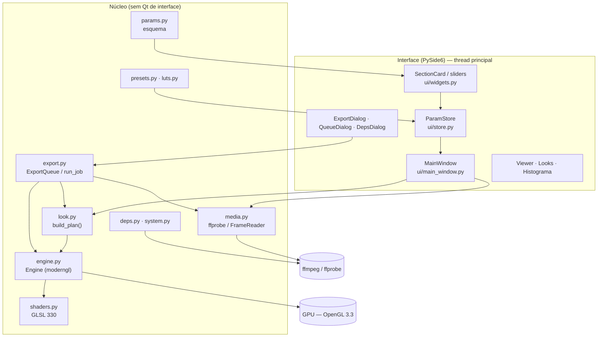
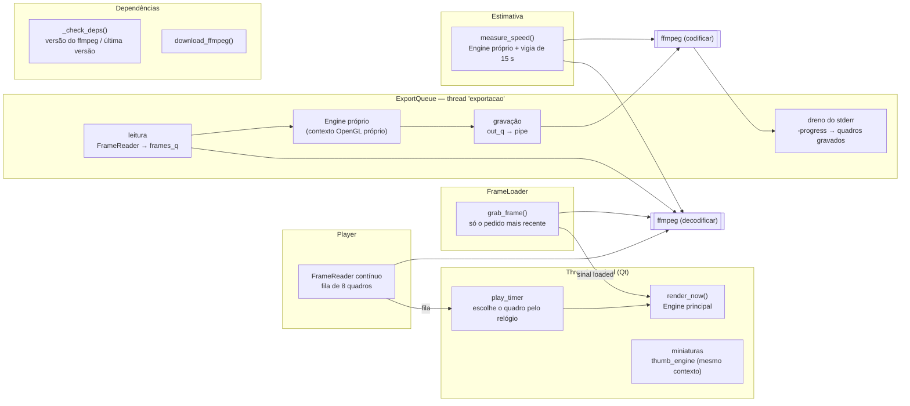

# Arquitetura do PeliculaConverter

Mergulho técnico no funcionamento interno: camadas, pipeline de GPU, gestão de cor, threads,
comunicação com o ffmpeg, exportação e persistência. Para regras de contribuição e receitas
rápidas, veja [AGENTS.md](../AGENTS.md); para o significado de cada ajuste, [EFEITOS.md](EFEITOS.md).

## Sumário

1. [Visão geral](#1-visão-geral)
2. [Mapa dos módulos](#2-mapa-dos-módulos)
3. [Dos ajustes aos uniforms](#3-dos-ajustes-aos-uniforms)
4. [Pipeline de GPU](#4-pipeline-de-gpu)
5. [Gestão de cor](#5-gestão-de-cor)
6. [Determinismo e independência de resolução](#6-determinismo-e-independência-de-resolução)
7. [Threads e processos](#7-threads-e-processos)
8. [Leitura de quadros com o ffmpeg](#8-leitura-de-quadros-com-o-ffmpeg)
9. [Exportação](#9-exportação)
10. [Dependências externas (deps.py)](#10-dependências-externas-depspy)
11. [Persistência e arquivos](#11-persistência-e-arquivos)
12. [Testes](#12-testes)

---

## 1. Visão geral



Três ideias guiam o projeto:

1. **Um único caminho de renderização.** Prévia, miniaturas, "Salvar quadro", estimativa de tempo
   e exportação chamam as mesmas funções: `look.build_plan(values, w, h, frame, fps, lut_info,
   dither)` e `Engine.render(plan, depth)`.
2. **Esquema declarativo.** `params.SECTIONS` descreve todos os ajustes (tipo, faixa, padrão,
   rótulo, dica). A interface é gerada a partir dele e o motor lê os valores pelas chaves.
3. **O núcleo não depende da interface.** `look`, `engine`, `media`, `export`, `presets`, `luts` e
   `deps` funcionam sem janela (são usados assim pelos testes). A exceção é `edgetext`, que usa
   `QPainter` sobre `QImage` e precisa de uma `QGuiApplication` existente (sem ela, o texto de
   borda simplesmente não é desenhado).

## 2. Mapa dos módulos

| Módulo | Responsabilidade |
|---|---|
| `PeliculaConverter.pyw` | Abre o app sem console (`pythonw`). |
| `pelicula/__main__.py` | `python -m pelicula`. |
| `pelicula/__init__.py` | `__version__` e `APP_NAME`. |
| `pelicula/app.py` | `main()`: `QApplication`, estilo Fusion, paleta e folha de estilo, ícone; bloqueio do macOS (desativado); oferta de `pip install` se faltar `moderngl`/`numpy`/`glcontext`; cria a `MainWindow`; arquivos da linha de comando; gancho `PELICULA_SCREENSHOT`. |
| `pelicula/params.py` | `Param`, `Section`, `SECTIONS`, `PARAMS`, `defaults()`, `sanitize()`. |
| `pelicula/look.py` | Tabelas de bitolas (`GAUGES`), cópias (`PRINTS`), scan (`SCAN_FORMATS`), filtros P&B, viragens, primárias e matrizes de gamut; `build_plan()` → `Plan`. |
| `pelicula/shaders.py` | GLSL: `VERT`, `COMMON` (curvas, transferências log, look, cópia, LUT), `BASE`, `EXTRACT`, `BLUR`, `NOISE`, `FINAL`, `BAKE`. |
| `pelicula/engine.py` | `Engine`: contexto moderngl, programas, alvos de render, textura de entrada, LUT 3D, texto da borda; `render()` e `bake_lut()`; cache de LUTs por `mtime`. |
| `pelicula/presets.py` | `FILM_BASE`, `BUILTIN` (33 presets), presets do usuário (JSON), importar/exportar. |
| `pelicula/luts.py` | Ler/gravar `.cube`, palpite do espaço de entrada, LUTs instalados (Premiere, Resolve, Meus LUTs), instalar LUTs. |
| `pelicula/media.py` | Localizar ffmpeg/ffprobe, `probe()` → `MediaInfo`, `NamedPipe` (Windows), `FrameReader`, `grab_frame()`, `Perf`, detecção de codificadores e hwaccels. |
| `pelicula/export.py` | `CODECS`, qualidades prontas, `ExportSettings`, `build_encoder_cmd()`, `ExportJob`, `ExportQueue`, `run_job()`, `measure_speed()`. |
| `pelicula/deps.py` | Versão do ffmpeg, download verificado (gyan.dev / BtbN), pasta do app, pacotes Python, `pip_install()`. |
| `pelicula/system.py` | Processador, núcleos, RAM, GPUs NVIDIA (`nvidia-smi`), abrir pasta/arquivo no sistema. |
| `pelicula/edgetext.py` | Máscara do texto impresso na borda da película. |
| `pelicula/testimage.py` | Cena de teste (cartela de 24 cores, janela clara, lâmpadas, faixa de matiz, rampa de cinza). |
| `pelicula/ui/main_window.py` | Janela principal, carregamento de quadros, reprodução, presets, LUTs, exportação, atalhos, checagem de dependências. |
| `pelicula/ui/store.py` | `ParamStore`: valores atuais, sinal `changed`, desfazer/refazer (agrupado por 400 ms, até 300 passos). |
| `pelicula/ui/widgets.py` | `FilmSlider`, `ToggleSwitch`, linhas de parâmetro, `LutRow`, `SectionCard`, `Segmented`, `Histogram`, `Timeline`, `timecode()`. |
| `pelicula/ui/viewer.py` | Visualizador: modos de comparação, zoom livre (10%–1600%) e pan, espiar o original, modo de tela cheia (sem borda, fundo preto, dica das teclas), arrastar e soltar. |
| `pelicula/ui/looks.py` | Painel de miniaturas dos presets com busca. |
| `pelicula/ui/export_dialog.py` | Janela de exportação, desempenho e estimativa. |
| `pelicula/ui/queue_dialog.py` | Janela da fila. |
| `pelicula/ui/deps_dialog.py` | Janela *Dependências e atualizações*. |
| `pelicula/ui/theme.py` / `icons.py` | Cores, fontes, folha de estilo; ícones vetoriais e ícone do app (usa `assets/logo-*.png` quando existem). |

## 3. Dos ajustes aos uniforms

```
params.SECTIONS ──► interface (SectionCard) ──► ParamStore.values (dict)
                                                     │
                     presets.builtin_values() ───────┤  (FILM_BASE + valores do preset, sanitize)
                                                     ▼
          look.build_plan(values, largura, altura, quadro, fps, lut_info, dither)
                                                     │
                                                     ▼
   Plan(uniforms, soft_sigma, chains[hal/bloom/mist], grain_size, grain_seed, lut_path, edge_text)
                                                     │
                                                     ▼
                                   Engine.render(plan, depth=8|16)
```

`build_plan()` é uma função pura: dado o mesmo dicionário de valores, o mesmo tamanho e o mesmo
número de quadro, devolve exatamente os mesmos uniforms. Ela:

- converte px@1080 para pixels reais (`scale = altura / 1080`);
- aplica os multiplicadores da bitola (`GAUGES`) e do ISO (`(ISO/250)^0,35` na força,
  `(ISO/250)^0,18` no tamanho do grão);
- soma exposição, temperatura, tonalidade, cintilação, clarões e cor instável num ganho em EV por
  canal (`u_gain`);
- calcula o tremor (`u_shift`, `u_rot`, `u_zoom`) e os eventos de defeitos com `_hash()`/`_vnoise()`
  sobre o número do quadro e as sementes;
- monta as **cadeias de brilho** (`Chain`): halação (só luminância, limiar `0,18·2^limiar`, raio ×
  fator da bitola, máscara alfa quando há scan), bloom (colorido) e névoa (sem limiar);
- decide maciez/nitidez (`soft_sigma` = √(maciez_bitola² + (raio·maciez·2)²)·scale);
- calcula o tamanho do grão em pixels (mínimo 1 px) e a semente (`semente·7919 + quadro` se
  animado);
- converte as tabelas de cópia, filtros P&B, viragens e a cor da base do scan;
- com LUT ligado e `lut_info` válido, preenche tamanho, domínio e a matriz de gamut inversa do
  espaço que o LUT espera;
- com scan ligado, escolhe o formato (`SCAN_FORMATS`), a janela de visão em mm e o texto da borda.

## 4. Pipeline de GPU

Todos os passos desenham um quadrilátero de tela cheia (`VERT`) num *framebuffer*. Alvos usados
(criados sob demanda e reaproveitados enquanto o tamanho não muda):

| Alvo | Formato | Tamanho | Conteúdo |
|---|---|---|---|
| `input_tex` | RGB `f1` (8 bits) ou `nu2` (16 bits normalizado) | quadro | Quadro vindo do ffmpeg |
| `lin` | RGBA `f2` (half float) | quadro | Luz linear após o passo base; alfa = máscara da imagem no scan |
| `tmp`, `soft` | RGBA `f2` | quadro | Desfoque separável da maciez |
| `hi` | RGBA `f2` com mipmaps | quadro | Luzes extraídas para uma cadeia de brilho |
| `<cadeia>_a`, `<cadeia>_b` | RGBA `f2` | reduzido (`w >> nível`) | Desfoque horizontal e vertical de halação, bloom e névoa |
| `noise` | RGBA `f2` | `w / tamanho_do_grão` | Quatro canais de ruído gaussiano |
| `out8` / `out16` | RGB `f1` / `nu2` | quadro | Resultado lido de volta para a CPU |
| `bake` | RGB `f4` | `n² × n` | Grade de um LUT sendo exportado |

### 4.1 Passo base (`BASE`)

1. **Tremor**: `weave()` aplica zoom, rotação e deslocamento em pixels.
2. **Lente**: `lens()` aplica a distorção radial normalizada (o canto continua no canto) e, com
   aberração cromática, amostra R, G e B com escalas `1 + ca`, `1` e `1 − ca`.
3. **Entrada**: `toLinear(código, perfil)` desfaz a curva (Rec.709 neutra, N-Log, S-Log3, LogC3,
   V-Log, Cineon, DaVinci Intermediate, Log3G10) e `u_gamut` converte o gamut para Rec.709.
4. **Exposição e balanço**: `× exp2(u_gain)` por canal.
5. **Vinheta** (bitola + lente) em EV.
6. **Scan** (se ligado): converte o pixel para milímetros na tira (`u_scan_view`), calcula em qual
   quadro (`k`) ele cai, a distância com sinal ao retângulo arredondado do quadro (com rugosidade
   `fbm2`), os furos (retângulos arredondados periódicos), a densidade da base, o texto da borda
   (textura `t_text`) e a área fora da película. O vídeo é encaixado no quadro (caber/preencher) e
   os vizinhos mostram o mesmo quadro (como num scan estático). Alfa = dentro da imagem.

### 4.2 Maciez (`BLUR` × 2)

Gaussiana separável em resolução cheia com `soft_sigma`. O passo final usa `lin + (lin − soft) ×
nitidez` sobre a mistura escolhida, o que implementa ao mesmo tempo a maciez e a "recuperação de
detalhe" (máscara de nitidez).

### 4.3 Halação, bloom e névoa (`EXTRACT` + mipmaps + `BLUR`)

Para cada cadeia:

1. `EXTRACT` separa as luzes com joelho suave (`smoothstep(0,5·limiar, 1,5·limiar, L)`), limita a
   energia (`e / (1 + e/limite)`, evita que um pixel de 50× domine), multiplica pelo alfa do scan
   quando pedido e, na halação, reduz a luminância.
2. `build_mipmaps()` gera as reduções.
3. Escolhe-se o nível `n` tal que `σ / 2ⁿ ≤ 6` (até 8 níveis); o desfoque horizontal lê o mipmap
   nesse nível com `textureLod` e grava num alvo reduzido; o vertical completa. Raios de 250 px
   em 4K custam o mesmo que raios pequenos. O núcleo tem raio `3σ`, limitado a 48 amostras.

### 4.4 Ruído do grão (`NOISE`)

Uma textura com `⌈w / tamanho⌉ × ⌈h / tamanho⌉` texels recebe quatro números gaussianos
independentes por texel (Box–Muller sobre o hash PCG de `(x, y, semente)`). O passo final amostra
essa textura com **interpolação bicúbica** em duas escalas (fina e ~2,3× maior, misturadas pela
aspereza), mistura um canal comum (monocromático) com três independentes (grão colorido) e aplica a
resposta por luminância (gaussianas em L = 0,10 / 0,45 / 0,88).

### 4.5 Passo final (`FINAL`)

Em ordem:

1. `lin` → maciez/nitidez (`t_soft`).
2. Névoa: `mix(lin, névoa, 0,3·força) + névoa·0,35·força`.
3. Bloom (`+ bloom·força·0,22`), halação (`+ halo·cor·força·0,32`) e vazamento de luz (duas
   gaussianas coloridas que passeiam pelas bordas).
4. `colorPipe(lin)`:
   - **neutro** = curva neutra de exibição;
   - **LUT no lugar do look** → `mix(neutro, LUT(codificado no espaço do LUT), força)`;
   - senão **filmLook** (P&B com pesos do filtro → stops → saturação em log → contraste e
     deslocamento por canal → curva por canal com ombro/pé suaves → densidade → matiz de verdes,
     azuis e pele → tons de sombra/luz com pivô → viragem), misturado por *Intensidade do look*;
   - **printStage**: volta de exibição para stops (curva neutra inversa), saturação, gama e
     deslocamento por canal e curva da cópia; misturado por *Força da cópia*;
   - **envelhecimento**: dessatura 40%, levanta o preto (`×0,82 + 0,075`) e puxa para o magenta;
   - **LUT depois do look**: reencoda para o espaço que o LUT espera (Rec.709 usa o valor de
     exibição direto) e mistura.
5. Grão (no valor de exibição, como numa cópia).
6. Defeitos (`damage()`), em coordenadas px@1080: manchas, fio de cabelo (curva amostrada em 40
   segmentos), marca de troca de rolo, emenda, poeira (células de 90 px, 3×3 vizinhas, partículas
   elípticas) e riscos (até 6).
7. **Força geral**: `mix(código_original, resultado, u_mix)`.
8. **Moldura**: distância com sinal a um retângulo arredondado na proporção pedida, com borda suave
   e irregular, cor das barras (desligada quando o scan está ligado).
9. **Pontilhado**: ruído triangular de ±1 LSB em 8 bits (só quando `dither=True`).
10. `clamp(0, 1)` e gravação em `out8`/`out16`, lido com `fbo.read()`.

### 4.6 Exportar LUT (`BAKE`)

`Engine.bake_lut(values, n)` desenha uma grade `n² × n` (R varia mais rápido, depois G, depois B —
a ordem do `.cube`) e roda só `toLinear → gamut → ganho → colorPipe`, com o projetor desligado e sem
pontilhado. O resultado vai para `luts.save_cube()` (domínio 0–1, valores limitados a 0–1).

### 4.7 Coordenadas

Os shaders usam **coordenadas de imagem com y para baixo**: a linha 0 do array numpy (topo da
imagem) é enviada como linha 0 da textura e lida de volta como linha 0 do framebuffer. Como nada é
invertido no caminho, `v_uv.y = 0` é o topo. Toda geometria escrita à mão (tremor, scan, defeitos,
vazamento, marca de rolo no canto superior direito) segue essa convenção.

## 5. Gestão de cor

- **Espaço de trabalho**: luz linear de cena com primárias Rec.709/D65; cinza médio = 0,18.
- **Gamut**: matrizes calculadas em `look.py` a partir das primárias xy (Rec.709, Rec.2020,
  S-Gamut3.Cine, ARRI Wide Gamut 3, V-Gamut, DaVinci Wide Gamut, REDWideGamutRGB), todas com
  branco D65; enviadas como `mat3` coluna-maior (`mat3_uniform`).
- **Curvas de câmera** em GLSL: N-Log, S-Log3, LogC3 (EI 800), V-Log, Cineon (685/300 com preto
  offset), DaVinci Intermediate e Log3G10 — decodificação e codificação (a codificação serve para
  alimentar LUTs que esperam log).
- **Curva neutra de exibição** (`D_SLOPE = 0,155` por stop, `D_MID = 0,45`, `D_P = 4`): uma
  sigmoide de *soft clip* em stops, **inversível**. Ela é usada para levar Rec.709 até a luz linear
  e de volta, então com todos os efeitos desligados o vídeo sai igual ao que entrou (a menos do
  pontilhado). `look.display_to_lin()` é a mesma inversa em Python (usada para a cor da base do
  scan).
- **Curva da película** (`curve()`): mesma família, com inclinação = `D_SLOPE × contraste`, tom
  médio, preto, branco e expoentes de ombro (`ps`) e pé (`pt`) controlados pela suavidade
  (`4 → 1,15`).
- **Saída**: valores de exibição BT.709. O codificador recebe RGB e o ffmpeg converte para YUV com
  matriz BT.709 em faixa limitada (BT.601 em faixa cheia para JPEG/WebP), gravando as tags
  `bt709` de primárias, transferência e matriz.

## 6. Determinismo e independência de resolução

- **Nada aleatório de verdade.** Em Python, `_hash(i, semente)` (hash inteiro de 32 bits) e
  `_vnoise(x, semente)` (ruído de valor suave) geram tremor, cintilação, clarões, emendas, fio de
  cabelo, manchas, cor instável e vazamento a partir de `t = quadro / fps`, do índice do quadro e
  das sementes. Em GLSL, `pcg()`/`rnd(uvec3)` geram grão, poeira, riscos e pontilhado a partir de
  coordenadas inteiras, quadro e semente.
- **Mesmo quadro, mesmo resultado.** A prévia chama `build_plan(..., self.frame_idx, info.fps)`; a
  exportação chama `build_plan(..., first_index + i, fps_saída)`. Com a mesma resolução, o
  resultado é idêntico — uma exportação FFV1 16 bits foi conferida bit a bit contra
  `Engine.render()`.
- **Troca de fps.** Quando a exportação muda os quadros por segundo, os índices passam a contar na
  nova taxa (o primeiro quadro é `round(início · fps_saída / fps_original)`) e `build_plan` recebe
  o fps de saída; os efeitos ligados ao tempo (`t`) continuam no mesmo ritmo.
- **px@1080.** Todas as distâncias do esquema são em pixels de um quadro de 1080 linhas e
  multiplicadas por `altura / 1080`; os defeitos são desenhados num sistema de coordenadas de
  1080 linhas de altura. O grão é a única textura cujo padrão exato depende da resolução (o
  tamanho estatístico é o mesmo); por isso a dica da prévia recomenda a resolução máxima para
  julgar o grão.

## 7. Threads e processos



| Thread | Onde | O que faz | Como fala com a interface |
|---|---|---|---|
| Principal (Qt) | `MainWindow` | Recebe quadros, chama `build_plan` + `Engine.render` (8 bits) para a prévia, desenha o visualizador, o histograma e as miniaturas (com `thumb_engine`, que compartilha o contexto do `engine` principal). | — |
| `FrameLoader` | `main_window.FrameLoader` | Decodifica um único quadro com `media.grab_frame()`. Se chegarem vários pedidos (arrastando a linha do tempo), só o mais recente é atendido. | Sinais `loaded` / `failed` (fila do Qt). |
| `Player` | `main_window.Player` | Um `FrameReader` contínuo a partir do quadro atual; põe `(índice, imagem)` numa fila de 8. Repete o trecho se a repetição estiver ligada. | `play_timer` (timer preciso) lê a fila e mostra o quadro certo para o tempo decorrido, descartando quadros atrasados. |
| `exportacao` | `export.ExportQueue` | Executa os trabalhos um de cada vez. O `Engine` é criado **dentro** dessa thread (contexto OpenGL próprio, atual nela). | `QTimer` de 500 ms na janela e de 250 ms na fila leem o estado do `ExportJob`. |
| leitura / gravação / dreno | `export.run_job` | Leitura: `FrameReader` → `frames_q`. GPU: laço na thread `exportacao`. Gravação: `out_q` → pipe do codificador. Dreno: lê o `stderr` do ffmpeg, interpreta `frame=` do `-progress` e guarda as mensagens de erro. As filas têm o tamanho do *buffer* escolhido (mínimo 2). | Campos do `ExportJob` (`done`, `fps_rate`, `eta`, `status`, `error`). |
| estimativa | `export_dialog._start_estimate` | `measure_speed()` cria **outro** `Engine`, exporta até 60 quadros num arquivo temporário (sem áudio), descarta os 8 primeiros (aquecimento) e para sozinho depois de 15 s (thread vigia). | `_Bridge.done` (sinal). Uma nova mudança cancela a medição anterior (`threading.Event`). |
| dependências | `MainWindow._check_deps`, `DepsDialog` | Confere ffmpeg e a última versão publicada; baixa e instala o ffmpeg. | `_DepsBridge.result`, `_Bridge.progress/finished/latest`. |

Regras que decorrem disso:

- **Um contexto OpenGL por thread.** Um `Engine` só é usado na thread que o criou. A exportação e
  a estimativa criam os seus; a interface nunca toca neles.
- **Nada de Qt de interface fora da thread principal.** As threads de trabalho só trocam dados por
  sinais, filas ou campos simples.
- **Cancelamento cooperativo.** `ExportJob.cancel` (`threading.Event`) é conferido na leitura, na
  GPU e na gravação; o processo do codificador é morto e o arquivo parcial é apagado (sequências de
  imagens ficam).

## 8. Leitura de quadros com o ffmpeg

`media.probe()` roda `ffprobe -print_format json -show_streams -show_format` e monta o
`MediaInfo`: resolução (trocada em vídeos girados 90°), fps (`r_frame_rate`, imagens = 24),
quadros (`nb_frames` ou duração × fps), formato de pixel e profundidade, codec e perfil, taxa de
bits, metadados de cor, áudio e se é imagem.

`media.FrameReader` monta:

```
ffmpeg -v error -nostdin [-hwaccel X] [-threads N] [-ss (quadro−0,45)/fps]
       -i arquivo -map 0:v:0 -an -sn -dn
       -vf [fps=F,]scale=L:A:flags=…:in_color_matrix=M:in_range=R:threads=N,format=rgb24|rgb48le
       [-filter_threads N] [-frames:v K] -f rawvideo -pix_fmt rgb24|rgb48le <pipe>
```

- A busca usa `-ss` antes do `-i` meio quadro antes do alvo (rápido e preciso).
- A matriz de entrada vem dos metadados (`bt709`, `bt601`, `bt2020`, `smpte240m`; sem metadado,
  BT.709 a partir de 720 linhas); a faixa vem de `color_range`/`yuvj`.
- Prévia: `bicubic+full_chroma_int`. Exportação e "Salvar quadro": `lanczos+accurate_rnd+full_chroma_int`.
- 8 bits → `rgb24`; 16 bits → `rgb48le` (textura `nu2`).
- **Windows**: `NamedPipe` cria `\\.\pipe\pelicula_<uuid>` com buffer de 1 MiB; o ffmpeg escreve
  nele como se fosse um arquivo. A conexão espera o ffmpeg abrir o pipe e destrava sozinha se ele
  morrer antes (timeout de 60 s). Isso é bem mais rápido que `stdout` para quadros 4K.
- **Linux/macOS**: `stdout`/`stdin` comuns.
- Prioridade: no Windows por `creationflags` (abaixo/acima do normal); no Linux, `os.nice(10)`
  para *Baixa*.

Codificadores e acelerações são descobertos com `ffmpeg -encoders` e `ffmpeg -hwaccels`
(em cache; `media.reset_cache()` limpa depois de trocar o ffmpeg). NVENC, QSV e AMF aparecem na
lista mesmo sem hardware compatível, então `encoder_works()` codifica 0,1 s de teste antes de
oferecê-los.

## 9. Exportação

### 9.1 Do diálogo à fila

`ExportDialog` monta um `ExportSettings` (codec, recipiente, formato de pixel, qualidade,
velocidade, perfil, taxa de bits, resolução, fps, áudio, *tune grain*, pontilhado e as opções de
desempenho) e um `ExportJob` com uma **cópia** dos valores atuais. A janela principal guarda a
pasta, a qualidade e o desempenho escolhidos e põe o trabalho na `ExportQueue`.

### 9.2 `run_job()`

1. Tamanho de saída (`output_size`, dimensões pares quando o codec exige), fps, profundidade
   (`high_depth`: 16 bits se o formato tiver 10/12/16 bits, `p010`, RGB 48 ou for ProRes/FFV1),
   trecho em quadros e total de quadros na taxa de saída.
2. Pipe nomeado de saída (Windows) e comando do codificador (`build_encoder_cmd`):
   - entrada 0: `rawvideo` RGB (8/16 bits) pelo pipe, com `-progress pipe:2`;
   - entrada 1 (se houver áudio e o formato aceitar): o arquivo original com `-ss`/`-t` do trecho,
     mapeando `1:a:0?`;
   - conversão para YUV com `scale=out_color_matrix=…:out_range=…:flags=accurate_rnd+full_chroma_int`
     (GIF usa `palettegen`/`paletteuse`);
   - argumentos do codec (CRF/CQ/QP/bitrate, preset, perfil, `-tune grain`, `-x265-params`,
     `-tag:v hvc1`, opções de NVENC/QSV/AMF, FFV1 nível 3 com GOP 1 e 16 *slices*, TIFF com
     *deflate* etc.);
   - tags de cor BT.709, `+faststart` em MP4/MOV, áudio conforme `_audio_args()`.
3. `FrameReader` em alta qualidade. Com troca de fps, o leitor aplica o filtro `fps=` desde o
   começo e pula os quadros antes do trecho.
4. Três etapas em paralelo (leitura → GPU → gravação) com filas do tamanho do *buffer*.
5. Progresso: quadros **gravados** pelo ffmpeg (`frame=` do `-progress`) ou, antes disso, quadros
   processados; velocidade e tempo restante a partir daí.
6. Fim: fecha o pipe, espera o ffmpeg, confere código de saída e erros de escrita; status
   `concluido`, `erro` (com o final do `stderr`) ou `cancelado`.

### 9.3 Qualidades prontas e codecs

`export.quality_presets(info)` devolve a lista conforme o arquivo (imagem ou vídeo) e o que o
ffmpeg instalado oferece (`available()`). *Original — mesmo formato* é derivado do arquivo:
ProRes → mesmo perfil; DNxHD → DNxHR HQ/HQX; VP9/WebM → VP9; H.265 ou >8 bits → x265 10 bits com
o mesmo croma; senão x264 com o mesmo croma.

### 9.4 Áudio

`_audio_args()` copia quando o codec do original cabe no recipiente (tabela por recipiente) e senão
converte: WebM → Opus, AVI → MP3, MOV → PCM 24 bits, demais → AAC 320. PCM em MP4 vira AAC. GIF,
imagens e sequências não têm áudio.

## 10. Dependências externas (`deps.py`)

| Item | Valor |
|---|---|
| Versão mínima recomendada | `MIN_VERSION = (7, 0)`; builds de desenvolvimento (`N-…-AAAAMMDD`) são "desatualizados" depois de 540 dias |
| Fonte Windows | `https://www.gyan.dev/ffmpeg/builds/ffmpeg-release-essentials.zip` + `.sha256`; versão atual em `…/release-version` |
| Fonte Linux | `https://github.com/BtbN/FFmpeg-Builds/releases/latest/download/ffmpeg-master-latest-linux64-gpl.tar.xz` + `checksums.sha256` |
| Plataformas | `PLATFORM_ENABLED = {"win32": True, "linux": True, "darwin": False}` |
| Pasta do app | Windows `%LOCALAPPDATA%\PeliculaConverter`; Linux `$XDG_DATA_HOME/PeliculaConverter` (padrão `~/.local/share/…`); macOS `~/Library/Application Support/…` |
| Instalação | `ffmpeg/bin/` dentro da pasta do app, com `ORIGEM.txt` (URL, fonte, SHA-256) |

`download_ffmpeg()`:

1. baixa o arquivo de hash publicado e extrai o SHA-256 esperado (no Linux, a linha do arquivo
   certo dentro de `checksums.sha256`);
2. baixa o pacote para uma pasta temporária calculando o SHA-256 em *streaming* (cancelável);
3. se o hash não conferir, para sem instalar nada;
4. extrai (zip com checagem de caminhos suspeitos; tar com `filter="data"`), localiza `ffmpeg` e
   `ffprobe`, copia para `bin.novo`, marca como executável no Linux e troca a pasta `bin` de uma
   vez (`rename`);
5. apaga a pasta temporária.

`media.configure()` procura nesta ordem: pasta escolhida pelo usuário → pasta do app
(`deps.ffmpeg_dir()`) → `PATH` → pastas comuns do sistema.

`missing_python_modules()` e `pip_install()` só valem rodando pelo código-fonte; no executável do
PyInstaller as bibliotecas já estão embutidas (`sys.frozen`).

## 11. Persistência e arquivos

| O quê | Onde |
|---|---|
| Sessão e preferências | `QSettings("PeliculaConverter", "PeliculaConverter")` — registro `HKCU\Software\PeliculaConverter\PeliculaConverter` no Windows, `~/.config/PeliculaConverter/PeliculaConverter.conf` no Linux. Chaves: `session_values` (JSON dos ajustes), `session_preset`, `geometry`, `splitter`, `compare`, `preview_quality`, `advanced`, `last_dir`, `export_dir`, `export_quality`, `export_perf`, `ffmpeg_dir`, `ffmpeg_skip`. A sessão é gravada no `closeEvent` da janela. |
| Presets do usuário | `presets.user_dir()` = `$APPDATA/PeliculaConverter/presets` (sem `APPDATA`, a pasta pessoal) — um `.json` por preset, nome derivado do título. |
| Meus LUTs | `luts.user_dir()` = `$APPDATA/PeliculaConverter/luts`. |
| ffmpeg baixado | `deps.ffmpeg_dir()` (veja a seção 10). |
| Temporários | `pelicula_seta.png` (seta das listas), `pelicula_cena_de_teste.png` (cena de teste), `pelicula_medida_*` (estimativa, apagada no fim), `pelicula_ffmpeg_*` (download, apagada no fim). |

Formato do preset: `{"nome", "desc", "app": "PeliculaConverter", "versao": 1, "valores": {…}}`.
`params.sanitize()` completa as chaves que faltam com o padrão, descarta chaves desconhecidas,
limita números à faixa e recusa escolhas inválidas — presets antigos continuam abrindo quando
parâmetros novos surgem.

## 12. Testes

A suíte fica em `tests/` (configuração em `pytest.ini`, que já põe a raiz no `sys.path`):

- `@pytest.mark.gpu` usa a fixture `gl_engine` e é pulado sem OpenGL 3.3 (CI, máquinas virtuais);
- `@pytest.mark.ffmpeg` usa `ffmpeg_ok` e é pulado sem ffmpeg/ffprobe;
- `APPDATA` é redirecionado para uma pasta temporária em todos os testes, então presets e LUTs do
  usuário nunca são tocados.

```bash
.venv\Scripts\python -m pytest -q      # Windows
.venv/bin/python -m pytest -q          # Linux
QT_QPA_PLATFORM=offscreen python -m pytest -q   # sem tela (como no CI)
```
